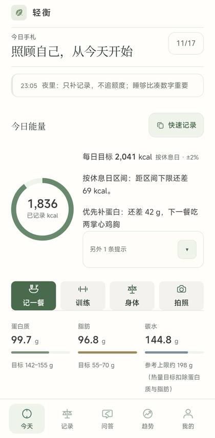
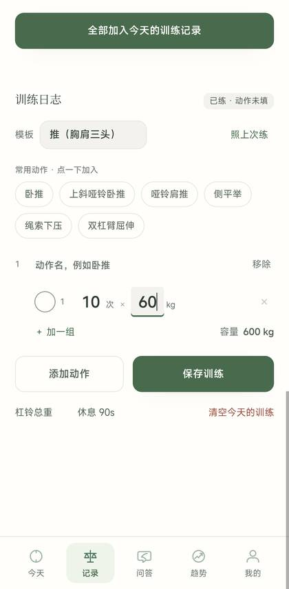

# 杞昏　

**姣忎竴澶╋紝杞讳竴鐐广€?* 涓€鏈彧瀛樺湪浣犳墜鏈洪噷鐨勫仴搴疯处锛氶ギ椋熴€佽缁冦€佽韩浣撲笁鏍忚鍦ㄤ竴澶勶紝鏂綉涔熻兘鐢紝涓嶄笂浼犱换浣曡褰曘€?
     

[**灞曠ず椤?*](https://dustsanchen.github.io/qingheng/) 路 [**涓嬭浇鏈€鏂板畨瑁呭寘**](https://github.com/dustSanchen/qingheng/releases/latest) 路 [**鏇存柊璁板綍**](https://github.com/dustSanchen/qingheng/releases)

<table>
<tr>
<td align="center"><br><sub>浠婂ぉ 路 涓€灞忕湅瀹屾€庝箞鍚?/sub></td>
<td align="center"><br><sub>璁粌 路 涓€缁勪竴琛?/sub></td>
<td align="center"><br><sub>闂瓟 路 鍏堜緷鎹悗鍔ㄤ綔</sub></td>
<td align="center"><br><sub>瓒嬪娍 路 鍙繛瀹炴祴鐐?/sub></td>
</tr>
</table>

## 瀹冭В鍐充粈涔堥棶棰?
澶氭暟鍋ュ悍 App 瑕佷箞鎶婅褰曞仛鎴愯〃鏍硷紝瑕佷箞鎶婂缓璁仛鎴愬彛鍙枫€傝交琛″彧鍋氫袱浠朵簨锛?*璁╄褰曡冻澶熺煭**銆?*璁╃粨璁烘湁鍑哄**銆?
- 璁颁竴椁愶細璇翠竴鍙ャ€岀背楗?100 鍏嬨€侀浮鑳?150 鍏嬨€嶅氨鑳界畻锛屾暟瀛楄窡鐫€杈撳叆瀹炴椂鍙橈紱鏈湴椋熷搧搴撳父骞村彲鐢紝甯稿悆鐨勪竴椁愪竴閿鍒躲€?- 璁拌缁冿細涓€缁勪竴琛岋紝10 娆?脳 60 kg 鍐欏湪鍚屼竴琛岋紝瀹归噺绔嬪埢鐪嬪緱瑙侊紱缁勯棿浼戞伅鎸夊姩浣滅粰鏃堕暱锛屽嬀瀹屽氨鑷姩寮€濮嬨€?- 鐪嬬粨璁猴細鐑噺鍖洪棿銆佽泲鐧界己鍙ｃ€佹湰鍛ㄥ閲忋€佷綋閲嶈秼鍔库€斺€旂己鏁版嵁灏卞啓缂猴紝涓嶈ˉ闆躲€佷笉缂栨暟銆?- 瑕佸缓璁細鍏堢粰渚濇嵁锛屽啀缁欒鍔紱涓嶈瘖鏂€佷笉寮€澶勬柟銆佷笉鎺ㄨ崘鏋佺鑺傞銆?
## 浜旈〉鍔熻兘鍦板浘

| 椤甸潰 | 鑳藉仛浠€涔?|
|---|---|
| **浠婂ぉ** | 鑳介噺鐜笌涓夊ぇ瀹忛噺銆佸墿浣欓搴︺€佷粖鏃ヤ綋妫€锛堝洓椤瑰姞鏉冿紝鎺ヨ繎/鍋忕鍒嗘。锛夈€併€屼笅涓€姝ャ€嶅崟涓€涓昏鍔ㄣ€佷粖鏃ヨ褰曟寜椁愭鎶樺彔 |
| **璁板綍** | 楗锛氭媿鐓?/ 鐩稿唽 / 涓€鍙ヨ瘽浼扮畻锛岄瑙堢‘璁ゅ悗鍏ユ。锛屾湰鍦伴鍝佸簱銆佷竴閿鍒朵竴椁愶紱璁粌锛氭湰鍛ㄥ閲忎笌姒傝銆佸懆璁″垝銆佷粖鏃ラ『搴忋€侀€愮粍璁板綍涓庣粍闂翠紤鎭€佽鍚庢€荤粨锛涜韩浣擄細浣撻噸 + 鐫＄湢涓€娆′繚瀛?|
| **闂瓟** | 娴佸紡鍥炵瓟銆佽仈缃戞绱㈠紑鍏炽€佹寜澶╁洖鐪嬨€佹敹钘忎笌鎼滅储銆佹媿鐓ф彁闂紱鍙戦€佸墠鍙睍寮€鏍稿灏嗗彂閫佺殑鏁版嵁 |
| **瓒嬪娍** | 浣撻噸鎸夌湡瀹炴祴閲忔棩鏈熺粯鍒躲€佷笉鎻掑€硷紱涓婂懆鍥炵湅锛涢ギ椋熴€佽缁冧笌浣撻噸涓夊潡闈㈡澘 |
| **鎴戠殑** | 韬綋妗ｆ涓庣洰鏍囥€丄I 妯″瀷涓庡瘑閽ワ紙鍚敤閲忎笌浣欓锛夈€佹彁閱掍笌姣忔棩寤鸿銆佸亸濂戒笌璁板繂銆佸瑙備笌椁愭鏃堕棿銆佹暟鎹鐞?|

## 鏁版嵁鍦ㄥ摢

- 鍏ㄩ儴璁板綍瀛樺湪鏈満锛坄state.json` + SQLite 闀滃儚锛夛紝娌℃湁璐﹀彿銆佹病鏈変簯鍚屾銆佹病鏈夋湇鍔＄銆?- 鏂綉鍙敤锛涜仈缃戝彧鍦ㄤ綘涓诲姩鎻愰棶鎴栬妯″瀷浼颁竴椁愭椂鍙戠敓銆?- 瀵煎嚭鐨勫浠芥槸鏄庢枃 JSON锛屾斁鍦ㄤ綘鑷繁閫夌殑浣嶇疆銆?
## AI 鏄彲閫夌殑

妯″瀷杩炴帴鏄彲閫夐」锛氬～鑷繁鐨?key锛堝瓨鍦ㄧ郴缁?Keystore锛夛紝鎴栧共鑴嗕笉濉€斺€旈ギ椋熴€佽缁冦€佽秼鍔裤€佷綋妫€閮借兘鏈湴绠椼€?涓嶅～ key 鏃讹紝椁愰浼扮畻璧版湰鍦伴鍝佸簱锛涢棶绛旈〉浼氳鏄庛€岃繕娌¤繛鎺ユā鍨嬨€嶃€?
## 瀹夎

1. 鍒?[Releases](https://github.com/dustSanchen/qingheng/releases/latest) 涓嬭浇 `qingheng-<鐗堟湰>.apk`銆?2. 瀹夎鍓嶅彲鏍稿绛惧悕锛?
```powershell
apksigner verify --print-certs qingheng-1.5.08.apk
# 鏈熸湜 SHA-256: b23aba9a2955e620dad5453c15a879ffab3ca4ad90a3e5b1b63beb5f55fab1ac
```

3. 棣栨鎵撳紑鍙湁涓ら」鏉冮檺锛氶€氱煡涓庣簿纭椆閽燂紱鍏朵綑锛堢浉鏈?鐩稿唽銆佹枃浠惰鍐欙級閮藉湪鐢ㄥ埌鏃跺啀闂€?
## 鐗堟湰涓庢祴璇?
褰撳墠 1.5.08锛坴ersionCode 508锛夛紝109 椤硅嚜鍔ㄥ寲娴嬭瘯鍏ㄧ豢銆傜増鏈彿鐢?`tools/sync-version.mjs` 涓€澶勫悓姝ュ埌婧愮爜銆佹瀯寤鸿剼鏈笌娴嬭瘯锛岀姝㈡墜鏀广€?
## 璁稿彲

涓汉浣滃搧锛屾寜 [LICENSE](LICENSE) 鎺堟潈锛氬彲闃呰銆佸彲鑷敤锛涗慨鏀瑰悗鍐嶅彂甯冦€佽浆鍞笉鍦ㄦ巿鏉冭寖鍥村唴銆?
浣滆€咃細Sanchen
