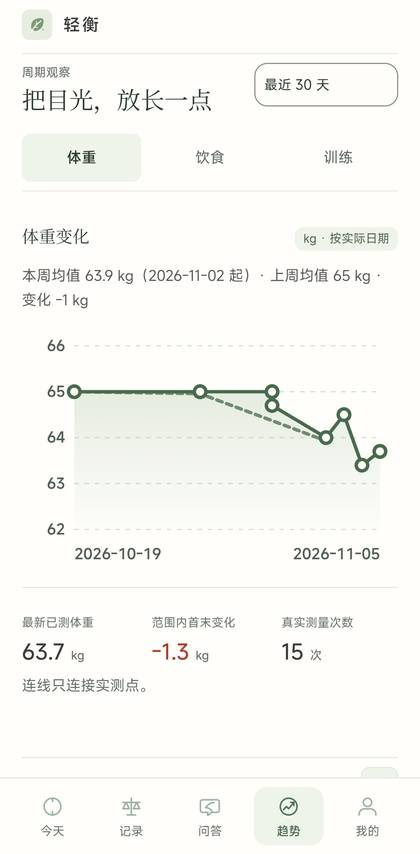

# 杞昏　

**姣忎竴澶╋紝杞讳竴鐐广€?* 涓€鏈彧瀛樺湪浣犳墜鏈洪噷鐨勫仴搴疯处锛氶ギ椋熴€佽缁冦€佽韩浣撲笁鏍忚鍦ㄤ竴澶勶紝鏂綉涔熻兘鐢紝涓嶄笂浼犱换浣曡褰曘€?
     

[**灞曠ず椤?*](https://dustsanchen.github.io/qingheng/) 路 [**涓嬭浇鏈€鏂板畨瑁呭寘**](https://github.com/dustSanchen/qingheng/releases/latest) 路 [**鏇存柊璁板綍**](https://github.com/dustSanchen/qingheng/releases)

<table>
<tr>
<td align="center"><br><sub>浠婂ぉ 路 涓€灞忕湅瀹屾€庝箞鍚?/sub></td>
<td align="center"><br><sub>璁粌 路 涓€缁勪竴琛?/sub></td>
<td align="center"><br><sub>闂瓟 路 鍏堜緷鎹悗鍔ㄤ綔</sub></td>
<td align="center"><br><sub>瓒嬪娍 路 鍙繛瀹炴祴鐐?/sub></td>
</tr>
</table>

## 瀹冭В鍐充粈涔堥棶棰?
澶氭暟鍋ュ悍 App 瑕佷箞鎶婅褰曞仛鎴愯〃鏍硷紝瑕佷箞鎶婂缓璁仛鎴愬彛鍙枫€傝交琛″彧鍋氫袱浠朵簨锛?*璁╄褰曡冻澶熺煭**锛?*璁╃粨璁烘湁鍑哄**銆?
- 璁颁竴椁愶細璇翠竴鍙ャ€岀背楗?100 鍏嬨€侀浮鑳?150 鍏嬨€嶅氨鑳界畻锛屾暟瀛楄窡鐫€杈撳叆瀹炴椂鍙樸€?- 璁拌缁冿細涓€缁勪竴琛岋紝10 娆?脳 60 kg 鍐欏湪鍚屼竴琛岋紝瀹归噺绔嬪埢鐪嬪緱瑙併€?- 鐪嬬粨璁猴細鐑噺鍖洪棿銆佽泲鐧界己鍙ｃ€佹湰鍛ㄥ閲忋€佷綋閲嶈秼鍔库€斺€旂己鏁版嵁灏卞啓缂猴紝涓嶈ˉ闆躲€?- 瑕佸缓璁細鍏堢粰渚濇嵁锛屽啀缁欏姩浣滐紱涓嶈瘖鏂€佷笉寮€澶勬柟銆佷笉鎺ㄨ崘鏋佺鑺傞銆?
## 浜旈〉鍔熻兘鍦板浘

| 椤甸潰 | 鑳藉仛浠€涔?|
|---|---|
| **浠婂ぉ** | 鑳介噺鐜笌涓夊ぇ瀹忛噺銆佷粖鏃ヤ綋妫€锛堝洓椤瑰姞鏉冿紝鎺ヨ繎/鍋忕鍒嗘。锛夈€佹斁鏉炬棩銆佷粖鏃ユ竻鍗曘€佸缓璁崱锛涙洿澶氶噷鏀捐韩浣撹繎鍐典笌灏忎範鎯?|
| **璁板綍** | 楗锛氭媿鐓?/ 鐩稿唽 / 涓€鍙ヨ瘽鎻忚堪浼扮畻锛岄瑙堢‘璁ゅ悗鍏ユ。锛屾湰鍦伴鍝佸簱 150 鏉★紝涓€閿鍒朵竴椁愶紱璁粌锛氭湰鍛ㄥ閲忎笌姒傝銆佸懆璁″垝銆佷笁琛屽紡浠婃棩椤哄簭銆侀€愮粍璁板綍涓庣粍闂翠紤鎭€佹潬閾冩€婚噸涓庣収涓婃缁冦€?1 鏉″姩浣滆鏄庛€佽鍚庢€荤粨锛涜韩浣擄細浣撻噸 + 鐫＄湢涓€娆′繚瀛?|
| **闂瓟** | 娴佸紡鍥炵瓟銆佽仈缃戞绱㈠紑鍏炽€佹寜澶╁洖鐪嬨€佹敹钘忎笌鎼滅储銆佹媿鐓ф彁闂紱鍙戦€佸墠鍙睍寮€鏍稿灏嗗彂閫佺殑鏁版嵁 |
| **瓒嬪娍** | 浣撻噸鎸夌湡瀹炴祴閲忔棩鏈熺粯鍒躲€佷笉鎻掑€硷紱涓婂懆鍥炵湅锛涢鐗┿€佽缁冧笌浣撻噸涓夊潡闈㈡澘 |
| **鎴戠殑** | 韬綋妗ｆ涓庣洰鏍囥€丄I 妯″瀷涓庡瘑閽ワ紙鍚敤閲忎笌浣欓锛夈€佹彁閱掍笌姣忔棩寤鸿銆佸亸濂戒笌璁板繂銆佸瑙備笌椁愭鏃堕棿銆佹暟鎹鐞嗐€佹洿澶氳缃?|

## 鍥涗釜姣忓ぉ閮戒細鐢ㄥ埌鐨勭粏鑺?
**姣忕粍鐨勬暟瀛楁槸涓昏銆?* 10 娆?脳 60 kg 涓€鏉＄嚎锛屽崟浣嶅彧璺熶竴娆★紱瀹归噺闅忚緭鍏ュ疄鏃剁畻锛屼笉鐢ㄧ瓑淇濆瓨鎵嶇湅瑙佽繖涓€缁勭殑浠介噺銆?


**鍔ㄤ綔瑕佺偣璺熺潃閭ｅぉ缁冧粈涔堣蛋銆?* 鏈懆瀹夋帓鐐瑰紑鏌愪竴澶╋紝瀹冧細璇存竻閭ｅぉ缁冧粈涔堛€佹瘡涓姩浣滅殑瑕佺偣锛岃€屼笉鏄ā鏉胯瘽銆?


**缁勯棿浼戞伅涓嶇敤閫€鍑鸿缁冭閲庛€?* 搴曟爮涓婃柟鐨勬诞鍔ㄨ嵂涓哥偣涓€涓嬪紑濮嬭鏃讹紝鐜舰杩涘害璺熺潃绉掓暟璧般€?
**鏈夋哀涔熻寰椾笅銆?* 璺戞銆侀獞琛屻€佹き鍦嗘寜璺濈涓庢椂闀胯锛岄厤閫熻嚜鍔ㄧ畻锛屼笉鎶婃湁姘у杩涘閲忛噷鍑戞暟銆?
## 鎬庝箞瀹炵幇鐨?
涓€鍙ヨ瘽锛?*鍗?Activity + WebView 鐨勬湰鍦板簲鐢紝閫昏緫鍙湪浣犳墜鏈洪噷璺戙€?*

```
Android 鍘熺敓灞? 鈹€鈹€  Keystore 瀛樺瘑閽?路 鏉冮檺 路 鎻愰啋 路 瀵煎嚭鏂囦欢
      鈹?  WebView 椤甸潰  鈹€鈹€  浜旈〉鐣岄潰锛堥潤鎬佽祫婧愶紝绂荤嚎鍙敤锛?      鈹?  鏈湴鏁版嵁灞?   鈹€鈹€  state.json 涓哄敮涓€鏉冨▉  鈹€鈹€  SQLite 浠呴暅鍍忎笌涓€鑷存€ц嚜妫€
      鈹?  鍙€?AI 灞?   鈹€鈹€  浣犺嚜宸辩殑 key 鈫?OpenAI 鍏煎鎺ュ彛锛圖eepSeek / B.AI / 纭呭熀娴佸姩锛?```

- **娌℃湁鏈嶅姟绔€佹病鏈夎处鍙枫€佹病鏈変簯鍚屾銆?* 鍏虫帀缃戠粶锛岄櫎 AI 澶栧叏閮ㄥ姛鑳界収甯搞€?- **鏁版嵁鍙湁涓€浠芥潈濞併€?* 璁板綍鍐欏叆鎵嬫満绉佹湁鐩綍鐨?`state.json`锛汼QLite 鍙仛闀滃儚锛屼笉涓€鑷存椂浠?JSON 涓哄噯銆?- **AI 鏄彲閫夐」銆?* 娌℃湁閰嶇疆 key 鏃讹紝璁粌璁″垝涓庣儹閲忓彛寰勪粛鐢辨湰鍦拌鍒欑粰鍑猴紱閰嶇疆鍚庢寜 token 璁¤垂锛岃皟鐢ㄥ墠闇€浣犳巿鏉冦€?- **姣忔鍙戠増閮借繃闂ㄦ銆?* 109 椤规祴璇曞畧浣忕粨鏋勩€佸彛寰勩€佸彲璁块棶鎬т笌鏁版嵁濂戠害锛屽啀鍦ㄧ湡鏈哄畨瑁呭仛鍐掔儫銆?- **绐勫睆涓撻棬鏀惰繃涓€杞€?* 640px 涓?360px 涓ゆ。鏂偣锛岃Е鎺х洰鏍囦繚鎸?44px 浠ヤ笂銆?
## 璁捐鍙栧悜

- 涓夊鐨偆锛氱焊鎰燂紙鏆栫背搴曘€佽‖绾挎爣棰橈級銆佽处鏈紙杩戠櫧銆佹棤琛嚎銆佹暟鎹紭鍏堬級銆佸闂达紙鏆楀簳锛屾墜鍔ㄥ垏鎹級銆?- 绾跨敤涓夋。銆佸瓧鍙峰叚妗ｃ€佸渾瑙掍笁妗ｏ紱鍥炬爣 24 缃戞牸銆?.5 鎻忚竟銆佹瘡鏋氭渶澶氫竴涓井鍨嬭鍙枫€?- 灞曞紑/鏀惰捣鍋?0.28鈥?.46s 鐨勪笉瀵圭О杩囨浮锛岀郴缁熷紑銆屽噺灏戝姩鎬佹晥鏋溿€嶆椂鍏ㄩ儴鍏抽棴銆?
## 闅愮涓庢暟鎹?
- 璁板綍榛樿鍙啓鏈満锛涘嵏杞戒細鍒犻櫎绉佹湁鐩綍锛岄噸瑕佹暟鎹瀹氭湡瀵煎嚭 JSON / Markdown銆?- API Key 鐢卞師鐢熷眰鐢?Android Keystore 淇濆瓨锛屼笉鍥炰紶椤甸潰銆佷笉鍏ユ棩蹇椼€佷笉闅忓鍑烘枃浠跺甫璧般€?- 鍙湁浣犲悓鎰忓苟鐐瑰嚮鏃讹紝鎵嶄細鎶婂綋娆℃墍闇€鏁板瓧鍙戠粰宸查厤缃殑妯″瀷鏈嶅姟鍟嗐€?
## 妯″瀷鎺ュ叆

| 鎻愪緵鏂?| 榛樿鍦板潃 | 璇存槑 |
|---|---|---|
| DeepSeek | `https://api.deepseek.com` | 鏂囨湰涓庡浘鐗囷紱鏀寔浣欓鏌ヨ涓庡厖鍊煎叆鍙ｏ紙璺冲畼鏂规帶鍒跺彴锛屼笉鍦ㄥ簲鐢ㄥ唴鏀舵锛?|
| B.AI | `https://api.b.ai/v1` | 鎸夎处鍙峰彲鐢ㄦā鍨嬪～鍐欙紱浣欓鍙ｅ緞涓嶅悓锛屾殏涓嶆敮鎸佹煡璇?|
| 纭呭熀娴佸姩 | 鎸夋帶鍒跺彴鍦板潃 | 鍚屼笂 |

銆屾垜鐨?鈫?AI 妯″瀷涓庡瘑閽?鈫?鐢ㄩ噺涓庝綑棰濄€嶈褰曟瘡娆¤皟鐢ㄧ殑 token锛堜笉璁板綍闂涓庡洖绛旓級锛屾寜鍙敼鍗曚环浼扮畻閲戦锛涢粯璁?楼2 / 楼8 姣忕櫨涓?tokens锛屾湇鍔″晢璋冧环鍚庤嚜琛屼慨鏀广€?
## 涓嬭浇涓庡畨瑁?
| 椤?| 鍊?|
|---|---|
| 鏈€鏂扮増鏈?| 1.5.07锛坴ersionCode 507锛?|
| 瀹夎鍖?| [`qingheng-1.5.07.apk`](https://github.com/dustSanchen/qingheng/releases/latest)锛?55 KB |
| 绯荤粺瑕佹眰 | Android 8.0+锛坢inSdk 26锛夛紝targetSdk 35 |
| 绛惧悕璇佷功 SHA-256 | `b23aba9a2955e620dad5453c15a879ffab3ca4ad90a3e5b1b63beb5f55fab1ac` |

瀹夎鍓嶅彲鐢?`apksigner verify --print-certs qingheng-1.5.07.apk` 鏍稿绛惧悕锛氭寚绾逛笉涓€鑷寸殑鍖呬笉鏄畼鏂规瀯寤猴紝涔熸棤娉曡鐩栧畨瑁呭畼鏂圭増鏈€?
## 鐗堟湰涓庨獙璇?
- 鐗堟湰瑙勫垯锛歚1.<minor>.<patch>`锛宲atch 涓や綅琛ラ浂锛涙瘡涓増鏈搴旂嫭绔?versionCode锛?.5.07 鈫?507锛夈€?- 鍙戠増鍓嶈窇鍏ㄩ噺 109 椤规祴璇曪紝骞跺湪鐪熸満瀹夎鍋氬啋鐑燂紙鍚姩銆佹棤 JS 閿欒銆佸叧閿〉闈㈠彲杩涘叆锛夈€?- 姣忎釜鐗堟湰鐨?APK SHA-256 鍐欏湪瀵瑰簲 Release 璇存槑閲岋紝鍙嚜琛屾牎楠屻€?
## 鍏充簬璁稿彲

杞昏　鏄釜浜轰綔鍝侊紝婧愮爜鍏紑锛氫綘鍙互闃呰銆佸涔犮€丗ork 鑷敤銆佹彁 PR锛屼篃鍙互鑷敱瀹夎骞舵妸浣跨敤浣撻獙鍒嗕韩缁欏埆浜恒€?
绂佹浜屾杞敭銆侀噸鏂版墦鍖呭垎鍙戝畨瑁呭寘锛屼篃绂佹鐢ㄣ€岃交琛°€嶅悕绉颁笌鍥炬爣鍙戝竷琛嶇敓鐗堟湰锛涘畬鏁磋竟鐣岃 [LICENSE](LICENSE)銆?
## 宸茬煡闄愬埗

- 闇€瑕佺綉缁滅殑 AI 鍔熻兘浼氫骇鐢熸湇鍔″晢璐圭敤锛涢粯璁ら厤缃彲鐢ㄤ笉浠ｈ〃鍏嶈垂鎴栭搴﹀厖瓒炽€?- 鍥剧墖璇嗗埆涓嶆槸璇婃柇锛屼唤閲忎笌鐢ㄦ补浠嶈浜哄伐鏍稿銆?- 閮ㄥ垎 Android 璁惧鐨勭渷鐢电瓥鐣ヤ細寤惰繜闈炵簿纭畾鏃剁殑鎻愰啋銆?- 鐢ㄩ噺璐︽湰鍙粺璁″畨瑁呮湰鐗堟湰涔嬪悗鍙戠敓鐨勮皟鐢紝鍘嗗彶璋冪敤鏃犳硶鍥炴函銆?
## 鍙嶉

鐗堟湰鍙?+ 璁惧鍨嬪彿 + 鍝竴椤靛嚭浜嗕粈涔堥棶棰橈紝鏄渶鏈夌敤鐨勪笁鏍蜂俊鎭€傝寮€ [Issue](https://github.com/dustSanchen/qingheng/issues) 鍛婅瘔鎴戙€?