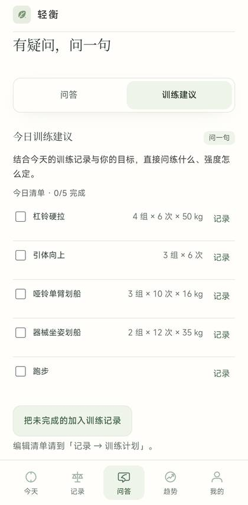
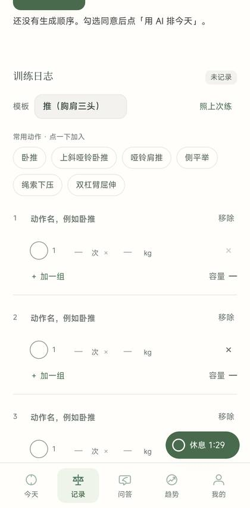

# 轻衡

**每一天，轻一点。** 一本只存在你手机里的健康账：饮食、训练、身体三栏记在一处，断网也能用，不上传任何记录。

     

[**展示页**](https://dustsanchen.github.io/qingheng/) · [**下载最新安装包**](https://github.com/dustSanchen/qingheng/releases/latest) · [**更新记录**](https://github.com/dustSanchen/qingheng/releases)

<table>
<tr>
<td align="center"><br><sub>今天 · 一屏看完怎么吃</sub></td>
<td align="center"><br><sub>训练 · 一组一行</sub></td>
<td align="center"><br><sub>问答 · 先依据后动作</sub></td>
<td align="center"><br><sub>趋势 · 只连实测点</sub></td>
</tr>
</table>

## 它解决什么问题

多数健康 App 要么把记录做成表格，要么把建议做成口号。轻衡只做两件事：**让记录足够短**，**让结论有出处**。

- 记一餐：说一句「米饭 100 克、鸡胸 150 克」就能算，数字跟着输入实时变。
- 记训练：一组一行，10 次 × 60 kg 写在同一行，容量立刻看得见。
- 看结论：热量区间、蛋白缺口、本周容量、体重趋势——缺数据就写缺，不补零。
- 要建议：先给依据，再给动作；不诊断、不开处方、不推荐极端节食。

## 五页功能地图

| 页面 | 能做什么 |
|---|---|
| **今天** | 能量环与三大宏量、今日体检（四项加权，接近/偏离分档）、放松日、今日清单、建议卡；更多里放身体近况与小习惯 |
| **记录** | 饮食：拍照 / 相册 / 一句话描述估算，预览确认后入档，本地食品库 150 条，一键复制一餐；训练：本周容量与概览、周计划、三行式今日顺序、逐组记录与组间休息、杠铃总重与照上次练、91 条动作说明、课后总结；身体：体重 + 睡眠一次保存 |
| **问答** | 流式回答、联网检索开关、按天回看、收藏与搜索、拍照提问；发送前可展开核对将发送的数据 |
| **趋势** | 体重按真实测量日期绘制、不插值；上周回看；食物、训练与体重三块面板 |
| **我的** | 身体档案与目标、AI 模型与密钥（含用量与余额）、提醒与每日建议、偏好与记忆、外观与餐次时间、数据管理、更多设置 |

## 四个每天都会用到的细节

**每组的数字是主角。** 10 次 × 60 kg 一条线，单位只跟一次；容量随输入实时算，不用等保存才看见这一组的份量。


**动作要点跟着那天练什么走。** 本周安排点开某一天，它会说清那天练什么、每个动作的要点，而不是模板话。



**组间休息不用退出训练视野。** 底栏上方的浮动药丸点一下开始计时，环形进度跟着秒数走。

**有氧也记得下。** 跑步、骑行、椭圆按距离与时长记，配速自动算，不把有氧塞进容量里凑数。

## 怎么实现的

一句话：**单 Activity + WebView 的本地应用，逻辑只在你手机里跑。**

```
Android 原生层  ──  Keystore 存密钥 · 权限 · 提醒 · 导出文件
      │
  WebView 页面  ──  五页界面（静态资源，离线可用）
      │
  本地数据层    ──  state.json 为唯一权威  ──  SQLite 仅镜像与一致性自检
      │
  可选 AI 层    ──  你自己的 key → OpenAI 兼容接口（DeepSeek / B.AI / 硅基流动）
```

- **没有服务端、没有账号、没有云同步。** 关掉网络，除 AI 外全部功能照常。
- **数据只有一份权威。** 记录写入手机私有目录的 `state.json`；SQLite 只做镜像，不一致时以 JSON 为准。
- **AI 是可选项。** 没有配置 key 时，训练计划与热量口径仍由本地规则给出；配置后按 token 计费，调用前需你授权。
- **每次发版都过门槛。** 91 项测试守住结构、口径、可访问性与数据契约，再在真机安装做冒烟。
- **窄屏专门收过一轮。** 640px 与 360px 两档断点，触控目标保持 44px 以上。

## 设计取向

- 三套皮肤：纸感（暖米底、衬线标题）、账本（近白、无衬线、数据优先）、夜间（暗底，手动切换）。
- 线用三档、字号六档、圆角三档；图标 24 网格、1.5 描边、每枚最多一个微型记号。
- 展开/收起做 0.28–0.46s 的不对称过渡，系统开「减少动态效果」时全部关闭。

## 隐私与数据

- 记录默认只写本机；卸载会删除私有目录，重要数据请定期导出 JSON / Markdown。
- API Key 由原生层用 Android Keystore 保存，不回传页面、不入日志、不随导出文件带走。
- 只有你同意并点击时，才会把当次所需数字发给已配置的模型服务商。

## 模型接入

| 提供方 | 默认地址 | 说明 |
|---|---|---|
| DeepSeek | `https://api.deepseek.com` | 文本与图片；支持余额查询与充值入口（跳官方控制台，不在应用内收款） |
| B.AI | `https://api.b.ai/v1` | 按账号可用模型填写；余额口径不同，暂不支持查询 |
| 硅基流动 | 按控制台地址 | 同上 |

「我的 → AI 模型与密钥 → 用量与余额」记录每次调用的 token（不记录问题与回答），按可改单价估算金额；默认 ¥2 / ¥8 每百万 tokens，服务商调价后自行修改。

## 下载与安装

| 项 | 值 |
|---|---|
| 最新版本 | 1.4.77（versionCode 477） |
| 安装包 | [`qingheng-1.4.77.apk`](https://github.com/dustSanchen/qingheng/releases/latest)，647 KB |
| 系统要求 | Android 8.0+（minSdk 26），targetSdk 35 |
| 签名证书 SHA-256 | `b23aba9a2955e620dad5453c15a879ffab3ca4ad90a3e5b1b63beb5f55fab1ac` |

安装前可用 `apksigner verify --print-certs qingheng-1.4.77.apk` 核对签名：指纹不一致的包不是官方构建，也无法覆盖安装官方版本。

## 版本与验证

- 版本规则：`1.<minor>.<patch>`，patch 两位补零；每个版本对应独立 versionCode（1.4.77 → 477）。
- 发版前跑全量 91 项测试，并在真机安装做冒烟（启动、无 JS 错误、关键页面可进入）。
- 每个版本的 APK SHA-256 写在对应 Release 说明里，可自行校验。

## 关于许可

轻衡是个人作品，源码公开：你可以阅读、学习、Fork 自用、提 PR，也可以自由安装并把使用体验分享给别人。

禁止二次转售、重新打包分发安装包，也禁止用「轻衡」名称与图标发布衍生版本；完整边界见 [LICENSE](LICENSE)。

## 已知限制

- 需要网络的 AI 功能会产生服务商费用；默认配置可用不代表免费或额度充足。
- 图片识别不是诊断，份量与用油仍要人工核对。
- 部分 Android 设备的省电策略会延迟非精确定时的提醒。
- 用量账本只统计安装本版本之后发生的调用，历史调用无法回溯。

## 反馈

版本号 + 设备型号 + 哪一页出了什么问题，是最有用的三样信息。请开 [Issue](https://github.com/dustSanchen/qingheng/issues) 告诉我。
