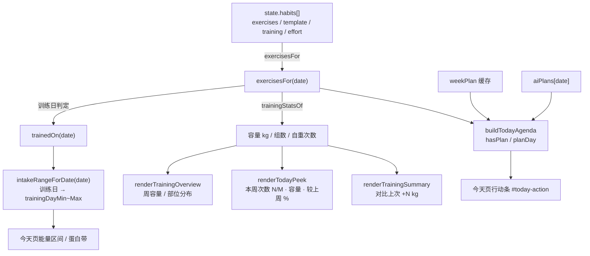

# 轻衡 · 训练（Training）模块代码提取

> **快照说明（2026-11-23 02:05 追加）**：本文档是 **Phase 1（f202628）** 时的代码底稿。
> Phase 2/3 已把纯领域层抽到 `55-training-domain.fragment.js`、训练日志层抽到 `68-training-log.fragment.js`，
> 并删除了 AI 清单的死渲染（`aiPlanRowHtml` / `collectAiPlanEdits` / `aiPlanDose`）与 `#week-plan` 的重复监听器。
> 因此下表的「文件:行号」不再对应当前 master；需要现版底稿就重跑 `.tmp/training-extract/build.mjs`（SEL 需按新文件更新）。


> 用途：给外部评审用的**完整代码底稿**。本文档只做提取与索引，不做重构判断。
>
> - 仓库：`D:\AI\health-android`（app `cn.qingheng.health`，版本 **1.5.30 / 530**）
> - 提取日期：2026-11-23；以工作区 `master` 当时内容为准
> - 生成方式：脚本按「函数名 + 行区间」从源文件逐字截取，未手改任何一行代码；行号即源文件行号
> - 未包含：样式文件 `styles.css`（训练相关选择器未贴）、`assets/app.js`（由 fragments 拼装生成，禁止手改）
> - 三段生成物：结构层（index.html 原样，只在标签之间插入换行）、逻辑层（fragments 整函数）、原生层（Java 关键函数）
> - 一共 209 段代码；索引表在 §0

## 0. 训练模块文件与函数索引表

层级说明：**数据/状态**＝读写与缓存；**生成/计算**＝纯计算；**文案**＝可读解释；**表单编辑**＝DOM 构建与读回；**视图**＝渲染；**校验**＝落库前检查；**绑定**＝事件与交互；**消费**＝今天页/趋势页读取训练数据。

### 00-head —— 全局状态、训练开关与配置同步（数据层 / 消费层的开关）

| 函数 / 代码段 | 位置（行） | 行数 | 层 | 一句话说明 |
|---|---|---|---|---|
| 训练相关 localStorage 键常量 | 00-head.fragment.js:940–944 | 5 | 数据 | TRAINING_CONSENT_KEY / BODYWEIGHT_MARK_KEY 等键集中声明，禁止裸字面量。 |
| `collectedAiPlans` | 00-head.fragment.js:948–956 | 9 | 数据 | 把 localStorage 里最近 10 份按日 AI 清单收成一个可备份对象。 |
| `schedulePrefsSync` | 00-head.fragment.js:958–961 | 4 | 数据 | 防抖 400ms，把 prefs patch 写进 /api/prefs；失败不打断用户动作。 |
| `hydratePrefsFromState` | 00-head.fragment.js:964–1005 | 42 | 数据 | 启动时把 state.prefs 还原进 localStorage（planPrefs / aiPlans / bodyweightMoves / trainingConsent）。 |
| CONFIG_REGISTRY 配置注册表 | 00-head.fragment.js:1010–1016 | 7 | 数据 | localStorage 即时缓存 ↔ state.prefs 的唯一映射；新增配置必须登记。 |
| `verifyConfigSync` | 00-head.fragment.js:1018–1027 | 10 | 数据 | 启动比对本地缓存与 state.prefs，漂移时以本地为准回写。 |
| `loadState` | 00-head.fragment.js:1048–1084 | 37 | 数据 | 拉 /api/state、校验结构、还原偏好，再触发整页渲染。 |
| `todayActionItems` | 00-head.fragment.js:1279–1292 | 14 | 消费 | 今天页行动条的数据源：把训练/餐食/补记项收成 1 主 + N 次。 |
| `renderTodayAction` | 00-head.fragment.js:1293–1324 | 32 | 消费 | 渲染今天页行动条；训练类目标的 target 为 ai-plan / training-form。 |
| `trainingEnabled` | 00-head.fragment.js:1436–1439 | 4 | 视图 | 档案 training === "none" 时关闭全部训练 UI（隐藏菜单）。 |
| `trainingStateFor` | 00-head.fragment.js:1445–1456 | 12 | 数据 | 纯函数：一天训练状态 trained / rest / planned / plan-rest / unrecorded / disabled。 |
| `hideTrainingTabs` | 00-head.fragment.js:1481–1499 | 19 | 视图 | 不健身时隐藏训练分段按钮与入口，并把当前分段切走。 |
| `applyTrainingVisibility` | 00-head.fragment.js:1500–1523 | 24 | 视图 | 统一显隐训练相关 DOM 块（日志 / 建议 / 容量卡 / 周计划）。 |
| `intakeRangeForDate` | 00-head.fragment.js:1528–1560 | 33 | 消费 | 当天摄入区间：训练日取 trainingDay、其余取 restDay；「训练日」由是否存过动作判定。 |

### 10-rich-answer —— 今天页「本周训练」概况与上次训练建议（消费层）

| 函数 / 代码段 | 位置（行） | 行数 | 层 | 一句话说明 |
|---|---|---|---|---|
| 今天页训练行渲染（renderBody 内） | 10-rich-answer.fragment.js:251–269 | 19 | 消费 | 记录页页眉旁一行「训练 N 个动作 · 容量 X kg / 今天还没练」，点进训练面板。 |
| `renderTodayPeek` | 10-rich-answer.fragment.js:467–529 | 63 | 消费 | 今天页顶部横滑概况：本周训练次数/容量/较上周 %，口径为最近 7 天对上一 7 天。 |
| `readLastTrainingAdvice` | 10-rich-answer.fragment.js:925–931 | 7 | 消费 | 读本机缓存的「上次训练建议」回答。 |
| `saveLastTrainingAdvice` | 10-rich-answer.fragment.js:932–940 | 9 | 消费 | 问答页训练建议成功后落一份本机缓存。 |
| `renderLastChat` | 10-rich-answer.fragment.js:942–954 | 13 | 消费 | 渲染「上次训练建议」入口卡（问题 + 摘要）。 |

### 40-targets —— 训练天数进入目标计算（数据层）

| 函数 / 代码段 | 位置（行） | 行数 | 层 | 一句话说明 |
|---|---|---|---|---|
| `plannedSessions` | 40-targets.fragment.js:33–42 | 10 | 数据 | 每周计划训练次数：优先 planPrefs.days，回落档案 training。 |

### 50-onboarding —— 训练表单与训练日志的编辑/保存层（表单编辑层）

| 函数 / 代码段 | 位置（行） | 行数 | 层 | 一句话说明 |
|---|---|---|---|---|
| `habitRowFor` | 50-onboarding.fragment.js:698–702 | 5 | 数据 | 取某天 habit 行；一天出现重复行时取字段最全的一条。 |
| `trainedOn` | 50-onboarding.fragment.js:707–709 | 3 | 数据 | 当天算不算训练日：只看有没有保存动作（删空即回落休息日）。 |
| TRAINING_TEMPLATES 模板码 | 50-onboarding.fragment.js:719–719 | 1 | 数据 | push/pull/legs/other → 推/拉/腿/其他。 |
| `exercisesFor` | 50-onboarding.fragment.js:721–730 | 10 | 数据 | 规范化某天动作数组（id/name/sets/reps/weight/distanceKm/durationMin）。 |
| `exerciseVolume` | 50-onboarding.fragment.js:732–736 | 5 | 数据 | 单动作容量 = 组 × 次 × 重；任一缺失返回 null，不编数。 |
| `readBodyweightMarks` | 50-onboarding.fragment.js:748–753 | 6 | 数据 | 读用户自定义的自重动作名表（localStorage）。 |
| `loadUserBodyweightMarks` | 50-onboarding.fragment.js:755–758 | 4 | 数据 | 把自重名表灌进内存 Set（备份还原后调用）。 |
| `isUserBodyweight` | 50-onboarding.fragment.js:759–761 | 3 | 数据 | 判断动作名是否在用户自重表里。 |
| `setUserBodyweight` | 50-onboarding.fragment.js:762–773 | 12 | 数据 | 标记/取消自重动作，写 localStorage 并同步进 state.prefs。 |
| `isBodyweightMove` | 50-onboarding.fragment.js:774–781 | 8 | 规则 | 自重判定：先查用户表，再走正则；带「负重/杠铃/哑铃…」的变体不算。 |
| `isCompoundMove` | 50-onboarding.fragment.js:788–793 | 6 | 规则 | 复合动作判定，只用于组间休息时长，不参与容量与进阶。 |
| `trainingStatsOf` | 50-onboarding.fragment.js:798–824 | 27 | 计算 | 一次训练三口径：kg 容量 / 总组数 / 自重次数（自重不折算 kg）。 |
| `latestExerciseValues` | 50-onboarding.fragment.js:833–847 | 15 | 数据 | 同名动作最近一次的组/次/负重，用于「点一下加入」预填。 |
| `trainingSetDetails` | 50-onboarding.fragment.js:849–860 | 12 | 计算 | 旧记录（只有 sets）展开成逐组；自重 0 kg 归一成空。 |
| `setRowHtml` | 50-onboarding.fragment.js:861–874 | 14 | 视图 | 一组的手账行 HTML：勾选 + 序号 + 次 × kg + 删除。 |
| `isCardioName` | 50-onboarding.fragment.js:880–883 | 4 | 规则 | 按动作名前缀识别有氧（跑步/骑行/椭圆…），不误伤「杠铃划船」。 |
| `isCardioItem` | 50-onboarding.fragment.js:884–886 | 3 | 规则 | 有氧项判定：名字或已带距离/时长。 |
| `fmtPace` | 50-onboarding.fragment.js:888–891 | 4 | 计算 | 配速格式化：分钟/公里 → 6'00"。 |
| `cardioRowHtml` | 50-onboarding.fragment.js:892–899 | 8 | 视图 | 有氧行 HTML：距离 km × 时长 分钟 + 配速。 |
| `refreshCardioPace` | 50-onboarding.fragment.js:901–910 | 10 | 视图 | 按输入重算有氧行配速。 |
| `syncExerciseMode` | 50-onboarding.fragment.js:912–927 | 16 | 视图 | 动作名改成有氧时整行切成有氧表单，改回力量动作再切回组次表。 |
| `exerciseRowHtml` | 50-onboarding.fragment.js:928–945 | 18 | 视图 | 一个动作的整块 HTML：名称行(看要点/改/自重) + 组列表 + 加一组/容量。 |
| `refreshSetRow` | 50-onboarding.fragment.js:947–975 | 29 | 视图 | 组序号、aria、容量就地重算；只改 DOM，不写库。 |
| `renumberExerciseRows` | 50-onboarding.fragment.js:977–989 | 13 | 视图 | 增删动作后重排编号与移除按钮的索引。 |
| `appendExerciseRow` | 50-onboarding.fragment.js:991–1011 | 21 | 视图 | 追加一行动作（含第 1 组），上限 12 个动作。 |
| `renderTrainingPresets` | 50-onboarding.fragment.js:1013–1019 | 7 | 视图 | 按当前模板渲染「常用动作」胶囊。 |
| `seedExercisesFromPlan` | 50-onboarding.fragment.js:1024–1044 | 21 | 消费 | 把今天的 AI 清单或本周计划播成可打卡行；只产数据、不写库。 |
| trainingDrafts 内存草稿 | 50-onboarding.fragment.js:1043–1043 | 1 | 状态 | 按日期保存表单草稿，重建表单时优先还原。 |
| `draftRowsFromForm` | 50-onboarding.fragment.js:1050–1075 | 26 | 状态 | 把当前表单读成草稿行（含逐组 done）。 |
| `rememberTrainingDraft` | 50-onboarding.fragment.js:1076–1080 | 5 | 状态 | 输入/勾组即存草稿；空表单则清掉。 |
| `forgetTrainingDraft` | 50-onboarding.fragment.js:1081–1081 | 1 | 状态 | 保存或清空后丢弃当天草稿。 |
| `renderTrainingLog` | 50-onboarding.fragment.js:1082–1124 | 43 | 视图 | 重建训练日志表单：已记录 → 草稿 → 计划播种 → 空行，四选一。 |
| `repeatLastTraining` | 50-onboarding.fragment.js:1126–1136 | 11 | 视图 | 「照上次练」：把上一次训练预填进表单（只改草稿）。 |
| `readTrainingExercises` | 50-onboarding.fragment.js:1137–1159 | 23 | 校验 | 表单 → 待保存动作数组：逐组 setDetails、有氧距离时长、fromPlan 标记。 |
| `trainingVolumeOf` | 50-onboarding.fragment.js:1160–1174 | 15 | 计算 | 待保存动作的容量合计（逐组或旧字段，两种口径）。 |
| `renderTrainingSummary` | 50-onboarding.fragment.js:1176–1204 | 29 | 视图 | 保存后的课后总结：容量 / 组数 / 对比上次 / 下次建议。 |
| `sessionStartKey` | 50-onboarding.fragment.js:1209–1209 | 1 | 计时 | 训练计时起点键（按日、只存本机）。 |
| `sessionStartedAt` | 50-onboarding.fragment.js:1210–1212 | 3 | 计时 | 读当天训练起点时间戳。 |
| `markSessionStart` | 50-onboarding.fragment.js:1213–1216 | 4 | 计时 | 第一次勾组时记下起点（已有则不动）。 |
| `clearSessionStart` | 50-onboarding.fragment.js:1217–1219 | 3 | 计时 | 保存后清掉当天起点。 |
| `sessionMinutesEstimate` | 50-onboarding.fragment.js:1221–1225 | 5 | 计时 | 默认耗时：按起点算，夹在 5–300 分钟；没起点留空。 |
| `trainingSaveDialogHtml` | 50-onboarding.fragment.js:1227–1269 | 43 | 视图 | 「结束训练」弹窗内容：汇总 + 逐动作明细 + 同模板容量对比 + 耗时 + 疲劳度。 |
| `wireTrainingSaveDialog` | 50-onboarding.fragment.js:1271–1287 | 17 | 绑定 | 弹窗内交互：疲劳度单选、先补记录（定位到没填完的组）。 |
| `saveTrainingLog` | 50-onboarding.fragment.js:1289–1368 | 80 | 校验 | 保存流程：校验（自重可空）→ 结束训练弹窗 → 写 /api/habits → 补 effort → 写重量记忆。 |
| `weeklyVolume` | 50-onboarding.fragment.js:1370–1398 | 29 | 计算 | 按动作、按 ISO 周汇总容量，输出近两周变化最大的 6 项。 |
| `renderVolumeTable` | 50-onboarding.fragment.js:1399–1411 | 13 | 视图 | 趋势页「训练容量」表：动作 / 上周 / 本周 / 变化。 |

### 60-training-copy —— 周计划生成、训练库文案、重量记忆与计划缓存（计划生成层）

| 函数 / 代码段 | 位置（行） | 行数 | 层 | 一句话说明 |
|---|---|---|---|---|
| DRAFT_MOVES 可识别动作名表 | 60-training-copy.fragment.js:5–6 | 2 | 数据 | 一句话录入时不需要模型也能认出的力量动作。 |
| `renderTrainingDraft` | 60-training-copy.fragment.js:9–24 | 16 | 视图 | 问答里的训练草稿卡（待确认 → 写入记录）。 |
| ACWR / 平台期阈值与 DRAFT_KINDS | 60-training-copy.fragment.js:30–34 | 5 | 规则 | 负荷比 1.5/0.8、平台期 0.2 kg 等阈值集中声明。 |
| `parseDraft` | 60-training-copy.fragment.js:40–123 | 84 | 解析 | 一句话 → 草稿：识别日期、动作、组次重量，训练/体重/睡眠/步数/饮水通用。 |
| `parseTrainingDraft` | 60-training-copy.fragment.js:126–129 | 4 | 解析 | 只要训练草稿的薄包装，统一 call site 与测试的 {payload:{exercises}} 形状。 |
| `draftSummary` | 60-training-copy.fragment.js:165–168 | 4 | 视图 | 草稿的一句话摘要。 |
| `acwrFromDailyLoads` | 60-training-copy.fragment.js:333–346 | 14 | 计算 | 负荷比 = 近 7 天负荷 ÷（近 28 天总负荷 ÷ 4）；>1.5 判 high（减载）、<0.8 判 low。 |
| `plateauFromWeekly` | 60-training-copy.fragment.js:352–359 | 8 | 计算 | 体重平台期：最近三周周均首尾差 < 0.2 kg。 |
| `loadableWeightKg` | 60-training-copy.fragment.js:365–383 | 19 | 计算 | 把重量落到装得出来的档：杠铃 20 kg 空杆 + 5 kg 级、哑铃 2 kg、器械 5 kg、自重返回 null。 |
| `generateWeekPlan` | 60-training-copy.fragment.js:396–681 | 286 | 生成 | 周计划生成：六套模板选动作、组次/RIR、时长约束、周组数自检、历史 +2.5%、减载。 |
| `localCoachLine` | 60-training-copy.fragment.js:684–687 | 4 | 文案 | 训练建议首行（本地、不调模型）。 |
| `trainingLibrary` | 60-training-copy.fragment.js:723–726 | 4 | 数据 | 读 window.TRAINING_PRINCIPLES（rules / dayTemplates / moves / sources）；未加载返回 null。 |
| `libraryRule` | 60-training-copy.fragment.js:727–730 | 4 | 数据 | 按 id 取一条训练库规则。 |
| `libraryDayTemplate` | 60-training-copy.fragment.js:731–735 | 5 | 数据 | 按模板码取库里的日内动作编排。 |
| `libraryMoves` | 60-training-copy.fragment.js:736–739 | 4 | 数据 | 取库里某个分类的动作清单。 |
| `librarySourceLabel` | 60-training-copy.fragment.js:740–744 | 5 | 文案 | 规则来源标签（用于「这周怎么排的」）。 |
| `planWhy` | 60-training-copy.fragment.js:746–760 | 15 | 文案 | 把命中的规则翻译成一句可读理由 + 来源。 |
| LIBRARY_ROUTES 部位路由表 | 60-training-copy.fragment.js:762–774 | 13 | 数据 | 模板/名称 → 训练库路由。 |
| `libraryLookup` | 60-training-copy.fragment.js:775–793 | 19 | 数据 | 问题关键词 → 训练库 tag，按来源优先级取 ≤N 条规则纯文本（不带出处，避免模型报 BV 号）。 |
| `libraryCues` | 60-training-copy.fragment.js:795–807 | 13 | 数据 | 按模板从训练库取 2 条短要点（推/拉/腿各一组固定规则）。 |
| `exerciseCore` | 60-training-copy.fragment.js:809–814 | 6 | 数据 | 去掉器械/姿态前缀，留下动作本体，用于和训练库对名。 |
| `cueTokens` | 60-training-copy.fragment.js:817–830 | 14 | 文案 | 动作名的对名候选：全名 + 逐层剥掉器械/姿态前缀后的形态，以及被剥掉的修饰词。 |
| `trimCue` | 60-training-copy.fragment.js:832–837 | 6 | 文案 | 要点截到一个分句、上限 46 字，保证不超过两行。 |
| `pickCueClause` | 60-training-copy.fragment.js:839–847 | 9 | 文案 | 从一条规则里挑「能照做」的半句：先点名该动作的分句，再动作要求句，最后第一句。 |
| `cueForExercise` | 60-training-copy.fragment.js:856–916 | 61 | 文案 | 按动作名四级匹配要点（修饰词优先 → 开头命中 → 模板要点 → tag 命中），查不到返回 null。 |
| `libraryCuesFor` | 60-training-copy.fragment.js:918–939 | 22 | 文案 | 计划某天的 ≤3 条要点（每条点名动作），命中不足时补通用提醒。 |
| `libraryRuleForMetric` | 60-training-copy.fragment.js:941–945 | 5 | 文案 | 按指标（热量/蛋白/脂肪/训练/睡眠）映射到对应的训练库规则。 |
| `librarySummary` | 60-training-copy.fragment.js:947–962 | 16 | 文案 | 进问答载荷的紧凑摘要：按来源优先级取前 N 条规则，含视频引用。 |
| `dailyLoads` | 60-training-copy.fragment.js:964–980 | 17 | 计算 | 近 N 天每日训练负荷：逐日 sets×reps×weight 求和，有氧按分钟 ×6 计入。 |
| `weekdayIndex` | 60-training-copy.fragment.js:1002–1005 | 4 | 计算 | 周几（周一 = 0）。 |
| PLAN_PREFS_KEY / GEAR_LABELS / SPLIT·GEAR 中文名 | 60-training-copy.fragment.js:1073–1087 | 15 | 数据 | 偏好键与展示名。 |
| `planPrefs` | 60-training-copy.fragment.js:1079–1081 | 3 | 状态 | 读周计划偏好（days/split/gear/minutes/request）。 |
| `savePlanPrefs` | 60-training-copy.fragment.js:1082–1086 | 5 | 状态 | 写偏好到 localStorage 并同步进 state.prefs。 |
| `planPrefsSummary` | 60-training-copy.fragment.js:1090–1097 | 8 | 文案 | 偏好压成一行：N 练 · 分化 · 器械 · 分钟。 |
| `installPlanPrefs` | 60-training-copy.fragment.js:1099–1206 | 108 | 绑定 | 偏好 chips / 展开·取消 / 换一套 / 保存并重排 的事件与还原逻辑。 |
| `weekPlanToday` | 60-training-copy.fragment.js:1215–1235 | 21 | 数据 | 本周计划里今天是哪一节；休息日与「还没排」分开表达。 |
| `weekTodaySession` | 60-training-copy.fragment.js:1237–1239 | 3 | 数据 | 今天那一节（与 weekPlanToday 同一来源）。 |
| `cachedWeekPlan` | 60-training-copy.fragment.js:1241–1244 | 4 | 数据 | 只读本周计划缓存，不临时生成。 |
| `buildTodayAgenda` | 60-training-copy.fragment.js:1249–1325 | 77 | 计算 | 今天页行动模型：1 primary + ≤2 secondary，只读、无网络、无写库。 |
| `todayAgendaState` | 60-training-copy.fragment.js:1327–1359 | 33 | 消费 | 当前页面适配器：收集 state/缓存/时段，喂给纯函数 builder。 |
| `adoptWeekDay` | 60-training-copy.fragment.js:1361–1387 | 27 | 写库 | 把本周计划今天那节写进今日 AI 清单（覆盖前先确认）。 |
| `renderAdviceOrder` | 60-training-copy.fragment.js:1388–1494 | 107 | 视图 | 训练建议区的「今日清单」：勾选/记录/全部加入/就地排今天，含跳转兜底。 |
| `recentExerciseBaselines` | 60-training-copy.fragment.js:1497–1508 | 12 | 计算 | 近 14 天每个动作最近一次的组/次/负重（跑步与计时类不参与排课）。 |
| WEIGHT_MEMORY_* / WEIGHT_FAMILIES / WEIGHT_EQUIP / WEIGHT_RATIOS | 60-training-copy.fragment.js:1512–1557 | 46 | 数据 | 重量记忆的键、保留天数、动作族与器械系数表。 |
| `exerciseKey` | 60-training-copy.fragment.js:1561–1563 | 3 | 数据 | 动作去重键。 |
| `exerciseFamily` | 60-training-copy.fragment.js:1564–1568 | 5 | 数据 | 动作族（卧推/深蹲/划船…），用于跨名称继承重量。 |
| `exerciseEquip` | 60-training-copy.fragment.js:1569–1573 | 5 | 数据 | 动作所属器械类型。 |
| `readWeightMemory` | 60-training-copy.fragment.js:1576–1584 | 9 | 状态 | 读本机重量记忆（localStorage，带缓存）。 |
| `writeWeightMemory` | 60-training-copy.fragment.js:1585–1595 | 11 | 状态 | 写回重量记忆：超过 120 条时按日期裁掉最旧的。 |
| `rememberExerciseWeight` | 60-training-copy.fragment.js:1597–1613 | 17 | 状态 | 只在来源不更弱（log > model/plan > inferred）、日期不更旧时覆盖该动作的重量。 |
| `seedWeightMemoryFromHistory` | 60-training-copy.fragment.js:1615–1636 | 22 | 状态 | 用历史训练记录回填重量记忆（幂等，按种子键去重）。 |
| `reduceLoadableWeightKg` | 60-training-copy.fragment.js:1641–1653 | 13 | 计算 | 要减的时候必须向下探到真正可装且低于原值的档（1 kg 一档往下试，最多 8 次）。 |
| `progressiveWeightKg` | 60-training-copy.fragment.js:1658–1674 | 17 | 计算 | 按上次次数与间隔定档：≥8 次 +1 档（上肢 2.5 / 下肢 5 kg，且 ≤+10%）、≤5 次 −1 档、>21 天持平、>60 天 −5%，最后落可装档。 |
| `startingWeightKg` | 60-training-copy.fragment.js:1676–1686 | 11 | 计算 | 无历史时的起步重量 = 体重 × 动作族系数 × 器械系数（偏保守），推不出返回 null。 |
| `plannedWeightFor` | 60-training-copy.fragment.js:1691–1709 | 19 | 计算 | 排课重量三层：同名记忆（渐进）→ 同族迁移 ×0.85 → 体重比例；source 决定界面是否标「约」。 |
| `rememberPlanWeights` | 60-training-copy.fragment.js:1711–1717 | 7 | 状态 | 把计划里的重量写进重量记忆（source=plan）。 |
| `rememberExerciseLogs` | 60-training-copy.fragment.js:1719–1724 | 6 | 状态 | 保存训练后把实测重量写进重量记忆（source=log）。 |
| `prefsForPlan` | 60-training-copy.fragment.js:1729–1731 | 3 | 状态 | 生成器只读的偏好快照（含 request）。 |
| `weekPlanFingerprint` | 60-training-copy.fragment.js:1732–1742 | 11 | 计算 | 周计划指纹：偏好 + 基线 + 次数，变了才重算。 |
| `readWeekPlanCache` | 60-training-copy.fragment.js:1743–1745 | 3 | 状态 | 读按周缓存的本周计划（localStorage）。 |
| `writeWeekPlanCache` | 60-training-copy.fragment.js:1746–1748 | 3 | 状态 | 写本周计划缓存（plan + fingerprint + savedAt）。 |
| `planStartDate` | 60-training-copy.fragment.js:1751–1753 | 3 | 数据 | 计划起点：看的那天（非法则今天）。 |
| `dayTemplateSlot` | 60-training-copy.fragment.js:1758–1762 | 5 | 数据 | 那天该练哪一类：唯一来源是周计划缓存的 template。 |
| `dayLabel` | 60-training-copy.fragment.js:1764–1766 | 3 | 文案 | 今天/MM-DD 的日期称呼。 |
| `dayTemplateNote` | 60-training-copy.fragment.js:1768–1773 | 6 | 文案 | 喂给两个 AI 入口的同一句「今天按周计划练什么」。 |
| `nextStartTemplate` | 60-training-copy.fragment.js:1776–1787 | 12 | 计算 | 起始部位接上一次训练的下一个（ppl 推→拉→腿 / ul 上下交替 / fb 固定）。 |
| `regenerateWeekPlan` | 60-training-copy.fragment.js:1788–1794 | 7 | 写库 | 「换一套」：清缓存、强制重算、重渲染（不改偏好）。 |
| `renderWeekPlan` | 60-training-copy.fragment.js:1795–1947 | 153 | 视图 | 周计划卡：算（负荷比/指纹/生成）→ 拼 HTML → 绑一次事件 → 把说明搬进抽屉。 |
| `renderTrendWarnings` | 60-training-copy.fragment.js:1950–1963 | 14 | 视图 | 趋势页顶部警告：训练负荷急增/偏低、体重平台期。 |

### 65-exercise-guide —— 动作要点半屏（文案数据 + 渲染）

| 函数 / 代码段 | 位置（行） | 行数 | 层 | 一句话说明 |
|---|---|---|---|---|
| EXERCISE_GUIDES 动作要点表 | 65-exercise-guide.fragment.js:7–193 | 187 | 数据 | 每个动作的角色、要点、安全提示（本地数据，不联网）。 |
| EXERCISE_HOW 怎么做 | 65-exercise-guide.fragment.js:196–290 | 95 | 数据 | 动作的分步做法。 |
| `normalizeExerciseName` | 65-exercise-guide.fragment.js:292–294 | 3 | 数据 | 动作名归一（去空格/括号注释）。 |
| `exerciseGuideFor` | 65-exercise-guide.fragment.js:296–314 | 19 | 数据 | 按动作名查要点；查不到返回 null。 |
| `closeExerciseGuide` | 65-exercise-guide.fragment.js:315–318 | 4 | 绑定 | 关闭动作要点半屏。 |
| `showExerciseGuide` | 65-exercise-guide.fragment.js:319–333 | 15 | 视图 | 打开要点半屏并填充角色/做法/要点。 |
| `installExerciseGuide` | 65-exercise-guide.fragment.js:334–344 | 11 | 绑定 | 半屏的关闭与遮罩点击绑定。 |

### 70-rest —— AI 排今天、今日清单、训练概览、休息计时与事件绑定（视图层 / 绑定层）

| 函数 / 代码段 | 位置（行） | 行数 | 层 | 一句话说明 |
|---|---|---|---|---|
| `setActiveDate` | 70-rest.fragment.js:112–117 | 6 | 状态 | 切换记录日期：写 URL/host、重渲染记录页（会重建训练表单，草稿靠 trainingDrafts 兜）。 |
| AI_PLAN_KEY | 70-rest.fragment.js:329–329 | 1 | 数据 | 按日 AI 清单的 localStorage 键。 |
| `aiPlanStore` | 70-rest.fragment.js:330–337 | 8 | 状态 | 按日读写今日 AI 清单，并随 prefs 同步进 state.json。 |
| `aiPlanSets` | 70-rest.fragment.js:339–344 | 6 | 计算 | 清单项组数：新数据读 sets，旧数据从 dose 字符串解析。 |
| AI_PLAN_WORK_SECONDS / MINUTE_STEPS | 70-rest.fragment.js:349–350 | 2 | 规则 | 每组执行 45 秒、时长档位 30/45/60/75/90。 |
| `planItemMinutes` | 70-rest.fragment.js:351–359 | 9 | 计算 | 单个动作占用：组数 ×（执行 + 组间休息），有氧按自身时长。 |
| `planMinutes` | 70-rest.fragment.js:361–364 | 4 | 计算 | 整份清单折算分钟（向上取整）。 |
| `planMinutesStep` | 70-rest.fragment.js:366–369 | 4 | 计算 | 折算值收进可选档位（不给 36 分钟这种）。 |
| `addExercisesToToday` | 70-rest.fragment.js:374–425 | 52 | 写库 | 动作并入当天训练记录（同名跳过、只追加），是清单与日志之间的唯一接口。 |
| `removeExerciseFromToday` | 70-rest.fragment.js:430–437 | 8 | 写库 | 从当天训练记录里撤掉一条（取消勾选时回收未改动行）。 |
| `togglePlanDone` | 70-rest.fragment.js:438–479 | 42 | 写库 | 勾选即记录：今天且填了组次才写库；取消勾选只回收「没动过」的行。 |
| `startLoggingFromPlan` | 70-rest.fragment.js:484–498 | 15 | 视图 | 清单项 → 记录：并入今天、切到训练分段、聚焦该行负重。 |
| `parseExercisesFromText` | 70-rest.fragment.js:501–517 | 17 | 解析 | 从 AI 回答纯文本里认出「动作名 3组×8次 60kg」。 |
| EFFORT_LABELS / EFFORT_LEVELS | 70-rest.fragment.js:523–524 | 2 | 数据 | 疲劳度四档：太轻 / 刚好 / 有点累 / 太累。 |
| `effortFor` | 70-rest.fragment.js:526–530 | 5 | 数据 | 读某天记录的疲劳度（非法值视为未记）。 |
| `effortSignal` | 70-rest.fragment.js:535–551 | 17 | 计算 | 近 7 天疲劳度 → deload / push / keep 信号，附一句原因（太累两次或有太累即降档）。 |
| `applyEffortSignalToPlan` | 70-rest.fragment.js:553–571 | 19 | 计算 | 降载：配重动作每组 −1、重量退 5%；加量：首个复合动作 +1 组（上限 5）。 |
| `renderTrainingEffort` | 70-rest.fragment.js:572–579 | 8 | 视图 | 渲染疲劳度 chips 的当前选中态。 |
| `saveTrainingEffort` | 70-rest.fragment.js:580–587 | 8 | 写库 | 点一下即写 effort 到当天 habit 行。 |
| `planNoteKey` | 70-rest.fragment.js:589–589 | 1 | 数据 | 教练说明的本机键（按日，不进导出）。 |
| `readPlanNote` | 70-rest.fragment.js:590–592 | 3 | 状态 | 读「AI 为什么没完全照要求办」的教练说明。 |
| `writePlanNote` | 70-rest.fragment.js:593–598 | 6 | 状态 | 写教练说明（只留本机，不落 state.json）。 |
| `renderPlanNote` | 70-rest.fragment.js:599–605 | 7 | 视图 | 渲染教练说明行（#ai-plan-note）。 |
| `renderPlanTiming` | 70-rest.fragment.js:607–621 | 15 | 视图 | 把上次排课的耗时 / 失败原因贴在清单上方（toast 只活 10 秒）。 |
| `aiPlanDose` | 70-rest.fragment.js:622–636 | 15 | 文案 | 清单项剂量文案：组×次×kg，推算重量写「约」。 |
| `collectAiPlanEdits` | 70-rest.fragment.js:638–656 | 19 | 状态 | 把清单编辑态输入读回存储，空名行视为删除。 |
| `aiPlanRowHtml` | 70-rest.fragment.js:658–682 | 25 | 视图 | 清单一行 HTML（只读态 / 编辑态两套）。 |
| `syncPlanDoneFromRow` | 70-rest.fragment.js:687–700 | 14 | 状态 | 执行区每组 ○ 全亮 → 回写清单项 done。 |
| `renderAiPlan` | 70-rest.fragment.js:701–769 | 69 | 视图 | 渲染清单入口文案、计数、汇总与折叠；清单本身已播进执行区。 |
| `planWeightFor` | 70-rest.fragment.js:780–795 | 16 | 计算 | 清单项的重量补全（历史/体重推算/器械起步）。 |
| `planItemFromRow` | 70-rest.fragment.js:796–811 | 16 | 数据 | AI 返回的一行 → 清单项（字段归一）。 |
| `partialPlanRows` | 70-rest.fragment.js:813–841 | 29 | 数据 | 流式返回时先把已到的行解析出来。 |
| `parseAiPlanReply` | 70-rest.fragment.js:843–867 | 25 | 解析 | 解析 AI 排课回复：动作 / 组 / 次 / kg / 理由。 |
| `compilePlanContext` | 70-rest.fragment.js:872–906 | 35 | 上下文 | 把规则与记录在本地算成一张卡（部位/时长/组次/RIR/基线），提示词不再贴原始数据外发。 |
| `validatePlanAgainstContext` | 70-rest.fragment.js:911–932 | 22 | 校验 | 本地兜底：重量落档、组数 1~5、超时长从末尾动作减组。 |
| `askAiPlan` | 70-rest.fragment.js:933–1089 | 157 | 生成 | 「AI 排今天」：授权校验 → 流式请求 → 解析 → 本地校验 → 写清单 → 渲染。 |
| `installAiPlan` | 70-rest.fragment.js:1090–1249 | 160 | 绑定 | 清单元素的事件绑定：重排/清空/顺延/编辑/勾选/换一个/记录/改时长。 |
| `installWeightCalc` | 70-rest.fragment.js:1252–1289 | 38 | 绑定 | 「杠铃总重」半屏：杆重 + 每侧片重 → 填入当前动作负重。 |
| `weekTrainingStats` | 70-rest.fragment.js:1821–1841 | 21 | 计算 | 本周（周一起）逐日训练统计：次数 / 容量 / 自重次数 / 有氧 km·分钟，供概览卡与对比上周。 |
| `renderTrainingOverview` | 70-rest.fragment.js:1842–1942 | 101 | 视图 | 「训练概览」折叠块：本周次数、容量、自重、今天蛋白同屏 + 较上周对比。 |
| `switchRecordPanel` | 70-rest.fragment.js:2003–2021 | 19 | 绑定 | 记录页分段切换（饮食/身体/训练）；不健身时 training 段回退饮食。 |
| 训练表单事件绑定（日期 / 疲劳度 / 添加动作） | 70-rest.fragment.js:2139–2157 | 19 | 绑定 | 日期 input 换 activeDate；疲劳度 click 直写；「＋ 添加动作」走同一个构造函数。 |
| 常用动作 / 模板 / 照上次练 绑定 | 70-rest.fragment.js:2167–2180 | 14 | 绑定 | 胶囊按最近一次记录预填；模板切换重渲染胶囊；「照上次练」预填表单。 |
| 休息计时状态变量 | 70-rest.fragment.js:2183–2186 | 4 | 状态 | restTick / restEnd / 视野标记 / restLine。 |
| `clearRestLine` | 70-rest.fragment.js:2192–2194 | 3 | 计时 | 移除挂在动作卡上的休息线。 |
| `attachRestLine` | 70-rest.fragment.js:2199–2217 | 19 | 计时 | 把休息线挂到刚勾完那一组所属的动作卡上。 |
| REST_SECONDS / restLength / REST_RING_C | 70-rest.fragment.js:2214–2216 | 3 | 规则 | 默认 90 秒与环形周长。 |
| `restSecondsFor` | 70-rest.fragment.js:2227–2234 | 8 | 计算 | 按时限给休息秒数：复合 120~150 / 孤立 60~90 / 自重 75~90 / 有氧 0。 |
| restAudio | 70-rest.fragment.js:2235–2235 | 1 | 状态 | AudioContext 单例（需用户手势解锁）。 |
| `primeRestAudio` | 70-rest.fragment.js:2241–2249 | 9 | 计时 | 开始计时那一下解锁音频，否则到点无声。 |
| `playRestChime` | 70-rest.fragment.js:2250–2277 | 28 | 计时 | 合成两枚短音提示（不打包音频文件）。 |
| `restLineVisible` | 70-rest.fragment.js:2279–2283 | 5 | 计时 | 休息线是否仍在视野内。 |
| `syncRestDock` | 70-rest.fragment.js:2284–2291 | 8 | 计时 | 底部药丸的显隐：训练区在视野内或计时进行中才出现。 |
| `paintRest` | 70-rest.fragment.js:2293–2328 | 36 | 视图 | 画药丸倒计时与环形进度。 |
| `startRestTimer` | 70-rest.fragment.js:2333–2357 | 25 | 计时 | 开始/取消一轮休息计时（restEnd 为唯一真相）。 |
| `installRestDock` | 70-rest.fragment.js:2358–2380 | 23 | 绑定 | 用 IntersectionObserver 监听训练区与动作行，驱动药丸显隐。 |
| 休息药丸与容量联动绑定 | 70-rest.fragment.js:2378–2394 | 17 | 绑定 | 药丸点击重开计时；输入时重算容量与有氧配速。 |
| `lockExerciseName` | 70-rest.fragment.js:2404–2413 | 10 | 视图 | 动作名失焦后锁回展示态（行内不锁，行外 pointerdown 才锁）。 |
| 动作行事件委托与训练日志动作 | 70-rest.fragment.js:2409–2532 | 124 | 绑定 | 名称锁定 / 看要点 / 改 / 自重 / 勾组 / 加组 / 删组 / 删动作；保存 / 清空 / 记为休息 / 今天训练入口。 |
| `trainingInsights` | 70-rest.fragment.js:2903–2927 | 25 | 计算 | 本地三条洞察（不调模型）：负荷偏高/偏低、动作连续两周停滞并给替代动作、总容量上涨过快。 |
| `renderTrainingInsights` | 70-rest.fragment.js:2929–2935 | 7 | 视图 | 渲染训练建议卡的数字摘要行。 |
| `installTrainingAdvice` | 70-rest.fragment.js:2938–3005 | 68 | 绑定 | 问答页「训练建议」：chips、提交、focus:"training" 请求与渲染。 |
| `installTrainingSheets` | 70-rest.fragment.js:3195–3223 | 29 | 绑定 | 计划说明 / 杠铃总重等半屏的开关绑定。 |
| `showTrainingDraft` | 70-rest.fragment.js:3435–3438 | 4 | 绑定 | 问答草稿 → 训练记录的写入入口。 |
| `applyDraft` | 70-rest.fragment.js:3461–3480 | 20 | 写库 | 把已确认草稿写进当天记录（训练走 exercises/template，30 秒可撤销）。 |
| 本周安排写入绑定 | 70-rest.fragment.js:3521–3557 | 37 | 绑定 | 「把这周写进训练记录」：只追加不覆盖，同名动作跳过。 |

### 72-chat-panels —— 问答页分段（问答 / 训练建议）切换

| 函数 / 代码段 | 位置（行） | 行数 | 层 | 一句话说明 |
|---|---|---|---|---|
| 整份片段 | 72-chat-panels.fragment.js:1–33 | 33 | 绑定 | 问答页两个分段（问答 / 训练建议）的切换与记忆。 |

## 1. 数据与状态结构

### 1.1 state.json 里与训练有关的形状

原生侧 `state.json`（AtomicFile）是权威数据，`STATE_VERSION = 4`；前端只通过 `/api/state`、`/api/habits`、`/api/prefs` 读写。训练相关的字段如下（`—` 表示该字段可能不存在）：

```jsonc
{
  "version": 4,
  "profile": {
    "training": 4,                 // 每周训练天数；"none" = 不健身（隐藏全部训练 UI）
    "trainingDayMin": 1800, "trainingDayMax": 2200,
    "restDayMin": 1600, "restDayMax": 1900
  },
  "habits": [{                     // 一天一条；训练日志就写在这条上
    "id": "uuid",
    "date": "2026-11-22",
    "steps": 8000, "water": 2000, "sleep": 7.5, "oilSpoons": 2,
    "template": "push|pull|legs|other",   // 训练模板（Java 侧白名单校验）
    "training": true,                     // false = 用户明确「记为休息」；缺字段 = 未记录
    "durationMin": 52,                    // 「结束训练」弹窗填的实际耗时
    "effort": "tooLight|justRight|tired|tooMuch",  // 疲劳度，下一次排课据此加减档
    "exercises": [{
      "id": "uuid",
      "name": "卧推",
      "sets": 4, "reps": 8, "weight": 60,  // 旧口径的汇总值；新记录里由 setDetails 派生
      "setDetails": [                      // 逐组（最多 30 组）；自重动作 weight 可为 null
        {"reps": 8, "weight": 60, "done": true},
        {"reps": 8, "weight": 60, "done": false}
      ],
      "distanceKm": 5.2, "durationMin": 30, // 有氧项（无组次）
      "fromPlan": true,                     // 勾选计划加进来的行，取消勾选时只回收这类
      "weightApprox": true                  // 重量是按体重/器械推算的起步值，行内显示「约」
    }]
  }],
  "prefs": {                       // 随备份走；localStorage 只是即时缓存
    "planPrefs": {"days": 4, "split": "ppl|ul|fb", "gear": "mixed|barbell|dumbbell|machine|body", "minutes": 45, "request": "只有 40 分钟…"},
    "aiPlans": {                   // 按日「今日 AI 清单」（最多同步最近 10 天）
      "2026-11-22": [{"name": "卧推", "sets": 4, "reps": 8, "weight": 60,
                      "weightSource": "log|plan|model|inferred|family", "reason": "…",
                      "done": false, "source": "ai|week", "distanceKm": 0, "durationMin": 0}]
    },
    "bodyweightMoves": ["引体向上"],   // 用户手工标记的自重动作名
    "trainingConsent": true,           // 训练建议外发授权
    "preferences": [], "chatWeb": true, "unhelpfulChats": []
  }
}

```

### 1.2 localStorage 键与 state.prefs 的对应关系

| localStorage 键 | 内容 | 写入点 | 是否随备份（state.prefs） |
|---|---|---|---|
| `qingheng.planPrefs` | 周计划偏好 days/split/gear/minutes/request | `savePlanPrefs` | 是（`planPrefs`） |
| `qingheng.aiPlan.<date>` | 当天 AI 清单 | `aiPlanStore` | 是（`aiPlans`，最近 10 天） |
| `qingheng.weekPlan.<startDate>` | 本周计划缓存 + 指纹 | `writeWeekPlanCache` | **否**（本机缓存） |
| `qingheng.exerciseWeights` | 重量记忆（动作 → 日期/重量，180 天/120 条上限） | `rememberExerciseWeight` / `rememberPlanWeights` / `rememberExerciseLogs` | **否**（本机缓存） |
| `qingheng.sessionStart.<date>` | 训练计时起点时间戳 | `markSessionStart` | **否** |
| `qingheng.bodyweightMoves` | 用户自定义自重动作名（≤200） | `setUserBodyweight` | 是（`bodyweightMoves`） |
| `qingheng.training.consent` | 训练建议外发授权 | 授权入口 | 是（`trainingConsent`） |
| `qingheng.barWeight` | 杠铃杆重（总重计算器） | `installWeightCalc` | **否** |

### 1.3 三个「训练状态源」与各自的写入点

| 状态源 | 载体 | 谁写 | 谁读 |
|---|---|---|---|
| ① 本周安排（周计划） | `qingheng.weekPlan.<startDate>` 缓存 → `lastWeekPlan` 内存 | `renderWeekPlan` 生成后写缓存；`regenerateWeekPlan` 清缓存；`adoptWeekDay`/`week-plan` 点击只读 | 周计划卡、`dayTemplateSlot`、`seedExercisesFromPlan`、`weekPlanToday`、`buildTodayAgenda`（`hasPlan`/`planDay`） |
| ② 今日清单（AI 排今天 / 周计划采纳） | `qingheng.aiPlan.<date>` + `state.prefs.aiPlans` | `aiPlanStore`（被 `askAiPlan`、`adoptWeekDay`、`togglePlanDone`、`collectAiPlanEdits`、`applyEffortSignalToPlan`、清空按钮调用） | `renderAiPlan`、`renderAdviceOrder`、`buildTodayAgenda`、`seedExercisesFromPlan`、`compilePlanContext` |
| ③ 训练日志（实际记录） | `state.habits[].exercises / template / training / effort / durationMin` | `saveTrainingLog`、`addExercisesToToday`、`removeExerciseFromToday`、清空/记为休息按钮、`week-plan` 写入、`applyDraft` | 容量/概览/趋势、`exerciseRowHtml`、`latestExerciseValues`、`seedWeightMemoryFromHistory`、原生 `trainingLog()` / `adviceBody()` |

### 1.4 训练数据流向今天页（与容量 / 次数 / 蛋白联动）



### 1.5 关键口径（写死在代码里的约定，评审时别当成 bug）

- 训练日只看「有没有保存动作」（`trainedOn` / Java `trainedOn`），手填的训练情况字段已废弃；动作删空即回落休息日。
- 容量 = 逐组 `reps × weight` 求和；旧记录退回 `sets × reps × weight`；自重动作单独记「次数」，不折算 kg，也不与上次比 kg。
- 组间休息按动作给：复合 120–150s、孤立 60–90s、自重 75–90s、有氧 0s；目标为增肌/保持时取长档。
- 周计划重量永不留给用户空着：历史 ×1.025（减载 ×0.9）→ 无历史按体重推算 → 仍无则按器械给保守起步值，全部标 `weightApprox` 并在行内显示「约」。

## 2. 结构层：index.html 的训练相关结构

> 说明：`index.html` 是「最少行数」排版（一个卡片一整行）。为便于评审，下面只在标签之间插入换行，**标签、属性、层级顺序与源文件完全一致**。行号指源文件行号。

### 训练计划卡 #week-plan-card（含偏好 chips、本周安排、采纳/写入入口）

源文件行：`app/src/main/assets/index.html:35`（整行）

```html
<article class="card" id="week-plan-card">
<div class="card-heading">
<h2>训练计划</h2>
<button type="button" class="text-button" id="plan-explain-open" aria-haspopup="dialog" aria-controls="plan-sheet">计划说明 ▾</button>
</div>
<div class="plan-prefs-bar">
<p class="plan-prefs-summary" id="plan-prefs-summary" hidden>
</p>
<span class="plan-bar-actions">
<button type="button" class="text-button" id="pref-regen" title="按当前偏好重新排一遍，偏好不变" hidden>换一套</button>
<button type="button" class="text-button" id="pref-edit" hidden aria-expanded="false" aria-controls="plan-prefs">改偏好</button>
</span>
</div>
<div class="plan-prefs" id="plan-prefs">
<div class="pref-group">
<span class="pref-label">每周训练</span>
<div class="pref-chips" data-pref="days" role="group" aria-label="每周训练次数">
<button type="button" class="pref-chip" data-value="3">3 次</button>
<button type="button" class="pref-chip" data-value="4">4 次</button>
<button type="button" class="pref-chip" data-value="5">5 次</button>
<button type="button" class="pref-chip" data-value="6">6 次</button>
</div>
</div>
  <div class="pref-group">
<span class="pref-label">分化</span>
<div class="pref-chips" data-pref="split" role="group" aria-label="训练分化">
<button type="button" class="pref-chip" data-value="ppl">推拉腿</button>
<button type="button" class="pref-chip" data-value="ul">上下肢</button>
<button type="button" class="pref-chip" data-value="fb">全身</button>
</div>
</div>
  <div class="pref-group">
<span class="pref-label">器械</span>
<div class="pref-chips" data-pref="gear" role="group" aria-label="可用器械">
<button type="button" class="pref-chip" data-value="mixed">综合</button>
<button type="button" class="pref-chip" data-value="barbell">杠铃</button>
<button type="button" class="pref-chip" data-value="dumbbell">哑铃</button>
<button type="button" class="pref-chip" data-value="machine">固定器械</button>
<button type="button" class="pref-chip" data-value="body">自重</button>
</div>
</div>
  <div class="pref-group">
<span class="pref-label">单次时长</span>
<div class="pref-chips" data-pref="minutes" role="group" aria-label="单次训练时长">
<button type="button" class="pref-chip" data-value="30">30 分钟</button>
<button type="button" class="pref-chip" data-value="45">45 分钟</button>
<button type="button" class="pref-chip" data-value="60">60 分钟</button>
<button type="button" class="pref-chip" data-value="75">75 分钟</button>
<button type="button" class="pref-chip" data-value="90">90 分钟</button>
</div>
</div>
<div class="pref-group">
<span class="pref-label">训练要求（可选）</span>
<textarea id="plan-request" rows="2" maxlength="200" placeholder="例如：只有 40 分钟，想把腿练完；右肩不舒服，别安排过头推举">
</textarea>
<p class="fine-print">用在「换一套 / 保存并重排」和「重排今天」：会改时长、排除不适合的动作，不合理时说明原因并给替代。</p>
</div>
<div class="button-row">
<button type="button" class="button subtle" id="pref-save" title="保存偏好，并按新偏好重排本周安排">保存并重排</button>
</div>
</div>
<div id="week-plan">
<p class="muted">还没有足够的训练记录来自动生成；先记两周训练。</p>
</div>
</article>
```

### 训练概览 #training-overview（折叠块，内容由 renderTrainingOverview 写入）

源文件行：`app/src/main/assets/index.html:38`（整行）

```html
<details class="train-overview" id="training-overview" open>
<summary class="train-overview-head">训练概览</summary>
<div class="overview-grid" id="training-overview-grid">
</div>
<div class="overview-bars" id="training-overview-bars" aria-hidden="true">
</div>
<p class="fine-print" id="training-overview-note">
</p>
</details>
```

### 训练日志卡 #training-log（工具栏 + 表单 + 记录/清空/休息 + 疲劳度 + 课后总结）

源文件行：`app/src/main/assets/index.html:38`（整行）

```html
<article class="card" id="training-log">
<div class="card-heading">
<h2>训练日志</h2>
<span class="tag" id="training-tag">未记录</span>
</div>
<div class="training-toolbar" id="training-toolbar">
<button type="button" class="button subtle" id="ai-plan-ask" title="用 AI 按器械与时长重排今天">重排今天</button>
<button class="button subtle" type="button" id="training-add">＋ 添加动作</button>
</div>
<p class="ai-plan-note" id="ai-plan-note" hidden>
</p>
<p class="fine-print ai-plan-timing" id="ai-plan-timing" hidden>
</p>
<div class="inline-busy" id="plan-busy" hidden role="status" aria-live="polite">
<span class="busy-ring" aria-hidden="true">
</span>
<span class="inline-busy-text">正在排今天的动作顺序…</span>
</div>
<form id="training-form">
<div class="log-bar log-date">
<label class="log-template">
<span>日期</span>
<input type="date" id="training-date" name="date" required data-default-date>
</label>
</div>
<div class="log-bar">
<label class="log-template">
<span>模板</span>
<select name="template" id="training-template">
<option value="push">推（胸肩三头）</option>
<option value="pull">拉（背二头）</option>
<option value="legs">腿（下肢核心）</option>
<option value="other">其他</option>
</select>
</label>
<button type="button" class="text-button" id="training-repeat">照上次练</button>
</div>
<div class="preset-block">
<span class="preset-label">常用动作 · 点一下加入</span>
<div class="button-row" id="training-presets" aria-label="常用动作，点一下添加">
</div>
</div>
<div id="training-exercises" class="list-stack">
</div>
<div class="log-actions">
<button class="button primary" type="submit">保存训练</button>
</div>
<div class="log-tools">
<button class="text-button" type="button" id="weight-calc">杠铃总重</button>
<button class="text-button" type="button" id="training-rest" hidden>记为休息</button>
<button class="text-button" type="button" id="ai-plan-postpone" hidden>顺延到明天</button>
<button class="text-button" type="button" id="training-clear">清空今天的训练</button>
</div>
<p class="form-feedback" role="status" aria-live="polite">
</p>
</form>
<div class="effort-row" id="training-effort" role="group" aria-label="今天练下来感觉如何">
<span class="effort-label">练下来</span>
<button type="button" class="effort-chip" data-effort="tooLight" aria-pressed="false">太轻</button>
<button type="button" class="effort-chip" data-effort="justRight" aria-pressed="false">刚好</button>
<button type="button" class="effort-chip" data-effort="tired" aria-pressed="false">有点累</button>
<button type="button" class="effort-chip" data-effort="tooMuch" aria-pressed="false">太累</button>
</div>
<section id="training-summary" class="training-summary" aria-live="polite" hidden>
</section>
</article>
```

### 趋势页训练容量卡 #training-volume-card（内容由 renderVolumeTable 写入）

源文件行：`app/src/main/assets/index.html:52`（整行）

```html
<article class="card" id="training-volume-card">
<div class="card-heading">
<h2>训练容量（渐进超负荷）</h2>
</div>
<div class="table-wrap" id="volume-table">
</div>
</article>
```

### 计划说明抽屉 #plan-sheet（本周要求/怎么排的/负荷由 renderWeekPlan 搬入）

源文件行：`app/src/main/assets/index.html:125`（整行）

```html
<div class="sheet" id="plan-sheet" hidden role="presentation">
<div class="sheet-panel" role="dialog" aria-modal="true" aria-labelledby="plan-sheet-title">
<p class="sheet-title" id="plan-sheet-title">计划说明</p>
<div class="sheet-scroll" id="plan-explain-body">
</div>
<div class="sheet-note" id="plan-explain-notes">
</div>
<button type="button" class="button subtle full-width" id="plan-sheet-close">关闭</button>
</div>
</div>
```

### 动作要点半屏 #exercise-guide

源文件行：`app/src/main/assets/index.html:126`（整行）

```html
<div class="term-sheet" id="exercise-guide" hidden role="dialog" aria-modal="true" aria-labelledby="exercise-guide-title">
<div class="term-panel">
<div class="term-head">
<strong id="exercise-guide-title">动作</strong>
<button type="button" class="term-close" id="exercise-guide-ok" aria-label="关闭">×</button>
</div>
<p class="term-full" id="exercise-guide-role">
</p>
<p class="guide-how" id="exercise-guide-how" hidden>
</p>
<ul class="guide-points" id="exercise-guide-points">
</ul>
<p class="fine-print note-safe">通用动作要点，不替代教练指导；有疼痛就停下。</p>
</div>
</div>
```

### 杠铃总重半屏 #weight-sheet

源文件行：`app/src/main/assets/index.html:123`（整行）

```html
<div class="term-sheet" id="weight-sheet" hidden role="dialog" aria-modal="true" aria-labelledby="weight-title">
<div class="term-panel">
<div class="term-head">
<strong id="weight-title">杠铃总重怎么算</strong>
<button type="button" class="term-close" id="weight-close" aria-label="关闭">×</button>
</div>
<label class="weight-row">杆重 · kg<input type="number" id="bar-weight" value="20" min="0" max="60" step="0.5" inputmode="decimal">
</label>
<label class="weight-row">每侧片重 · kg<input type="number" id="plate-weight" value="15" min="0" max="100" step="0.5" inputmode="decimal">
</label>
<label class="weight-row">按单侧输入<input type="checkbox" id="weight-per-side" checked>
</label>
<p class="term-line" id="weight-result">—</p>
<p class="fine-print">总重 = 杆重 + 2 × 每侧片重（例：20 kg 杆 + 15 kg×2 = 50 kg）。哑铃按单只，器械按配重片标示。</p>
<div class="button-row">
<button type="button" class="button primary" id="weight-fill">填入当前动作的负重</button>
</div>
</div>
</div>
```

### 组间休息药丸 #rest-dock

源文件行：`app/src/main/assets/index.html:128`（整行）

```html
<div class="rest-dock" id="rest-dock">
<button type="button" class="rest-pill" id="rest-timer" aria-label="开始 90 秒组间休息">
<span class="rest-ring" aria-hidden="true">
<svg viewBox="0 0 28 28" focusable="false">
<circle class="rest-ring-track" cx="14" cy="14" r="11.5">
</circle>
<circle class="rest-ring-fill" cx="14" cy="14" r="11.5">
</circle>
</svg>
</span>
<span class="rest-label">
<span data-rest-label>休息 90s</span>
</span>
</button>
</div>
```

### 今天页训练入口 #today-training-line（菜单位置的按钮，点击跳到记录·训练）

源文件行：`app/src/main/assets/index.html:16`（整行）

```html
<button type="button" class="today-training-line text-button" id="today-training-line" hidden>
</button>
```

### 问答页「训练建议」分区（含今日清单挂载点）

源文件行：`app/src/main/assets/index.html:49`（整行）

```html
<button type="button" class="segment" role="tab" data-chat-panel="training" aria-selected="false">训练建议</button>
```

### 训练弹窗/抽屉的宿主说明

| 结构 | 宿主 | 说明 |
|---|---|---|
| 结束训练弹窗 | `#app-dialog`（通用确认弹窗，`index.html:126`） | 内容由 `trainingSaveDialogHtml()` 拼出后塞进 `#app-dialog-body` |
| 计划说明 | `#plan-sheet` | 周计划卡里的说明节点由 `renderWeekPlan()` **move** 进 `#plan-explain-body` |
| 杠铃总重 | `#weight-sheet` | `installWeightCalc()` 绑定 |
| 动作要点 | `#exercise-guide` | 名字本身是按钮，点开走 `showExerciseGuide()` |
| 组间休息 | `#rest-dock`（常驻）+ 动作卡内的 `.rest-line` | 两处共用同一个 `restEnd` |

## 3. 逻辑层：fragments 里的训练代码（按源文件顺序，整函数截取）

> 每个代码块上方标注「文件:起–止（行数）」。函数上方的原注释一并保留，便于对照设计意图。带 `[range]` 的是事件绑定/常量等非函数段。

### 3.1 全局状态、训练开关与配置同步（数据层 / 消费层的开关）

#### 训练相关 localStorage 键常量 — 00-head.fragment.js:940–944（5 行）

```js
  const CHAT_UNHELPFUL_KEY = 'qingheng.chat.unhelpful';
  const CHAT_WEB_KEY = 'qingheng.chat.web';
  const TRAINING_CONSENT_KEY = 'qingheng.training.consent';
  // 用户手工标记的自重动作名（训练行「自重」按钮写入，随 prefs 备份）。
  const BODYWEIGHT_MARK_KEY = 'qingheng.bodyweightMoves';
```

#### `collectedAiPlans` — 00-head.fragment.js:948–956（9 行）

```js
  /** Collects the per-date AI plans (newest 10) from localStorage into one portable object. */
  function collectedAiPlans() {
    const plans = {};
    try {
      const prefix = 'qingheng.aiPlan.';
      const keys = Object.keys(localStorage).filter(key => key.startsWith(prefix)).sort().slice(-10);
      for (const key of keys) { try { plans[key.slice(prefix.length)] = JSON.parse(localStorage.getItem(key)); } catch { } }
    } catch { }
    return plans;
  }
```

#### `schedulePrefsSync` — 00-head.fragment.js:958–961（4 行）

```js
  /** Debounced fire-and-forget write; a failed sync must never interrupt the user's action. */
  function schedulePrefsSync(patch) {
    try { clearTimeout(prefsSyncTimer); } catch { }
    prefsSyncTimer = setTimeout(() => { api('/api/prefs', {prefs: patch}).catch(() => { }); }, 400);
  }
```

#### `hydratePrefsFromState` — 00-head.fragment.js:964–1005（42 行）

```js
  /** Restores localStorage from state.prefs on load, so a fresh phone regains its preferences.
   *  Uses the shared key constants (PLAN_PREFS_KEY / AI_PLAN_KEY) instead of new literals. */
  function hydratePrefsFromState(data) {
    const prefs = data && typeof data.prefs === 'object' && data.prefs !== null ? data.prefs : null;
    if (!prefs) return;
    try { if (prefs.planPrefs !== undefined && prefs.planPrefs !== null) localStorage.setItem(PLAN_PREFS_KEY, JSON.stringify(prefs.planPrefs)); } catch { }
    try {
      if (prefs.aiPlans && typeof prefs.aiPlans === 'object') {
        for (const [date, plan] of Object.entries(prefs.aiPlans)) localStorage.setItem(AI_PLAN_KEY(date), JSON.stringify(plan));
      }
    } catch { }
    try {
      if (Array.isArray(prefs.unhelpfulChats)) localStorage.setItem(CHAT_UNHELPFUL_KEY, JSON.stringify(prefs.unhelpfulChats));
      if (typeof prefs.chatWeb === 'boolean') localStorage.setItem(CHAT_WEB_KEY, prefs.chatWeb ? '1' : '0');
      if (prefs.trainingConsent === true) localStorage.setItem(TRAINING_CONSENT_KEY, '1');
    if (Array.isArray(prefs.bodyweightMoves)) {
      localStorage.setItem(BODYWEIGHT_MARK_KEY, JSON.stringify(prefs.bodyweightMoves));
      if (typeof loadUserBodyweightMarks === 'function') loadUserBodyweightMarks();
    }
      if (Array.isArray(prefs.preferences)) {
        const entries = normalizePreferenceEntries(prefs.preferences, prefs.preferenceMeta);
        const local = readPreferenceRows();
        const localByText = new Map(local.map(row => [row.text, row]));
        const merged = entries.map(row => {
          const old = localByText.get(row.text);
          if (!old) return row;
          return {
            ...row,
            source: row.source === 'legacy' && old.source !== 'legacy' ? old.source : row.source,
            createdAt: row.createdAt || old.createdAt,
            updatedAt: row.updatedAt || old.updatedAt
          };
        });
        localStorage.setItem(PREFERENCES_KEY, JSON.stringify(merged));
        localStorage.removeItem(PREFERENCE_META_KEY);
        const alreadyObjects = prefs.preferences.every(item => item && typeof item === 'object' && !Array.isArray(item) && typeof item.text === 'string');
        // Lift an old string/meta backup to the object array in state as well, not just in the cache.
        if ((!alreadyObjects || prefs.preferenceMeta || JSON.stringify(merged) !== JSON.stringify(entries)) && typeof schedulePrefsSync === 'function') {
          try {schedulePrefsSync({preferences: merged, preferenceMeta: null});} catch {}
        }
      }
    } catch { }
    if (typeof renderPreferences === 'function') renderPreferences();
  }
```

#### CONFIG_REGISTRY 配置注册表 — 00-head.fragment.js:1010–1016（7 行）

```js
  const CONFIG_REGISTRY = [
    {id: 'planPrefs', read: () => { try { return JSON.parse(localStorage.getItem(PLAN_PREFS_KEY) || 'null'); } catch { return null; } }, fromState: prefs => prefs.planPrefs ?? null},
    {id: 'aiPlans', read: () => collectedAiPlans(), fromState: prefs => prefs.aiPlans || {}},
    {id: 'preferences', read: () => readPreferenceRows(), fromState: prefs => normalizePreferenceEntries(Array.isArray(prefs.preferences) ? prefs.preferences : [], prefs.preferenceMeta)},
    // 用户手工标记的自重动作名：跟着备份走，换机后同名动作仍然按自重处理。
    {id: 'bodyweightMoves', read: () => { try { return JSON.parse(localStorage.getItem(BODYWEIGHT_MARK_KEY) || '[]'); } catch { return []; } }, fromState: prefs => Array.isArray(prefs.bodyweightMoves) ? prefs.bodyweightMoves : []},
  ];
```

#### `verifyConfigSync` — 00-head.fragment.js:1018–1027（10 行）

```js
  /** 启动时对齐一次：本地缓存是当前事实，state.prefs 是随备份走的那份；漂移时以本地为准回写。 */
  function verifyConfigSync() {
    const stored = state && state.prefs && typeof state.prefs === 'object' ? state.prefs : {};
    const patch = {};
    for (const entry of CONFIG_REGISTRY) {
      if (JSON.stringify(entry.read()) === JSON.stringify(entry.fromState(stored))) continue;
      patch[entry.id] = entry.read();
    }
    if (Object.keys(patch).length) schedulePrefsSync(patch);
    return Object.keys(patch);
  }
```

#### `loadState` — 00-head.fragment.js:1048–1084（37 行）

```js
  async function loadState(options = {}) {    const revision = ++requestRevision;
    try {
      const data = await api('/api/state');
      if (!data || !data.profile || !Array.isArray(data.measurements) || !Array.isArray(data.meals) || !Array.isArray(data.habits)) throw new Error('手机本地数据结构不完整，请检查备份或重新打开应用。');
      if (revision !== requestRevision) return;
      // /api/state carries records only. Replacing settings with {} here used to erase the
      // saved model config, which silently disabled photo analysis until the app restarted.
      const keptSettings = (state && typeof state.settings === 'object' && state.settings) || {};
      state = {...data, settings: (data.settings && typeof data.settings === 'object') ? data.settings : keptSettings}; loaded = true; loadFailed = false;
      settingsKnown = typeof state.settings.apiConfigured === 'boolean';
      hydratePrefsFromState(state);
      ensurePreferenceStorage();
      if (options.populate !== false) {populate($('#profile-form'), state.profile); applySettings(state.settings);
        const weightField = $('#profile-form').elements.weight;
        if (weightField && !weightField.value) weightField.value = latestWeight() || '';
      }
      render(); connection();
      renderUndatedMeals();
      if (!options.quiet) notice('');
      const repair = state.mealDateRepair;
      if (repair && number(repair.count) > 0) {
        const key = `qingheng.mealdate.${repair.at || repair.count}`;
        let seen = false;
        try {seen = localStorage.getItem(key) === '1';} catch {}
        if (!seen) {
          try {localStorage.setItem(key, '1');} catch {}
          notice(`已为 ${fmt(repair.count, 0)} 条缺少日期的餐食按拍摄时间或记录时间补上日期，请核对记录。`);
        }
      }
      if (!state.onboardingDone && number((state.profile || {}).height) === null && !options.skipOnboarding) showOnboarding(true);
      // 每次加载对齐一次本地缓存与 state.prefs，避免新增配置只存了一半。
      try { verifyConfigSync(); } catch { }
      // 一次性清掉旧版本把「AI 排今天」工具调用误存成问答的条目；只删这个固定开头的机器提示。
      setTimeout(() => { cleanupPlanChatEntries().catch(() => {}); }, 800);
      if (options.offerTargetAdjustment !== false) setTimeout(() => {maybeOfferTargetAdjustment().catch(() => {});}, 0);
    } catch (error) {loaded = false; loadFailed = true; connection(); if (typeof showRenderError === 'function') showRenderError(error); notice(error.message,true); throw error;}
  }
```

#### `todayActionItems` — 00-head.fragment.js:1279–1292（14 行）

```js
  /**
   * 今天页唯一的一条行动行（2026-11-22 四模块清单之一）：
   * 左半执行当前那条 primary，右半 1/N › 打开「今天的状况」半屏——
   * 原来分居两处的 #slot-hint（下一步）与 #status-strip（状态轮播）在这里合一。
   */
  function todayActionItems() {
    const agenda = typeof todayAgendaState === "function" ? todayAgendaState() : null;
    const items = [];
    if (agenda && agenda.primary) items.push({label: agenda.primary.label, target: agenda.primary.target, tone: "info"});
    if (agenda && Array.isArray(agenda.secondary)) {
      for (const item of agenda.secondary) {
        if (item && item.label) items.push({label: item.label, target: item.target || "", tone: "info"});
      }
    }
    const live = activeDate === localDate();
    const missing = live ? missingMealSlots(activeDate, new Date()) : [];
    for (const item of missing) items.push({label: "补记" + item.label, target: "meal-text", tone: "warn"});
    return items;
  }
```

#### `renderTodayAction` — 00-head.fragment.js:1293–1324（32 行）

```js
  function renderTodayAction() {
    const bar = $("#today-action");
    if (!bar) return;
    const items = todayActionItems();
    const main = $("#today-action-main"), text = $("#today-action-text"), count = $("#today-action-count");
    if (!items.length) {
      // 没有缺口也不藏起来：退回一行安静的当日状态，位置固定，避免首屏高度来回跳。
      bar.hidden = false;
      bar.classList.remove("is-warn");
      bar.dataset.target = "";
      if (text) text.textContent = "今天没有要补的缺口，按计划走就好";
      if (count) count.textContent = "";
      if (main) main.disabled = false;
      return;
    }
    if (todayActionCursor >= items.length) todayActionCursor = 0;
    const item = items[todayActionCursor];
    bar.hidden = false;
    bar.classList.toggle("is-warn", item.tone === "warn");
    bar.dataset.target = item.target || "";
    if (text) {
      text.textContent = item.label;
      // 换条时轻微上浮淡入（180ms，reduced-motion 下由 CSS 关掉）。
      text.classList.remove("is-swap");
      void text.offsetWidth;
      text.classList.add("is-swap");
    }
    if (count) count.textContent = items.length > 1 ? `${todayActionCursor + 1}/${items.length} ›` : "›";
    bar.setAttribute("aria-label", items.length > 1
      ? `下一步：${item.label}。右边可以看今天的状况，共 ${items.length} 条`
      : `下一步：${item.label}`);
  }
```

#### `trainingEnabled` — 00-head.fragment.js:1436–1439（4 行）

```js
  /** True when the user told us they do not train, so training UI should not be shown at all. */
  function trainingEnabled() {
    const raw = state && state.profile ? String(state.profile.training ?? '') : '';
    return raw !== 'none';
  }
```

#### `trainingStateFor` — 00-head.fragment.js:1445–1456（12 行）

```js
  /**
   * One day's training state, independent of the DOM.
   * `trained` wins over an old rest marker so a contradictory row can never hide real work.
   * A missing `training` field means "not recorded", not "rest".
   */
  function trainingStateFor(input) {
    const src = input || {};
    const exercises = Array.isArray(src.exercises) ? src.exercises : [];
    if (exercises.some(item => item && String(item.name || '').trim())) return 'trained';
    if (String(src.profileTraining ?? '') === 'none') return 'disabled';
    if (src.habitTraining === false || String(src.habitTraining ?? '') === 'false') return 'rest';
    if (src.hasPlan) {
      const planned = src.planDay && Array.isArray(src.planDay.exercises) ? src.planDay.exercises : [];
      return planned.some(item => item && String(item.name || '').trim()) ? 'planned' : 'plan-rest';
    }
    return 'unrecorded';
  }
```

#### `hideTrainingTabs` — 00-head.fragment.js:1481–1499（19 行）

```js
  function hideTrainingTabs(on) {
    // 状态类留给 CSS：即使分段按钮被 JS 重建，display:none 依然生效。
    if (document.body) document.body.classList.toggle("no-training", !on);
    const selector = '[data-records-panel="training"], [data-trends-panel="training"], [data-go="training"], [data-focus="training"]';
    for (const node of document.querySelectorAll(selector)) node.hidden = !on;
    for (const id of ['record-panel-training', 'trend-panel-training']) {
      const node = document.getElementById(id);
      if (!node) continue;
      if (!on) { node.hidden = true; continue; }
      // 开启训练时不要强制显示：可见性归 switchRecordPanel / switchTrendPanel。
      // 旧写法 node.hidden = false 会在每次 applyTrainingVisibility 时把训练面板揭开，
      // 导致「身体」分段下也能看到训练计划（2026-10-29 修）。
      const isRecord = id === 'record-panel-training';
      const switcher = isRecord ? (typeof switchRecordPanel === 'function' ? switchRecordPanel : null)
                               : (typeof switchTrendPanel === 'function' ? switchTrendPanel : null);
      const active = document.querySelector((isRecord ? '[data-records-panel]' : '[data-trends-panel]') + '.active');
      if (switcher && active) switcher(active.dataset[isRecord ? 'recordsPanel' : 'trendsPanel']);
    }
  }
```

#### `applyTrainingVisibility` — 00-head.fragment.js:1500–1523（24 行）

```js
function applyTrainingVisibility() {
    const on = trainingEnabled();
    for (const id of ['training-log', 'training-advice', 'training-volume-card', 'week-plan-card', 'training-advice-order']) {
      const node = document.getElementById(id);
      if (node) node.hidden = !on;
    }
    hideTrainingTabs(on);
    // 分段按钮由 JS 在渲染后创建，这里再补一次，避免第一次调用时还找不到节点。
    if (typeof setTimeout === "function") setTimeout(() => hideTrainingTabs(trainingEnabled()), 0);
    if (!on) {
      const recordActive = document.querySelector('[data-records-panel].active');
      if (recordActive && recordActive.dataset.recordsPanel === "training") {
        const food = document.querySelector('[data-records-panel="food"]');
        if (food) food.click();
      }
      const trendActive = document.querySelector('[data-trends-panel].active');
      if (trendActive && trendActive.dataset.trendsPanel === "training") {
        const weight = document.querySelector('[data-trends-panel="weight"]');
        if (weight) weight.click();
      }
      const prefs = document.getElementById("plan-prefs");
      if (prefs) prefs.hidden = true;
    }
  }
```

#### `intakeRangeForDate` — 00-head.fragment.js:1528–1560（33 行）

```js
function intakeRangeForDate(date = activeDate, profileOverride = null) {
    const profile = profileOverride || state?.profile || {}, rules = targetRules(profile);
    // 训练日只看动作（2026-11-18）：当天保存过训练动作就是训练日，不再读手填的训练情况。
    const trained = typeof trainedOn === 'function' ? !!trainedOn(date) : false;
    const useTraining = trained;
    const plan = computeTargets({
          sex: profile.sex,
          weight: number(profile.weight) ?? latestWeight(date),
          height: profile.height,
          age: profile.age,
          goal: profile.goal,
          applyGoalPresets: true,
          training: plannedSessions(),
          rules: profile
        });
    const active = plan && !plan.incomplete ? plan : null;
    const unset = !active;
    const trainingDay = active ? active.trainingDay : {min: rules.trainingDayMin, max: rules.trainingDayMax};
    const restDay = active ? active.restDay : {min: rules.restDayMin, max: rules.restDayMax};
    const basis = active
      ? `${goalLabel(profile.goal)}（按维持 ${active.tdee}${active.leanPlan ? ' 与有效缺口 ' + active.leanPlan.effectivePercent + '%' : ''}）`
      : '未测算：到「我的 → 身体档案与目标」补齐性别、身高、体重与年龄';
    return {
      min: useTraining ? trainingDay.min : restDay.min,
      max: useTraining ? trainingDay.max : restDay.max,
      trained,
      basis,
      unset,
      trainingDay,
      restDay,
      expectedWeeklyKg: active && Number.isFinite(active.expectedWeeklyKg) ? active.expectedWeeklyKg : null
    };
  }
```

### 3.2 今天页「本周训练」概况与上次训练建议（消费层）

#### 今天页训练行渲染（renderBody 内） — 10-rich-answer.fragment.js:251–269（19 行）

```js
    // 饮食页也要看得到训练：一行「今天练了什么 / 多少容量」，点进去就是训练面板。
    // 没练的那天以前整行消失，打卡闭环就断在这里；现在写着「今天还没练」仍然可点（2026-11-22）。
    const trainingLine = $('#today-training-line');
    if (trainingLine) {
      const habit = (state.habits || []).find(row => row && row.date === activeDate);
      const rows = habit && Array.isArray(habit.exercises) ? habit.exercises : [];
      const volume = typeof trainingVolumeOf === 'function' ? trainingVolumeOf(rows) : 0;
      const restDay = !!habit && (habit.training === false || String(habit.training) === 'false');
      if (rows.length) {
        trainingLine.hidden = false;
        trainingLine.textContent = `训练 ${rows.length} 个动作 · 容量 ${fmt(volume, 0)} kg`;
      } else if (activeDate === localDate() && trainingEnabled() && !restDay) {
        // 只写状态，不再加「去记录」：行动由「下一步」那一行统一承担，同一屏不留两个训练入口。
        trainingLine.hidden = false;
        trainingLine.textContent = '今天还没练';
      } else {
        trainingLine.hidden = true;
        trainingLine.textContent = '';
      }
```

#### `renderTodayPeek` — 10-rich-answer.fragment.js:467–529（63 行）

```js
  /**
   * 顶部横滑概况（2026-11-22 第七轮）：每枚卡 = 主数 + 基准 + 进度/缺口。
   * 硬约束：数字旁边必须有一个比较对象（计划次数 / 上周容量 / 目标区间 / 7 日变化），带不出基准的不上卡。
   */
  function renderTodayPeek() {
    const box = $('#today-peek');
    if (!box) return;
    const end = new Date(activeDate + 'T00:00:00');
    if (Number.isNaN(end.getTime())) return;
    const windowOf = offset => {
      const to = new Date(end); to.setDate(end.getDate() + offset);
      const from = new Date(to); from.setDate(to.getDate() - 6);
      let volume = 0, sessions = 0;
      for (const row of (state.habits || [])) {
        if (!row || !Array.isArray(row.exercises) || !row.exercises.length || !validDate(row.date)) continue;
        const day = new Date(row.date + 'T00:00:00');
        if (Number.isNaN(day.getTime()) || day < from || day > to) continue;
        sessions++;
        volume += row.exercises.reduce((sum, item) => sum + (trainingVolumeOf([item]) || 0), 0);
      }
      return {volume, sessions};
    };
    const thisWeek = windowOf(0), lastWeek = windowOf(-7);
    const planDays = number(typeof planPrefs === 'function' ? planPrefs().days : null);
    const volumeDelta = lastWeek.volume > 0 && thisWeek.volume > 0
      ? Math.round((thisWeek.volume - lastWeek.volume) / lastWeek.volume * 100) : null;

    const measurements = (state.measurements || []).filter(item => validDate(item.date) && item.date <= activeDate).sort((a, b) => b.date.localeCompare(a.date));
    const weight = latestField(measurements, 'weight'), bodyFat = latestField(measurements, 'bodyFat');
    const profile = typeof effectiveProfileForDate === 'function' ? effectiveProfileForDate(activeDate) : {};
    const targetMin = number(profile.weightTargetMin), targetMax = number(profile.weightTargetMax);
    const currentWeight = weight ? number(weight.weight) : null;
    // 目标区间：报「还差多少」而不是「目标是多少」——差值才是可判断的信息。
    let targetLine = '';
    if (currentWeight !== null && targetMin !== null && targetMax !== null) {
      if (currentWeight > targetMax) targetLine = `距目标 ${fmt(targetMin, 1)}–${fmt(targetMax, 1)} 还差 ${fmt(currentWeight - targetMax, 1)} kg`;
      else if (currentWeight < targetMin) targetLine = `距目标 ${fmt(targetMin, 1)}–${fmt(targetMax, 1)} 还差 ${fmt(targetMin - currentWeight, 1)} kg`;
      else targetLine = `已在目标区间 ${fmt(targetMin, 1)}–${fmt(targetMax, 1)}`;
    }
    // 7 日变化：取 activeDate-7 当天或之前最近一条体重，和当前读数比。
    let weekDelta = null;
    if (currentWeight !== null) {
      const mark = new Date(end); mark.setDate(mark.getDate() - 7);
      const markDate = mark.toISOString().slice(0, 10);
      const past = measurements.find(row => row.date <= markDate && number(row.weight) !== null);
      if (past) weekDelta = currentWeight - number(past.weight);
    }
    const bodySub = [targetLine,
      weekDelta === null ? '' : `7 日 ${weekDelta >= 0 ? '+' : '−'}${fmt(Math.abs(weekDelta), 1)} kg`,
      !targetLine && bodyFat && number(bodyFat.bodyFat) !== null ? `体脂 ${fmt(bodyFat.bodyFat, 1)}%` : ''
    ].filter(Boolean).join(' · ');

    const cards = [
      {label: '本周训练', value: thisWeek.sessions ? `${fmt(thisWeek.sessions, 0)}${planDays ? ' / ' + fmt(planDays, 0) : ''} 次` : '还没练',
        sub: thisWeek.sessions ? `容量 ${fmt(thisWeek.volume, 0)} kg${volumeDelta === null ? '' : ` · 较上周 ${volumeDelta >= 0 ? '+' : '−'}${Math.abs(volumeDelta)}%`}` : '先记一节',
        progress: planDays ? Math.min(1, thisWeek.sessions / planDays) : null, focus: 'training-form'},
      {label: '身体', value: currentWeight !== null ? `${fmt(currentWeight, 1)} kg` : '—',
        sub: bodySub || '还没有体重记录', progress: null, focus: 'measurement-weight'}
    ];
    box.innerHTML = cards.map(card =>
      `<button type="button" class="peek-card" data-go="records" data-focus="${card.focus}" role="listitem">`
      + `<span class="peek-label">${esc(card.label)}</span><b class="peek-value">${esc(card.value)}</b>`
      + (card.sub ? `<span class="peek-sub">${esc(card.sub)}</span>` : '')
      + (card.progress === null ? '' : `<span class="peek-bar" aria-hidden="true"><i style="width:${(card.progress * 100).toFixed(0)}%"></i></span>`)
      + '</button>'
    ).join('');
  }
```

#### `readLastTrainingAdvice` — 10-rich-answer.fragment.js:925–931（7 行）

```js
  function readLastTrainingAdvice() {
    try {
      const raw = localStorage.getItem(LAST_TRAINING_KEY);
      const saved = raw ? JSON.parse(raw) : null;
      return saved && saved.answer ? saved : null;
    } catch { return null; }
  }
```

#### `saveLastTrainingAdvice` — 10-rich-answer.fragment.js:932–940（9 行）

```js
  function saveLastTrainingAdvice(question, answer) {
    if (!answer) return;
    try {
      localStorage.setItem(LAST_TRAINING_KEY, JSON.stringify({
        date: localDate(), question: String(question || '').slice(0, 200),
        answer: String(answer).slice(0, 8000)
      }));
    } catch { }
  }
```

#### `renderLastChat` — 10-rich-answer.fragment.js:942–954（13 行）

```js
  /** Fills the "上次训练建议" row; stays hidden until a training question has been answered. */
  function renderLastChat() {
    const open = $('#last-chat-open');
    if (!open) return;
    const last = readLastTrainingAdvice();
    open.hidden = !last;
    if (!last) return;
    const question = $('#last-chat-question'), preview = $('#last-chat-preview');
    if (question) question.textContent = String(last.question || '（未记录问题）').slice(0, 42);
    if (preview) {
      const text = String(last.answer || '').replace(/\s+/g, ' ').trim();
      preview.textContent = text ? text.slice(0, 48) : '点开看上次训练建议的完整回答';
    }
  }
```

### 3.3 训练天数进入目标计算（数据层）

#### `plannedSessions` — 40-targets.fragment.js:33–42（10 行）

```js
  /** 每周训练天数只认「记录→训练计划」的偏好；老档案里的 training 仅作兜底。 */
  function plannedSessions() {
    try {
      const raw = localStorage.getItem("qingheng.planPrefs");
      const prefs = raw ? JSON.parse(raw) : null;
      const days = number(prefs && prefs.days);
      if (days !== null && days > 0) return days;
    } catch { }
    const legacy = number(state && state.profile ? state.profile.training : null);
    return legacy !== null && legacy > 0 ? legacy : null;
  }
```

### 3.4 训练表单与训练日志的编辑/保存层（表单编辑层）

#### `habitRowFor` — 50-onboarding.fragment.js:698–702（5 行）

```js
  /** The habit row for a date; older builds could append duplicates, so keep the fullest one. */
  function habitRowFor(date) {
    const rows = (state.habits || []).filter(row => row && row.date === date);
    if (rows.length <= 1) return rows[0] || null;
    return rows.slice().sort((a, b) => JSON.stringify(b).length - JSON.stringify(a).length)[0];
  }
```

#### `trainedOn` — 50-onboarding.fragment.js:707–709（3 行）

```js
  /**
   * 当天算不算训练日：只看「有没有保存训练动作」（2026-11-18 用户要求：训练情况由动作判断，
   * 不再让用户在「日常习惯」里手填）。动作删空就自动回落成休息日。
   */
  function trainedOn(date) {
    return exercisesFor(date).some(item => item && String(item.name || '').trim());
  }
```

#### TRAINING_TEMPLATES 模板码 — 50-onboarding.fragment.js:719–719（1 行）

```js
  const TRAINING_TEMPLATES = {push: '推', pull: '拉', legs: '腿', other: '其他'};
```

#### `exercisesFor` — 50-onboarding.fragment.js:721–730（10 行）

```js
  /** Normalised exercise list of one day: [{name, sets, reps, weight}]. */
  function exercisesFor(date) {
    const row = habitRowFor(date);
    const list = Array.isArray(row?.exercises) ? row.exercises : [];
    return list.map(item => ({
      id: item && item.id ? String(item.id) : '',
      name: String(item?.name ?? '').slice(0, 60),
      sets: number(item?.sets), reps: number(item?.reps), weight: number(item?.weight),
      distanceKm: number(item?.distanceKm), durationMin: number(item?.durationMin)
    })).filter(item => item.name || item.sets !== null || item.reps !== null || item.weight !== null);
  }
```

#### `exerciseVolume` — 50-onboarding.fragment.js:732–736（5 行）

```js
  /** Volume = sets × reps × weight; null when any factor is missing, so nothing is invented. */
  function exerciseVolume(item) {
    const sets = number(item?.sets), reps = number(item?.reps), weight = number(item?.weight);
    if (sets === null || reps === null || weight === null) return null;
    return sets * reps * weight;
  }
```

#### `readBodyweightMarks` — 50-onboarding.fragment.js:748–753（6 行）

```js
  /**
   * 用户自己认定的自重动作（2026-11-23）：训练行里点「自重」就把这个名字记下来，
   * 以后识别到同名动作直接按自重处理——不填负重也合法。
   * 名字表存 localStorage 并随 prefs 进 state.json，换机也带着走。
   */
  function readBodyweightMarks() {
    try {
      const raw = JSON.parse(localStorage.getItem(BODYWEIGHT_MARK_KEY) || '[]');
      return Array.isArray(raw) ? raw.map(name => String(name || '').trim()).filter(Boolean) : [];
    } catch { return []; }
  }
```

#### `loadUserBodyweightMarks` — 50-onboarding.fragment.js:755–758（4 行）

```js
  function loadUserBodyweightMarks() {
    USER_BODYWEIGHT.clear();
    for (const name of readBodyweightMarks()) USER_BODYWEIGHT.add(name);
  }
```

#### `isUserBodyweight` — 50-onboarding.fragment.js:759–761（3 行）

```js
  function isUserBodyweight(name) {
    return USER_BODYWEIGHT.has(String(name || '').trim());
  }
```

#### `setUserBodyweight` — 50-onboarding.fragment.js:762–773（12 行）

```js
  function setUserBodyweight(name, on) {
    const key = String(name || '').trim();
    if (!key) return false;
    const names = new Set(readBodyweightMarks());
    if (on) names.add(key); else names.delete(key);
    const list = [...names].slice(-200);
    try { localStorage.setItem(BODYWEIGHT_MARK_KEY, JSON.stringify(list)); } catch { }
    USER_BODYWEIGHT.clear();
    for (const row of list) USER_BODYWEIGHT.add(row);
    if (typeof schedulePrefsSync === 'function') schedulePrefsSync({bodyweightMoves: list});
    return true;
  }
```

#### `isBodyweightMove` — 50-onboarding.fragment.js:774–781（8 行）

```js
  function isBodyweightMove(name) {
    const text = String(name || '').trim();
    if (!text) return false;
    // 用户标过的名字优先：他比正则更知道自己练的是什么。
    if (USER_BODYWEIGHT.has(text)) return true;
    if (/(负重|加片|哑铃|杠铃|壶铃|配重|史密斯|器械)/.test(text)) return false;
    return BODYWEIGHT_MOVES.test(text);
  }
```

#### `isCompoundMove` — 50-onboarding.fragment.js:788–793（6 行）

```js
  function isCompoundMove(name) {
    const text = String(name || '').trim();
    if (!text) return false;
    if (ISOLATION_MOVES.test(text)) return false;
    return COMPOUND_MOVES.test(text);
  }
```

#### `trainingStatsOf` — 50-onboarding.fragment.js:798–824（27 行）

```js
  /**
   * 一次训练的三个口径：kg 容量、总组数、自重次数。
   * 自重的次数单独计数，不乘一个假想体重去冒充 kg 容量——缺什么就报什么，但组次要进分析。
   */
  function trainingStatsOf(items) {
    const out = {volume: 0, sets: 0, bodyweightReps: 0};
    for (const item of (items || [])) {
      if (!item) continue;
      const hasDetails = Array.isArray(item.setDetails) && item.setDetails.length > 0;
      const bodyweight = isBodyweightMove(item.name);
      if (!hasDetails) {
        // 旧记录只有「组数 / 次数 / 重量」三个数：按 sets × reps × weight 计，别把它当成一组。
        const sets = number(item.sets), reps = number(item.reps), weight = number(item.weight);
        out.sets += Math.max(0, Math.round(sets || 0));
        if (!(sets > 0) || reps === null) continue;
        if (weight !== null && weight > 0) out.volume += sets * reps * weight;
        else if (bodyweight) out.bodyweightReps += sets * reps;
        continue;
      }
      out.sets += item.setDetails.length;
      for (const set of item.setDetails) {
        const reps = number(set && set.reps), weight = number(set && set.weight);
        if (reps === null) continue;
        if (weight !== null && weight > 0) out.volume += reps * weight;
        else if (bodyweight) out.bodyweightReps += reps;
      }
    }
    out.volume = Math.round(out.volume);
    out.bodyweightReps = Math.round(out.bodyweightReps);
    return out;
  }
```

#### `latestExerciseValues` — 50-onboarding.fragment.js:833–847（15 行）

```js
  /** Most recent recorded values for one exercise, so a repeat is one tap instead of retyping. */
  function latestExerciseValues(name) {
    const wanted = String(name || '').trim();
    if (!wanted) return null;
    const rows = (state.habits || []).filter(row => row && Array.isArray(row.exercises) && validDate(row.date))
      .sort((a, b) => String(b.date).localeCompare(String(a.date)));
    for (const row of rows) {
      for (const item of row.exercises) {
        if (!item || String(item.name || '').trim() !== wanted) continue;
        const sets = number(item.sets), reps = number(item.reps), weight = number(item.weight);
        if (sets === null || reps === null || weight === null) continue;
        return {sets, reps, weight, date: row.date};
      }
    }
    return null;
  }
```

#### `trainingSetDetails` — 50-onboarding.fragment.js:849–860（12 行）

```js
  /** 一组一条：旧记录没有 setDetails 时，用 sets/次/负重复制出同样多组。 */
  function trainingSetDetails(item) {
    const bodyweight = isBodyweightMove(item && item.name);
    // 自重动作的 0 kg 只是「没配重」的另一种写法：显示成空，别让用户看到「0 kg」以为填漏了。
    const normWeight = value => {
      const weight = number(value);
      return bodyweight && weight !== null && weight <= 0 ? null : weight;
    };
    const details = Array.isArray(item && item.setDetails) ? item.setDetails : null;
    if (details && details.length) return details.slice(0, 30).map(set => ({reps: number(set.reps), weight: normWeight(set.weight), done: set.done === true}));
    const count = Math.max(1, Math.min(30, Math.round(number(item && item.sets) || 1)));
    return Array.from({length: count}, () => ({reps: number(item && item.reps), weight: normWeight(item && item.weight)}));
  }
```

#### `setRowHtml` — 50-onboarding.fragment.js:861–874（14 行）

```js
  function setRowHtml(set, index) {
    const n = index + 1;
    const value = v => v === null || v === undefined ? '' : ` value="${Number(v)}"`;
    // 2026-11-11 晚：这里不再是一张表（表头 + 两个输入框），而是一行手账：
    // 「◯ 1  10 次 × 60 kg   ×」，数字本身就是主角，单位只跟一次，改数时只有一条下划线出现。
    return `<div class="set-row${set && set.done ? ' is-done' : ''}" data-set-row><button type="button" class="set-check" data-set-done aria-pressed="${set && set.done ? 'true' : 'false'}" aria-label="标记第 ${n} 组完成">✓</button>`
      + `<span class="set-no" aria-hidden="true">${n}</span>`
      + `<span class="set-values">`
      + `<label class="set-value"><input data-set="reps" type="number" inputmode="numeric" min="0" max="200" step="1" aria-label="第 ${n} 组次数" placeholder="—"${value(set.reps)}><small>次</small></label>`
      + `<span class="set-times" aria-hidden="true">×</span>`
      + `<label class="set-value is-kg"><input data-set="weight" type="number" inputmode="decimal" min="0" max="500" step="0.5" aria-label="第 ${n} 组负重公斤" placeholder="—"${value(set.weight)}><small>kg</small></label>`
      + `</span>`
      + `<button type="button" class="set-remove" data-set-remove aria-label="移除第 ${n} 组">×</button></div>`;
  }
```

#### `isCardioName` — 50-onboarding.fragment.js:880–883（4 行）

```js
  /**
   * 一个动作 = 一张手账：编号 + 动作名（行标题，不套框）→ 每一组一行「次 × kg」→ 加一组 / 容量。
   * 删除放在动作名行右端与组行末尾，避免 44px 危险按钮压在标题行上方。
   */
  /** 有氧动作（跑步 / 骑行 / 椭圆…）：没有组次负重，记距离与时长。只认前缀，别把「杠铃划船」当下肢有氧。 */
  function isCardioName(name) {
    const text = String(name || '').trim();
    return /^(跑步|慢跑|快跑|快走|走路|散步|骑行|单车|椭圆|划船机|跳绳|爬楼|爬坡|有氧)/.test(text);
  }
```

#### `isCardioItem` — 50-onboarding.fragment.js:884–886（3 行）

```js
  function isCardioItem(item) {
    return isCardioName(item && item.name) || number(item && item.distanceKm) !== null || number(item && item.durationMin) !== null;
  }
```

#### `fmtPace` — 50-onboarding.fragment.js:888–891（4 行）

```js
  /** 配速按「分钟 / 公里」算，显示成 6'00"。 */
  function fmtPace(minutesPerKm) {
    const total = Math.round(minutesPerKm * 60);
    return Math.floor(total / 60) + "'" + String(total % 60).padStart(2, '0') + '"';
  }
```

#### `cardioRowHtml` — 50-onboarding.fragment.js:892–899（8 行）

```js
  function cardioRowHtml(item) {
    const value = v => v === null || v === undefined ? '' : ` value="${Number(v)}"`;
    return `<div class="cardio-row" data-cardio-row><span class="cardio-mark" aria-hidden="true">跑</span>`
      + `<span class="set-values"><label class="set-value"><input data-cardio="distance" type="number" inputmode="decimal" min="0" max="200" step="0.1" placeholder="—" aria-label="距离公里"${value(item.distanceKm)}><small>km</small></label>`
      + `<span class="set-times" aria-hidden="true">×</span>`
      + `<label class="set-value is-kg"><input data-cardio="minutes" type="number" inputmode="numeric" min="0" max="600" step="1" placeholder="—" aria-label="时长分钟"${value(item.durationMin)}><small>分钟</small></label></span>`
      + `<span class="cardio-pace" data-cardio-pace>配速 —</span></div>`;
  }
```

#### `refreshCardioPace` — 50-onboarding.fragment.js:901–910（10 行）

```js
  /** 有氧行右侧的配速跟着两个输入走；容器可以是整行也可以是有氧行本身。 */
  function refreshCardioPace(container) {
    if (!container) return;
    const row = container.matches?.('[data-cardio-row]') ? container : $('[data-cardio-row]', container);
    if (!row) return;
    const out = $('[data-cardio-pace]', row);
    if (!out) return;
    const km = number($('[data-cardio="distance"]', row)?.value);
    const min = number($('[data-cardio="minutes"]', row)?.value);
    out.textContent = km && min ? '配速 ' + fmtPace(min / km) : '配速 —';
  }
```

#### `syncExerciseMode` — 50-onboarding.fragment.js:912–927（16 行）

```js
  /** 动作名改成「跑步」时当场换成有氧表单，改回力量动作再换回来。 */
  function syncExerciseMode(row) {
    if (!row) return;
    const want = isCardioName($('[data-exercise="name"]', row)?.value) ? '1' : '0';
    if ((row.dataset.cardio || '0') === want) {refreshSetRow(row); return;}
    row.dataset.cardio = want;
    const list = $('[data-set-list]', row), foot = $('.set-foot', row);
    if (want === '1') {
      if (list) list.innerHTML = cardioRowHtml({name: $('[data-exercise="name"]', row)?.value});
      if (foot) foot.innerHTML = '<span class="row-meta">有氧记录</span>';
    } else {
      if (list) list.innerHTML = setRowHtml({reps: null, weight: null}, 0);
      if (foot) foot.innerHTML = '<button type="button" class="text-button" data-set-add>＋ 加一组</button><span class="row-meta">容量 <b data-set-volume>—</b></span>';
      refreshSetRow(row);
    }
    refreshCardioPace(row);
  }
```

#### `exerciseRowHtml` — 50-onboarding.fragment.js:928–945（18 行）

```js
  function exerciseRowHtml(item, index) {
    const n = index + 1;
    const cardio = isCardioItem(item);
    const body = cardio ? cardioRowHtml(item) : trainingSetDetails(item).map(setRowHtml).join('');
    const foot = cardio
      ? '<span class="row-meta">有氧记录</span>'
      : '<button type="button" class="text-button" data-set-add>＋ 加一组</button><span class="row-meta">容量 <b data-set-volume>—</b></span>';
    // 行的身份要写回 DOM：planIndex 决定勾组后回写哪一条今日清单，fromPlan 决定取消勾选时能不能回收。
    // 缺了这两个属性，表单一旦重建（切日期 / 切页）就再也认不出这行，清单完成度永远停在原地。
    const planAttr = item.planIndex === null || item.planIndex === undefined ? '' : ` data-plan-index="${Number(item.planIndex)}"`;
    const fromAttr = item.fromPlan ? ' data-from-plan="1"' : '';
    return `<div class="training-row" data-exercise-row="${index}" data-exercise-id="${esc(item.id || '')}" data-cardio="${cardio ? 1 : 0}"${planAttr}${fromAttr}>`
      + `<div class="exercise-row-head"><span class="exercise-no" aria-hidden="true">${n}</span>`
      + `<div class="exercise-name-row${item.name ? ' is-locked' : ''}">${item.weightApprox ? '<span class="exercise-approx" title="重量是按体重推算的起步值，练完一次按实际校准">约</span>' : ''}<input data-exercise="name" value="${esc(item.name || '')}" maxlength="60" placeholder="动作名，例如卧推" aria-label="第 ${n} 个动作名称"${item.name ? ' readonly' : ''}><button type="button" class="exercise-name-open" data-exercise-open aria-haspopup="dialog" aria-label="查看动作说明：${esc(item.name || '')}">${esc(item.name || '')}</button><button type="button" class="exercise-name-edit" data-exercise-edit aria-label="修改动作名称">改</button><button type="button" class="exercise-bodyweight" data-exercise-bodyweight aria-pressed="${isBodyweightMove(item.name) ? 'true' : 'false'}" title="标为自重动作：不填负重也算完整">${isBodyweightMove(item.name) ? '自重 ✓' : '自重'}</button></div>`
      + `<button type="button" class="text-button exercise-remove" data-exercise-remove="${index}" aria-label="移除这个动作">移除</button></div>`
      + `<div class="set-list" data-set-list>${body}</div>`
      + `<div class="set-foot">${foot}</div></div>`;
  }
```

#### `refreshSetRow` — 50-onboarding.fragment.js:947–975（29 行）

```js
  /** 一组增删后重排序号、重算该动作容量；只改 UI，保存时才落库。 */
  function refreshSetRow(row) {
    const sets = $$('[data-set-row]', row);
    const bodyweight = isBodyweightMove($('[data-exercise="name"]', row)?.value);
    let repsTotal = 0;
    sets.forEach((set, index) => {
      const n = index + 1;
      const no = $('.set-no', set); if (no) no.textContent = String(n);
      const remove = $('[data-set-remove]', set);
      if (remove) { remove.disabled = sets.length <= 1; remove.setAttribute('aria-label', '移除第 ' + n + ' 组'); }
      const done = $('[data-set-done]', set);
      if (done) done.setAttribute('aria-label', '标记第 ' + n + ' 组完成');
      const reps = $('[data-set="reps"]', set);
      if (reps) reps.setAttribute('aria-label', '第 ' + n + ' 组次数');
      const weight = $('[data-set="weight"]', set);
      if (weight) {
        weight.setAttribute('aria-label', '第 ' + n + ' 组负重公斤');
        // 自重动作的负重格写「自重」：不是漏填，而是这个动作本来就没有配重（也可填负重引体用的片重）。
        weight.placeholder = bodyweight ? '自重' : '—';
        weight.closest('.set-value')?.classList.toggle('is-bodyweight', bodyweight);
      }
      repsTotal += number($('[data-set="reps"]', set)?.value) || 0;
    });
    const volume = sets.reduce((sum, set) => {
      const reps = number($('[data-set="reps"]', set)?.value), weight = number($('[data-set="weight"]', set)?.value);
      return reps !== null && weight !== null ? sum + reps * weight : sum;
    }, 0);
    const out = $('[data-set-volume]', row);
    if (out) out.textContent = volume > 0 ? fmt(volume, 0) + ' kg' : bodyweight && repsTotal > 0 ? fmt(repsTotal, 0) + ' 次' : '—';
  }
```

#### `renumberExerciseRows` — 50-onboarding.fragment.js:977–989（13 行）

```js
  /** 增删动作后统一重排序号：行前的数字、移除按钮与输入框的 aria-label 都跟着行序走。 */
  function renumberExerciseRows() {
    const box = $('#training-exercises');
    if (!box) return;
    $$('[data-exercise-row]', box).forEach((row, index) => {
      row.dataset.exerciseRow = String(index);
      const no = $('.exercise-no', row);
      if (no) no.textContent = String(index + 1);
      const remove = $('[data-exercise-remove]', row);
      if (remove) { remove.dataset.exerciseRemove = String(index); remove.setAttribute('aria-label', '移除第 ' + (index + 1) + ' 个动作'); }
      const name = $('[data-exercise="name"]', row);
      if (name) name.setAttribute('aria-label', '第 ' + (index + 1) + ' 个动作名称');
    });
  }
```

#### `appendExerciseRow` — 50-onboarding.fragment.js:991–1011（21 行）

```js
  /** Adds one exercise row, optionally pre-filled; shared by the 添加动作 button and the preset chips. */
  function appendExerciseRow(name, values) {
    const box = $('#training-exercises');
    if (!box) return null;
    const index = box.querySelectorAll('[data-exercise-row]').length;
    if (index >= 12) {notice('一次最多记录 12 个动作。', true); return null;}
    // exerciseRowHtml 自己就带 .training-row 外壳：这里只做临时容器，取出那一行再加进列表。
    // （1.3.44 起这里多包了一层 .training-row，导致每加一个动作多出一行空白、编号跳号。）
    const holder = document.createElement('div');
    holder.innerHTML = exerciseRowHtml({
      name: name || '',
      id: '',
      sets: values && values.sets,
      reps: values && values.reps,
      weight: values && values.weight
    }, index);
    const row = holder.firstElementChild;
    if (!row) return null;
    box.append(row);
    renumberExerciseRows();
    return row;
  }
```

#### `renderTrainingPresets` — 50-onboarding.fragment.js:1013–1019（7 行）

```js
  /** Chips for the selected template. 小号胶囊：它们是「快捷方式」，不该和主行动一样重。 */
  function renderTrainingPresets() {
    const box = $('#training-presets'), form = $('#training-form');
    if (!box || !form) return;
    const template = TRAINING_TEMPLATES[form.elements.template.value] ? form.elements.template.value : 'push';
    box.innerHTML = (EXERCISE_PRESETS[template] || []).map(name => `<button type="button" class="preset-chip" data-training-preset="${esc(name)}">${esc(name)}</button>`).join('');
    box.dataset.template = template;
  }
```

#### `seedExercisesFromPlan` — 50-onboarding.fragment.js:1024–1044（21 行）

```js
  /**
   * 计划 → 执行区预填（2026-11-22 四模块清单之二）：只产数据、不写库，
   * 用户核对后点「保存训练」才落。优先用今天 AI 排的未完成动作，其次用本周计划当天的动作。
   */
  function seedExercisesFromPlan(date) {
    if (typeof trainingEnabled === 'function' && !trainingEnabled()) return [];
    let plan = [];
    if (typeof aiPlanStore === 'function') {
      try { plan = aiPlanStore(date) || []; } catch { plan = []; }
    }
    const pending = plan.map((item, index) => ({item, index}))
      .filter(row => row.item && row.item.name && row.item.done !== true);
    if (pending.length) {
      // planIndex 指向 aiPlanStore 里的原始下标：清单里已有做完的动作时，播种行的序号不等于清单下标。
      return pending.map(({item, index}) => ({name: item.name, planIndex: index, sets: item.sets || 1, reps: item.reps || null, weight: item.weight ?? null,
        ...(item.weightApprox ? {weightApprox: true} : {})}));
    }
    const week = typeof cachedWeekPlan === 'function' ? cachedWeekPlan() : null;
    const day = week && Array.isArray(week.days) ? week.days.find(row => row && row.date === date) : null;
    if (day && Array.isArray(day.exercises) && day.exercises.length) {
      return day.exercises.map(item => ({name: item.name, sets: item.sets || 1, reps: item.reps || null, weight: item.weight ?? null,
        ...(item.weightApprox ? {weightApprox: true} : {})}));
    }
    return [];
  }
```

#### trainingDrafts 内存草稿 — 50-onboarding.fragment.js:1043–1043（1 行）

```js
    return [];
```

#### `draftRowsFromForm` — 50-onboarding.fragment.js:1050–1075（26 行）

```js
  function draftRowsFromForm() {
    const box = $('#training-exercises');
    if (!box) return null;
    const rows = [...box.querySelectorAll('[data-exercise-row]')].map(row => {
      const name = ($('[data-exercise="name"]', row)?.value || '').trim();
      if (!name) return null;
      // 草稿必须带住行的身份：id 用于对位、planIndex 用于回写今日清单、weightApprox 决定要不要显示「约」、
      // fromPlan 决定取消勾选时能不能回收。以前只存 name + setDetails，重渲染后这四样全丢。
      const meta = {
        id: row.dataset.exerciseId || '',
        ...(row.dataset.planIndex === undefined || row.dataset.planIndex === '' ? {} : {planIndex: Number(row.dataset.planIndex)}),
        ...(row.dataset.fromPlan === '1' ? {fromPlan: true} : {}),
        ...($('.exercise-approx', row) ? {weightApprox: true} : {})
      };
      if (row.dataset.cardio === '1') {
        return {...meta, name, distanceKm: number($('[data-cardio="distance"]', row)?.value), durationMin: number($('[data-cardio="minutes"]', row)?.value)};
      }
      const setDetails = [...row.querySelectorAll('[data-set-row]')].map(set => ({
        reps: number($('[data-set="reps"]', set)?.value),
        weight: number($('[data-set="weight"]', set)?.value),
        done: $('[data-set-done]', set)?.getAttribute('aria-pressed') === 'true'
      }));
      return {...meta, name, setDetails};
    }).filter(Boolean);
    return rows.length ? rows : null;
  }
```

#### `rememberTrainingDraft` — 50-onboarding.fragment.js:1076–1080（5 行）

```js
  function rememberTrainingDraft() {
    const rows = draftRowsFromForm();
    if (rows) trainingDrafts.set(activeDate, rows);
    else trainingDrafts.delete(activeDate);
  }
```

#### `forgetTrainingDraft` — 50-onboarding.fragment.js:1081–1081（1 行）

```js
  function forgetTrainingDraft() { trainingDrafts.delete(activeDate); }
```

#### `renderTrainingLog` — 50-onboarding.fragment.js:1082–1124（43 行）

```js
  function renderTrainingLog(rowsOverride = null) {
    const form = $('#training-form');
    if (!form) return;
    // 强度反馈跟着日期走：换一天要显示那天点过的档位。
    if (typeof renderTrainingEffort === 'function') renderTrainingEffort();
    const row = habitRowFor(activeDate);
    const exercises = exercisesFor(activeDate);
    const template = TRAINING_TEMPLATES[row?.template] ? row.template : 'push';
    if (document.activeElement !== form.elements.template) form.elements.template.value = template;
    const box = $('#training-exercises');
    // 2026-11-22：今天还没记动作时，把计划播成可打卡的行（每组带 ○）。清空或保存后不再自动播。
    const muted = form.dataset.seedMuted === activeDate;
    const seeds = exercises.length || muted ? [] : seedExercisesFromPlan(activeDate);
    const draft = trainingDrafts.get(activeDate);
    const rows = Array.isArray(rowsOverride) ? rowsOverride
      : (draft && draft.length ? draft : (exercises.length ? exercises : (seeds.length ? seeds : [{name: '', sets: 1, reps: null, weight: null}])));
    box.innerHTML = rows.map(exerciseRowHtml).join('');
    // planIndex 由 exerciseRowHtml 直接写在行上（来自种子或草稿），不再按渲染序号补写：
    // 草稿里用户可能加过行、删过行，按序号补写会把勾组回写到错误的清单项。
    if (!box.dataset.draftWired) {
      box.dataset.draftWired = '1';
      const remember = () => rememberTrainingDraft();
      box.addEventListener('input', remember);
      box.addEventListener('change', remember);
      box.addEventListener('focusout', remember);
      // 勾组 / 加组 / 删组走 click，等 DOM 更新完再记一份。
      box.addEventListener('click', event => {
        if (event.target.closest('[data-set-done], [data-set-add], [data-exercise-remove]')) setTimeout(remember, 0);
      });
    }
    $$('[data-exercise-row]', box).forEach(refreshSetRow);
    $$('[data-exercise-row]', box).filter(node => node.dataset.cardio === '1').forEach(node => refreshCardioPace(node));
    renderTrainingPresets();
    const tag = $('#training-tag');
    // 训练状态只认动作（2026-11-18）；rest 是用户明确记下的「今天休息」，缺失才是「未记录」。
    const restMarked = !!row && (row.training === false || String(row.training) === 'false') && !exercises.length;
    if (tag) tag.textContent = exercises.length ? `${TRAINING_TEMPLATES[template]} · ${exercises.length} 个动作` : restMarked ? '休息日' : '未记录';
    const restButton = $('#training-rest');
    if (restButton) {
      restButton.hidden = !trainingEnabled() || exercises.length > 0;
      restButton.textContent = restMarked ? '取消休息' : '记为休息';
    }
  }
```

#### `repeatLastTraining` — 50-onboarding.fragment.js:1126–1136（11 行）

```js
  /** 照上一次训练预填表单（只改草稿，不落库）；主流健身 App 都靠这一下省掉重复输入。 */
  function repeatLastTraining() {
    const sessions = (state.habits || [])
      .filter(row => row && row.date < activeDate && Array.isArray(row.exercises) && row.exercises.length)
      .sort((a, b) => String(b.date).localeCompare(String(a.date)));
    if (!sessions.length) { notice('还没有可照抄的训练记录，先记一次。'); return; }
    const last = sessions[0];
    renderTrainingLog(last.exercises.map(item => ({name: item.name, sets: item.sets, reps: item.reps, weight: item.weight, distanceKm: item.distanceKm, durationMin: item.durationMin})));
    if (typeof rememberTrainingDraft === 'function') rememberTrainingDraft();
    notice(`已照 ${last.date.slice(5)} 的训练填好；核对实际组次后点「保存训练」。`);
    $('#training-form')?.scrollIntoView({block: 'start', behavior: 'smooth'});
  }
```

#### `readTrainingExercises` — 50-onboarding.fragment.js:1137–1159（23 行）

```js
  function readTrainingExercises() {
    const box = $('#training-exercises');
    // 2026-11-17：有氧动作终于有输入框了（距离 / 时长），不再靠「与上次记录对位继承」。
    return [...box.querySelectorAll('[data-exercise-row]')].map(row => {
      const name = $('[data-exercise="name"]', row).value.trim().slice(0, 60);
      // 没有 id 说明是新加的一行，给它一个，后续对位就靠它。
      const id = row.dataset.exerciseId || ((typeof crypto !== 'undefined' && crypto.randomUUID) ? crypto.randomUUID() : 'ex-' + Date.now().toString(36) + '-' + Math.random().toString(36).slice(2, 8));
      // 表单按 DOM 重建时要把「这条是勾选计划加进来的」带过去，否则取消勾选就再也认不出它。
      const carried = (typeof exercisesFor === 'function' ? exercisesFor(activeDate) : [])
        .find(item => item && (item.id === id || String(item.name || '').trim() === name));
      // 行上的 data-from-plan 是草稿恢复后的唯一线索；能查回记录时以记录为准。
      const fromPlan = (row.dataset.fromPlan === '1' || (carried && carried.fromPlan === true)) ? {fromPlan: true} : {};
      if (row.dataset.cardio === '1') {
        return {...fromPlan, id, name, cardio: true, distanceKm: number($('[data-cardio="distance"]', row)?.value), durationMin: number($('[data-cardio="minutes"]', row)?.value), sets: 0, reps: null, weight: null, setDetails: []};
      }
      const setDetails = $$('[data-set-row]', row).map(set => ({
        reps: number($('[data-set="reps"]', set).value),
        weight: number($('[data-set="weight"]', set).value)
      }));
      const weights = setDetails.map(set => set.weight).filter(value => value !== null);
      return {...fromPlan, id, name, setDetails, sets: setDetails.length, reps: setDetails[0] ? setDetails[0].reps : null, weight: weights.length ? Math.max(...weights) : null};
    }).filter(item => item.name || item.distanceKm !== null || item.durationMin !== null || item.setDetails.some(set => set.reps !== null || set.weight !== null));
  }
```

#### `trainingVolumeOf` — 50-onboarding.fragment.js:1160–1174（15 行）

```js
  function trainingVolumeOf(items) {
    let volume = 0;
    for (const item of (items || [])) {
      if (Array.isArray(item.setDetails) && item.setDetails.length) {
        for (const set of item.setDetails) {
          const reps = number(set.reps), weight = number(set.weight);
          if (reps !== null && weight !== null && weight > 0) volume += reps * weight;
        }
      } else {
        const sets = number(item.sets), reps = number(item.reps), weight = number(item.weight);
        if (sets !== null && reps !== null && weight !== null && weight > 0) volume += sets * reps * weight;
      }
    }
    return Math.round(volume);
  }
```

#### `renderTrainingSummary` — 50-onboarding.fragment.js:1176–1204（29 行）

```js
  /** 保存后的课后总结：容量、组数、和上次比、下次怎么做；不打断操作，放在表单下方。 */
  function renderTrainingSummary(items) {
    const box = $('#training-summary');
    if (!box) return;
    const stats = typeof trainingStatsOf === 'function' ? trainingStatsOf(items) : {volume: trainingVolumeOf(items), sets: 0, bodyweightReps: 0};
    const volume = stats.volume;
    const sets = stats.sets || (items || []).reduce((sum, item) => sum + (Array.isArray(item.setDetails) ? item.setDetails.length : (number(item.sets) || 0)), 0);
    const previous = (state.habits || [])
      .filter(row => row && row.date < activeDate && Array.isArray(row.exercises) && row.exercises.length)
      .sort((a, b) => String(b.date).localeCompare(String(a.date)))[0];
    const before = previous ? trainingVolumeOf(previous.exercises) : null;
    const delta = before === null ? null : volume - before;
    // 自重课没有 kg 容量：不拿「容量 0」去和上次比，改成比次数。
    const bodyweightOnly = volume === 0 && stats.bodyweightReps > 0;
    const next = bodyweightOnly
      ? '自重动作：下次同动作每组 +1 次，或最后一组加 1 组。'
      : delta === null ? '下次同动作先持平，把每组次数做满。'
      : delta >= 0 ? '下次同动作试 +2.5 kg，或最后一组 +1 次。'
      : '这次容量低于上次；下次先把动作做满，不急着加重。';
    const runs = (items || []).filter(item => item && item.cardio);
    const runKm = runs.reduce((sum, item) => sum + (number(item.distanceKm) || 0), 0);
    const runMin = runs.reduce((sum, item) => sum + (number(item.durationMin) || 0), 0);
    box.innerHTML = `<p class="plan-label">本次训练</p><div class="overview-grid"><div class="overview-stat"><small>容量</small><strong>${bodyweightOnly ? '—' : fmt(volume, 0)}<span>${bodyweightOnly ? ' 自重课' : ' kg'}</span></strong></div>`
      + `<div class="overview-stat"><small>组数</small><strong>${sets}<span> 组</span></strong></div>`
      + `<div class="overview-stat"><small>对比上次</small><strong>${bodyweightOnly ? '首次' : delta === null ? '首次' : (delta >= 0 ? '+' : '') + fmt(delta, 0)}<span>${bodyweightOnly ? '' : delta === null ? '' : ' kg'}</span></strong></div></div>`
      + (stats.bodyweightReps > 0 ? `<p class="fine-print">自重 ${fmt(stats.bodyweightReps, 0)} 次（按次数计，不折算成 kg）。</p>` : '')
      + (runs.length ? `<p class="fine-print">有氧：${runKm ? fmt(runKm, 1) + ' km' : ''}${runKm && runMin ? ' · ' : ''}${runMin ? fmt(runMin, 0) + ' 分钟' : ''}</p>` : '')
      + `<p class="fine-print">${next}</p>`;
    box.hidden = false;
  }
```

#### `sessionStartKey` — 50-onboarding.fragment.js:1209–1209（1 行）

```js
  /**
   * 训练计时（2026-11-22）：第一次把某组标记完成时记下起点，「结束训练」时给出实际耗时的默认值。
   * 只存本机、按日覆盖；保存成功后清掉，第二天不会沿用昨天的起点。
   */
  function sessionStartKey(date = activeDate) { return 'qingheng.sessionStart.' + date; }
```

#### `sessionStartedAt` — 50-onboarding.fragment.js:1210–1212（3 行）

```js
  function sessionStartedAt(date = activeDate) {
    try { const raw = Number(localStorage.getItem(sessionStartKey(date))); return Number.isFinite(raw) && raw > 0 ? raw : null; } catch { return null; }
  }
```

#### `markSessionStart` — 50-onboarding.fragment.js:1213–1216（4 行）

```js
  function markSessionStart(date = activeDate) {
    if (sessionStartedAt(date)) return;
    try { localStorage.setItem(sessionStartKey(date), String(Date.now())); } catch {}
  }
```

#### `clearSessionStart` — 50-onboarding.fragment.js:1217–1219（3 行）

```js
  function clearSessionStart(date = activeDate) {
    try { localStorage.removeItem(sessionStartKey(date)); } catch {}
  }
```

#### `sessionMinutesEstimate` — 50-onboarding.fragment.js:1221–1225（5 行）

```js
  /** 默认耗时（分钟）：有起点按实际、夹在 5–300 之间；没有起点就留空，不编一个数。 */
  function sessionMinutesEstimate(date = activeDate) {
    const start = sessionStartedAt(date);
    if (!start) return '';
    return String(Math.min(300, Math.max(5, Math.round((Date.now() - start) / 60000))));
  }
```

#### `trainingSaveDialogHtml` — 50-onboarding.fragment.js:1227–1269（43 行）

```js
  /** 「结束训练」弹窗内容：汇总 + 实际耗时 + 疲劳度 + 先补记录。只拼本地数字，不接后端字符串。 */
  function trainingSaveDialogHtml(exercises) {
    const setsCount = exercises.reduce((sum, item) => sum + (Array.isArray(item.setDetails) ? item.setDetails.length : (number(item.sets) || 0)), 0);
    const stats = trainingStatsOf(exercises);
    const runKm = exercises.reduce((sum, item) => sum + (number(item.distanceKm) || 0), 0);
    const runMin = exercises.reduce((sum, item) => sum + (number(item.durationMin) || 0), 0);
    const parts = [fmt(exercises.length, 0) + ' 个动作'];
    if (setsCount) parts.push(setsCount + ' 组');
    if (stats.volume > 0) parts.push('容量 ' + fmt(stats.volume, 0) + ' kg');
    if (stats.bodyweightReps > 0) parts.push('自重 ' + fmt(stats.bodyweightReps, 0) + ' 次');
    if (runKm > 0 || runMin > 0) parts.push('有氧 ' + [runKm > 0 ? fmt(runKm, 1) + ' km' : '', runMin > 0 ? fmt(runMin, 0) + ' 分钟' : ''].filter(Boolean).join(' · '));
    const current = typeof effortFor === 'function' ? effortFor(activeDate) : null;
    const levels = typeof EFFORT_LEVELS !== 'undefined' ? EFFORT_LEVELS : [];
    const chips = levels.map(level =>
      `<button type="button" class="effort-chip" data-effort="${level}" aria-pressed="${current === level}">${EFFORT_LABELS[level]}</button>`).join('');
    // 2026-11-22：逐动作明细 + 与上次同模板训练的总容量对比——存之前先看清这一次练了什么、比上次多还是少。
    const lines = exercises.map(item => {
      const sets = Array.isArray(item.setDetails) && item.setDetails.length
        ? item.setDetails.length : (number(item.sets) || 0);
      if (item.cardio) {
        const cardio = [number(item.distanceKm) > 0 ? fmt(item.distanceKm, 1) + ' km' : '', number(item.durationMin) > 0 ? fmt(item.durationMin, 0) + ' 分钟' : ''].filter(Boolean).join(' · ');
        return {name: item.name, detail: cardio || '有氧'};
      }
      const weights = (Array.isArray(item.setDetails) ? item.setDetails : []).map(set => number(set.weight)).filter(value => value !== null && value > 0);
      const kg = weights.length ? weights.reduce((sum, value) => sum + value, 0) / weights.length : number(item.weight);
      return {name: item.name, detail: sets + ' 组' + (kg !== null && kg > 0 ? ' · ' + fmt(kg, 1) + ' kg' : '')};
    });
    const template = String(document.querySelector('#training-template')?.value || habitRowFor(activeDate)?.template || 'push');
    const previous = (state.habits || [])
      .filter(row => row && row.date < activeDate && String(row.template) === template && Array.isArray(row.exercises) && row.exercises.length)
      .sort((a, b) => String(b.date).localeCompare(String(a.date)))[0] || null;
    const previousVolume = previous ? trainingStatsOf(previous.exercises).volume : 0;
    const delta = previous && previousVolume > 0 && stats.volume > 0 ? stats.volume - previousVolume : null;
    const compare = delta === null ? ''
      : `<p class="dialog-compare">同模板上次（${esc(String(previous.date).slice(5).replace('-', '/'))}）容量 ${fmt(previousVolume, 0)} kg · 这次 ${delta >= 0 ? '+' : '−'}${fmt(Math.abs(delta), 0)} kg</p>`;
    return `<p class="dialog-summary">${esc(parts.join(' · '))}</p>`
      + `<ul class="dialog-items" aria-label="这次练了什么">${lines.map(line =>
        `<li><span>${esc(line.name)}</span><b>${esc(line.detail)}</b></li>`).join('')}</ul>`
      + compare
      + '<div class="dialog-field"><span>耗时</span><input type="number" inputmode="numeric" min="0" max="600" step="1" name="durationMin" value="' + sessionMinutesEstimate() + '" placeholder="—" aria-label="实际耗时（分钟）"><span>分钟</span></div>'
      + '<p class="dialog-field-label">今天练下来感觉如何？</p>'
      + `<div class="dialog-effort" role="group" aria-label="今天练下来感觉如何">${chips}</div>`
      + '<button type="button" class="text-button" data-dialog-fill>先补记录</button>';
  }
```

#### `wireTrainingSaveDialog` — 50-onboarding.fragment.js:1271–1287（17 行）

```js
  /** 弹窗内的交互：疲劳度单选、先补记录（关弹窗并把焦点送回第一个没填完的组）。 */
  function wireTrainingSaveDialog() {
    const body = $('#app-dialog-body');
    if (!body) return;
    body.querySelectorAll('.effort-chip').forEach(chip => {
      chip.addEventListener('click', () => {
        body.querySelectorAll('.effort-chip').forEach(other => other.setAttribute('aria-pressed', String(other === chip)));
      });
    });
    body.querySelector('[data-dialog-fill]')?.addEventListener('click', () => {
      closeDialog(false);
      const rows = $$('[data-set-row]');
      const empty = rows.find(row => number($('[data-set="reps"]', row)?.value) === null)
        || rows.find(row => number($('[data-set="weight"]', row)?.value) === null);
      const target = empty || $('[data-exercise="name"]') || $('#training-exercises');
      if (target && typeof target.focus === 'function') { target.scrollIntoView({block: 'center'}); target.focus({preventScroll: true}); }
    });
  }
```

#### `saveTrainingLog` — 50-onboarding.fragment.js:1289–1368（80 行）

```js
  /** Saves the log onto the day's habit row, preserving every other field it already carries. */
  async function saveTrainingLog() {
    const form = $('#training-form'), message = $('.form-feedback', form), button = $('button[type=submit]', form);
    const exercises = readTrainingExercises();
    // 力量行要求每组「次数」；负重只有配重动作才必填——自重动作（引体、俯卧撑、平板支撑…）留空即可。
    const invalid = exercises.find(item => {
      if (!item.name) return true;
      if (item.cardio) return !(number(item.distanceKm) > 0 || number(item.durationMin) > 0);
      const bodyweight = isBodyweightMove(item.name);
      return !item.setDetails.length || item.setDetails.some(set => set.reps === null || (!bodyweight && set.weight === null));
    });
    if (invalid) {
      const row = $$('[data-exercise-row]', form).find(node => {
        const name = $('[data-exercise="name"]', node).value.trim();
        if (!name) return true;
        if (node.dataset.cardio === '1') {
          return !(number($('[data-cardio="distance"]', node)?.value) > 0 || number($('[data-cardio="minutes"]', node)?.value) > 0);
        }
        const sets = $$('[data-set-row]', node);
        const bodyweight = isBodyweightMove(name);
        return !sets.length || sets.some(set => number($('[data-set="reps"]', set).value) === null || (!bodyweight && number($('[data-set="weight"]', set).value) === null));
      });
      const cardio = row?.dataset.cardio === '1';
      const bodyweightRow = !cardio && row ? isBodyweightMove($('[data-exercise="name"]', row)?.value) : false;
      const missing = !row ? []
        : cardio
          ? $$('[data-cardio="distance"], [data-cardio="minutes"]', row).filter(field => !(number(field.value) > 0))
          : $$(bodyweightRow ? '[data-set="reps"]' : '[data-set="reps"], [data-set="weight"]', row).filter(field => number(field.value) === null);
      if (cardio) missing.forEach(field => markFieldInvalid(field, '至少填距离或时长。'));
      else missing.forEach(field => markFieldInvalid(field, '请补全这一组。'));
      feedback(message, cardio
        ? '有氧动作至少填距离或时长；不想记的动作请先移除。'
        : '每个动作至少一组、每组填次数；配重动作还要填负重，自重动作负重留空即可。', true);
      missing[0]?.focus();
      return;
    }
    if (!exercises.length) {feedback(message, '还没有动作可保存；可以先用「清空今天的训练」。', true); return;}
    // 2026-11-17：训练也加一步核对（身体保持直存）。先把这次会存进去的内容说清，再落库。
    const setsCount = exercises.reduce((sum, item) => sum + (Array.isArray(item.setDetails) ? item.setDetails.length : (number(item.sets) || 0)), 0);
    const stats = trainingStatsOf(exercises);
    const volume = stats.volume;
    const runKm = exercises.reduce((sum, item) => sum + (number(item.distanceKm) || 0), 0);
    const runMin = exercises.reduce((sum, item) => sum + (number(item.durationMin) || 0), 0);
    const summary = exercises.length + ' 个动作'
      + (setsCount > 0 ? ' · ' + setsCount + ' 组' : '')
      + (volume > 0 ? ' · 容量 ' + fmt(volume, 0) + ' kg' : '')
      + (stats.bodyweightReps > 0 ? ' · 自重 ' + fmt(stats.bodyweightReps, 0) + ' 次' : '')
      + (runKm > 0 || runMin > 0 ? ' · 有氧 ' + [runKm > 0 ? fmt(runKm, 1) + ' km' : '', runMin > 0 ? fmt(runMin, 0) + ' 分钟' : ''].filter(Boolean).join(' · ') : '');
    // 2026-11-22：保存变成「结束训练」——汇总 + 实际耗时 + 疲劳度一次核对，补记录入口在弹窗里。
    const confirmPromise = askConfirm('确认后写入今天的训练记录。', {title: '结束训练', ok: '确认保存', bodyHtml: trainingSaveDialogHtml(exercises)});
    wireTrainingSaveDialog();
    if (!await confirmPromise) return;
    const dialogBody = $('#app-dialog-body');
    const durationMin = dialogBody ? number($('input[name="durationMin"]', dialogBody)?.value) : null;
    const chosenEffort = dialogBody ? $('.effort-chip[aria-pressed="true"]', dialogBody)?.dataset.effort || null : null;
    if (button.disabled) return;
    button.disabled = true;
    feedback(message, '正在保存训练…');
    try {
      const existing = habitRowFor(activeDate) || {};
      await api('/api/habits', {...existing, date: activeDate, training: true, template: form.elements.template.value, exercises,
        ...(number(durationMin) > 0 ? {durationMin: Math.round(number(durationMin))} : {})});
      // 疲劳度与日志同一次确认提交：先写日志再补 effort，失败时日志已经落地，不会丢。
      if (chosenEffort && typeof saveTrainingEffort === 'function' && effortFor(activeDate) !== chosenEffort) {
        try { await saveTrainingEffort(chosenEffort); } catch { notice('训练已保存，疲劳度没记上；可在下面再点一次。', true); }
      }
      await loadState({quiet: true});
      clearSessionStart();
      // 真实负重写进本地重量记忆：下一次「用 AI 排今天」按它渐进（不用再靠 14 天窗口撞运气）。
      if (typeof rememberExerciseLogs === 'function') rememberExerciseLogs(exercises, activeDate);
      feedback(message, `已保存：${summary}。`);
      // 没在弹窗里选疲劳度时兜底问一句：这个答案直接影响下一次排课的组数与重量。
      if (typeof effortFor === 'function' && !effortFor(activeDate)) {
        notice('今天练下来感觉如何？在下面点一下「太轻 / 刚好 / 有点累 / 太累」，下次排课会参考。');
      }
      forgetTrainingDraft();
      renderTrainingLog();
      renderTrainingSummary(exercises);
    } catch (error) {feedback(message, error.message, true);}
    finally {button.disabled = false;}
  }
```

#### `weeklyVolume` — 50-onboarding.fragment.js:1370–1398（29 行）

```js
  /** Weekly volume per exercise, newest week first, using ISO weeks (Monday start). */
  function weeklyVolume() {
    const byExercise = new Map();
    for (const row of (state.habits || [])) {
      if (!row || !Array.isArray(row.exercises) || !validDate(row.date)) continue;
      const date = new Date(`${row.date}T00:00:00`);
      if (Number.isNaN(date.getTime())) continue;
      const monday = new Date(date);
      monday.setDate(date.getDate() - ((date.getDay() + 6) % 7));
      const week = localDate(monday);
      for (const item of row.exercises) {
        const name = String(item?.name ?? '').trim();
        // 2026-11-17：与训练概览同口径——有 setDetails 按逐组算，旧记录退回 sets×reps×weight。
        const volume = trainingVolumeOf([item]);
        if (!name || volume === null) continue;
        if (!byExercise.has(name)) byExercise.set(name, new Map());
        const weeks = byExercise.get(name);
        weeks.set(week, (weeks.get(week) || 0) + volume);
      }
    }
    const out = [];
    for (const [name, weeks] of byExercise) {
      const ordered = [...weeks.entries()].sort((a, b) => a[0].localeCompare(b[0]));
      if (ordered.length < 2) continue;
      const [lastWeek, lastVolume] = ordered[ordered.length - 1];
      const [prevWeek, prevVolume] = ordered[ordered.length - 2];
      out.push({name, lastWeek, lastVolume, prevWeek, prevVolume, delta: lastVolume - prevVolume});
    }
    return out.sort((a, b) => Math.abs(b.delta) - Math.abs(a.delta) || b.lastVolume - a.lastVolume).slice(0, 6);
  }
```

#### `renderVolumeTable` — 50-onboarding.fragment.js:1399–1411（13 行）

```js
  function renderVolumeTable() {
    const box = $('#volume-table');
    if (!box) return;
    const rows = weeklyVolume();
    if (!rows.length) {
      box.innerHTML = '<p class="fine-print">还不足以比较：同一动作至少需要两周的训练记录（趋势页按周一为一周起点）。</p>';
      return;
    }
    box.innerHTML = '<table class="stats-table"><caption class="fine-print">容量 = 组数 × 次数 × 负重；只比较你自己记录过的同一动作。</caption>'
      + '<thead><tr><th scope="col">动作</th><th scope="col">' + esc(String(rows[0].prevWeek).slice(5)) + ' 周</th><th scope="col">' + esc(String(rows[0].lastWeek).slice(5)) + ' 周</th><th scope="col">变化</th></tr></thead><tbody>'
      + rows.map(row => `<tr><td>${esc(row.name)}</td><td class="num">${fmt(row.prevVolume, 0)} <small>kg</small></td><td class="num">${fmt(row.lastVolume, 0)} <small>kg</small></td><td><span class="stats-trend" style="color:${volumeColor(row.delta, row.prevVolume)}">${row.delta >= 0 ? '+' : ''}${fmt(row.delta, 0)} <small>kg</small></span></td></tr>`).join('')
      + '</tbody></table>';
  }
```

### 3.5 周计划生成、训练库文案、重量记忆与计划缓存（计划生成层）

#### DRAFT_MOVES 可识别动作名表 — 60-training-copy.fragment.js:5–6（2 行）

```js
  const DRAFT_MOVES = ['卧推', '上斜卧推', '哑铃卧推', '深蹲', '硬拉', '罗马尼亚硬拉', '腿举', '划船', '杠铃划船', '哑铃划船',
    '引体向上', '高位下拉', '肩推', '推举', '侧平举', '弯举', '面拉', '绳索下压', '双杠臂屈伸', '腿弯举', '腿屈伸', '提踵', '卷腹', '平板支撑'];
```

#### `renderTrainingDraft` — 60-training-copy.fragment.js:9–24（16 行）

```js
  function renderTrainingDraft(draft) {
    const box = $('#chat-training-draft');
    if (!box) return;
    if (!draft) { box.hidden = true; box.innerHTML = ''; return; }
    const isMeal = draft.kind === 'meal';
    const missing = isMeal
      ? '<p class="fine-print">会带入现有餐食表单；生成估算预览并确认后才会写入，不会直接落库。</p>'
      : draft.missing.length
        ? '<p class="fine-print">还缺：' + esc(draft.missing.join('、')) + '。可以先写入，稍后在训练日志里补；也可以点「补充信息」再改这句描述。</p>'
        : '<p class="fine-print">信息齐全，确认后会写入当天的训练记录。</p>';
    box.hidden = false;
    box.innerHTML = `<div class="card training-draft"><div class="card-heading"><h2>${isMeal ? '识别到餐食草稿' : '识别到训练草稿'}</h2><span class="tag">待确认</span></div>`
      + `<p><strong>${esc(draft.date)}</strong> · ${esc(draftSummary(draft))}</p>` + missing
      + `<div class="button-row"><button type="button" class="button primary" data-draft-confirm="1">${isMeal ? '去确认餐食' : '写入记录'}</button>`
      + `<button type="button" class="button subtle" data-draft-cancel="1">取消</button></div></div>`;
  }
```

#### ACWR / 平台期阈值与 DRAFT_KINDS — 60-training-copy.fragment.js:30–34（5 行）

```js
  const ACWR_HIGH = 1.5;
  const ACWR_LOW = 0.8;
  const PLATEAU_SPAN_KG = 0.2;

  const DRAFT_KINDS = {training: '训练', weight: '体重', sleep: '睡眠', steps: '步数', water: '饮水', plan: '计划', meal: '餐食'};
```

#### `parseDraft` — 60-training-copy.fragment.js:40–123（84 行）

```js
  /**
   * One sentence -> one draft. Recognises training, weight, sleep, steps and water.
   * Returns {kind, date, rows, missing, payload} or null. Pure: no DOM, no state.
   */
  function parseDraft(text, baseDate) {
    const raw = String(text || '').trim();
    if (!raw) return null;
    const pad2 = n => String(n).padStart(2, '0');
    const shift = (day, delta) => {
      const [y, m, d] = String(day).split('-').map(Number);
      const date = new Date(y, m - 1, d + delta);
      return date.getFullYear() + '-' + pad2(date.getMonth() + 1) + '-' + pad2(date.getDate());
    };
    const today = /^\d{4}-\d{2}-\d{2}$/.test(String(baseDate || '')) ? baseDate : new Date().toISOString().slice(0, 10);
    let date = today;
    const explicit = raw.match(/(\d{4})[\-\/](\d{1,2})[\-\/](\d{1,2})/) || raw.match(/(\d{1,2})月(\d{1,2})[日号]?/);
    if (explicit) {
      const year = explicit[3] ? Number(explicit[1]) : Number(today.slice(0, 4));
      const month = explicit[3] ? Number(explicit[2]) : Number(explicit[1]);
      const day = explicit[3] ? Number(explicit[3]) : Number(explicit[2]);
      if (month >= 1 && month <= 12 && day >= 1 && day <= 31) date = year + '-' + pad2(month) + '-' + pad2(day);
    } else if (/大前天/.test(raw)) date = shift(today, -3);
    else if (/前天/.test(raw)) date = shift(today, -2);
    else if (/昨天|昨晚|昨日/.test(raw)) date = shift(today, -1);

    const planned = /(打算|计划|准备|明天|后天|下周|要不要|该不该|想做)/.test(raw);

    // --- plain measurements ---------------------------------------------------------------------
    const weight = raw.match(/(\d{2,3}(?:\.\d)?)\s*(?:kg|公斤|千克)/);
    if (weight && /(体重|称了|称重|重量)/.test(raw) && !/(跑了|跑步|卧推|深蹲|硬拉|引体)/.test(raw)) {
      const value = Number(weight[1]);
      if (value >= 20 && value <= 400) return {kind: 'weight', date, rows: [{label: '体重', value: value + ' kg'}], missing: [], payload: {weight: value}};
    }
    const sleep = raw.match(/(\d+(?:\.\d+)?)\s*(?:个)?(?:小时|h|H)/);
    if (sleep && /(睡|睡眠)/.test(raw)) {
      const value = Number(sleep[1]);
      if (value > 0 && value <= 24) return {kind: 'sleep', date, rows: [{label: '睡眠', value: value + ' 小时'}], missing: [], payload: {sleep: value}};
    }
    const steps = raw.match(/(\d{3,6})\s*步/);
    if (steps) return {kind: 'steps', date, rows: [{label: '步数', value: Number(steps[1]).toLocaleString() + ' 步'}], missing: [], payload: {steps: Number(steps[1])}};
    const water = raw.match(/(\d+(?:\.\d+)?)\s*(?:升|L|l|毫升|ml|ML)/);
    if (water && /(喝|饮水|水)/.test(raw)) {
      const isMl = /毫升|ml|ML/.test(water[0]);
      const value = isMl ? Number(water[1]) / 1000 : Number(water[1]);
      if (value > 0 && value <= 10) return {kind: 'water', date, rows: [{label: '饮水', value: value.toFixed(1) + ' L'}], missing: [], payload: {water: Math.round(value * 1000)}};
    }

    // --- training -------------------------------------------------------------------------------
    const runWord = /(跑步|慢跑|跑了|晨跑|夜跑|快走|跑完)/.test(raw);
    const moveHit = DRAFT_MOVES.find(name => raw.includes(name)) || '';
    const strengthWord = /(组|次|kg|公斤|千克|举|推|拉|蹲)/.test(raw);
    if (!runWord && !moveHit && !/(练了|训练了|做了)/.test(raw)) {
      if (!(strengthWord && /组|kg|公斤/.test(raw))) return null;
    }
    const exercises = [];
    const rows = [];
    const missing = [];
    if (runWord) {
      const distance = raw.match(/(\d+(?:\.\d+)?)\s*(?:km|KM|Km|公里|千米)/);
      const minutes = raw.match(/(\d+)\s*(?:分钟|min)/);
      const clock = raw.match(/(\d{1,2}):(\d{2})/);
      const item = {name: '跑步', sets: null, reps: null, weight: null, distanceKm: distance ? Number(distance[1]) : null,
        durationMin: minutes ? Number(minutes[1]) : clock ? Number(clock[1]) * 60 + Number(clock[2]) : null};
      exercises.push(item);
      if (item.distanceKm === null) missing.push('距离（km）');
      if (item.durationMin === null) missing.push('时长（分钟）');
      rows.push({label: '跑步', value: [item.distanceKm !== null ? item.distanceKm + ' km' : '待补距离', item.durationMin !== null ? item.durationMin + ' 分钟' : '待补时长'].join(' · ')});
    }
    if (moveHit) {
      const clauses = raw.split(/[，,；;。、]/).filter(Boolean);
      for (const clause of clauses) {
        const name = DRAFT_MOVES.find(move => clause.includes(move));
        if (!name) continue;
        const sets = clause.match(/(\d+)\s*组/);
        const reps = clause.match(/(\d+)\s*[次下个]/);
        const weightHit = clause.match(/(\d+(?:\.\d+)?)\s*(?:kg|KG|Kg|公斤|千克)/);
        const item = {name, sets: sets ? Number(sets[1]) : null, reps: reps ? Number(reps[1]) : null,
          weight: weightHit ? Number(weightHit[1]) : null, distanceKm: null, durationMin: null};
        exercises.push(item);
        if (!sets || !reps) missing.push(name + ' 的组数/次数');
        rows.push({label: name, value: [item.sets !== null ? item.sets + ' 组' : '待补组数', item.reps !== null ? '× ' + item.reps + ' 次' : '待补次数', item.weight !== null ? item.weight + ' kg' : ''].filter(Boolean).join(' ')});
      }
    }
    if (!exercises.length) return null;
    if (planned && !/今天|昨天|前天|\d/.test(raw)) return null;
    const template = /(腿|深蹲|硬拉|提踵|腿举)/.test(raw) ? 'legs' : /(拉|划船|引体|下拉|弯举)/.test(raw) ? 'pull' : /(推|卧推|肩推|侧平举)/.test(raw) ? 'push' : 'other';
    return {kind: 'training', date, rows, missing, payload: {template, exercises}};
  }
```

#### `parseTrainingDraft` — 60-training-copy.fragment.js:126–129（4 行）

```js
  /** The one live parser: a training-only view over parseDraft; call sites and tests rely on the {payload:{exercises}} shape. */
  function parseTrainingDraft(text, baseDate) {
    const draft = parseDraft(text, baseDate);
    return draft && draft.kind === 'training' ? draft : null;
  }
```

#### `draftSummary` — 60-training-copy.fragment.js:165–168（4 行）

```js
  function draftSummary(draft) {
    if (!draft) return '';
    return (draft.rows || []).map(row => row.label + ' ' + row.value).join('；');
  }
```

#### `acwrFromDailyLoads` — 60-training-copy.fragment.js:333–346（14 行）

```js
  /**
   * Acute:chronic workload ratio from daily loads. ratio > 1.5 = spike, < 0.8 = detraining.
   * loads: [{date:'YYYY-MM-DD', load:number}] (load = 组×次×负重, or run minutes×6).
   */
  function acwrFromDailyLoads(loads, today) {
    const rows = (loads || []).filter(row => row && Number.isFinite(Number(row.load)));
    if (!rows.length || !/^\d{4}-\d{2}-\d{2}$/.test(String(today || ''))) return null;
    const dayTime = day => new Date(day + 'T00:00:00').getTime();
    const base = dayTime(today);
    const within = days => rows.filter(row => base - dayTime(row.date) < days * 86400000 && dayTime(row.date) <= base);
    const acute = within(7).reduce((acc, row) => acc + Number(row.load), 0);
    const chronicTotal = within(28).reduce((acc, row) => acc + Number(row.load), 0);
    const chronic = chronicTotal / 4;
    if (chronic <= 0) return {acute, chronic, ratio: null, flag: 'none', days: within(7).length};
    const ratio = acute / chronic;
    const flag = ratio > ACWR_HIGH ? 'high' : ratio < ACWR_LOW ? 'low' : 'ok';
    return {acute, chronic, ratio: Math.round(ratio * 100) / 100, flag, days: within(7).length};
  }
```

#### `plateauFromWeekly` — 60-training-copy.fragment.js:352–359（8 行）

```js
  /**
   * Plateau: three weekly means and the last two barely differ.
   * weekly: [{week:'YYYY-MM-DD', mean:number}] sorted oldest first.
   */
  function plateauFromWeekly(weekly) {
    const rows = (weekly || []).filter(row => row && Number.isFinite(Number(row.mean)));
    if (rows.length < 3) return null;
    const last3 = rows.slice(-3);
    const span = Math.abs(last3[2].mean - last3[0].mean);
    return {weeks: 3, span: Math.round(span * 100) / 100, plateau: span < PLATEAU_SPAN_KG,
      from: last3[0].week, to: last3[2].week, mean: last3[2].mean};
  }
```

#### `loadableWeightKg` — 60-training-copy.fragment.js:365–383（19 行）

```js
  /**
   * 把建议重量落到健身房里装得出来的数：杠铃按 20 kg 空杆 + 每侧 2.5 kg 的整数倍，
   * 哑铃按 2 kg、器械按 5 kg 递增。装不出的数字（如 62.5 kg）比偏轻更伤执行。
   */
  function loadableWeightKg(name, desired) {
    const kg = Number(desired);
    const text = String(name || '');
    if (!Number.isFinite(kg) || kg <= 0) return null;
    // 自重动作没有「装得出来的重量」这回事（负重引体这类带前缀的变体仍会走到下面的分支）。
    const bodyweight = typeof isBodyweightMove === 'function'
      ? isBodyweightMove(name)
      : /(引体向上|俯卧撑|平板支撑|卷腹|悬垂举腿|双杠臂屈伸)/.test(text) && !/负重/.test(text);
    if (bodyweight) return null;
    const barbell = /杠铃/.test(text) || (!/(哑铃|器械|绳索|史密斯|龙门)/.test(text)
      && /(卧推|深蹲|硬拉|划船|推举|肩推|罗马尼亚|臀推|臀桥|早安|箭步|实力举|借力推)/.test(text));
    if (barbell) {
      if (kg <= 20) return 20;
      return 20 + Math.max(5, Math.round((kg - 20) / 5) * 5);
    }
    if (/(哑铃|飞鸟|侧平举|前平举|锤式|弯举|保加利亚)/.test(text)) return Math.max(2, Math.round(kg / 2) * 2);
    if (/(器械|绳索|下拉|腿举|腿屈伸|腿弯举|夹胸|史密斯|龙门)/.test(text)) return Math.max(5, Math.round(kg / 5) * 5);
    return Math.round(kg * 2) / 2;
  }
```

#### `generateWeekPlan` — 60-training-copy.fragment.js:396–681（286 行）

```js
  /**
   * 七天训练安排从「今天」起算（2026-11-18 用户要求：不再排下一周，日期显示当日起的后续安排）。
   * sessions from the last two weeks per exercise, with a graded progression.
   * lastByExercise: {name: {sets, reps, weight, date}}; acwr flag decides a deload.
   */
  /**
   * 38 号训练配套方案（docs/design/38-training-prescriptions.md）。
   * 每套模板的动作槽位固定：1 主复合 + 1 次复合 + 孤立/核心；组次与 RIR 取 GOAL_PRESETS；
   * 重量：有历史 ×1.025（减载 ×0.9）、无历史按体重推算并标「约」、自重留空按次数进阶。
   * 选动作五规则：器械匹配 → 部位覆盖 → 同角度不重复 → 可加重优先 → 有历史先继承。
   */
  function generateWeekPlan(input) {
    const src = input || {};
    const start = String(src.startDate || '');
    if (!/^\d{4}-\d{2}-\d{2}$/.test(start)) return null;
    const TRAINING_POOLS = {
      push: [
        {name: '卧推', role: 'main', gear: 'barbell', angle: 'horizontal-press'},
        {name: '器械卧推', role: 'compound', gear: 'machine', angle: 'horizontal-press'},
        {name: '上斜哑铃卧推', role: 'compound', gear: 'dumbbell', angle: 'incline-press'},
        {name: '哑铃肩推', role: 'isolate', gear: 'dumbbell', angle: 'vertical-press'},
        {name: '侧平举', role: 'isolate', gear: 'dumbbell', angle: 'lateral-raise'},
        {name: '绳索下压', role: 'isolate', gear: 'machine', angle: 'triceps'},
        {name: '双杠臂屈伸', role: 'isolate', gear: 'body', angle: 'triceps'}
      ],
      pull: [
        {name: '引体向上', role: 'main', gear: 'body', angle: 'vertical-pull'},
        {name: '高位下拉', role: 'main', gear: 'machine', angle: 'vertical-pull'},
        {name: '杠铃划船', role: 'compound', gear: 'barbell', angle: 'row'},
        {name: '器械划船', role: 'compound', gear: 'machine', angle: 'row'},
        {name: '面拉', role: 'isolate', gear: 'machine', angle: 'rear-delt'},
        {name: '哑铃弯举', role: 'isolate', gear: 'dumbbell', angle: 'biceps'},
        {name: '直臂下压', role: 'isolate', gear: 'machine', angle: 'lats'}
      ],
      legs: [
        {name: '深蹲', role: 'main', gear: 'barbell', angle: 'squat'},
        {name: '硬拉', role: 'compound', gear: 'barbell', angle: 'hinge'},
        {name: '罗马尼亚硬拉', role: 'compound', gear: 'barbell', angle: 'hinge'},
        {name: '腿举', role: 'isolate', gear: 'machine', angle: 'leg-press'},
        {name: '保加利亚分腿蹲', role: 'isolate', gear: 'dumbbell', angle: 'single-leg'},
        {name: '提踵', role: 'isolate', gear: 'machine', angle: 'calf'},
        {name: '平板支撑', role: 'core', gear: 'body', angle: 'core'}
      ],
      upper: [
        {name: '卧推', role: 'main', gear: 'barbell', angle: 'horizontal-press', family: 'push'},
        {name: '引体向上', role: 'main', gear: 'body', angle: 'vertical-pull', family: 'pull'},
        {name: '上斜哑铃卧推', role: 'compound', gear: 'dumbbell', angle: 'incline-press', family: 'push'},
        {name: '杠铃划船', role: 'compound', gear: 'barbell', angle: 'row', family: 'pull'},
        {name: '哑铃肩推', role: 'isolate', gear: 'dumbbell', angle: 'vertical-press', family: 'push'},
        {name: '面拉', role: 'isolate', gear: 'machine', angle: 'rear-delt', family: 'pull'},
        {name: '绳索下压', role: 'isolate', gear: 'machine', angle: 'triceps', family: 'push'}
      ],
      lower: [
        {name: '深蹲', role: 'main', gear: 'barbell', angle: 'squat'},
        {name: '罗马尼亚硬拉', role: 'compound', gear: 'barbell', angle: 'hinge'},
        {name: '腿举', role: 'isolate', gear: 'machine', angle: 'leg-press'},
        {name: '保加利亚分腿蹲', role: 'isolate', gear: 'dumbbell', angle: 'single-leg'},
        {name: '提踵', role: 'isolate', gear: 'machine', angle: 'calf'},
        {name: '平板支撑', role: 'core', gear: 'body', angle: 'core'}
      ],
      full: [
        {name: '深蹲', role: 'main', gear: 'barbell', angle: 'squat', family: 'legs'},
        {name: '卧推', role: 'compound', gear: 'barbell', angle: 'horizontal-press', family: 'push'},
        {name: '杠铃划船', role: 'compound', gear: 'barbell', angle: 'row', family: 'pull'},
        {name: '引体向上', role: 'isolate', gear: 'body', angle: 'vertical-pull', family: 'pull'},
        {name: '腿举', role: 'isolate', gear: 'machine', angle: 'leg-press', family: 'legs'},
        {name: '平板支撑', role: 'core', gear: 'body', angle: 'core', family: 'legs'}
      ]
    };
    /** 每天要填的槽位：上肢=推 2 + 拉 2；全身=推拉腿各 1 + 核心；其余=1 主 + 1 次 + 孤立。 */
    const PLAN_SHAPES = {
      push: [{role: 'main'}, {role: 'compound'}, {role: 'isolate'}, {role: 'isolate'}, {role: 'isolate'}],
      pull: [{role: 'main'}, {role: 'compound'}, {role: 'isolate'}, {role: 'isolate'}, {role: 'isolate'}],
      legs: [{role: 'main'}, {role: 'compound'}, {role: 'isolate'}, {role: 'isolate'}, {role: 'core'}],
      upper: [
        {role: 'main', family: 'push'}, {role: 'main', family: 'pull'},
        {role: 'compound', family: 'push'}, {role: 'compound', family: 'pull'},
        {role: 'isolate'}
      ],
      lower: [{role: 'main'}, {role: 'compound'}, {role: 'isolate'}, {role: 'isolate'}, {role: 'core'}],
      full: [
        {role: 'main', family: 'legs'}, {role: 'compound', family: 'push'},
        {role: 'compound', family: 'pull'}, {role: 'isolate', family: 'pull'}, {role: 'core'}
      ]
    };
    const pad2 = n => String(n).padStart(2, '0');
    const sessions = Math.max(1, Math.min(6, Number(src.sessions) || 3));
    const split = ['ppl', 'ul', 'fb'].includes(String(src.split)) ? String(src.split) : 'ppl';
    const templates = split === 'ul' ? ['upper', 'lower'] : split === 'fb' ? ['full'] : ['push', 'pull', 'legs'];
    const startAt = Math.max(0, templates.indexOf(String(src.startTemplate || '')));
    // 用户在偏好里写的训练要求（2026-11-23 从「计划说明」搬进改偏好）：本地生成器只做能确定的两件事——
    // 改这次时长、把明确说「别 / 不要 / 避免」的动作剔除；部位轮换与更复杂的要求交给「重排今天」的 AI。
    const request = String(src.request || '').slice(0, 200);
    const requestMinutes = (request.match(/(\d{2,3})\s*分钟/) || [])[1];
    const minutes = Math.max(20, Math.min(120, Number(requestMinutes) || Number(src.minutes) || 45));
    const bannedAngles = new Set(), bannedWords = [], bannedNameRe = [];
    for (const match of request.matchAll(/(?:别|不要|避免|不安排|避开)([^。；，,\n]{1,14})/g)) {
      const text = match[1];
      bannedWords.push(text);
      for (const [re, angles] of [
        [/过头|肩推|推举|侧平举/, ['vertical-press', 'lateral-raise']],
        [/卧推|推胸|飞鸟/, ['horizontal-press', 'incline-press']],
        [/深蹲|蹲|腿举/, ['squat', 'leg-press', 'single-leg']],
        [/硬拉/, ['hinge']],
        [/划船/, ['row']],
        [/引体|下拉/, ['vertical-pull']],
        [/弯举/, ['biceps']],
        [/下压|臂屈伸/, ['triceps']],
        [/卷腹|平板|核心/, ['core']]
      ]) if (re.test(text)) angles.forEach(angle => bannedAngles.add(angle));
      // 训练库里的动作 angle 直接用名字，角度表罩不住；按名字里的关键动作再补一层。
      for (const re of [/深蹲|蹲/, /硬拉/, /卧推|飞鸟/, /肩推|推举|侧平举/, /划船/, /引体|下拉/, /弯举/, /下压|臂屈伸/, /卷腹|平板/]) {
        if (re.test(text)) bannedNameRe.push(re);
      }
    }
    const excludedMove = item => !!item && (bannedAngles.has(item.angle)
      || bannedNameRe.some(re => re.test(item.name))
      || bannedWords.some(word => word && (item.name.includes(word) || word.includes(item.name))));
    const moves = minutes <= 30 ? 3 : minutes <= 45 ? 4 : minutes <= 60 ? 5 : 6;
    const setCap = minutes <= 30 ? 3 : minutes <= 60 ? 4 : 5;
    const budget = Math.max(8, Math.round(minutes / 3.5));
    const gearKey = String(src.gear || 'mixed');
    const rotation = n => {
      const plan = [];
      for (let i = 0; i < n; i++) plan.push(templates[(startAt + i) % templates.length]);
      return plan;
    };
    // Spread the sessions over the week: Mon/Tue/Thu/Fri/Sat pattern.
    const slots = [[0], [0, 3], [0, 2, 4], [0, 1, 3, 5], [0, 1, 2, 4, 5], [0, 1, 2, 3, 4, 6]][sessions - 1];
    const deload = src.acwrFlag === 'high';
    const goal = String(src.goal || '');
    // 组次与 RIR 只取这一张表，不另造数字（27 号证据表 §1）。
    const goalPreset = typeof GOAL_PRESETS === 'object' ? GOAL_PRESETS[goal] : null;
    const repsRange = goalPreset && Array.isArray(goalPreset.reps) ? goalPreset.reps : [8, 12];
    const rirRange = goalPreset && Array.isArray(goalPreset.rir) ? goalPreset.rir : [2, 3];
    const lastByExercise = src.lastByExercise || {};

    // 历史 → 处方重量：有历史按 +2.5%（减载 ×0.9）并落到可装载档；自重只按次数进阶。
    const history = new Map();
    for (const [name, row] of Object.entries(lastByExercise)) {
      if (!row || row.sets === null || !Number.isFinite(Number(row.sets))) continue;
      // A run has duration/distance instead of sets: it is not a lift and must not be scheduled as one.
      if (Number.isFinite(Number(row.durationMin)) || Number.isFinite(Number(row.distanceKm))) continue;
      const bodyweight = typeof isBodyweightMove === 'function' && isBodyweightMove(name);
      const weight = Number(row.weight);
      let next = !bodyweight && Number.isFinite(weight) && weight > 0
        ? Math.round((deload ? weight * 0.9 : weight * 1.025) * 2) / 2
        : null;
      if (next !== null && typeof loadableWeightKg === 'function') {
        next = loadableWeightKg(name, next);
        // +2.5% 对轻重量可能落回同一档，这时至少进一档，不能原地不动。
        if (!deload && next !== null && next <= weight) next = loadableWeightKg(name, weight + 2.5);
      }
      history.set(name, {sets: Number(row.sets), reps: Number(row.reps) || null, weight: next, bodyweight});
    }

    const isBodyweight = name => typeof isBodyweightMove === 'function' ? isBodyweightMove(name) : false;
    const weightFor = name => {
      if (isBodyweight(name)) return {weight: null, bodyweight: true};
      const past = history.get(name);
      if (past && past.weight !== null && past.weight > 0) return {weight: past.weight};
      // 没有历史也要给一个可执行的起步值：按体重与动作系数推算，界面上标「约」，练完一次自动校准。
      const guess = typeof plannedWeightFor === 'function' ? plannedWeightFor(name) : null;
      const value = guess && Number(guess.weight);
      if (Number.isFinite(value) && value > 0) return {weight: value, approx: true};
      return {weight: null};
    };
    const repsFor = (role, bodyweight) => {
      const base = role === 'main' ? repsRange[0] : Math.round((repsRange[0] + repsRange[1]) / 2);
      const reps = Math.max(repsRange[0], Math.min(repsRange[1], base));
      return bodyweight && !deload ? Math.min(repsRange[1] + 2, reps + 1) : reps;
    };
    const rirFor = role => role === 'main' ? rirRange[0] : rirRange[1];
    const setsFor = role => {
      const base = role === 'isolate' || role === 'core' ? 3 : 4;
      const gain = goal === 'gain' && role === 'main' && !deload ? 1 : 0;
      return Math.max(2, Math.min(5, base + gain - (deload ? 1 : 0)));
    };

    const pickDay = template => {
      // 动作来源：训练库（training-principles.js）里有这套模板就用库里的动作，没有才用内置池。
      // 库是「数据库」，生成器不该自己编一份和它对不上的清单。
      let pool = (TRAINING_POOLS[template] || []).slice();
      const libDay = typeof libraryDayTemplate === 'function' ? libraryDayTemplate(template) : null;
      const libList = libDay && Array.isArray(libDay.exercises) && libDay.exercises.length
        ? libDay.exercises
        : (typeof libraryMoves === 'function' ? libraryMoves(template) : []);
      if (libList && libList.length) {
        const known = new Map(pool.map(item => [item.name, item]));
        pool = libList.map((item, index) => {
          const name = String(item.name || '').trim();
          if (known.has(name)) return {...known.get(name), rpe: item.rpe || null};
          const gear = /(杠铃|深蹲|硬拉|卧推|划船|推举)/.test(name) ? 'barbell'
            : /(哑铃)/.test(name) ? 'dumbbell'
              : /(引体|俯卧撑|双杠|平板|卷腹)/.test(name) ? 'body' : 'machine';
          return {name, role: index === 0 ? 'main' : index < 2 ? 'compound' : 'isolate', gear, angle: name, rpe: item.rpe || null};
        }).filter(item => item.name);
      }
      const shape = (PLAN_SHAPES[template] || []).slice(0, Math.max(1, moves));
      if (!pool.length || !shape.length) return {exercises: [], suggested: false};
      // 用户写了「别安排 X」就先把这些动作剔掉；剔完还有动作才生效，避免一句话把整天排空。
      const allowed = pool.filter(item => !excludedMove(item));
      if (allowed.length) pool = allowed;
      const taken = new Set(), usedAngles = new Set(), exercises = [];
      for (const slot of shape) {
        const candidates = pool.filter(item => !taken.has(item.name)
          && (item.role || 'isolate') === slot.role
          && (!slot.family || item.family === slot.family)
          && !usedAngles.has(item.angle));
        if (!candidates.length) continue;
        // 器械优先匹配 → 有历史先继承 → 可加重优先（barbell/dumbbell/machine 排在 body 前）。
        const score = item => (gearKey === 'mixed' || item.gear === gearKey ? 4 : 0)
          + (history.has(item.name) ? 2 : 0)
          + (item.gear === 'body' ? 0 : 1);
        candidates.sort((a, b) => score(b) - score(a));
        const picked = candidates[0];
        taken.add(picked.name);
        usedAngles.add(picked.angle);
        const {weight, bodyweight, approx} = weightFor(picked.name);
        // 推算不出来时按器械给一个保守起步值（空杆 40 / 哑铃 8 / 器械 20），同样是「约」。
        const GEAR_START = {barbell: 40, dumbbell: 8, machine: 20};
        const gearStart = bodyweight || Number(weight) > 0 ? null : (GEAR_START[picked.gear] || 10);
        exercises.push({
          name: picked.name,
          sets: setsFor(picked.role),
          reps: repsFor(picked.role, bodyweight),
          rir: rirFor(picked.role),
          weight: gearStart !== null ? gearStart : weight,
          ...((approx || gearStart !== null) ? {weightApprox: true} : {}),
          ...(bodyweight ? {bodyweight: true} : {}),
          role: picked.role,
          gear: picked.gear,
          ...(picked.rpe ? {rpe: picked.rpe} : {})
        });
      }
      // 总组数预算：超了先裁孤立/核心，不动主复合。
      const totalSets = () => exercises.reduce((sum, item) => sum + item.sets, 0);
      while (totalSets() > budget) {
        const at = exercises.map((item, i) => (item.role === 'isolate' || item.role === 'core') ? i : -1).filter(i => i >= 0).pop();
        if (at === undefined) break;
        exercises.splice(at, 1);
      }
      for (const item of exercises) item.sets = Math.min(setCap, item.sets);
      return {exercises, suggested: !exercises.some(item => history.has(item.name))};
    };

    const days = [];
    rotation(sessions).forEach((template, index) => {
      const date = new Date(start + 'T00:00:00');
      date.setDate(date.getDate() + slots[index]);
      const picked = pickDay(template);
      days.push({date: date.getFullYear() + '-' + pad2(date.getMonth() + 1) + '-' + pad2(date.getDate()),
        template, deload, exercises: picked.exercises, suggested: picked.suggested,
        prescription: {reps: repsRange, rir: rirRange}});
    });
    // 38 号 §2 的周组数自检：按「部位」统计一周总组数（不是按训练日），超上限就削。
    // 先删整块孤立（动作数 > 3 时），剩下用减组数消化，主复合不取消。
    const weeklyCap = goalPreset && Array.isArray(goalPreset.muscleSetsPerWeek) ? goalPreset.muscleSetsPerWeek[1] : 20;
    const familyOf = name => {
      const text = String(name || '');
      if (/(深蹲|硬拉|腿举|提踵|臀|保加利亚|分腿蹲)/.test(text)) return 'legs';
      if (/(引体|划船|下拉|弯举|面拉|直臂)/.test(text)) return 'pull';
      if (/(卧推|肩推|侧平举|下压|臂屈伸|飞鸟)/.test(text)) return 'push';
      return 'other';
    };
    const weeklyFor = family => days.reduce((sum, day) => sum + day.exercises
      .filter(item => familyOf(item.name) === family)
      .reduce((inner, item) => inner + item.sets, 0), 0);
    for (const family of ['push', 'pull', 'legs']) {
      let guard = 0;
      while (weeklyFor(family) > weeklyCap && guard++ < 80) {
        const flat = [];
        for (const day of days) day.exercises.forEach((item, idx) => {
          if (familyOf(item.name) === family) flat.push({day, idx, item});
        });
        if (!flat.length) break;
        const drop = flat.find(row => ['isolate', 'core'].includes(row.item.role) && row.day.exercises.length > 3);
        if (drop) { drop.day.exercises.splice(drop.idx, 1); continue; }
        const shrink = flat.filter(row => row.item.sets > 2).sort((a, b) => b.item.sets - a.item.sets)[0];
        if (!shrink) break;
        shrink.item.sets -= 1;
      }
    }
    for (const day of days) {
      day.weeklySets = {cap: weeklyCap, total: day.exercises.reduce((sum, item) => sum + item.sets, 0)};
    }
    // The analysis layer is optional: the generator still works without the library loaded.
    const reasons = typeof planWhy === 'function' ? planWhy({deload, suggested: days.some(day => day.suggested),
      templateId: 'push-day-template'}) : [];
    const approxCount = days.reduce((sum, day) => sum + day.exercises.filter(item => item.weightApprox).length, 0);
    return {startDate: start, sessions, deload, days, reasons, goal: goal || null,
      prescription: {reps: repsRange, rir: rirRange},
      note: deload
        ? '本周负荷偏高（ACWR > 1.5），按减载周安排：负重 ×0.9、组数 −1。'
        : '按上周重量 +2.5% 安排；自重动作不加重，按次数进阶（下次每组 +1 次）；'
          + (approxCount ? approxCount + ' 个动作没有历史，重量是按体重推算的起步值（带「约」），练完一次按实际校准。' : '重量按你最近 14 天的记录安排。')};
  }
```

#### `localCoachLine` — 60-training-copy.fragment.js:684–687（4 行）

```js
  /** The model-free one-liner used when a request does not need an LLM at all. */
  function localCoachLine(check) {
    if (!check) return '';
    return check.action || '';
  }
```

#### `trainingLibrary` — 60-training-copy.fragment.js:723–726（4 行）

```js
  function trainingLibrary() {
    const lib = window.TRAINING_PRINCIPLES;
    return lib && Array.isArray(lib.rules) ? lib : null;
  }
```

#### `libraryRule` — 60-training-copy.fragment.js:727–730（4 行）

```js
  function libraryRule(id) {
    const lib = trainingLibrary();
    return lib ? lib.rules.find(rule => rule.id === id) || null : null;
  }
```

#### `libraryDayTemplate` — 60-training-copy.fragment.js:731–735（5 行）

```js
  function libraryDayTemplate(template) {
    const lib = trainingLibrary();
    const day = lib && lib.dayTemplates ? lib.dayTemplates[template] : null;
    return day && Array.isArray(day.exercises) ? day : null;
  }
```

#### `libraryMoves` — 60-training-copy.fragment.js:736–739（4 行）

```js
  function libraryMoves(template) {
    const lib = trainingLibrary();
    return lib && lib.moves && Array.isArray(lib.moves[template]) ? lib.moves[template] : [];
  }
```

#### `librarySourceLabel` — 60-training-copy.fragment.js:740–744（5 行）

```js
  function librarySourceLabel(sourceId) {
    const lib = trainingLibrary();
    const source = lib && lib.sources ? lib.sources.find(row => row.id === sourceId) : null;
    return source ? source.label + (source.level ? '（' + source.level + ' 级）' : '') : sourceId;
  }
```

#### `planWhy` — 60-training-copy.fragment.js:746–760（15 行）

```js
  /** Why this week looks like this: the rules actually used, each carrying its source. */
  function planWhy(input) {
    const src = input || {};
    const reasons = [];
    const push = (id, text) => {
      const rule = libraryRule(id);
      reasons.push({id, text, source: rule ? librarySourceLabel(rule.source) : '', confidence: rule ? rule.confidence : ''});
    };
    if (src.deload) push('deload-rule', '本周按减载周排：负荷偏高时负重 ×0.9、组数 −1');
    else if (src.templateId) push(src.templateId, '动作顺序与组次来自三分化整理图（推/拉/腿各 5 个动作）');
    else push('split-3-rationale', '按三分化排：每部位每周约 1.5~2 次刺激，单次每个部位 6~10 组正式组');
    push('main-lift-rpe8', '主项守 RPE 8（留约 2 次余量），不做到力竭');
    push('isolation-failure', '单关节动作接近力竭，复合主项不追求力竭');
    if (src.suggested) push('volume-cap', '没有历史动作时用训练库建议动作，先按 3 组建立基线');
    return reasons;
  }
```

#### LIBRARY_ROUTES 部位路由表 — 60-training-copy.fragment.js:762–774（13 行）

```js
  const LIBRARY_ROUTES = [
    {match: /腹肌|核心|举腿|卷腹/, tags: ['abs']},
    {match: /肩|侧平举|后束|飞鸟/, tags: ['shoulder']},
    {match: /腿|深蹲|硬拉|保加利亚/, tags: ['legs']},
    {match: /背|划船|下拉|引体/, tags: ['pull']},
    {match: /胸|卧推|推日|上斜/, tags: ['push']},
    {match: /热身|激活|拉伸|放松|泡沫轴/, tags: ['warmup', 'stretch']},
    {match: /力竭|RPE|组数|次数|强度/, tags: ['intensity', 'main']},
    {match: /减脂|减肥|缺口|平台|体重不降/, tags: ['fatloss', 'deficit']},
    {match: /蛋白|蛋白质|吃多少/, tags: ['protein']},
    {match: /睡眠|熬夜|累|疲劳|恢复/, tags: ['sleep', 'recovery']},
    {match: /增肌|肌肉|围度/, tags: ['main', 'volume']}
  ];
```

#### `libraryLookup` — 60-training-copy.fragment.js:775–793（19 行）

```js
  function libraryLookup(question, max = 8) {
    const lib = trainingLibrary();
    if (!lib) return '';
    const text = String(question || '');
    const wanted = new Set();
    for (const route of LIBRARY_ROUTES) if (route.match.test(text)) route.tags.forEach(tag => wanted.add(tag));
    if (!wanted.size) return '';
    const order = Array.isArray(lib.priority) ? lib.priority : [];
    const rank = source => {
      const index = order.indexOf(source);
      return index >= 0 ? index : 9;
    };
    const hits = lib.rules
      .filter(rule => (rule.tags || []).some(tag => wanted.has(tag)))
      .sort((a, b) => rank(a.source) - rank(b.source))
      .slice(0, max);
    // 只给规则本身，不带出处：模型不该在回答里报 BV 号或「口述 02:08」。
    return hits.map(rule => '[' + rule.topic + '] ' + rule.claim).join('\n');
  }
```

#### `libraryCues` — 60-training-copy.fragment.js:795–807（13 行）

```js
  /** Two short cues for today's template, taken from the transcript-level rules. */
  function libraryCues(template) {
    const lib = trainingLibrary();
    if (!lib) return [];
    const byTemplate = {
      push: ['lateral-raise-partial', 'rpe8-is-not-rm'],
      pull: ['rear-delt-neutral-grip', 'compound-deload-not-failure'],
      legs: ['leg-warmup-six-moves', 'rest-by-signal-not-calendar']
    };
    return (byTemplate[template] || [])
      .map(id => lib.rules.find(rule => rule.id === id))
      .filter(Boolean)
      .map(rule => rule.claim.split('；')[0]);
  }
```

#### `exerciseCore` — 60-training-copy.fragment.js:809–814（6 行）

```js
  /** 去掉器械/姿态前缀，留下动作本体（卧推 / 硬拉 / 划船…），用来和训练库对名。 */
  function exerciseCore(name) {
    let text = String(name || '').replace(/\s+/g, '');
    const prefix = /^(杠铃|哑铃|器械|固定器械|固定|坐姿|站姿|俯身|仰卧|上斜|下斜|单臂|单手|双臂|绳索|钢线|高位|颈前|对握|平板|斜板|反握|正握|罗马尼亚|保加利亚|双杠)/;
    for (let i = 0; i < 2; i += 1) text = text.replace(prefix, '');
    return text.length >= 2 ? text : String(name || '').replace(/\s+/g, '');
  }
```

#### `cueTokens` — 60-training-copy.fragment.js:817–830（14 行）

```js
  /** 对名用的候选词：全名、逐层去掉器械/姿态前缀后的形态，以及被去掉的修饰词本身
   *  （哑铃上斜卧推 → 上斜卧推 / 卧推 / 上斜 / 哑铃），这样「上斜」这类线索也能命中。 */
  function cueTokens(name) {
    const raw = String(name || '').replace(/\s+/g, '');
    const prefix = /^(杠铃|哑铃|器械|固定器械|固定|坐姿|站姿|俯身|仰卧|上斜|下斜|单臂|单手|双臂|绳索|钢线|高位|颈前|对握|平板|斜板|反握|正握|罗马尼亚|保加利亚|双杠)/;
    const tokens = new Set([raw]);
    let text = raw;
    for (let i = 0; i < 3; i += 1) {
      const head = (text.match(prefix) || [])[0];
      if (!head || text.length - head.length < 2) break;
      tokens.add(head);
      text = text.slice(head.length);
      tokens.add(text);
    }
    return [...tokens].filter(token => token.length >= 2);
  }
```

#### `trimCue` — 60-training-copy.fragment.js:832–837（6 行）

```js
  /** 一条要点别超过两行：到句号或 46 字为止。 */
  function trimCue(text) {
    const clean = String(text || '').replace(/\s+/g, ' ').trim();
    const first = clean.split('。')[0].split('；')[0].trim();
    if (first.length <= 46) return first;
    return first.slice(0, 46).replace(/[，、：]$/, '') + '…';
  }
```

#### `pickCueClause` — 60-training-copy.fragment.js:839–847（9 行）

```js
  /** 从一条规则里挑「能照做」的那半句：先挑提到这个动作的分句，再挑有动作要求的，最后用第一句。 */
  function pickCueClause(text, tokens) {
    const parts = String(text || '').split(/[；。]/).map(part => part.trim()).filter(Boolean);
    const named = (tokens || []).length
      ? parts.find(part => tokens.some(token => part.indexOf(token) >= 0))
      : null;
    if (named) return named;
    const actionable = parts.find(part => /(要|别|先|可以|守|留|建议|每组|每次|次数|组数|RPE|激活|热身|握距|开肘|幅度|退阶|曲肘)/.test(part));
    return actionable || parts[0] || '';
  }
```

#### `cueForExercise` — 60-training-copy.fragment.js:856–916（61 行）

```js
  /**
   * 动作要点跟着「那天实际要做的动作」走，命中顺序按「说得有多准」排：
   * ⓪ 带修饰的动作（上斜哑铃卧推）先用「上斜/上斜哑铃」这类词找，免得回落到泛泛的「卧推」；
   * ① 以这个动作开头的规则（「划船时过度肩胛后缩…」）；
   * ② 模板要点里点名这个动作的那条（上斜/深蹲/引体都覆盖得到）；
   * ③ 规则里提到它、且标签与今天的分化对得上；
   * ④ 都没有就返回 null，由调用方补通用提醒。
   */
  function cueForExercise(name, family) {
    const lib = trainingLibrary();
    if (!lib) return null;
    const raw = String(name || '').trim();
    if (!raw) return null;
    const core = exerciseCore(raw);
    const tokens = cueTokens(raw);
    const specific = raw.replace(/\s+/g, '') !== core ? tokens.filter(token => token !== core && token.indexOf(core) < 0) : [];
    const order = Array.isArray(lib.priority) ? lib.priority : [];
    const rank = source => { const index = order.indexOf(source); return index < 0 ? 9 : index; };
    const rules = lib.rules || [];
    const startsWith = (rule, list) => list.some(token => String(rule.claim || '').indexOf(token) === 0);
    const mentions = (rule, list) => list.some(token => String(rule.claim || '').indexOf(token) >= 0);
    const bodyText = rule => trimCue(pickCueClause(rule.claim, [raw].concat(tokens)));
    // ⓪ 修饰词优先：长的先试（上斜卧推 > 上斜 > 哑铃），免得回落到泛泛的「卧推」
    if (specific.length) {
      const ordered = specific.slice().sort((a, b) => b.length - a.length);
      for (const token of ordered) {
        const head = rules
          .filter(rule => String(rule.claim || '').indexOf(token) === 0)
          .sort((a, b) => rank(a.source) - rank(b.source));
        if (head.length) {
          const text = bodyText(head[0]);
          if (text) return {name: raw, text};
        }
      }
      for (const token of ordered) {
        for (const key of Object.keys(lib.dayTemplates || {})) {
          const hit = (lib.dayTemplates[key].cues || []).find(cue => String(cue).indexOf(token) >= 0);
          if (hit) {
            const text = trimCue(hit);
            if (text) return {name: raw, text};
          }
        }
      }
    }
    // ① 以动作本体/全名开头的规则
    const heads = rules.filter(rule => startsWith(rule, tokens)).sort((a, b) => rank(a.source) - rank(b.source));
    if (heads.length) {
      const text = bodyText(heads[0]);
      if (text) return {name: raw, text};
    }
    // ② 模板要点里点名这个动作的
    const templates = lib.dayTemplates || {};
    for (const key of Object.keys(templates)) {
      const hit = (templates[key].cues || []).find(cue => mentions({claim: cue}, tokens));
      if (hit) {
        const text = trimCue(hit);
        if (text) return {name: raw, text};
      }
    }
    // ③ 规则里提到它、且标签与分化对得上
    const tagged = rules
      .filter(rule => (family || []).some(tag => (rule.tags || []).indexOf(tag) >= 0) && mentions(rule, tokens))
      .sort((a, b) => rank(a.source) - rank(b.source));
    if (tagged.length) {
      const text = bodyText(tagged[0]);
      if (text) return {name: raw, text};
    }
    return null;
  }
```

#### `libraryCuesFor` — 60-training-copy.fragment.js:918–939（22 行）

```js
  /** 计划某一天的要点：最多 3 条，每条点名对应的动作；命中不足时补通用提醒。 */
  function libraryCuesFor(day) {
    if (!day) return [];
    const family = {push: ['push', 'shoulder', 'main', 'intensity'], pull: ['pull', 'shoulder', 'main', 'intensity'], legs: ['legs', 'warmup', 'main', 'intensity']}[day.template] || [];
    const out = [];
    const seen = new Set();
    for (const item of (day.exercises || [])) {
      const cue = cueForExercise(item && item.name, family);
      if (!cue || !cue.text || seen.has(cue.text)) continue;
      seen.add(cue.text);
      out.push(cue);
      if (out.length >= 3) break;
    }
    if (out.length < 3) {
      for (const item of (day.exercises || [])) {
        if (out.length >= 3) break;
        const name = String(item && item.name || '').trim();
        if (!name || out.some(cue => cue.name === name)) continue;
        out.push({name, text: '做到接近力竭前停；动作变形就结束这一组'});
      }
    }
    return out;
  }
```

#### `libraryRuleForMetric` — 60-training-copy.fragment.js:941–945（5 行）

```js
  /** Which library rule answers the weakest metric of the day. */
  function libraryRuleForMetric(key) {
    const map = {calories: 'weekly-rate', protein: 'protein-preserve', fat: 'protein-preserve',
      training: 'split-3-rationale', sleep: 'sleep-deficit'};
    return libraryRule(map[key] || '');
  }
```

#### `librarySummary` — 60-training-copy.fragment.js:947–962（16 行）

```js
  /** Compact digest for the question payload: priority order, one line per rule. */
  function librarySummary(max = 6) {
    const lib = trainingLibrary();
    if (!lib) return '';
    const order = Array.isArray(lib.priority) ? lib.priority : [];
    const rank = source => {
      const row = lib.sources.find(item => item.id === source);
      const index = order.indexOf(source);
      return index >= 0 ? index : (row && Number.isFinite(row.priority) ? row.priority : 9);
    };
    return lib.rules.slice()
      .sort((a, b) => rank(a.source) - rank(b.source))
      .slice(0, max)
      .map(rule => '[' + rule.topic + '·P' + (rank(rule.source) + 1) + '] ' + rule.claim
        + (rule.video ? '（视频 ' + rule.video.bvid + '，' + Math.round(rule.video.seconds / 60) + ' 分钟：' + rule.video.title + '）' : ''))
      .join('\n');
  }
```

#### `dailyLoads` — 60-training-copy.fragment.js:964–980（17 行）

```js
  /** Daily training load (sets × reps × weight; runs count as minutes × 6). */
  function dailyLoads(days) {
    const out = [];
    for (let offset = 0; offset < days; offset++) {
      const day = shiftDay(activeDate, -offset);
      let load = 0;
      for (const item of exercisesFor(day)) {
        // 逐组口径：金字塔组（10×40 / 8×60 / 5×80）真实 1280 kg，用外层汇总（sets=3、reps=10、weight=80）
        // 会被算成 2400 kg，把 ACWR 负荷比和减载判定一起带偏。
        const volume = typeof trainingVolumeOf === 'function' ? trainingVolumeOf([item]) : exerciseVolume(item);
        if (volume !== null) load += volume;
        const minutes = number(item.durationMin);
        if (minutes !== null) load += minutes * 6;
      }
      out.push({date: day, load});
    }
    return out;
  }
```

#### `weekdayIndex` — 60-training-copy.fragment.js:1002–1005（4 行）

```js
  /** 0 = Monday … 6 = Sunday. */
  function weekdayIndex(day) {
    const date = new Date(day + 'T00:00:00');
    return Number.isNaN(date.getTime()) ? 0 : (date.getDay() + 6) % 7;
  }
```

#### PLAN_PREFS_KEY / GEAR_LABELS / SPLIT·GEAR 中文名 — 60-training-copy.fragment.js:1073–1087（15 行）

```js

  /** Two weeks of history -> next week's sessions, with a deload when the load ran hot. */
  const PLAN_PREFS_KEY = "qingheng.planPrefs";
  /** 器械偏好的中文名；直接把 barbell 丢给模型它会不确定。mixed = 综合。 */
  const GEAR_LABELS = {mixed: "综合（杠铃、哑铃、固定器械、自重都可用）", barbell: "杠铃为主", dumbbell: "哑铃为主", machine: "固定器械", body: "自重"};
  /** 用户偏好：没有设置就不生成方案。 */
  function planPrefs() {
    try { const raw = localStorage.getItem(PLAN_PREFS_KEY); return raw ? JSON.parse(raw) : null; } catch { return null; }
  }
  function savePlanPrefs(prefs) {
    try { localStorage.setItem(PLAN_PREFS_KEY, JSON.stringify(prefs)); } catch { }
    // 收进 state.json：换新手机导入备份后周计划偏好还在；localStorage 此时是空的。
    if (typeof schedulePrefsSync === 'function') schedulePrefsSync({planPrefs: prefs ?? null, aiPlans: collectedAiPlans()});
  }
  /** 已保存的训练安排压成一行：折叠后仍要知道「每周几天、怎么分、用什么器械、每次多久」。 */
```

#### `planPrefs` — 60-training-copy.fragment.js:1079–1081（3 行）

```js
  /** 用户偏好：没有设置就不生成方案。 */
  function planPrefs() {
    try { const raw = localStorage.getItem(PLAN_PREFS_KEY); return raw ? JSON.parse(raw) : null; } catch { return null; }
  }
```

#### `savePlanPrefs` — 60-training-copy.fragment.js:1082–1086（5 行）

```js
  function savePlanPrefs(prefs) {
    try { localStorage.setItem(PLAN_PREFS_KEY, JSON.stringify(prefs)); } catch { }
    // 收进 state.json：换新手机导入备份后周计划偏好还在；localStorage 此时是空的。
    if (typeof schedulePrefsSync === 'function') schedulePrefsSync({planPrefs: prefs ?? null, aiPlans: collectedAiPlans()});
  }
```

#### `planPrefsSummary` — 60-training-copy.fragment.js:1090–1097（8 行）

```js
  function planPrefsSummary(prefs) {
    if (!prefs) return "";
    const days = Number(prefs.days) > 0 ? Number(prefs.days) : 3;
    const split = PLAN_SPLIT_LABELS[prefs.split] || "推拉腿";
    const gear = PLAN_GEAR_LABELS[prefs.gear] || "综合";
    const minutes = Number(prefs.minutes) > 0 ? Number(prefs.minutes) : 45;
    return "每周 " + days + " 练 · " + split + " · " + gear + " · " + minutes + " 分钟";
  }
```

#### `installPlanPrefs` — 60-training-copy.fragment.js:1099–1206（108 行）

```js
  function installPlanPrefs() {
    const box = $("#plan-prefs");
    if (!box) return;
    const chipsOf = name => $$(`[data-pref="${name}"] .pref-chip`);
    const mark = (name, value) => chipsOf(name).forEach(chip => {
      chip.setAttribute("aria-pressed", String(chip.dataset.value) === String(value) ? "true" : "false");
    });
    const read = name => {
      const on = chipsOf(name).find(chip => chip.getAttribute("aria-pressed") === "true");
      return on ? on.dataset.value : null;
    };
    // 器械默认「综合」：不限单一器材，交给模型混用。
    const markSaved = saved => {
      mark("days", saved && saved.days ? saved.days : 3);
      mark("split", (saved && saved.split) || "ppl");
      mark("gear", (saved && saved.gear) || "mixed");
      mark("minutes", (saved && saved.minutes) || 45);
    };
    markSaved(planPrefs());
    const summary = $("#plan-prefs-summary"), edit = $("#pref-edit");
    const regen = $("#pref-regen"), save = $("#pref-save"), requestBox = $("#plan-request");
    // 训练要求跟着偏好一起存：换手机、切日期都还在；取消编辑时也要还原成已保存的那句。
    const readRequest = () => String((requestBox && requestBox.value) || "").trim().slice(0, 200);
    const paintRequest = () => {
      if (requestBox) requestBox.value = String((planPrefs() || {}).request || "");
    };
    paintRequest();
    // 摘要跟着 chips 走：展开改选项时上方摘要也换成新值，收起时才不会「看着没变」。
    const paintSummary = () => {
      const saved = planPrefs();
      if (!summary) return;
      if (!saved) { summary.hidden = true; summary.textContent = ""; return; }
      summary.textContent = planPrefsSummary({
        days: Number(read("days")) || saved.days,
        split: read("split") || saved.split,
        gear: read("gear") || saved.gear,
        minutes: Number(read("minutes")) || saved.minutes
      });
    };
    /** 收起 = 放弃这次改动：chips 与要求都回到已保存的偏好。 */
    const restoreSaved = () => {
      markSaved(planPrefs());
      paintRequest();
      paintSummary();
    };
    for (const name of ["days", "split", "gear", "minutes"]) {
      chipsOf(name).forEach(chip => {
        if (chip.dataset.wired) return;
        chip.dataset.wired = "1";
        chip.addEventListener("click", () => { mark(name, chip.dataset.value); paintSummary(); });
      });
    }
    // 收起时是一行摘要 + 两个动作；展开后同一位置变成「取消」——不再出现「点进来就出不去」。
    const setCollapsed = collapsed => {
      box.hidden = collapsed;
      const has = !!planPrefs();
      if (summary) { summary.hidden = !has; paintSummary(); }
      if (edit) {
        edit.hidden = !has;
        edit.textContent = collapsed ? "改偏好" : "取消";
        edit.setAttribute("aria-expanded", String(!collapsed));
        edit.setAttribute("aria-label", collapsed ? "改训练偏好" : "取消训练偏好编辑，改动不保存");
        edit.setAttribute("title", collapsed ? "改频率 / 分化 / 器械 / 时长" : "取消编辑，改动不保存");
      }
      // 「换一套」只在收起时出现：展开时它和「保存并重排」太像，会分不清。
      if (regen) regen.hidden = !has || !collapsed;
    };
    setCollapsed(!!planPrefs());
    if (edit && !edit.dataset.wired) {
      edit.dataset.wired = "1";
      edit.addEventListener("click", () => {
        if (box.hidden) {
          setCollapsed(false);
          // preventScroll：展开时卡片会变高，再把焦点抢到第一排按钮会把整页往上顶，
          // 用户刚点的位置就跑了（2026-11-23 真机复验踩到）。焦点给键盘用户，但别动滚动位置。
          const first = $("#plan-prefs .pref-chip");
          if (first) first.focus({preventScroll: true});
          return;
        }
        // 没点「保存」就收起，等于放弃改动：先把 chips 还原到已保存的偏好。
        restoreSaved();
        setCollapsed(true);
      });
    }
    if (regen && !regen.dataset.wired) {
      regen.dataset.wired = "1";
      regen.addEventListener("click", () => {
        regenerateWeekPlan();
        notice("已按当前偏好换了一套本周安排。");
      });
    }
    if (save && !save.dataset.wired) {
      save.dataset.wired = "1";
      save.addEventListener("click", () => {
        savePlanPrefs({
          days: Number(read("days")) || 3,
          split: read("split") || "ppl",
          gear: read("gear") || "mixed",
          minutes: Number(read("minutes")) || 45,
          request: readRequest()
        });
        // 保存偏好与生成本周安排是同一次动作：以前指纹没变就复用缓存，看起来像「点了没反应」。
        regenerateWeekPlan();
        setCollapsed(true);
        notice("已保存训练偏好，并按新偏好重排本周安排。");
      });
    }
  }
```

#### `weekPlanToday` — 60-training-copy.fragment.js:1215–1235（21 行）

```js
  /**
   * 今天页的「今日训练清单」：计划语义的唯一入口。三态——
   * 有 AI 清单：可勾选的镜像 + 完成度 + 一键加入训练记录；
   * 无清单但有记录：列出已记录动作（只报记录，不伪装成排好的顺序）；
   * 都没有：给「用 AI 排今天 / 看本周安排」两个入口。
   */
  /** 本周计划整体是否存在、今天那一节是什么——休息日与「还没排」是两件事，不能混成一句话。 */
  function weekPlanToday() {
    const weekStart = planStartDate();
    let plan = (lastWeekPlan && lastWeekPlan.days) ? lastWeekPlan : null;
    if (!plan) {
      const cached = readWeekPlanCache(weekStart);
      plan = cached && cached.plan ? cached.plan : null;
    }
    if (!plan) {
      try {
        const baselines = recentExerciseBaselines(14);
        const pref = prefsForPlan() || {};
        const sessions = Math.max(1, Math.min(6, Math.round(number(pref.days) || number(effectiveProfileForDate(activeDate).training) || 3)));
        const flag = (acwrFromDailyLoads(dailyLoads(28), activeDate) || {}).flag || "ok";
        plan = generateWeekPlan({startDate: weekStart, sessions, lastByExercise: baselines, acwrFlag: flag,
          goal: (state.profile || {}).goal, split: pref.split, gear: pref.gear, minutes: pref.minutes,
          request: pref.request, startTemplate: typeof nextStartTemplate === "function" ? nextStartTemplate(pref.split) : ""});
        if (plan) writeWeekPlanCache(weekStart, {plan, fingerprint: weekPlanFingerprint(prefsForPlan(), baselines, sessions), savedAt: Date.now()});
      } catch { plan = null; }
    }
    return {hasPlan: !!(plan && plan.days), day: plan && plan.days ? plan.days.find(item => item.date === activeDate) || null : null};
  }
```

#### `weekTodaySession` — 60-training-copy.fragment.js:1237–1239（3 行）

```js
  /** 本周计划里「今天」那一节：与 weekPlanToday 共用同一个来源，不再各算一遍。 */
  function weekTodaySession() {
    return weekPlanToday().day;
  }
```

#### `cachedWeekPlan` — 60-training-copy.fragment.js:1241–1244（4 行）

```js
  /** 今天页只读已有缓存，不为了显示「今天该练」临时生成一份新计划。 */
  function cachedWeekPlan() {
    const cached = readWeekPlanCache(planStartDate());
    return cached && cached.plan && Array.isArray(cached.plan.days) ? cached.plan : null;
  }
```

#### `buildTodayAgenda` — 60-training-copy.fragment.js:1249–1325（77 行）

```js
  /**
   * 今天页的单一行动模型：只读、无网络、无写库。最多一个 primary 加两个 secondary。
   * 休息/未记录/不训练都不在这里被当成「漏练」；计划只来自已存在的周计划缓存。
   */
  function buildTodayAgenda(input) {
    const src = input || {};
    const meals = Array.isArray(src.meals) ? src.meals : [];
    const aiPlan = Array.isArray(src.aiPlan) ? src.aiPlan : [];
    const trainingState = trainingStateFor({
      exercises: src.exercises,
      habitTraining: src.habitTraining,
      profileTraining: src.profileTraining,
      hasPlan: src.hasPlan,
      planDay: src.planDay
    });
    const secondary = [];
    const addSecondary = item => {
      if (!item || secondary.length >= 2) return;
      if (secondary.some(row => row.id === item.id)) return;
      secondary.push(item);
    };
    let primary = null;

    if (src.isToday === false) {
      if (!meals.length) {
        primary = {
          id: 'meal', kind: 'meal', label: '补记一餐', target: 'meal-text',
          mealSlot: src.mealSlot || 'lunch', reason: '这一天还没有餐食记录'
        };
      }
      if (src.sleepMissing) addSecondary({id: 'sleep', kind: 'sleep', label: '补睡眠', target: 'habit-sleep'});
      if (src.weightMissing) addSecondary({id: 'weight', kind: 'weight', label: '补体重', target: 'measurement-weight'});
      return {primary, secondary, state: trainingState};
    }

    const trainingAvailable = trainingState !== 'disabled';
    if (trainingAvailable) {
      const pending = aiPlan.filter(item => item && !item.done);
      if (pending.length) {
        const started = aiPlan.some(item => item && item.done);
        primary = {
          id: 'training-next', kind: 'training',
          label: started ? '继续今天的训练' : '按今天的顺序开始训练',
          target: 'ai-plan', reason: `${pending.length} 个动作还没完成`
        };
      }
    }

    const missing = Array.isArray(src.missingMeals) ? src.missingMeals : [];
    if (!primary && missing.length) {
      const names = missing.map(item => item.label).join('、');
      primary = {
        id: 'meal-missing', kind: 'meal', label: `补记${names}`,
        target: 'meal-text', mealSlot: missing[0].key, reason: '按现在的时段还没有看到记录'
      };
    }
    if (!primary && trainingAvailable && trainingState === 'planned') {
      primary = {
        id: 'training-plan', kind: 'training', label: '记录今天的训练',
        target: 'training-form', reason: '今天有安排，还没有动作记录'
      };
    }
    if (!primary && !meals.length) {
      primary = {
        id: 'meal-first', kind: 'meal', label: '记下今天的一餐',
        target: 'meal-text', mealSlot: src.mealSlot || 'lunch', reason: '今天还没有餐食记录'
      };
    }
    if (!primary && src.proteinGap > 0) {
      primary = {
        id: 'protein-gap', kind: 'meal',
        label: `下一餐补蛋白（还差 ${Math.round(src.proteinGap)} g）`,
        target: 'meal-text', mealSlot: src.mealSlot || 'lunch',
        reason: '蛋白质还没到目标'
      };
    }

    if (src.sleepMissing) addSecondary({id: 'sleep', kind: 'sleep', label: '补睡眠', target: 'habit-sleep'});
    if (src.weightMissing) addSecondary({id: 'weight', kind: 'weight', label: '补体重', target: 'measurement-weight'});
    return {primary, secondary, state: trainingState};
  }
```

#### `todayAgendaState` — 60-training-copy.fragment.js:1327–1359（33 行）

```js
  /** Current-page adapter: gathers state, cache and today's clock for the pure builder. */
  function todayAgendaState() {
    const today = localDate();
    const plan = cachedWeekPlan();
    const planDay = plan && Array.isArray(plan.days) ? plan.days.find(item => item && item.date === activeDate) || null : null;
    const habit = habitRowFor(activeDate) || {};
    const exercises = exercisesFor(activeDate);
    const meals = (state && Array.isArray(state.meals) ? state.meals : []).filter(row => row && row.date === activeDate);
    const measurement = measurementRowFor(activeDate) || {};
    const profile = effectiveProfileForDate(activeDate);
    const totals = totalsFor(meals);
    const proteinMin = number(profile.proteinMin);
    const protein = number(totals.protein);
    const proteinGap = proteinMin !== null && protein !== null && protein < proteinMin ? Math.round((proteinMin - protein) * 10) / 10 : 0;
    const currentMealSlot = typeof defaultMealTypeFor === 'function' ? defaultMealTypeFor(nowClock()) : 'lunch';
    let aiPlan = [];
    if (activeDate === today && typeof aiPlanStore === 'function') {
      try {aiPlan = aiPlanStore(activeDate) || [];} catch {aiPlan = [];}
    }
    return buildTodayAgenda({
      isToday: activeDate === today,
      meals, exercises,
      habitTraining: habit.training,
      profileTraining: state && state.profile ? state.profile.training : '',
      hasPlan: !!plan,
      planDay,
      missingMeals: activeDate === today ? missingMealSlots(activeDate, new Date()) : [],
      aiPlan,
      mealSlot: currentMealSlot,
      sleepMissing: number(habit.sleep) === null,
      weightMissing: number(measurement.weight) === null,
      proteinGap
    });
  }
```

#### `adoptWeekDay` — 60-training-copy.fragment.js:1361–1387（27 行）

```js
  /** 把周计划今天那一节写进今日清单，两处入口（今日页 / 记录页）共用。 */
  async function adoptWeekDay() {
    const day = weekTodaySession();
    if (!day || !day.exercises.length) { notice("今天的安排是空的，没有可采纳的动作。"); return; }
    // 覆盖前先问：用户可能刚用 AI 排过一份，替换掉要他自己点头。
    const existing = aiPlanStore(activeDate) || [];
    if (existing.length) {
      const go = await askConfirm("今天已有一份清单（" + existing.length + " 个动作）。要用本周安排替换它吗？",
        {title: "替换今日清单", ok: "替换", cancel: "保留原来的"});
      if (!go) return;
    }
    const plan = day.exercises.map(item => ({
      name: String(item.name || "").slice(0, 60),
      sets: number(item.sets) > 0 ? number(item.sets) : 0,
      reps: number(item.reps) > 0 ? number(item.reps) : 0,
      weight: number(item.weight) > 0 ? number(item.weight) : null,
      ...(item.weightApprox ? {weightApprox: true} : {}),
      reason: "",
      source: "week",
      done: false
    })).filter(item => item.name);
    if (!plan.length) { notice("今天的安排是空的，没有可采纳的动作。"); return; }
    aiPlanStore(activeDate, plan);
    if (typeof renderAiPlan === "function") renderAiPlan();
    renderAdviceOrder();
    renderWeekPlan();
    notice("已把今天这节采纳到今日清单，可以逐项勾选执行。");
  }
```

#### `renderAdviceOrder` — 60-training-copy.fragment.js:1388–1494（107 行）

```js
  function renderAdviceOrder() {
    const box = $("#training-advice-order");
    if (!box) return;
    if (!box.dataset.todayWired) {
      box.dataset.todayWired = "1";
      box.addEventListener("click", event => {
        const log = event.target.closest("[data-today-log]");
        if (log) {
          event.preventDefault();
          const plan = typeof aiPlanStore === "function" ? (aiPlanStore(activeDate) || []) : [];
          if (typeof startLoggingFromPlan === "function") startLoggingFromPlan(plan[Number(log.dataset.todayLog)]).catch(() => {});
          return;
        }
        const done = event.target.closest("[data-today-done]");
        if (done) {
          const plan = typeof aiPlanStore === "function" ? (aiPlanStore(activeDate) || []) : [];
          const index = Number(done.dataset.todayDone);
          if (plan[index]) { plan[index].done = done.checked; aiPlanStore(activeDate, plan); }
          renderAdviceOrder();
          if (typeof renderAiPlan === "function") renderAiPlan();
          return;
        }
        const adopt = event.target.closest("[data-today-adopt]");
        if (adopt) { event.preventDefault(); adoptWeekDay(); return; }
        const addAll = event.target.closest("[data-today-add-all]");
        if (addAll) {
          const pending = (typeof aiPlanStore === "function" ? (aiPlanStore(activeDate) || []) : []).filter(item => !item.done);
          if (typeof addExercisesToToday === "function") addExercisesToToday(pending).catch(() => {});
          return;
        }
        const jump = event.target.closest("[data-today-plan]");
        if (jump) {
          // 「用 AI 排今天」就地排：跳页再让用户点第二次，是最伤直觉的一步。
          if (jump.dataset.todayPlan === "ai" && typeof askAiPlan === "function") {
            if (!externalConsent()) { notice("请先到「我的 → 数据与关于」开启外部模型授权。"); return; }
            askAiPlan(jump);
            return;
          }
          // 本周安排长在「训练」分段里：先切分段，再等卡片真的渲染出来再滚。
          // 原来只 switchTab + 80ms 后 scrollIntoView，记录页此刻还停在饮食分段，滚动打空。
          const wantAi = jump.dataset.todayPlan === "ai";
          switchTab("records", true);
          const jumpToPlan = (attempt = 0) => {
            if (!wantAi && typeof switchRecordPanel === "function") switchRecordPanel("training");
            const target = $(wantAi ? "#ai-plan" : "#week-plan-card");
            if (target) {
              target.scrollIntoView({block: "start", behavior: "smooth"});
              if (typeof flashTarget === "function") flashTarget(target);
              return;
            }
            if (attempt < 12) setTimeout(() => jumpToPlan(attempt + 1), 100);
          };
          setTimeout(() => jumpToPlan(), 60);
        }
      });
    }
    const plan = typeof aiPlanStore === "function" ? aiPlanStore(activeDate) : null;
    const items = exercisesFor(activeDate).filter(item => item && item.name);
    if (plan && plan.length) {
      const doneCount = plan.filter(item => item.done).length;
      const pending = plan.length - doneCount;
      const rows = plan.map((item, index) => {
        const dose = [item.sets ? item.sets + " 组" : "", item.reps ? item.reps + " 次" : "", item.weight ? item.weight + " kg" : ""].filter(Boolean).join(" × ");
        return "<li class=\"adv-plan-li\"><label class=\"adv-plan-item\"><input type=\"checkbox\" data-today-done=\"" + index + "\"" + (item.done ? " checked" : "") + ">"
          + "<span class=\"adv-name\">" + esc(item.name) + "</span>" + (dose ? "<span class=\"adv-dose\">" + esc(dose) + "</span>" : "") + "</label>"
          + "<button type=\"button\" class=\"text-button adv-plan-log\" data-today-log=\"" + index + "\" aria-label=\"记录" + esc(item.name) + "\">记录</button></li>";
      }).join("");
      box.hidden = false;
      box.innerHTML = "<h3 class=\"plan-sub\">今日清单 · " + doneCount + "/" + plan.length + " 完成</h3><ol class=\"adv-order-list\">" + rows + "</ol>"
        + (pending ? "<div class=\"button-row\"><button type=\"button\" class=\"button subtle\" data-today-add-all>把未完成的加入训练记录</button></div>" : "<p class=\"fine-print\">清单已全部完成。</p>")
        + "<p class=\"fine-print\">编辑清单请到「记录 → 训练计划」。</p>";
      return;
    }
    if (!items.length) {
      const weekInfo = weekPlanToday();
      const weekDay = weekInfo.day;
      if (weekInfo.hasPlan && (!weekDay || !weekDay.exercises.length)) {
        // 排过周计划、今天就是休息日——直说休息，别用「还没有训练清单」这种暗示漏排的说法。
        box.hidden = false;
        box.innerHTML = "<h3 class=\"plan-sub\">今天按本周安排是休息日</h3>"
          + "<p class=\"fine-print\">想练也可以临时排一份，不会改动本周安排。</p>"
          + "<div class=\"button-row\"><button type=\"button\" class=\"button subtle\" data-today-plan=\"ai\">临时用 AI 排今天</button>"
          + "<button type=\"button\" class=\"button subtle\" data-today-plan=\"week\">看本周安排</button></div>";
        return;
      }
      if (weekDay && weekDay.exercises.length) {
        const names = weekDay.exercises.map(item => item.name).slice(0, 4).join("、");
        box.hidden = false;
        box.innerHTML = "<h3 class=\"plan-sub\">本周计划今天 · " + esc(TRAINING_TEMPLATES[weekDay.template] || weekDay.template) + "</h3>"
          + "<p class=\"fine-print\">" + esc(names) + (weekDay.exercises.length > 4 ? " 等 " + weekDay.exercises.length + " 个动作" : "") + "</p>"
          + "<div class=\"button-row\"><button type=\"button\" class=\"button primary\" data-today-adopt>把今天加入清单</button></div>";
        return;
      }
      box.hidden = false;
      box.innerHTML = "<p class=\"muted\">今天还没有训练清单；想练的时候再排也来得及。</p>"
        + "<div class=\"button-row\"><button type=\"button\" class=\"button subtle\" data-today-plan=\"ai\">用 AI 排今天</button>"
        + "<button type=\"button\" class=\"button subtle\" data-today-plan=\"week\">看本周安排</button></div>";
      return;
    }
    const rows = items.map((item, index) => {
      const dose = [item.sets && item.sets + " 组", item.reps && item.reps + " 次", item.weight && item.weight + " kg"].filter(Boolean).join(" × ");
      return "<li><span class=\"adv-order\">" + (index + 1) + "</span><span class=\"adv-name\">" + esc(item.name) + "</span>" + (dose ? "<span class=\"adv-dose\">" + esc(dose) + "</span>" : "") + "</li>";
    }).join("");
    box.hidden = false;
    box.innerHTML = "<h3 class=\"plan-sub\">已记录 " + items.length + " 个动作</h3><ol class=\"adv-order-list\">" + rows + "</ol>"
      + "<p class=\"fine-print\">想要一份按顺序的清单？用 AI 排今天，或按本周安排练。</p>";
  }
```

#### `recentExerciseBaselines` — 60-training-copy.fragment.js:1497–1508（12 行）

```js
  /** 14 天内每个动作最近一次的组/次/负重，供渐进参考；跑步与计时类不参与排课。 */
  function recentExerciseBaselines(days = 14) {
    const lastByExercise = {};
    for (let offset = 0; offset < days; offset++) {
      const day = shiftDay(activeDate, -offset);
      for (const item of exercisesFor(day)) {
        if (!item.name || lastByExercise[item.name]) continue;
        if (item.sets === null || item.reps === null) continue; // runs and timed work are not scheduled
        lastByExercise[item.name] = {sets: item.sets, reps: item.reps, weight: item.weight, date: day};
      }
    }
    return lastByExercise;
  }
```

#### WEIGHT_MEMORY_* / WEIGHT_FAMILIES / WEIGHT_EQUIP / WEIGHT_RATIOS — 60-training-copy.fragment.js:1512–1557（46 行）

```js
     14 天内找到同名记录才补。现在三层兜底——记忆（含历史种子）→ 同族迁移 → 体重比例起步值；
     重量同时写进 localStorage 的 qingheng.exerciseWeights，下次直接用并按上次表现渐进。 */
  const WEIGHT_MEMORY_KEY = 'qingheng.exerciseWeights';
  const WEIGHT_MEMORY_DAYS = 180;
  const WEIGHT_MEMORY_MAX = 120;

  /** 动作族：只用于「同族迁移」与起步重量，不拿别族的重量直接照搬。 */
  const WEIGHT_FAMILIES = [
    ['卧推', /卧推|推胸/],
    ['肩推', /推肩|肩推|实力举|借力推/],
    ['深蹲', /深蹲|哈克|腿举|分腿蹲|保加利亚|箭步/],
    ['硬拉', /硬拉|罗马尼亚|早安/],
    ['划船', /划船|引体|下拉/],
    ['弯举', /弯举|锤式/],
    ['臂屈伸', /下压|臂屈伸/],
    ['飞鸟', /飞鸟|夹胸/],
    ['侧平举', /侧平举|前平举|后束|面拉/],
    ['提踵', /提踵/],
    ['臀推', /臀桥|臀推/],
    ['核心', /卷腹|举腿|平板|挺身/]
  ];
  const WEIGHT_EQUIP = [
    ['barbell', /杠铃|史密斯/],
    ['dumbbell', /哑铃|壶铃/],
    ['machine', /器械|龙门|绳索|滑轮|固定/],
    ['body', /自重|空手/]
  ];
  /**
   * 起步重量 = 体重 × 系数（按能做 8~10 次、RIR 2~3 估），取偏保守的中位：
   * 第一组轻一点、第二组再加，比第一次就做不动更好。
   */
  const WEIGHT_RATIOS = {
    卧推: {barbell: 0.5, dumbbell: 0.18, machine: 0.4},
    肩推: {barbell: 0.3, dumbbell: 0.12, machine: 0.25},
    深蹲: {barbell: 0.6, dumbbell: 0.15, machine: 0.75},
    硬拉: {barbell: 0.7, dumbbell: 0.25, machine: 0.6},
    划船: {barbell: 0.45, dumbbell: 0.2, machine: 0.4},
    弯举: {barbell: 0.2, dumbbell: 0.08, machine: 0.15},
    臂屈伸: {barbell: 0.2, dumbbell: 0.08, machine: 0.2},
    飞鸟: {barbell: 0.15, dumbbell: 0.08, machine: 0.2},
    侧平举: {barbell: 0.1, dumbbell: 0.05, machine: 0.06},
    提踵: {barbell: 0.5, dumbbell: 0.2, machine: 0.6},
    臀推: {barbell: 0.6, dumbbell: 0.2, machine: 0.6},
    核心: {}
  };
  // 下肢一次加 5 kg，上肢 2.5 kg。
```

#### `exerciseKey` — 60-training-copy.fragment.js:1561–1563（3 行）

```js
  function exerciseKey(name) {
    return String(name || '').replace(/[\s·・\-_/（）()]/g, '').toLowerCase();
  }
```

#### `exerciseFamily` — 60-training-copy.fragment.js:1564–1568（5 行）

```js
  function exerciseFamily(name) {
    const text = String(name || '');
    for (const [family, re] of WEIGHT_FAMILIES) if (re.test(text)) return family;
    return '';
  }
```

#### `exerciseEquip` — 60-training-copy.fragment.js:1569–1573（5 行）

```js
  function exerciseEquip(name) {
    const text = String(name || '');
    for (const [equip, re] of WEIGHT_EQUIP) if (re.test(text)) return equip;
    return '';
  }
```

#### `readWeightMemory` — 60-training-copy.fragment.js:1576–1584（9 行）

```js
  function readWeightMemory() {
    if (weightMemoryCache) return weightMemoryCache;
    try {
      const raw = localStorage.getItem(WEIGHT_MEMORY_KEY);
      const map = raw ? JSON.parse(raw) : {};
      weightMemoryCache = map && typeof map === 'object' ? map : {};
    } catch { weightMemoryCache = {}; }
    return weightMemoryCache;
  }
```

#### `writeWeightMemory` — 60-training-copy.fragment.js:1585–1595（11 行）

```js
  function writeWeightMemory(map) {
    weightMemoryCache = map || {};
    try {
      const keys = Object.keys(weightMemoryCache);
      if (keys.length > WEIGHT_MEMORY_MAX) {
        keys.sort((a, b) => String(weightMemoryCache[b].date || '').localeCompare(String(weightMemoryCache[a].date || '')));
        for (const key of keys.slice(WEIGHT_MEMORY_MAX)) delete weightMemoryCache[key];
      }
      localStorage.setItem(WEIGHT_MEMORY_KEY, JSON.stringify(weightMemoryCache));
    } catch {}
  }
```

#### `rememberExerciseWeight` — 60-training-copy.fragment.js:1597–1613（17 行）

```js
  /** 只在不比已有记录更旧、且来源不更弱时覆盖：log > model/plan > inferred。 */
  function rememberExerciseWeight(name, row, options = {}) {
    const kg = number(row && row.weight);
    const key = exerciseKey(name);
    if (!key || !(kg > 0)) return;
    const source = String(options.source || (row && row.source) || 'log');
    const date = String(options.date || (row && row.date) || activeDate || localDate());
    const map = readWeightMemory();
    const prev = map[key];
    const prevRank = WEIGHT_SOURCE_RANK[prev && prev.source];
    const nextRank = WEIGHT_SOURCE_RANK[source];
    if (prev && number(prev.weight) > 0) {
      if ((prevRank === undefined ? -1 : prevRank) > (nextRank === undefined ? 0 : nextRank)) return;
      if (String(prev.date || '') > date) return;
    }
    map[key] = {name: String(name || '').trim().slice(0, 24), weight: kg, reps: number(row && row.reps), sets: number(row && row.sets), date, source};
    writeWeightMemory(map);
  }
```

#### `seedWeightMemoryFromHistory` — 60-training-copy.fragment.js:1615–1636（22 行）

```js
  /** 把历史记录里的真实负重灌进记忆（只读历史，不改记录本身）；同一天只扫一次。 */
  function seedWeightMemoryFromHistory(days = WEIGHT_MEMORY_DAYS) {
    const seedKey = String(activeDate) + '|' + (state.habits || []).length;
    if (weightMemorySeedKey === seedKey) return readWeightMemory();
    const map = readWeightMemory();
    let changed = false;
    for (let offset = 0; offset < days; offset++) {
      const day = shiftDay(activeDate, -offset);
      for (const item of exercisesFor(day)) {
        const name = String((item && item.name) || '').trim();
        const kg = number(item && item.weight);
        if (!name || !(kg > 0)) continue;
        const key = exerciseKey(name);
        const prev = map[key];
        if (prev && number(prev.weight) > 0 && (WEIGHT_SOURCE_RANK[prev.source] >= 2 || String(prev.date || '') >= day)) continue;
        map[key] = {name, weight: kg, reps: number(item.reps), sets: number(item.sets), date: day, source: 'log'};
        changed = true;
      }
    }
    if (changed) writeWeightMemory(map);
    weightMemorySeedKey = seedKey;
    return map;
  }
```

#### `reduceLoadableWeightKg` — 60-training-copy.fragment.js:1641–1653（13 行）

```js
  /**
   * 需要「减」的时候必须向下取：可装重量会把 47.5 抬回 50、把 15.2 抬回 16，等于没减。
   * 大步退到真能装出来且低于原重量为止。
   */
  function reduceLoadableWeightKg(name, desired, original) {
    let target = number(desired);
    let kg = typeof loadableWeightKg === 'function' ? loadableWeightKg(name, target) : target;
    let guard = 0;
    // 按 1 kg 往下探，让可装重量自己找到下一个更低档（杠铃 5 kg 一档、哑铃 2 kg 一档都能落对）。
    while (kg !== null && number(original) > 0 && kg >= number(original) && guard < 8) {
      guard += 1;
      target = target - 1;
      if (!(target > 0)) break;
      kg = typeof loadableWeightKg === 'function' ? loadableWeightKg(name, target) : target;
    }
    return kg && kg > 0 ? kg : null;
  }
```

#### `progressiveWeightKg` — 60-training-copy.fragment.js:1658–1674（17 行）

```js
  /**
   * 这次该做多少：上次 ≥8 次且 21 天内练过 → 进一档；6~7 次 → 持平；≤5 次 → 退一档；
   * 超过 21 天没练持平，超过 60 天退 5%。不冲、也不原地躺着。
   */
  function progressiveWeightKg(name, row) {
    const last = number(row && row.weight);
    if (!(last > 0)) return null;
    const step = LOWER_BODY.test(String(name || '')) ? 5 : 2.5;
    const reps = number(row.reps);
    const lastDate = String(row.date || '');
    let gap = 0;
    if (validDate(lastDate) && validDate(activeDate)) {
      gap = Math.round((new Date(activeDate + 'T00:00:00') - new Date(lastDate + 'T00:00:00')) / 86400000);
    }
    if (gap > 60) return reduceLoadableWeightKg(name, last * 0.95, last);
    if (gap > 21) return typeof loadableWeightKg === 'function' ? loadableWeightKg(name, last) : last;
    if (reps !== null && reps > 0 && reps <= 5) return reduceLoadableWeightKg(name, last - step, last);
    const kg = reps !== null && reps >= 8 ? Math.min(last * 1.1, last + step) : last;
    const loadable = typeof loadableWeightKg === 'function' ? loadableWeightKg(name, kg) : Math.round(kg * 2) / 2;
    return loadable && loadable > 0 ? loadable : null;
  }
```

#### `startingWeightKg` — 60-training-copy.fragment.js:1676–1686（11 行）

```js
  /** 完全没有记录的第一次：按体重比例给一个偏保守的起步重量。 */
  function startingWeightKg(name) {
    const family = exerciseFamily(name);
    const ratio = family ? WEIGHT_RATIOS[family] : null;
    if (!ratio) return null;
    const equip = exerciseEquip(name) || 'barbell';
    const factor = number(ratio[equip] || ratio.barbell || 0);
    const bodyweight = number((state.profile || {}).weight);
    if (!(factor > 0) || !(bodyweight > 0)) return null;
    const loadable = typeof loadableWeightKg === 'function' ? loadableWeightKg(name, bodyweight * factor) : null;
    return loadable && loadable > 0 ? loadable : null;
  }
```

#### `plannedWeightFor` — 60-training-copy.fragment.js:1691–1709（19 行）

```js
  /**
   * 排课时给每个动作一个重量：同名记忆 → 同族迁移（打 85 折）→ 体重比例起步。
   * 自重与推断不出来的返回 null（界面留空），source 供界面标注「约」。
   */
  function plannedWeightFor(name) {
    if (typeof isBodyweightMove === 'function' && isBodyweightMove(name)) return {weight: null, source: 'bodyweight'};
    const map = seedWeightMemoryFromHistory();
    const exact = map[exerciseKey(name)];
    if (exact && number(exact.weight) > 0) return {weight: progressiveWeightKg(name, exact), source: exact.source || 'log'};
    const family = exerciseFamily(name), equip = exerciseEquip(name);
    if (family) {
      const peers = Object.values(map)
        .filter(row => row && number(row.weight) > 0 && exerciseFamily(row.name) === family
          && (!equip || !exerciseEquip(row.name) || exerciseEquip(row.name) === equip))
        .sort((a, b) => String(b.date || '').localeCompare(String(a.date || '')));
      if (peers.length) {
        const scaled = typeof loadableWeightKg === 'function' ? loadableWeightKg(name, number(peers[0].weight) * 0.85) : null;
        if (scaled > 0) return {weight: scaled, source: 'family'};
      }
    }
    const start = startingWeightKg(name);
    return start ? {weight: start, source: 'inferred'} : {weight: null, source: 'none'};
  }
```

#### `rememberPlanWeights` — 60-training-copy.fragment.js:1711–1717（7 行）

```js
  /** 排完保存时把重量写进记忆；推断值记 plan，模型给的值记 model。 */
  function rememberPlanWeights(plan) {
    for (const item of Array.isArray(plan) ? plan : []) {
      if (!item || !item.name || !(number(item.weight) > 0)) continue;
      const inferred = item.weightSource === 'inferred' || item.weightSource === 'family';
      rememberExerciseWeight(item.name, item, {source: inferred ? 'plan' : 'model', date: activeDate});
    }
  }
```

#### `rememberExerciseLogs` — 60-training-copy.fragment.js:1719–1724（6 行）

```js
  /** 训练落库后把真实负重写进记忆（下一次排课按它渐进）。 */
  function rememberExerciseLogs(exercises, date) {
    for (const item of Array.isArray(exercises) ? exercises : []) {
      if (!item || !item.name || !(number(item.weight) > 0)) continue;
      rememberExerciseWeight(item.name, {weight: number(item.weight), reps: number(item.reps), sets: number(item.sets)}, {source: 'log', date: date || activeDate});
    }
  }
```

#### `prefsForPlan` — 60-training-copy.fragment.js:1729–1731（3 行）

```js
  /** 指纹 = 偏好 + 每个动作最近一次的组/次/重量；任一项变才重算，避免回看时清单悄悄变。 */
  /** 指纹只关心影响排课的那几个输入；没有偏好时留空，仍能稳定比较。 */
  function prefsForPlan() {
    return typeof planPrefs === "function" ? planPrefs() : null;
  }
```

#### `weekPlanFingerprint` — 60-training-copy.fragment.js:1732–1742（11 行）

```js
  function weekPlanFingerprint(prefs, lastByExercise, sessions) {
    const parts = [sessions, prefs ? prefs.days : "", prefs ? prefs.split : "", prefs ? prefs.gear : "", prefs ? prefs.minutes : "", prefs ? prefs.request : ""];
    for (const name of Object.keys(lastByExercise || {}).sort()) {
      const row = lastByExercise[name];
      parts.push(name + ":" + row.sets + "x" + row.reps + "x" + row.weight);
    }
    const text = parts.join("|");
    let hash = 5381;
    for (let i = 0; i < text.length; i++) hash = ((hash << 5) + hash + text.charCodeAt(i)) | 0;
    return String(hash >>> 0);
  }
```

#### `readWeekPlanCache` — 60-training-copy.fragment.js:1743–1745（3 行）

```js
  function readWeekPlanCache(week) {
    try { const raw = localStorage.getItem(WEEK_PLAN_KEY(week)); return raw ? JSON.parse(raw) : null; } catch { return null; }
  }
```

#### `writeWeekPlanCache` — 60-training-copy.fragment.js:1746–1748（3 行）

```js
  function writeWeekPlanCache(week, value) {
    try { localStorage.setItem(WEEK_PLAN_KEY(week), JSON.stringify(value)); } catch {}
  }
```

#### `planStartDate` — 60-training-copy.fragment.js:1751–1753（3 行）

```js
  /** 七天窗口的起点：就是正在看的这一天，不再跳到下周一。 */
  function planStartDate() {
    return validDate(activeDate) ? activeDate : localDate();
  }
```

#### `dayTemplateSlot` — 60-training-copy.fragment.js:1758–1762（5 行）

```js
  /**
   * 「那天该练哪一类」的唯一来源：本周安排（周计划）里当天的 template。
   * 排今天的提示词与问答的训练建议都读这一处，两边才不会一边排推、一边建议练腿。
   */
  function dayTemplateSlot(date = activeDate) {
    const cache = readWeekPlanCache(planStartDate());
    const days = cache && cache.plan && Array.isArray(cache.plan.days) ? cache.plan.days : [];
    return days.find(day => day && day.date === date) || null;
  }
```

#### `dayLabel` — 60-training-copy.fragment.js:1764–1766（3 行）

```js
  /** 所看那天的名字：日历上的今天写「今天」，其余写 MM-DD。 */
  function dayLabel(date = activeDate) {
    return date === localDate() ? "今天" : String(date || "").slice(5);
  }
```

#### `dayTemplateNote` — 60-training-copy.fragment.js:1768–1773（6 行）

```js
  /** 喂给两个 AI 入口的同一句话；没有周计划就直接给空串，不编一个部位出来。 */
  function dayTemplateNote(date = activeDate) {
    const slot = dayTemplateSlot(date);
    if (!slot || !slot.template) return "";
    const label = TRAINING_TEMPLATES[slot.template] || slot.template;
    return dayLabel(date) + "按周计划应练：" + label + "日（" + slot.template + "）；动作与建议都围绕这一类。";
  }
```

#### `nextStartTemplate` — 60-training-copy.fragment.js:1776–1787（12 行）

```js
  /** 明确「重新生成」：清掉本窗口缓存并强制重算，偏好不变也能换一版。 */
  /** 起始部位＝接上一次训练的下一个（2026-11-22 用户拍板）。ppl 按推→拉→腿轮转；上下肢按上下交替；全身固定。 */
  function nextStartTemplate(split) {
    const key = ['ppl', 'ul', 'fb'].includes(String(split)) ? String(split) : 'ppl';
    const rows = (state.habits || [])
      .filter(row => row && validDate(row.date) && row.date < activeDate && row.template && Array.isArray(row.exercises) && row.exercises.length)
      .sort((a, b) => String(b.date).localeCompare(String(a.date)));
    const last = rows[0] ? String(rows[0].template) : '';
    if (key === 'fb') return 'full';
    if (key === 'ul') return ['legs', 'lower'].includes(last) ? 'upper' : 'lower';
    const order = ['push', 'pull', 'legs'];
    const at = order.indexOf(last);
    return at >= 0 ? order[(at + 1) % 3] : 'push';
  }
```

#### `regenerateWeekPlan` — 60-training-copy.fragment.js:1788–1794（7 行）

```js
  function regenerateWeekPlan() {
    const startDate = planStartDate();
    try { localStorage.removeItem(WEEK_PLAN_KEY(startDate)); } catch { }
    lastWeekPlan = null;
    forceWeekPlan = true;
    renderWeekPlan();
  }
```

#### `renderWeekPlan` — 60-training-copy.fragment.js:1795–1947（153 行）

```js
  function renderWeekPlan() {
    const box = $('#week-plan'), tag = $('#week-plan-tag');
    if (!box) return;
    const loads = dailyLoads(28);
    const stats = acwrFromDailyLoads(loads, activeDate);
    const lastByExercise = recentExerciseBaselines(14);
    const planPref = prefsForPlan() || {};
    // 以「计划偏好里的每周训练次数」为准，档案次数只做兜底——否则改了 chip 也不生效。
    const sessions = Math.max(1, Math.min(6, Math.round(number(planPref.days) || number(effectiveProfileForDate(activeDate).training) || 3)));
    const startDate = planStartDate();
    const fingerprint = weekPlanFingerprint(prefsForPlan(), lastByExercise, sessions);
    const cached = forceWeekPlan ? null : readWeekPlanCache(startDate);
    let plan, drifted = false;
    if (cached && cached.plan && cached.fingerprint === fingerprint) {
      plan = cached.plan; // 指纹没变：照用上次的结果，计划是被「约定」过的
    } else {
      plan = generateWeekPlan({startDate, sessions, lastByExercise, acwrFlag: stats ? stats.flag : 'ok',
        goal: (state.profile || {}).goal, split: planPref.split, gear: planPref.gear, minutes: planPref.minutes,
        // 训练要求（排除动作 / 改时长）必须一起传：漏传会让「保存并重排」生成的计划完全不执行 excludedMove。
        request: planPref.request,
        startTemplate: nextStartTemplate(planPref.split)});
      drifted = !!(cached && cached.plan);
      if (plan) writeWeekPlanCache(startDate, {plan, fingerprint, savedAt: Date.now()});
    }
    forceWeekPlan = false;
    lastWeekPlan = plan;
    if (!plan) { box.innerHTML = empty('还没有足够的训练记录', '先记两周训练，计划会自动出来。', 'empty'); return; }
    if (tag) tag.textContent = plan.deload ? '减载周' : '负重 +2.5%';
    // "What do I train today": today's planned day, the next one, or what was already logged.
    const todayPlan = plan.days.find(day => day.date === activeDate);
    // 负荷：标签 + 数值 + 判定，不写成一句话。「急慢性比」第一次看不知道是谁比谁，改成「负荷比」+ 一行口径。
    const acwrHtml = (() => {
      if (!stats || !Number.isFinite(stats.ratio)) return '';
      const level = stats.flag === 'high' ? 'high' : stats.flag === 'low' ? 'low' : 'ok';
      const verdict = level === 'high' ? '偏高 · 本周减载' : level === 'low' ? '偏低 · 按记录安排' : '维持';
      return '<p class="plan-label">训练负荷</p><div class="plan-load is-' + level + '"><span class="plan-load-label">负荷比</span>'
        + '<span class="plan-load-value">' + stats.ratio.toFixed(2) + '</span>'
        + '<span class="plan-load-verdict">' + verdict + '</span></div>'
        + '<p class="fine-print plan-load-note">负荷比 = 近 7 天 ÷ 近 4 周平均负荷；0.8–1.3 为维持区。</p>';
    })();
    const suggestedNote = plan.days.some(day => day.suggested) ? '<p class="fine-print">带「建议」的动作来自训练库（该模板你还没有记录），先按 3 组建立基线。</p>' : '';
    // 预览日：点周条只换「看哪天」，不动 activeDate——页面不跳、周条窗口也不挪，随时能点回今天。
    const previewStart = startDate;
    const previewEnd = shiftDay(previewStart, 7);
    if (!weekDetailDay || weekDetailDay < previewStart || weekDetailDay >= previewEnd) weekDetailDay = activeDate;
    // 只讲「这一周怎么排的」。AI 给单个动作的理由已经在「今日顺序」每行下面，这里再列一遍
    // 会与预览日期脱节（切到 21 号还挂着 19 号的清单），所以不重复。
    const whyBody = '<p class="plan-why-lead">为什么这样排：这一周的框架按训练库与你最近两周的记录生成。</p>'
      + '<p>' + esc(plan.note) + '</p>'
      + (Array.isArray(plan.reasons) ? plan.reasons.map(reason =>
        '<p>' + esc(reason.text) + '</p>').join('') : '');
    // 2026-11-22：常驻的「动作要点」折叠块撤掉——动作名旁的 ? 已是唯一入口。
    // 「怎么来的」是这一周的口径，与哪天选中无关，所以单独折叠、切日期也不动它。
    const whyHtml = '<details class="plan-why"><summary>这周怎么排的</summary>' + whyBody + '</details>';
    // 本周安排：完全按用户偏好生成；没有偏好就不出方案。
    const planBox = $("#week-plan");
    if (planBox && !planBox.dataset.adoptWired) {
      planBox.dataset.adoptWired = "1";
      planBox.addEventListener("click", event => {
        const cell = event.target.closest("[data-week-day]");
        if (cell) {
          // 2026-11-19（用户：点 21 号页面不要跳，能点回 19；下方显示那天练什么 + 那天的动作要点）：
          // 只换「看哪天」，不动 activeDate——周条窗口还从原来那天起算，页面也不跳。
          const day = cell.dataset.weekDay || "";
          if (!day) return;
          weekDetailDay = day;
          for (const node of planBox.querySelectorAll("[data-week-day]")) {
            const on = node.dataset.weekDay === day;
            node.classList.toggle("is-selected", on);
            node.setAttribute("aria-pressed", String(on));
          }
          const detail = $("#week-detail");
          if (detail) detail.textContent = weekDetailHtml(day, lastWeekPlan);
          // 2026-11-22：常驻「动作要点」块已撤掉，点日期只换这一行明细；
          // 单个动作的要点走动作名旁的 ?（showExerciseGuide），不再占卡面。
          return;
        }
        const button = event.target.closest("[data-adopt-today]");
        if (!button) return;
        adoptWeekDay();
      });
    }
    const prefs = planPrefs();
    // 收起/展开由 installPlanPrefs 统一管：这里别再强行显示，否则「修改」刚收起又会被撑开。
    let thisWeekHtml;
    if (!prefs) {
      thisWeekHtml = "<p class=\"muted\">先选一下训练偏好（频率 / 分化 / 器械 / 时长），再按它安排本周。</p>";
    } else {
      // 2026-11-11 晚（用户：美术效果优先于表格结构）：本周安排不再是一张 7 行表格，
      // 而是一条 7 格周条——训练日一根绿短线、已练实心、今天加深；点某格在下面换一行详情。
      // 2026-11-18：周条改成「从今天起的 7 天」，与计划同日出发，标题也从「下周安排」改回「本周安排」。
      const weekStartPlan = startDate;
      const cells = [];
      for (let offset = 0; offset < 7; offset++) {
        const day = shiftDay(weekStartPlan, offset);
        const planDay = plan.days.find(item => item.date === day) || null;
        const logged = exercisesFor(day).filter(item => item && item.name).length > 0;
        // 加深只给日历上的今天：切到别的那天时，窗口里没有真正今天，就谁都不加深。
        const isToday = day === localDate();
        const selected = day === weekDetailDay;
        const dow = "日一二三四五六"[new Date(day + "T00:00:00").getDay()];
        const label = planDay ? (TRAINING_TEMPLATES[planDay.template] || planDay.template) : "休息";
        cells.push('<button type="button" class="week-cell'
          + (planDay ? " is-plan" : "") + (logged ? " is-done" : "") + (isToday ? " is-today" : "") + (selected ? " is-selected" : "")
          + '" data-week-day="' + day + '" aria-pressed="' + (selected ? "true" : "false") + '" aria-label="' + esc(day.slice(5)) + " " + esc(label) + '">'
          + '<span class="week-dow">' + dow + '</span>'
          + '<span class="week-num">' + esc(day.slice(8)) + '</span>'
          + '<span class="week-bar" aria-hidden="true"></span></button>');
      }
      thisWeekHtml = '<h3 class="plan-sub">本周安排 · ' + esc(weekStartPlan.slice(5)) + ' 起</h3>'
        + '<div class="week-strip" role="group" aria-label="从今天起的训练安排，点一天看安排">' + cells.join("") + '</div>'
        + '<p class="week-detail" id="week-detail">' + weekDetailHtml(weekDetailDay, plan) + '</p>';
    }
    const driftHtml = drifted ? '<p class="fine-print">记录有更新，本周安排已按最新数据重算。</p>' : '';
    // 目标对应的训练要求（组数 / 次数 / RIR）：和 docs/design/27-evidence-requirements.md 同一张表，
    // 增肌与减脂的要求不同，页面上直接写出来，别让用户自己猜「这次该练几组」。
    const goalPreset = typeof GOAL_PRESETS === 'object' ? GOAL_PRESETS[(state.profile || {}).goal] : null;
    const goalRequirementHtml = goalPreset && goalPreset.muscleSetsPerWeek
      ? '<p class="fine-print plan-requirement">' + esc('本周要求（' + goalLabelOf((state.profile || {}).goal) + '）：每个大肌群 '
        + goalPreset.muscleSetsPerWeek[0] + '~' + goalPreset.muscleSetsPerWeek[1] + ' 组 · 每组 '
        + goalPreset.reps[0] + '~' + goalPreset.reps[1] + ' 次 · RIR '
        + goalPreset.rir[0] + '~' + goalPreset.rir[1]) + '</p>'
      : '';
    // 采纳入口：今天有安排且今日清单还空着时，一键把它变成今日清单——否则用户要自己把
    // 数据层里的安排重录一遍。已有 AI 清单时不出现：AI 排的优先级高于周计划。
    const hasTodayList = (() => { try { const raw = localStorage.getItem(AI_PLAN_KEY(activeDate)); const list = raw ? JSON.parse(raw) : null; return Array.isArray(list) && list.length > 0; } catch { return false; } })();
    const adoptHtml = (!hasTodayList && todayPlan && todayPlan.exercises.length)
      ? '<button type="button" class="button primary full-width" data-adopt-today>把 ' + esc(dayLabel(activeDate)) + ' 这节加入' + (activeDate === localDate() ? '今日清单' : '当日清单') + '</button>'
      : '';
    // 一键排课：1.3.44 把 7 行表格换成周条时，这个按钮留在了一段死表达式里，handler 一直在、按钮再也
    // 没渲染出来。2026-11-18 顺手接回来：写入的是「今天起 7 天」，确认框里写清日期。
    const scheduleHtml = plan.days.length
      ? '<details class="plan-schedule-more" id="plan-schedule-more"><summary>把这周写进训练记录</summary><p class="fine-print">上面的按钮只改今天的安排；这里会把这周剩下的 ' + plan.days.length + ' 次训练写成记录，之后还能在日志里改。</p><button type="button" class="button subtle full-width" data-plan-schedule="1">写入' + esc(dayLabel(activeDate)) + '起 ' + plan.days.length + ' 次训练</button></details>'
      : '';
    // 「计划 vs 日志」是同屏最容易混的一对：卡上只留一句话说清谁写安排、谁写记录。
    const scopeHtml = plan.days.length
      ? '<p class="fine-print plan-scope">周条只写「练什么」；真正记录的是下面「训练日志」，两者不一致时以日志为准。</p>'
      : '';
    // 两套清单同屏容易混：先说清谁是谁、冲突时听谁的，再让用户读数据。
    const relationHtml = plan.days.length
      ? '<p class="fine-print plan-relation">上面按偏好与最近记录排周框架；实际执行顺序以你在训练日志里确认的那份为准，两者不一致时以日志为准。</p>'
      : '';
    box.innerHTML = annotateTerms(thisWeekHtml + goalRequirementHtml + relationHtml + whyHtml + acwrHtml + driftHtml + scopeHtml + adoptHtml + suggestedNote + scheduleHtml);
    // 计划说明进 sheet：本周要求 / 怎么排的 / 负荷都搬过去，卡面只留本周安排。
    const explainHost = $('#plan-explain-body');
    if (explainHost) {
      explainHost.innerHTML = '';
      // 用 move 而不是 clone：说明搬进抽屉后，卡面只留本周安排与采纳入口。
      for (const node of [...box.querySelectorAll('.plan-requirement, .plan-relation, .plan-why, .plan-label, .plan-load, .plan-load-note, .drift-line')]) {
        explainHost.appendChild(node);
      }
    }
  }
```

#### `renderTrendWarnings` — 60-training-copy.fragment.js:1950–1963（14 行）

```js
  /** Load and plateau warnings shown above the weight chart. */
  function renderTrendWarnings() {
    const box = $('#trend-warnings');
    if (!box) return;
    const notes = [];
    const stats = acwrFromDailyLoads(dailyLoads(28), activeDate);
    if (stats && stats.flag === 'high') notes.push('训练负荷急增：近 7 天是近 4 周均值的 ' + stats.ratio + ' 倍，建议本周减载或休息一天。');
    if (stats && stats.flag === 'low' && stats.days >= 3) notes.push('训练量偏低：近 7 天只有均值的 ' + stats.ratio + ' 倍，若在减脂期注意保住肌肉量。');
    const weekly = weeklyWeightMeans();
    const plateau = plateauFromWeekly(weekly);
    if (plateau && plateau.plateau) notes.push('体重平台期：最近三周周均在 ' + plateau.mean + ' kg 上下浮动不到 0.2 kg，可以重算维持热量或调整缺口。');
    if (!notes.length) { box.hidden = true; box.innerHTML = ''; return; }
    box.hidden = false;
    box.innerHTML = annotateTerms(notes.map(note => `<p class="warn-line">${esc(note)}</p>`).join(''));
  }
```

### 3.6 动作要点半屏（文案数据 + 渲染）

#### EXERCISE_GUIDES 动作要点表 — 65-exercise-guide.fragment.js:7–193（187 行）

```js
  const EXERCISE_GUIDES = [
    {keys: ['颈前深蹲', '前蹲'], name: '颈前深蹲', role: '股四头为主 · 躯干更直立',
      points: ['杠贴锁骨与前束，肘高抬，别让杠往下滑。', '全程躯干直立，膝盖前移是正常的。', '核心收紧，起身不要先抬臀。']},
    {keys: ['高脚杯深蹲', '高脚杯'], name: '高脚杯深蹲', role: '学深蹲模式 · 股四头与核心',
      points: ['抱铃贴胸，手肘在膝盖内侧。', '脚跟不离地，蹲到大腿低于水平（量力而行）。', '起身时胸口先起，别先撅臀。']},
    {keys: ['保加利亚', '分腿蹲'], name: '保加利亚分腿蹲', role: '单腿 · 股四头与臀',
      points: ['后脚搭凳，前脚踩稳，重心留在前脚。', '垂直下蹲，膝盖跟脚尖同向。', '躯干微前倾更偏臀，直立更偏股四头。']},
    {keys: ['深蹲', '背蹲'], name: '深蹲', role: '下肢整体 · 股四头、臀、髋伸链',
      points: ['脚掌三点踩实，膝盖方向跟脚尖一致，不内扣。', '蹲到蹲得住背中立的深度即可，活动度不够不必硬压。', '起身先顶髋再伸膝，腰不塌不弓。']},
    {keys: ['罗马尼亚硬拉', '直腿硬拉', 'RDL'], name: '罗马尼亚硬拉', role: '腘绳与臀',
      points: ['膝盖微屈并固定，靠髋往后移下放。', '杠贴腿走，感到腘绳被拉长就返回。', '背保持中立，别用腰往下压。']},
    {keys: ['硬拉'], name: '硬拉', role: '后链 · 臀、腘绳、竖脊',
      points: ['杠贴小腿，肩在杠正上方，背保持中立。', '先蹬地再顶髋，杠贴身走直线。', '顶端站直即可，不后仰、不耸肩。']},
    {keys: ['腿举', '倒蹬'], name: '腿举', role: '股四头与臀',
      points: ['脚掌全踩踏板，腰臀贴住靠垫。', '下放到膝约 90°，别让腰离开靠垫。', '顶端不锁死膝盖。']},
    {keys: ['提踵'], name: '提踵', role: '小腿',
      points: ['全幅度：脚跟降到最低，再顶到最高。', '顶端停 1 秒，回落要慢。', '别用弹震借力。']},
    {keys: ['上斜哑铃卧推', '上斜卧推', '上斜杠铃卧推'], name: '上斜卧推', role: '上胸',
      points: ['凳面 30~45°，角度太高会变成肩推。', '肘约 45° 打开，下放到底再推。', '肩胛始终后收，别耸肩。']},
    {keys: ['哑铃卧推'], name: '哑铃卧推', role: '胸 · 两侧独立发力',
      points: ['两只哑铃同步，别一高一低。', '下放到胸侧，肘不外翻。', '推起时想象把哑铃往中间合。']},
    {keys: ['卧推', '平板卧推'], name: '卧推', role: '胸、三头、前束',
      points: ['肩胛后收下沉，脚踩实，臀不离凳。', '杠落到乳线附近，前臂接近垂直。', '手腕保持中立，别向后折。']},
    {keys: ['哑铃肩推', '肩上推举', '推举'], name: '哑铃肩推', role: '三角肌前中束',
      points: ['核心收紧，肋骨不外翻，别塌腰。', '从耳侧推到头顶上方，肘微屈。', '下放到上臂约与地面平行。']},
    {keys: ['侧平举'], name: '侧平举', role: '三角肌中束',
      points: ['重量小一点，肘略屈并固定角度。', '抬到肩高即可，别耸肩、别甩。', '下放比上举更值得控制。']},
    {keys: ['绳索下压', '三头下压'], name: '绳索下压', role: '三头',
      points: ['肘固定在身体两侧，只动前臂。', '底端稍停，感受三头收紧。', '别用体重往下压。']},
    // 模型偶尔把「双杠臂屈伸」写成「双臂杠屈伸」，别名一起收：同一动作不该因为一个字就查不到说明。
    {keys: ['双杠臂屈伸', '双臂杠屈伸', '双臂屈伸', '臂屈伸', '双杠'], name: '双杠臂屈伸', role: '下胸与三头',
      points: ['身体前倾偏胸，直立更偏三头。', '肩别耸，下放到肩略低于肘。', '有肩痛就缩小幅度或换动作。']},
    {keys: ['俯卧撑'], name: '俯卧撑', role: '胸、三头、核心',
      points: ['身体成一条线，臀不塌不翘。', '手略宽于肩，肘朝后约 45°。', '撑不起来先做跪姿或上斜版本。']},
    {keys: ['引体'], name: '引体向上', role: '背阔与二头',
      points: ['先沉肩再拉，别一上来就屈肘。', '胸往杠上找，腿别甩。', '拉不上去用弹力带或辅助器械。']},
    {keys: ['高位下拉', '下拉'], name: '高位下拉', role: '背阔',
      points: ['先做肩胛下沉，再拉向锁骨。', '躯干微后仰即可，不后倒。', '回放控制，别让重量把手臂拽直。']},
    {keys: ['杠铃划船'], name: '杠铃划船', role: '中背与背阔',
      points: ['髋屈背平，别弓腰。', '杠拉向肚脐，肘贴近身体。', '别用身体起伏甩重量。']},
    {keys: ['坐姿划船', '器械划船', '划船'], name: '坐姿划船', role: '中背',
      points: ['胸挺起来，肩胛先收再拉。', '肘贴着身体往后。', '别用腰前后晃。']},
    {keys: ['面拉'], name: '面拉', role: '后束、中下斜方、肩袖',
      points: ['绳拉到眉心高度，肘高于手。', '末端做一点外旋，掌心朝上。', '重量轻、次数多，别甩。']},
    {keys: ['弯举'], name: '哑铃弯举', role: '二头',
      points: ['肘固定在身体两侧，别往前送。', '下放慢，别靠甩起来。', '手腕保持中立。']},
    {keys: ['直臂下压'], name: '直臂下压', role: '背阔 · 孤立',
      points: ['手臂接近伸直，以肩为轴往下压。', '肩胛下沉，别耸肩。', '躯干别前后晃。']},
    {keys: ['平板支撑', '平板'], name: '平板支撑', role: '核心抗伸展',
      points: ['肘在肩正下方，身体一条线。', '臀不塌不翘，正常呼吸。', '撑不住就缩短时间，别塌腰硬撑。']},
    {keys: ['卷腹'], name: '卷腹', role: '腹直肌',
      points: ['下巴微收，肩胛离地就够。', '别用手拉头，也别用惯性甩。', '呼气时卷起，回落控制。']},
    {keys: ['农夫行走', '农夫'], name: '农夫行走', role: '握力、核心、斜方',
      points: ['肩下沉，身体直立，别歪。', '小步快走，别憋气。', '重量以能走稳为准。']},
    {keys: ['壶铃'], name: '壶铃摇摆', role: '髋铰链 · 爆发',
      points: ['发力来自顶髋，不是手臂往上抬。', '顶端臀收紧，背保持中立。', '摆到胸口高度即可。']},
    {keys: ['跑步', '慢跑'], name: '跑步', role: '心肺训练',
      points: ['落地在重心正下方，别跨大步。', '步频偏快、身体微前倾。', '加跑量先慢后快，别一上来冲。']},
    {keys: ['有氧', '快走', '骑车', '骑行', '椭圆机', '跳绳'], name: '有氧', role: '心肺训练',
      points: ['强度以能说短句但唱不了歌为准。', '从 15~20 分钟起步，每周加 5 分钟左右。', '膝踝不适时优先低冲击的快走或椭圆机。']},
    {keys: ['拉伸'], name: '拉伸', role: '放松与活动度',
      points: ['拉到有牵拉感即可，不要疼。', '每个位置停 20~30 秒，正常呼吸。', '训练后做，别在冷身时硬压。']},
    {keys: ['杠铃肩推', '站姿推举', '站姿杠铃推举'], name: '杠铃肩推', role: '三角肌前中束与三头',
      points: ['杠从锁骨前推到头顶，肘在手腕正下方。', '核心与臀收紧，别靠后仰把杠推起来。', '下放到下巴附近即可，不追求触胸。']},
    {keys: ['阿诺德推举'], name: '阿诺德推举', role: '三角肌前中束',
      points: ['从掌心朝自己开始，推到顶时转成掌心朝前。', '重量比常规肩推轻一档。', '腰别塌，肘别完全锁死。']},
    {keys: ['俯身飞鸟', '俯身哑铃飞鸟'], name: '俯身飞鸟', role: '三角肌后束与中背',
      points: ['髋屈背平，胸口接近与地面平行。', '肘微屈固定，用肩把手肘往两侧抬。', '重量轻、次数多，别甩。']},
    {keys: ['前平举'], name: '前平举', role: '三角肌前束',
      points: ['抬到肩高即可，别超过眼睛。', '躯干别后仰借力。', '掌心朝下或相对都行，一次只选一种。']},
    {keys: ['绳索夹胸', '龙门架夹胸'], name: '绳索夹胸', role: '胸（内侧收缩）',
      points: ['肘微屈固定，双手在胸前合拢。', '身体前倾一小步，重心稳住。', '末端停一下再回放，别让配重拉着走。']},
    // 器械卧推 / 坐姿推胸 / 器械推胸是同一个动作，与杠铃卧推分开收录（2026-11-18）：
    // 名字比「卧推」长，按最长关键词匹配不会被杠铃那份要点抢走；配重也按器械档位算。
    {keys: ['器械卧推', '坐姿推胸', '器械推胸', '坐姿推举机'], name: '器械卧推', role: '胸与三头 · 固定轨迹',
      points: ['座椅高度让握把与胸线齐平，肩胛贴住靠背。', '推到肘微屈即可，不要锁死；回落让胸有拉伸感。', '配重按器械档位加（常见 5 kg 一档），动作稳了再加。']},
    {keys: ['哑铃划船', '单臂哑铃划船'], name: '单臂哑铃划船', role: '背阔与中背',
      points: ['一手一膝撑凳，背保持平直。', '肘贴着身体往后拉向髋部。', '别用躯干旋转借力。']},
    {keys: ['T杠划船', 'T 杠划船'], name: 'T 杠划船', role: '中背与背阔',
      points: ['髋屈背平，胸口朝下。', '杠拉向肚脐下方，肘贴近身体。', '顶端挤一下肩胛，回落控制。']},
    {keys: ['直腿硬拉'], name: '直腿硬拉', role: '腘绳与臀',
      points: ['膝几乎伸直但不锁死，靠髋后移。', '杠贴腿走，感到腘绳拉长就返回。', '背保持中立，别用手臂去够地面。']},
    {keys: ['臀桥', '臀推'], name: '臀桥 / 臀推', role: '臀大肌',
      points: ['顶端髋伸到躯干与大腿成一条线，别过度顶腰。', '脚跟发力，臀先收紧再起。', '停 1 秒再落，别用腰代偿。']},
    {keys: ['腿弯举'], name: '腿弯举', role: '腘绳',
      points: ['膝盖对准转轴，垫子压住脚踝上方。', '只动小腿，别抬臀借力。', '回落慢，别让配重把腿拽直。']},
    {keys: ['腿屈伸'], name: '腿屈伸', role: '股四头',
      points: ['背贴靠背，膝盖对准转轴。', '伸到接近直即可，别猛踢。', '顶端停一下，回落控制。']},
    {keys: ['箭步蹲', '弓步蹲'], name: '箭步蹲', role: '下肢单腿',
      points: ['前脚踩稳，后膝垂直下落到接近地面。', '膝盖跟脚尖同向，别内扣。', '起身用前脚发力，别靠后脚蹬。']},
    {keys: ['侧弓步'], name: '侧弓步', role: '内收肌与股四头',
      points: ['向侧跨一大步，屈髋向后坐。', '支撑脚全掌踩地，膝盖跟脚尖同向。', '幅度以能保持背中立为准。']},
    {keys: ['台阶'], name: '台阶', role: '下肢单腿与臀',
      points: ['台阶高度以踩上去膝盖不超过 90° 为准。', '整只脚踩实，别只用前脚掌。', '起身靠踩台阶那条腿，不靠后脚蹬地。']},
    {keys: ['悬垂举腿'], name: '悬垂举腿', role: '下腹与髋屈肌',
      points: ['先沉肩再抬腿，别晃。', '骨盆后倾把腿卷起来，不是单纯抬腿。', '控制下落，别摆荡。']},
    {keys: ['俄罗斯转体'], name: '俄罗斯转体', role: '腹斜肌',
      points: ['转的是胸廓，不是手臂左右甩。', '背保持中立，别弓腰。', '有腰不适就改成双脚踩地。']},
    {keys: ['死虫'], name: '死虫', role: '核心抗伸展',
      points: ['腰始终贴地，肋骨收住。', '对侧手脚缓慢伸出，呼气。', '腰离地就缩小幅度。']},
    {keys: ['鸟狗', '鸟狗式'], name: '鸟狗', role: '核心稳定与背部',
      points: ['对侧手脚伸直，骨盆保持水平。', '别抬手抬腿过高导致塌腰。', '慢起慢落，配合呼吸。']},
    {keys: ['侧平板', '侧支撑'], name: '侧平板', role: '腹斜肌与髋外侧',
      points: ['肘在肩正下方，身体一条线。', '髋别下沉，也别向上顶。', '撑不住就改成屈膝版本。']},
    {keys: ['山羊挺身', '背屈伸'], name: '山羊挺身', role: '竖脊与臀',
      points: ['髋部支点在垫子边缘，别压在腰上。', '下到躯干接近垂直即可，别过度后仰。', '用臀和竖脊发力，不是甩起来。']},
    {keys: ['锤式弯举'], name: '锤式弯举', role: '二头与肱肌',
      points: ['掌心相对，肘固定在体侧。', '别用肩前后晃。', '下放慢，手腕保持中立。']},
    {keys: ['窄距卧推'], name: '窄距卧推', role: '三头与胸内侧',
      points: ['握距略窄于肩，肘贴近身体。', '杠落到下胸，前臂接近垂直。', '推起时别让肘外翻。']},
    {keys: ['上斜飞鸟', '哑铃飞鸟'], name: '上斜飞鸟', role: '上胸（拉伸位）',
      points: ['肘微屈固定，像抱树一样打开。', '下放到胸侧有牵拉感即可，别过深。', '重量轻，肩不适就换成夹胸。']},
    {keys: ['波比跳'], name: '波比跳', role: '全身心肺',
      points: ['撑地时肩在手腕上方，背别塌。', '落地屈膝缓冲，别直腿砸地。', '累了就改成走步版，别硬追次数。']},
    {keys: ['开合跳'], name: '开合跳', role: '心肺热身',
      points: ['落地轻，膝盖微屈缓冲。', '手臂到头顶即可，别耸肩。', '膝踝不适改做低冲击版本。']},
    {keys: ['跳绳'], name: '跳绳', role: '心肺与小腿',
      points: ['手腕摇绳，跳起 2~3 cm 即可。', '落地前脚掌，膝盖微屈。', '从 30 秒一组起步，别一上来猛跳。']},
    {keys: ['划船机'], name: '划船机', role: '心肺与全身后链',
      points: ['顺序是腿 → 髋 → 手，回来反过来。', '背保持中立，别弓腰拉。', '阻力和桨频先稳，再谈速度。']},
    {keys: ['椭圆机'], name: '椭圆机', role: '低冲击心肺',
      points: ['脚掌全踩踏板，别踮脚。', '手推拉与腿同步，躯干别晃。', '阻力以能说短句为准。']},
    {keys: ['动感单车', '单车', '骑行台'], name: '动感单车', role: '心肺与股四头',
      points: ['座椅高度让踩到底膝盖微屈。', '踏频 70~90 转/分，别只靠重阻力。', '腰别弓，肩放松。']},
    {keys: ['游泳'], name: '游泳', role: '全身低冲击心肺',
      points: ['先热身肩与踝，再下水。', '呼吸节奏比速度重要。', '抽筋或耳不适就停，不硬撑。']},
    {keys: ['史密斯机深蹲', '史密斯深蹲'], name: '史密斯机深蹲', role: '股四头与臀 · 固定轨迹',
      points: ['脚位比自由深蹲略前一点，膝盖仍在脚尖上方。', '起身沿轨道走，别把重量全压在膝上。', '活动度不够就先减小幅度。']},
    {keys: ['史密斯机卧推', '史密斯卧推'], name: '史密斯机卧推', role: '胸与三头',
      points: ['凳位调到杠落到乳线附近。', '肩胛后收下沉，别为了触胸而耸肩。', '轨迹固定，推起时肘别外翻。']},
    {keys: ['髋内收', '内收肌'], name: '髋内收', role: '大腿内收肌',
      points: ['坐稳贴住靠垫，双腿在挡板内合拢。', '幅度以不疼为准，别硬压。', '回落慢，别让配重把腿弹开。']},
    {keys: ['坐姿绳索划船', '坐姿划船机'], name: '坐姿绳索划船', role: '中背与背阔',
      points: ['胸挺直，膝微屈，脚踩稳。', '先收肩胛，再把手拉向腹部。', '回放慢，别让配重把背拉弯。']},
    {keys: ['反手引体', '反手引体向上', 'chin-up'], name: '反手引体向上', role: '背阔与二头',
      points: ['反握与肩同宽，先沉肩再拉。', '胸往杠上找，腿别甩。', '下放控制，拉不上去用辅助带。']},
    {keys: ['坐姿提踵'], name: '坐姿提踵', role: '小腿（比目鱼肌）',
      points: ['膝上压住垫子，脚跟降到最低再顶起。', '顶端停 1 秒，回落要慢。', '别用弹震借力。']},
    {keys: ['早安式', '早安式体前屈'], name: '早安式', role: '腘绳与竖脊',
      points: ['杠放斜方，膝微屈固定。', '髋往后移，背保持中立。', '下到躯干接近水平即可，别弓腰。']},
    {keys: ['集中弯举'], name: '集中弯举', role: '二头（单侧）',
      points: ['肘抵住大腿内侧固定。', '只动前臂，别抬肩。', '下放慢，顶端略停。']},
    {keys: ['斜托弯举', '牧师凳弯举', 'preacher'], name: '斜托弯举', role: '二头',
      points: ['腋下贴住斜托，肩别前移。', '下放到手臂接近伸直但不锁死。', '别用肩把重量抬起来。']},
    {keys: ['仰卧臂屈伸', '碎颅者', 'skullcrusher'], name: '仰卧臂屈伸', role: '三头',
      points: ['肘指向天花板，只动前臂。', '杠落到额头上方即可，别砸头。', '肘别向外张。']},
    {keys: ['反向飞鸟'], name: '反向飞鸟', role: '三角肌后束',
      points: ['俯身或坐姿前倾，肘微屈固定。', '用肩把手肘往两侧抬，不是用手甩。', '重量轻、次数多。']},
    {keys: ['耸肩'], name: '耸肩', role: '斜方肌上部',
      points: ['只做上下，不要绕圈。', '顶端停一下再放。', '别用屈膝或甩身体借力。']},
    {keys: ['腕弯举'], name: '腕弯举', role: '前臂屈肌',
      points: ['前臂贴凳或大腿，只动手腕。', '全幅度慢速，顶端停一下。', '重量小一点，手腕别酸到发麻。']},
    {keys: ['仰卧举腿'], name: '仰卧举腿', role: '下腹与髋屈肌',
      points: ['腰始终贴地，腿伸到接近地面再收回。', '别用惯性摆腿。', '腰一离地就缩小幅度。']},
    {keys: ['空中自行车', '自行车卷腹'], name: '空中自行车', role: '腹直肌与腹斜肌',
      points: ['对侧肘膝相触，转的是胸廓。', '腰贴地，别把脖子拉起来。', '慢比快更有效。']},
    {keys: ['反向卷腹'], name: '反向卷腹', role: '下腹',
      points: ['骨盆后倾，把膝盖卷向胸口。', '别用腿甩起来。', '回落控制，腰别离地太多。']},
    {keys: ['绳索卷腹', '跪姿绳索卷腹'], name: '绳索卷腹', role: '腹直肌',
      points: ['跪姿，绳在头侧。', '用腹肌把胸廓卷向骨盆。', '髋别前后晃。']},
    {keys: ['登山跑', '登山者'], name: '登山跑', role: '核心与心肺',
      points: ['手在肩正下方，背保持平。', '膝盖交替向胸口收。', '臀别抬高，别塌腰。']},
    {keys: ['跳箱'], name: '跳箱', role: '下肢爆发',
      points: ['箱高以落地能稳住为准。', '轻落地、屈膝缓冲。', '跳不上去就走上去，别硬冲。']},
    {keys: ['药球砸地', '药球'], name: '药球砸地', role: '核心爆发',
      points: ['举过头顶，用核心往下砸。', '砸完接住或让球弹一次。', '别弓腰去够地面。']},
    {keys: ['器械夹胸', '蝴蝶机', '夹胸机'], name: '器械夹胸', role: '胸（内侧收缩）',
      points: ['背贴靠垫，肘微屈。', '双手在胸前合拢，停一下。', '回放别过深，肩别前移。']},
    {keys: ['绳索弯举'], name: '绳索弯举', role: '二头',
      points: ['肘固定在体侧，别往前送。', '底端不放松，顶端挤一下。', '别后仰借力。']},
    {keys: ['直臂下拉'], name: '直臂下拉', role: '背阔（孤立）',
      points: ['手臂接近伸直，以肩为轴往下压。', '肩胛下沉，别耸肩。', '躯干别前后晃。']},
    {keys: ['相扑硬拉', '相扑式硬拉'], name: '相扑硬拉', role: '臀与大腿内侧',
      points: ['站距宽、脚尖外展，膝对着脚尖。', '杠贴腿，先蹬地再顶髋。', '背保持中立，别弓。']},
    {keys: ['泽奇深蹲'], name: '泽奇深蹲', role: '股四头与核心',
      points: ['杠抱在肘弯里，贴紧躯干。', '肘抬高防滑，核心绷紧。', '躯干更直立，别前倾。']},
    {keys: ['单腿臀桥'], name: '单腿臀桥', role: '臀大肌（单侧）',
      points: ['一腿伸直抬起，另一脚踩地。', '顶端臀收紧，髋伸到一条线。', '别用顶腰代替伸髋。']},
    {keys: ['反向划船', 'inverted row'], name: '反向划船', role: '中背与背阔',
      points: ['杠在腰高，身体保持一条线。', '先收肩胛，再拉胸向杠。', '脚越往前越难，量力调整。']},
    {keys: ['杠铃臀推'], name: '杠铃臀推', role: '臀大肌',
      points: ['上背靠凳，杠压在髋部（垫个护垫）。', '顶端臀收紧停 1 秒。', '下巴微收，别用顶腰代替伸髋。']},
    {keys: ['器械推肩', '坐姿推肩'], name: '器械推肩', role: '三角肌与三头',
      points: ['座椅让握把与肩同高。', '肩胛下沉，背贴靠垫。', '推到肘微屈即可，别锁死。']},
    {keys: ['绳索拉臀', 'pull through'], name: '绳索拉臀', role: '臀与腘绳',
      points: ['背对绳索，绳从胯下穿过。', '先髋后移，再顶髋站直。', '别用手臂拉，也别弓腰。']}
  ];
```

#### EXERCISE_HOW 怎么做 — 65-exercise-guide.fragment.js:196–290（95 行）

```js
  const EXERCISE_HOW = {
    '颈前深蹲': '杠放锁骨前、肘抬高，直上直下蹲起。',
    '高脚杯深蹲': '抱哑铃贴胸，屈髋下蹲再站起。',
    '保加利亚分腿蹲': '后脚搭凳，前腿屈膝下蹲再站起。',
    '深蹲': '双脚与肩同宽，屈髋下蹲再站起。',
    '罗马尼亚硬拉': '膝微屈，髋后移把杠下放再顶髋。',
    '硬拉': '杠贴小腿，蹬地顶髋把杠拉起。',
    '腿举': '坐靠垫，双脚蹬板伸腿再屈膝。',
    '提踵': '前脚掌踩高，脚跟抬起再落下。',
    '上斜卧推': '凳调 30~45°，把杠从胸上方推起。',
    '哑铃卧推': '仰卧，两只哑铃从胸侧推起。',
    '卧推': '仰卧，杠从乳线推到手臂伸直。',
    '哑铃肩推': '坐姿，哑铃从耳侧推到头顶。',
    '侧平举': '双臂微屈，从体侧抬到肩高。',
    '绳索下压': '站绳索前，肘固定，把绳往下压到伸直。',
    '双杠臂屈伸': '撑双杠，屈肘下放再撑起。',
    '俯卧撑': '手撑地，身体一条线，屈肘下放再撑起。',
    '引体向上': '握杠悬垂，把身体拉到下巴过杠。',
    '高位下拉': '坐姿，把横杆拉到锁骨前。',
    '杠铃划船': '俯身握杠，把杠拉向肚脐。',
    '坐姿划船': '坐姿拉把手到腹部，先收肩胛。',
    '面拉': '把绳拉向眉心，肘高于手。',
    '哑铃弯举': '站姿，屈肘把哑铃举到肩前。',
    '直臂下压': '手臂近直，以肩为轴把杆压向大腿。',
    '平板支撑': '肘撑地，身体一条线保持不动。',
    '卷腹': '仰卧屈膝，肩胛离地卷起上背。',
    '农夫行走': '两手提重物，小步走稳。',
    '壶铃摇摆': '屈髋后摆，再顶髋把壶铃甩到胸前。',
    '跑步': '保持步频，落地在重心下方。',
    '有氧': '快走、骑车或椭圆机，持续 15~30 分钟。',
    '拉伸': '把肌肉拉到有牵拉感，停 20~30 秒。',
    '杠铃肩推': '站姿把杠从锁骨推到头顶。',
    '阿诺德推举': '掌心朝内起推，推到顶转成掌心朝前。',
    '俯身飞鸟': '俯身，双臂向两侧打开再合。',
    '前平举': '手臂伸直，把哑铃抬到肩高。',
    '绳索夹胸': '站龙门架中间，双臂向前合拢。',
    '坐姿推胸': '坐器械前，把把手推到手臂近直。',
    '器械卧推': '坐器械前，把把手推到手臂近直。',
    '单臂哑铃划船': '一手撑凳，另一手把哑铃拉向髋。',
    'T 杠划船': '俯身握 T 杠，拉向胸腹。',
    '直腿硬拉': '膝近直，髋后移把杠下放。',
    '臀桥 / 臀推': '上背靠地或凳，顶髋把臀收紧。',
    '腿弯举': '俯卧或坐姿，屈膝把垫子勾起。',
    '腿屈伸': '坐器械，伸膝把小腿抬起。',
    '箭步蹲': '向前跨一步，双膝弯曲下蹲再起。',
    '侧弓步': '向侧跨大步，屈髋下蹲再回。',
    '台阶': '单脚踩上台阶，蹬起再退下。',
    '悬垂举腿': '悬垂，屈髋把腿抬向胸口。',
    '俄罗斯转体': '坐姿后仰，胸廓左右转。',
    '死虫': '仰卧，对侧手脚缓慢伸直再收回。',
    '鸟狗': '四点支撑，对侧手脚伸直保持。',
    '侧平板': '侧撑，髋抬起让身体成一条线。',
    '山羊挺身': '俯卧器械，屈髋下放再挺身。',
    '锤式弯举': '掌心相对，屈肘举起哑铃。',
    '窄距卧推': '窄握杠，屈肘下放到下胸再推起。',
    '上斜飞鸟': '上斜凳，双臂打开再合拢。',
    '波比跳': '下蹲撑地跳成平板，再收腿跳起。',
    '开合跳': '跳起分腿同时双手上举，再并回。',
    '跳绳': '手腕摇绳，前脚掌轻跳。',
    '划船机': '腿蹬、髋伸、手拉，回程反过来。',
    '椭圆机': '双脚踩踏板，手脚同步前后摆。',
    '动感单车': '坐稳蹬踏，保持 70~90 转/分。',
    '游泳': '在水中用自由泳或蛙泳连续游。',
    '史密斯机深蹲': '杠在轨道上，屈髋下蹲再站起。',
    '史密斯机卧推': '仰卧，把杠沿轨道推到顶。',
    '器械卧推': '坐稳，双手推把手到手臂伸直再回落。',
    '髋内收': '坐器械，双腿从外向内合拢。',
    '坐姿绳索划船': '坐姿把绳索把手拉向腹部。',
    '反手引体向上': '反握杠，把身体拉到下巴过杠。',
    '坐姿提踵': '坐姿膝上压垫，脚跟抬起再落下。',
    '早安式': '杠放斜方，屈髋前倾再起身。',
    '集中弯举': '肘抵大腿，单手屈肘举起。',
    '斜托弯举': '腋下贴斜托，屈肘举起再放下。',
    '仰卧臂屈伸': '仰卧，屈肘把杠下放到额头再伸直。',
    '反向飞鸟': '俯身，双臂向两侧打开。',
    '耸肩': '站直，把肩膀耸到耳旁再落下。',
    '腕弯举': '前臂固定，只动手腕卷起重量。',
    '仰卧举腿': '仰卧，双腿伸直抬到垂直再慢落。',
    '空中自行车': '仰卧，对侧肘膝相碰，交替蹬腿。',
    '反向卷腹': '仰卧，屈膝把骨盆卷向胸口。',
    '绳索卷腹': '跪姿握绳，卷腹把肘拉向膝。',
    '登山跑': '平板撑，双膝交替向胸口收。',
    '跳箱': '屈膝摆臂跳上箱，再轻落。',
    '药球砸地': '举球过顶，用力向地面砸。',
    '器械夹胸': '坐蝴蝶机，双臂向中间合拢。',
    '绳索弯举': '站绳索前，屈肘把绳拉起。',
    '直臂下拉': '站高位下拉前，手臂伸直往下压。',
    '相扑硬拉': '宽站距，蹬地顶髋拉起杠。',
    '泽奇深蹲': '杠抱肘弯，屈髋下蹲再站起。',
    '单腿臀桥': '单脚踩地，顶髋把臀抬起。',
    '反向划船': '握低杠，身体后仰把胸拉向杠。',
    '杠铃臀推': '上背靠凳，杠压髋部顶起。',
    '器械推肩': '坐器械，把把手从肩高推到头顶。',
    '绳索拉臀': '背对绳索，髋后移再顶髋。'
  };
```

#### `normalizeExerciseName` — 65-exercise-guide.fragment.js:292–294（3 行）

```js
  /** 去掉空白与括号补充，名字里常见的「（器械版）」不影响匹配。 */
  function normalizeExerciseName(value) {
    return String(value || '').replace(/\s+/g, '').replace(/[（(][^）)]*[）)]/g, '');
  }
```

#### `exerciseGuideFor` — 65-exercise-guide.fragment.js:296–314（19 行）

```js
  /** 精确优先、其次取最长关键词：这样「颈前深蹲」不会被「深蹲」抢走。 */
  function exerciseGuideFor(name) {
    const raw = String(name || '').trim();
    const text = normalizeExerciseName(raw);
    let best = null, bestLen = 0;
    if (text) {
      for (const guide of EXERCISE_GUIDES) {
        for (const key of guide.keys) {
          if (text.includes(key) && key.length > bestLen) { best = guide; bestLen = key.length; }
        }
      }
    }
    if (best) return best;
    return {
      name: raw || '这个动作',
      role: '本地还没有收录这个动作',
      points: ['先把动作名记准；下次记录沿用同一个名字，才能对上次的组次与负重。',
        '不确定器械或发力位置时，先问教练或看一遍示范，不要直接上大重量。']
    };
  }
```

#### `closeExerciseGuide` — 65-exercise-guide.fragment.js:315–318（4 行）

```js
  function closeExerciseGuide() {
    const root = $('#exercise-guide');
    if (root) root.hidden = true;
  }
```

#### `showExerciseGuide` — 65-exercise-guide.fragment.js:319–333（15 行）

```js
  function showExerciseGuide(name) {
    const root = $('#exercise-guide');
    if (!root) { notice('动作说明暂时打不开。', true); return; }
    const guide = exerciseGuideFor(name);
    $('#exercise-guide-title').textContent = guide.name;
    $('#exercise-guide-role').textContent = guide.role;
    // 新手先看「怎么做」，再看要点；没有收录时这行不出现，不留空白。
    const how = EXERCISE_HOW[guide.name] || '';
    const howNode = $('#exercise-guide-how');
    if (howNode) { howNode.hidden = !how; howNode.textContent = how ? '怎么做：' + how : ''; }
    $('#exercise-guide-points').innerHTML = guide.points.map(point => '<li>' + esc(point) + '</li>').join('');
    root.hidden = false;
    const ok = $('#exercise-guide-ok');
    if (ok) ok.focus();
  }
```

#### `installExerciseGuide` — 65-exercise-guide.fragment.js:334–344（11 行）

```js
  function installExerciseGuide() {
    const root = $('#exercise-guide');
    if (!root || root.dataset.wired) return;
    root.dataset.wired = '1';
    const ok = $('#exercise-guide-ok');
    if (ok) ok.addEventListener('click', closeExerciseGuide);
    root.addEventListener('click', event => { if (event.target === root) closeExerciseGuide(); });
    document.addEventListener('keydown', event => {
      if (event.key === 'Escape' && !root.hidden) closeExerciseGuide();
    });
  }
```

### 3.7 AI 排今天、今日清单、训练概览、休息计时与事件绑定（视图层 / 绑定层）

#### `setActiveDate` — 70-rest.fragment.js:112–117（6 行）

```js
  function setActiveDate(value) {
    if(!validDate(value)) return false;
    activeDate=value; $('#active-date').value=value; syncActiveDateLabel(); setDefaultDates(); render();
    const content=$('#advice-content'); content.textContent=''; content.removeAttribute('data-date');
    return true;
  }
```

#### AI_PLAN_KEY — 70-rest.fragment.js:329–329（1 行）

```js
  const AI_PLAN_KEY = date => "qingheng.aiPlan." + date;
```

#### `aiPlanStore` — 70-rest.fragment.js:330–337（8 行）

```js
  function aiPlanStore(date, value) {
    try {
      if (value === undefined) return JSON.parse(localStorage.getItem(AI_PLAN_KEY(date)) || "null");
      localStorage.setItem(AI_PLAN_KEY(date), JSON.stringify(value));
      // 收进 state.json：备份/迁移带着走（保存时立即同步，清除时同样落库）。
      if (typeof schedulePrefsSync === 'function') schedulePrefsSync({aiPlans: collectedAiPlans()});
    } catch { return null; }
  }
```

#### `aiPlanSets` — 70-rest.fragment.js:339–344（6 行）

```js
  /** 总组数：新计划直接用 sets，旧数据从 dose 里读回。 */
  function aiPlanSets(item) {
    const n = Number(item && item.sets);
    if (Number.isFinite(n) && n > 0) return n;
    const hit = /(\d+)\s*组/.exec(String((item && item.dose) || ""));
    return hit ? Number(hit[1]) : 0;
  }
```

#### AI_PLAN_WORK_SECONDS / MINUTE_STEPS — 70-rest.fragment.js:349–350（2 行）

```js
  const AI_PLAN_WORK_SECONDS = 45;
  const AI_PLAN_MINUTE_STEPS = [30, 45, 60, 75, 90];
```

#### `planItemMinutes` — 70-rest.fragment.js:351–359（9 行）

```js
  function planItemMinutes(item) {
    const cardio = number(item && item.durationMin);
    if (cardio !== null && cardio > 0) return cardio;
    const sets = aiPlanSets(item);
    if (!sets) return 0;
    const name = String((item && item.name) || "");
    const rest = typeof restSecondsFor === "function" ? restSecondsFor(name) : 90;
    return sets * (AI_PLAN_WORK_SECONDS + rest) / 60;
  }
```

#### `planMinutes` — 70-rest.fragment.js:361–364（4 行）

```js
  /** 整份清单的实际占用（含组间休息），向上取整到分钟。 */
  function planMinutes(items) {
    const total = (Array.isArray(items) ? items : []).reduce((sum, item) => sum + planItemMinutes(item), 0);
    return total > 0 ? Math.ceil(total) : 0;
  }
```

#### `planMinutesStep` — 70-rest.fragment.js:366–369（4 行）

```js
  /** 折算值收进偏好档位：写回按钮的必须是能选的档，不能给 36 分钟这种。 */
  function planMinutesStep(minutes) {
    if (!minutes) return 0;
    return AI_PLAN_MINUTE_STEPS.find(step => step >= minutes) || AI_PLAN_MINUTE_STEPS[AI_PLAN_MINUTE_STEPS.length - 1];
  }
```

#### `addExercisesToToday` — 70-rest.fragment.js:374–425（52 行）

```js
  /**
   * 把一批动作并入当天训练记录：同名跳过，只追加不覆盖。
   * 训练日志与 AI 计划是两份数据，这里是唯一把它们接起来的入口。
   */
  async function addExercisesToToday(items, options = {}) {
    const wanted = (items || []).filter(item => item && String(item.name || "").trim());
    if (!wanted.length) { notice("没有可加入的动作。"); return; }
    const existing = habitRowFor(activeDate) || {};
    const current = Array.isArray(existing.exercises) ? existing.exercises.map(item => ({...item})) : [];
    const names = new Set(current.map(item => String(item && item.name || "").trim()));
    const added = [];
    for (const item of wanted) {
      const name = String(item.name).trim().slice(0, 60);
      if (names.has(name)) continue;
      // 自重动作的 weight 0 归一成 null：模型常把「没有配重」写成 0，别让它变成一条 0 kg 记录。
      const rawWeight = number(item.weight);
      const weight = typeof isBodyweightMove === "function" && isBodyweightMove(name) && rawWeight !== null && rawWeight <= 0 ? null : rawWeight;
      const record = {
        id: (typeof crypto !== "undefined" && crypto.randomUUID) ? crypto.randomUUID() : "ex-" + Date.now().toString(36) + "-" + Math.random().toString(36).slice(2, 8),
        name,
        sets: number(item.sets) === null ? null : number(item.sets),
        reps: number(item.reps) === null ? null : number(item.reps),
        weight
      };
      // 有氧项没有组次重量，改记距离与时长，训练日志那边才有东西可显示。
      if (number(item.distanceKm) !== null) record.distanceKm = number(item.distanceKm);
      if (number(item.durationMin) !== null) record.durationMin = number(item.durationMin);
      // 勾选即记录写进来的行带标记：取消勾选时只回收「还没动过」的行。
      if (options.fromPlan === true) record.fromPlan = true;
      current.push(record);
      names.add(name);
      added.push(name);
    }
    if (!added.length) { notice("这些动作已经在今天的训练记录里了。"); return; }
    try {
      await api("/api/habits", {...existing, date: activeDate, exercises: current});
      await loadState({quiet: true});
      if (options.keepInPlan === true) {
        // 勾选路径：清单项要留着显示「已做完」，不能像批量导入那样从清单里消失。
        notice("已记入今天的训练：" + added.join("、") + "。");
        return;
      }
      // 已经进了训练记录的动作，从今日顺序里拿掉；没进记录的留着，避免清单凭空缩水。
      const addedSet = new Set(added);
      const planNow = aiPlanStore(activeDate) || [];
      const planRest = planNow.filter(row => !addedSet.has(String(row && row.name || "").trim()));
      if (planRest.length !== planNow.length) {
        aiPlanStore(activeDate, planRest);
        renderAiPlan();
        if (typeof renderAdviceOrder === "function") renderAdviceOrder();
      }
      notice("已加入今天的训练记录：" + added.join("、") + "。");
    } catch (error) {
      notice("加入训练记录失败：" + (error && error.message ? error.message : "未知错误"), true);
    }
  }
```

#### `removeExerciseFromToday` — 70-rest.fragment.js:430–437（8 行）

```js
  /**
   * 勾选即记录（2026-11-22 第七轮）：清单勾一个就落一条训练记录，不再要求二次导入。
   * 只对今天生效、只在有组次时写库；取消勾选只回收「自己加进来且没动过」的行。
   */
  async function removeExerciseFromToday(target) {
    const existing = habitRowFor(activeDate) || {};
    const list = Array.isArray(existing.exercises) ? existing.exercises : [];
    const next = list.filter(row => !(row && target && row.id === target.id));
    if (next.length === list.length) return;
    await api("/api/habits", {...existing, date: activeDate, exercises: next});
    await loadState({quiet: true});
  }
```

#### `togglePlanDone` — 70-rest.fragment.js:438–479（42 行）

```js
  async function togglePlanDone(index, checked) {
    const plan = aiPlanStore(activeDate) || [];
    const item = plan[index];
    if (!item || !String(item.name || "").trim()) return;
    const name = String(item.name).trim();
    const isToday = activeDate === localDate();
    const canRecord = isToday && (number(item.sets) !== null || number(item.reps) !== null);
    if (!canRecord) {
      // 历史日期或没填组次：只做勾选框标记，绝不写历史记录。
      item.done = checked === true;
      aiPlanStore(activeDate, plan);
      renderAiPlan();
      return;
    }
    if (checked) {
      const existing = exercisesFor(activeDate).find(row => String(row && row.name || "").trim() === name);
      if (!existing) await addExercisesToToday([item], {fromPlan: true, keepInPlan: true});
      item.done = true;
      aiPlanStore(activeDate, plan);
      renderAiPlan();
      if (typeof renderTrainingLog === "function") renderTrainingLog();
      return;
    }
    item.done = false;
    aiPlanStore(activeDate, plan);
    const current = exercisesFor(activeDate).find(row => String(row && row.name || "").trim() === name);
    // 「没动过」= 组次负重仍然全是计划里给的那组数字（或还没生成组明细）。
    // 只看「数组是否为空」会误判：表单重建后每组都是对象，而计划本来就带 5 组 × 5 次 × 60 kg。
    const sameAsPlan = !Array.isArray(current?.setDetails) || !current.setDetails.length
      || current.setDetails.every(set => set
        && (number(set.reps) ?? null) === (number(item.reps) ?? null)
        && (number(set.weight) ?? null) === (number(item.weight) ?? null));
    const untouched = current && current.fromPlan === true && sameAsPlan;
    if (untouched) {
      await removeExerciseFromToday(current);
      if (typeof renderTrainingLog === "function") renderTrainingLog();
      notice("已取消勾选，并从今天的训练记录里撤掉。");
    } else if (current) {
      notice("已保留这条记录（里面已经有改动）。");
    }
    renderAiPlan();
  }
```

#### `startLoggingFromPlan` — 70-rest.fragment.js:484–498（15 行）

```js
  /**
   * 从「今日清单」直接进入记录：把动作并进今天，跳到训练日志并聚焦负重。
   * 主流健身 App 的路径都是「看清单 → 点这个动作 → 记实际组次」，不要求重新打字。
   */
  async function startLoggingFromPlan(item) {
    const name = String(item && item.name || "").trim();
    if (!name) return;
    const already = exercisesFor(activeDate).some(row => String(row && row.name || "").trim() === name);
    if (!already) await addExercisesToToday([item]);
    switchTab("records", true);
    if (typeof switchRecordPanel === "function") switchRecordPanel("training");
    setTimeout(() => {
      const row = [...document.querySelectorAll("#training-exercises [data-exercise-row]")]
        .find(node => String(($('[data-exercise="name"]', node) || {}).value || "").trim() === name);
      (row || $("#training-form"))?.scrollIntoView({block: "center", behavior: "smooth"});
      const target = row ? (row.querySelector('[data-cardio="distance"]') || row.querySelector('[data-exercise="weight"]')) : null;
      target?.focus();
    }, 220);
  }
```

#### `parseExercisesFromText` — 70-rest.fragment.js:501–517（17 行）

```js
  /** 从 AI 回答的纯文本里挑出「动作名 3组×8次 60kg」这类片段；认不出就返回空。 */
  function parseExercisesFromText(text) {
    const cleaned = String(text || "").replace(/<[^>]+>/g, "\n");
    const pattern = /([\u4e00-\u9fa5A-Za-z][\u4e00-\u9fa5A-Za-z0-9·\- ]{1,19}?)\s*[:：]?\s*(\d{1,2})\s*组?\s*[×xX*]\s*(\d{1,3})\s*次?\s*(?:[×xX*]\s*)?(\d{1,3}(?:\.\d)?)?\s*(?:kg|公斤)?/g;
    const out = [];
    let hit;
    while ((hit = pattern.exec(cleaned))) {
      const name = hit[1].trim().replace(/[：:，,。]$/, "");
      if (!name || name.length < 2) continue;
      out.push({
        name: name.slice(0, 24),
        sets: Number(hit[2]) || null,
        reps: Number(hit[3]) || null,
        weight: hit[4] ? Number(hit[4]) : null
      });
    }
    return out;
  }
```

#### EFFORT_LABELS / EFFORT_LEVELS — 70-rest.fragment.js:523–524（2 行）

```js
  const EFFORT_LABELS = {tooLight: "太轻", justRight: "刚好", tired: "有点累", tooMuch: "太累"};
  const EFFORT_LEVELS = ["tooLight", "justRight", "tired", "tooMuch"];
```

#### `effortFor` — 70-rest.fragment.js:526–530（5 行）

```js
  function effortFor(date) {
    const row = (state.habits || []).find(item => item && item.date === date);
    const value = row && row.effort;
    return EFFORT_LEVELS.includes(value) ? value : null;
  }
```

#### `effortSignal` — 70-rest.fragment.js:535–551（17 行）

```js
  /**
   * 近期强度信号：近 7 天「累」两次以上、或最近一次就是太累 → 降一档；
   * 一次都没喊累、而「太轻」两次以上 → 加一档；其余保持。
   */
  function effortSignal() {
    const rows = [];
    for (let offset = 0; offset < 10; offset++) {
      const value = effortFor(shiftDay(activeDate, -offset));
      if (value) rows.push({date: shiftDay(activeDate, -offset), value});
    }
    const recent = rows.filter(row => {
      const gap = Math.round((new Date(activeDate + "T00:00:00") - new Date(row.date + "T00:00:00")) / 86400000);
      return gap <= 7;
    });
    const heavy = recent.filter(row => row.value === "tired" || row.value === "tooMuch").length;
    const light = recent.filter(row => row.value === "tooLight").length;
    const last = rows[0] ? rows[0].value : null;
    if (last === "tooMuch" || heavy >= 2) return {level: "deload", last, heavy, light, text: "近 7 天有 " + heavy + " 次练到累，这次总量下调一档"};
    if (light >= 2 && heavy === 0) return {level: "push", last, heavy, light, text: "近 7 天有 " + light + " 次觉得太轻，这次加一档"};
    return {level: "keep", last, heavy, light, text: last ? "上次练下来：" + EFFORT_LABELS[last] : ""};
  }
```

#### `applyEffortSignalToPlan` — 70-rest.fragment.js:553–571（19 行）

```js
  /** 强度信号落到清单：降载时每个配重动作少一组、重量退 5%；加量时第一个复合动作多一组。 */
  function applyEffortSignalToPlan(plan) {
    const signal = effortSignal();
    if (!Array.isArray(plan) || !plan.length || signal.level === "keep") return plan;
    if (signal.level === "deload") {
      for (const item of plan) {
        if (!item || item.bodyweight || Number(item.distanceKm) > 0) continue;
        // 少一组，但别把只有 1 组的孤立动作「减」成 2 组（以前 Math.max(2, 0) 会越减越多）。
        item.sets = Math.max(1, (Number(item.sets) || 1) - 1);
        if (Number(item.weight) > 0 && typeof reduceLoadableWeightKg === "function") {
          const kg = reduceLoadableWeightKg(item.name, Number(item.weight) * 0.95, Number(item.weight));
          if (kg > 0) { item.weight = kg; item.weightSource = "deload"; }
        }
      }
    } else if (signal.level === "push") {
      const first = plan.find(item => item && !item.bodyweight && !(Number(item.distanceKm) > 0));
      if (first) first.sets = Math.min(5, (Number(first.sets) || 3) + 1);
    }
    return plan;
  }
```

#### `renderTrainingEffort` — 70-rest.fragment.js:572–579（8 行）

```js
  function renderTrainingEffort() {
    const box = $("#training-effort");
    if (!box) return;
    const current = effortFor(activeDate);
    $$("[data-effort]", box).forEach(chip => {
      chip.setAttribute("aria-pressed", chip.dataset.effort === current ? "true" : "false");
    });
  }
```

#### `saveTrainingEffort` — 70-rest.fragment.js:580–587（8 行）

```js
  async function saveTrainingEffort(value) {
    if (!EFFORT_LEVELS.includes(value)) return;
    const existing = (state.habits || []).find(item => item && item.date === activeDate) || {};
    await api("/api/habits", {...existing, date: activeDate, effort: value, effortAt: new Date().toISOString()});
    await loadState({quiet: true});
    renderTrainingEffort();
    notice("已记下：练下来" + EFFORT_LABELS[value] + "。下次排课会参考。");
  }
```

#### `planNoteKey` — 70-rest.fragment.js:589–589（1 行）

```js
  /** 教练说明只留在本机：它解释「为什么没完全照要求办」，不进导出数据。 */
  function planNoteKey(date) { return "qingheng.planNote." + date; }
```

#### `readPlanNote` — 70-rest.fragment.js:590–592（3 行）

```js
  function readPlanNote(date) {
    try { return localStorage.getItem(planNoteKey(date)) || ""; } catch { return ""; }
  }
```

#### `writePlanNote` — 70-rest.fragment.js:593–598（6 行）

```js
  function writePlanNote(date, text) {
    try {
      if (text) localStorage.setItem(planNoteKey(date), text);
      else localStorage.removeItem(planNoteKey(date));
    } catch {}
  }
```

#### `renderPlanNote` — 70-rest.fragment.js:599–605（7 行）

```js
  function renderPlanNote() {
    const node = $("#ai-plan-note");
    if (!node) return;
    const text = readPlanNote(activeDate);
    node.hidden = !text;
    node.textContent = text || "";
  }
```

#### `renderPlanTiming` — 70-rest.fragment.js:607–621（15 行）

```js
  /** 把上一次排课的耗时/失败原因贴在清单上方：toast 只活 10 秒，看完就没了。 */
  function renderPlanTiming() {
    const node = $("#ai-plan-timing");
    if (!node) return;
    let timing = null;
    try { timing = JSON.parse(localStorage.getItem("qingheng.planTiming." + activeDate) || "null"); } catch { timing = null; }
    if (!timing || !Number(timing.total)) { node.hidden = true; node.textContent = ""; return; }
    const seconds = (Number(timing.total) / 1000).toFixed(1);
    const first = Number(timing.first) > 0 ? "，首条 " + (Number(timing.first) / 1000).toFixed(1) + " 秒" : "";
    node.hidden = false;
    node.textContent = timing.error
      ? "上次排课失败（" + seconds + " 秒）：" + timing.error
      : "上次排课耗时 " + seconds + " 秒" + first + " · " + (Number(timing.rows) || 0) + " 个动作"
        + (Number(timing.sets) > 0 ? "、" + Number(timing.sets) + " 组" : "")
        + (Number(timing.minutes) > 0 ? " / 折算 " + Number(timing.minutes) + " 分钟" + (Number(timing.limit) > 0 ? "（上限 " + Number(timing.limit) + "）" : "") : "");
  }
```

#### `aiPlanDose` — 70-rest.fragment.js:622–636（15 行）

```js
  function aiPlanDose(item) {
    if (item && item.dose) return item.dose; // 旧数据只存了 dose 字符串
    const run = [];
    if (item && Number(item.distanceKm) > 0) run.push(item.distanceKm + " km");
    if (item && Number(item.durationMin) > 0) run.push(item.durationMin + " 分钟");
    if (run.length) return run.join(" · ");
    const kg = item && Number(item.weight);
    // 推算出来的起步重量要与实测记录区分开：写「约 40 kg」，不写「40 kg」。
    const approximated = item && (item.weightSource === "inferred" || item.weightSource === "family");
    return [
      item && item.sets ? item.sets + " 组" : "",
      item && item.reps ? item.reps + " 次" : "",
      kg > 0 ? (approximated ? "约 " + kg + " kg" : kg + " kg") : ""
    ].filter(Boolean).join(" × ");
  }
```

#### `collectAiPlanEdits` — 70-rest.fragment.js:638–656（19 行）

```js
  /** 把编辑态的输入读回存储；名称被清空的行视为删除。 */
  function collectAiPlanEdits() {
    const box = $("#ai-plan-list");
    const plan = aiPlanStore(activeDate) || [];
    if (!box) return 0;
    $$("[data-ai-row]", box).forEach(row => {
      const item = plan[Number(row.dataset.aiRow)];
      if (!item) return;
      const field = name => row.querySelector(`[data-ai-field="${name}"]`);
      const name = (field("name")?.value || "").trim();
      item.name = name ? name.slice(0, 60) : "";
      const sets = Number(field("sets")?.value), reps = Number(field("reps")?.value), weight = Number(field("weight")?.value);
      item.sets = sets > 0 ? sets : 0;
      item.reps = reps > 0 ? reps : 0;
      item.weight = weight > 0 ? weight : null;
      delete item.dose;
    });
    aiPlanStore(activeDate, plan.filter(item => item && item.name));
    return plan.length - plan.filter(item => item && item.name).length;
  }
```

#### `aiPlanRowHtml` — 70-rest.fragment.js:658–682（25 行）

```js
  /** 一行一个动作；编辑态把名称、组、次、负重换成输入框。 */
  function aiPlanRowHtml(item, index, editing) {
    if (!editing) {
      const dose = aiPlanDose(item);
      // 三行读一行：① 编号 + 勾选 + 动作名；② 组次重量 + 记录/换一个；③ 一句为什么。
      // 以前 dose 和两个按钮挤在同一条基线上，会随理由长短上下错位，读起来像散落的四列。
      // 名字本身是按钮：点开看这个动作练什么、要点是什么；勾选框仍是「已做完」。
      return "<div class=\"ai-plan-row\" role=\"listitem\"><label class=\"ai-plan-main\"><input type=\"checkbox\" data-ai-done=\"" + index + "\"" + (item.done ? " checked" : "") + "><span class=\"ai-plan-text\"><span class=\"ai-plan-head\"><button type=\"button\" class=\"ai-plan-name\" data-ai-guide=\"" + index + "\" aria-haspopup=\"dialog\" aria-label=\"查看动作说明：" + esc(item.name) + "\">" + esc(item.name) + "<span class=\"ai-plan-name-mark\" aria-hidden=\"true\">?</span></button></span></span></label>"
        + "<span class=\"ai-plan-meta\">" + (dose ? "<span class=\"ai-plan-dose\">" + esc(dose) + "</span>" : "")
        + "<button type=\"button\" class=\"text-button ai-plan-swap\" data-ai-swap=\"" + index + "\" aria-label=\"换一个动作\">换一个</button>"
        + "<button type=\"button\" class=\"text-button ai-plan-log\" data-ai-log=\"" + index + "\" aria-label=\"记录" + esc(item.name) + "\">记录</button></span>"
        + (item.reason ? "<span class=\"ai-plan-reason\">" + esc(item.reason) + "</span>" : "")
        + "</div>";
    }
    const num = (name, value, attrs, label) => "<input class=\"ai-plan-input\" data-ai-field=\"" + name + "\" type=\"number\" inputmode=\"decimal\" " + attrs + " value=\"" + (value == null ? "" : value) + "\" aria-label=\"" + label + "\">";
    // 编辑态留一行原建议：改名字/组数时还看得见「为什么排它」，不用退出编辑再回忆。
    return "<div class=\"ai-plan-row is-editing\" role=\"listitem\" data-ai-row=\"" + index + "\">"
      + "<span class=\"ai-plan-no\">" + (index + 1) + "</span>"
      + "<input class=\"ai-plan-input is-name\" data-ai-field=\"name\" maxlength=\"60\" enterkeyhint=\"done\" value=\"" + esc(item.name) + "\" aria-label=\"动作名\">"
      + "<button type=\"button\" class=\"ai-plan-remove\" data-ai-remove=\"" + index + "\" aria-label=\"删除这个动作\">×</button>"
      + (item.reason ? "<p class=\"ai-plan-edit-reason\">" + esc(item.reason) + "</p>" : "")
      + "<div class=\"ai-plan-nums\"><label class=\"ai-plan-num\"><span>组</span>" + num("sets", item.sets, 'min=\"0\" max=\"30\" step=\"1\"', "组数") + "</label>"
      + "<label class=\"ai-plan-num\"><span>次</span>" + num("reps", item.reps, 'min=\"0\" max=\"200\" step=\"1\"', "次数") + "</label>"
      + "<label class=\"ai-plan-num\"><span>kg</span>" + num("weight", item.weight, 'min=\"0\" max=\"500\" step=\"0.5\"', "负重公斤") + "</label></div>"
      + "</div>";
  }
```

#### `syncPlanDoneFromRow` — 70-rest.fragment.js:687–700（14 行）

```js
  /**
   * 播种行的每组 ○ 反过来决定计划项的 done（2026-11-22）：
   * 计划清单不再单独渲染，但 agenda 的「N 个动作还没完成」必须仍然说真话。
   */
  function syncPlanDoneFromRow(row) {
    if (!row || row.dataset.planIndex == null) return;
    const index = Number(row.dataset.planIndex);
    const plan = aiPlanStore(activeDate) || [];
    const item = plan[index];
    if (!item) return;
    const sets = $$('[data-set-row]', row);
    const allDone = sets.length > 0 && sets.every(set => set.classList.contains('is-done'));
    if (item.done === allDone) return;
    item.done = allDone;
    aiPlanStore(activeDate, plan);
    renderAiPlan();
    if (typeof renderTodayAction === 'function') renderTodayAction();
  }
```

#### `renderAiPlan` — 70-rest.fragment.js:701–769（69 行）

```js
  function renderAiPlan() {
    renderPlanNote();
    renderPlanTiming();
    const plan = aiPlanStore(activeDate);
    const box = $("#ai-plan-list"), tag = $("#ai-plan-tag"), clear = $("#ai-plan-clear"), summary = $("#ai-plan-summary");
    // 2026-11-22：动作清单不再单独渲染（计划直接播进执行区），这里只同步入口文案与计数。
    const ask = $("#ai-plan-ask"), hasPlan = !!(plan && plan.length);
    if (ask) {
      ask.textContent = hasPlan ? "重排今天" : "AI 排今天";
      ask.setAttribute("aria-label", hasPlan ? "让 AI 重新排今天的动作顺序" : "让 AI 排今天的动作顺序");
    }
    if (tag) tag.textContent = hasPlan ? plan.length + " 个动作" : "未生成";
    if (clear) clear.hidden = !hasPlan;
    if (!box) return;
    const allToggle = $("#ai-plan-all");
    if (allToggle) {
      allToggle.classList.toggle("primary", hasPlan);
      allToggle.classList.toggle("subtle", !hasPlan);
    }
    const edit = $("#ai-plan-edit");
    if (edit) edit.hidden = !(plan && plan.length);
    const postpone = $("#ai-plan-postpone");
    if (postpone) postpone.hidden = !(plan && plan.length);
    if (!plan || !plan.length) {
      if (tag) tag.textContent = "未生成";
      if (summary) { summary.hidden = true; summary.textContent = ""; }
      box.innerHTML = '';
      const allBox = $("#ai-plan-all"); if (allBox) allBox.hidden = true;
      return;
    }
    if (tag) tag.textContent = plan.length + " 个动作";
    const allButtonEl = $("#ai-plan-all"); if (allButtonEl) allButtonEl.hidden = false;
    if (summary) {
      const prefs = typeof planPrefs === "function" ? planPrefs() : null;
      const setMinutes = Number(prefs && prefs.minutes) > 0 ? Number(prefs.minutes) : 45;
      const totalSets = plan.reduce((sum, item) => sum + aiPlanSets(item), 0);
      // 时长按实际组次 + 组间休息折算，不再用固定 2.5 分钟/组。
      const need = planMinutes(plan);
      summary.hidden = false;
      if (!need) {
        summary.textContent = "共 " + plan.length + " 个动作";
      } else if (Math.abs(need - setMinutes) >= 10) {
        // 差异够大就给一个入口，点了才弹窗，不主动打断。
        summary.innerHTML = '<span class="ai-plan-summary-text">共 ' + totalSets + " 组 · 含组间休息约需 " + need + ' 分钟</span>'
          + '<button type="button" class="text-button" data-plan-minutes="' + planMinutesStep(need) + '">改单次时长</button>';
      } else {
        summary.innerHTML = '<span class="ai-plan-summary-text">共 ' + totalSets + " 组 · 含休息约需 " + need + ' 分钟</span>'
          + '<span class="ai-plan-summary-note">你设的是 ' + setMinutes + ' 分钟</span>';
      }
    }
    box.innerHTML = plan.map((item, index) =>
      aiPlanRowHtml(item, index, box.classList.contains("editing"))
    ).join("") + (box.classList.contains("editing")
      ? '<div class="ai-plan-append"><button type="button" class="button subtle" data-ai-append>添加一个动作</button></div>'
      : "");
    // 动作清单默认折叠长文本：还有没做的动作就展开，全部做完自动收起，把页面还给「保存」。
    const fold = $("#ai-plan-fold"), foldCount = $("#ai-plan-fold-count");
    if (foldCount) foldCount.textContent = plan.length + " 个动作";
    if (fold) {
      const pending = plan.some(item => item && item.done !== true);
      if (fold.open !== pending) fold.open = pending;
    }
    // 推算出来的重量要说清来源：第一次练完就会按你的实际记录校准，不是拍脑袋定的数。
    const approximated = plan.filter(item => item && (item.weightSource === "inferred" || item.weightSource === "family")).length;
    if (approximated && !box.classList.contains("editing")) {
      box.insertAdjacentHTML("beforeend", '<p class="fine-print ai-plan-weight-note">' + approximated
        + " 个动作的重量是按体重和你的历史推算的起步值（带「约」），练完一次后按实际记录校准。</p>");
    }
  }
```

#### `planWeightFor` — 70-rest.fragment.js:780–795（16 行）

```js
  /** 一行模型返回 → 计划条目；完整解析与流式预览共用同一套字段裁剪。 */
  /**
   * 模型常常只给第一个动作写重量；缺重量时用该动作最近一次记录补，
   * 否则「用 AI 排今天」会出现只有杠铃卧推有 kg、其余动作空着的清单。
   */
  /**
   * 重量三层兜底（2026-11-19，1.4.44）：模型给了就用（落到装得出来的档位），
   * 没给就用本地记忆/同族迁移/体重比例算一个——以前只认 14 天内的同名记录，
   * 于是「用 AI 排今天」经常只有第一个动作有 kg。
   */
  function planWeightFor(row) {
    const raw = Number(row && row.weight);
    if (Number.isFinite(raw) && raw > 0) {
      const kg = typeof loadableWeightKg === "function" ? loadableWeightKg(row.name, raw) : raw;
      return {weight: kg, source: "model"};
    }
    const planned = typeof plannedWeightFor === "function" ? plannedWeightFor(row && row.name) : null;
    if (planned && Number(planned.weight) > 0) return {weight: planned.weight, source: planned.source};
    // 推断不出来时按器械给保守起步值（与 38 号周计划同一套：杠铃 40 / 哑铃 8 / 器械 20 / 其它 10）。
    // 以前这里会留空，AI 排出来的配重动作到了保存校验就被「配重动作还要填负重」拦住整份清单（2026-11-23 用户报）。
    const bodyweight = typeof isBodyweightMove === "function" && isBodyweightMove(row && row.name);
    if (bodyweight) return {weight: null, source: "bodyweight"};
    const gear = typeof exerciseEquip === "function" ? exerciseEquip(row && row.name) : "";
    const START = {barbell: 40, dumbbell: 8, machine: 20};
    return {weight: START[gear] || 10, source: "gear"};
  }
```

#### `planItemFromRow` — 70-rest.fragment.js:796–811（16 行）

```js
  function planItemFromRow(row) {
    const guess = planWeightFor(row);
    return {
      name: String(row.name).trim().slice(0, 60),
      sets: Number(row.sets) > 0 ? Math.round(Number(row.sets)) : 0,
      reps: Number(row.reps) > 0 ? Math.round(Number(row.reps)) : 0,
      weight: guess.weight,
      weightSource: guess.source,
      weightApprox: guess.source === "gear" || guess.source === "family" || guess.source === "inferred",
      distanceKm: Number(row.distanceKm) > 0 ? Number(row.distanceKm) : null,
      durationMin: Number(row.durationMin) > 0 ? Number(row.durationMin) : null,
      reason: String(row.reason || "").slice(0, 60),
      source: "ai",
      done: false
    };
  }
```

#### `partialPlanRows` — 70-rest.fragment.js:813–841（29 行）

```js
  /** 流式期间只认已经闭合的 {...}，先画出来；最后仍以完整数组为准。 */
  function partialPlanRows(text) {
    const source = String(text || "");
    const start = source.indexOf("[");
    if (start < 0) return [];
    const rows = [];
    let depth = 0, objStart = -1, inString = false, escaped = false;
    for (let i = start; i < source.length; i++) {
      const ch = source.charAt(i);
      if (inString) {
        if (escaped) escaped = false;
        else if (ch === "\\") escaped = true;
        else if (ch === '"') inString = false;
        continue;
      }
      if (ch === '"') { inString = true; continue; }
      if (ch === "{") { if (depth === 0) objStart = i; depth += 1; }
      else if (ch === "}") {
        depth -= 1;
        if (depth === 0 && objStart >= 0) {
          try {
            const row = JSON.parse(source.slice(objStart, i + 1));
            if (row && String(row.name || "").trim()) rows.push(row);
          } catch { }
          objStart = -1;
        }
      }
    }
    return rows;
  }
```

#### `parseAiPlanReply` — 70-rest.fragment.js:843–867（25 行）

```js
  /** 模型偶尔会裹 ```json、末尾多一个逗号、或先寒暄两句：按括号配对取数组，再宽松解析。 */
  function parseAiPlanReply(reply) {
    const text = String(reply || "").replace(/```[a-zA-Z]*/g, "").trim();
    const start = text.indexOf("[");
    if (start < 0) return [];
    let depth = 0, end = -1, inString = false, escaped = false;
    for (let i = start; i < text.length; i++) {
      const ch = text.charAt(i);
      if (inString) {
        if (escaped) escaped = false;
        else if (ch === "\\") escaped = true;
        else if (ch === '"') inString = false;
        continue;
      }
      if (ch === '"') { inString = true; continue; }
      if (ch === "[") depth += 1;
      else if (ch === "]") { depth -= 1; if (!depth) { end = i; break; } }
    }
    if (end < 0) return [];
    const slice = text.slice(start, end + 1).replace(/,\s*([\]}])/g, "$1");
    let rows;
    try { rows = JSON.parse(slice); } catch { return []; }
    if (!Array.isArray(rows)) return [];
    // 组数与有氧距离都为空的行仍是合法动作（用户随后自己填），不在这里删。
    return rows.filter(row => row && String(row.name || "").trim()).slice(0, 12).map(planItemFromRow);
  }
```

#### `compilePlanContext` — 70-rest.fragment.js:872–906（35 行）

```js
  /**
   * 排课上下文（1.4.47）：把规则与数据在本地算成一张卡，提示词不再逐条贴原始记录。
   * 两份收益：prompt 变短（token），外发的原始数据变少（隐私）。
   */
  function compilePlanContext(date) {
    const prefs = typeof planPrefs === "function" ? planPrefs() : null;
    const profile = state.profile || {};
    const preset = typeof GOAL_PRESETS === "object" ? GOAL_PRESETS[profile.goal] : null;
    const minutes = Number(prefs && prefs.minutes) > 0 ? Number(prefs.minutes) : 45;
    const gear = prefs ? (typeof GEAR_LABELS === "object" && GEAR_LABELS[prefs.gear] ? GEAR_LABELS[prefs.gear] : prefs.gear) : null;
    const template = typeof dayTemplateNote === "function" ? dayTemplateNote(date) : "";
    const done = exercisesFor(date).filter(item => item && item.name).map(item => item.name);
    // 近 28 天有动作记录的天数：用来在等待时给用户一个真实进度（「已取 N 天记录」）。
    let recordDays = 0;
    for (let offset = 0; offset < 28; offset++) {
      if (exercisesFor(shiftDay(date, -offset)).some(item => item && item.name)) recordDays += 1;
    }
    // 只给该部位相关的基线：跨部位的历史对今天没帮助，还会把 prompt 撑长。
    const family = /腿|蹲|硬拉|臀|提踵/.test(template) ? /深蹲|硬拉|腿|臀|提踵/
      : /拉|背/.test(template) ? /划船|引体|下拉|弯举|面拉/
        : /推|胸|肩/.test(template) ? /卧推|肩推|飞鸟|下压|臂屈伸|侧平举/ : /.*/;
    const memory = typeof seedWeightMemoryFromHistory === "function" ? Object.values(seedWeightMemoryFromHistory()) : [];
    const baselines = memory.filter(row => row && Number(row.weight) > 0 && family.test(String(row.name || "")))
      .sort((a, b) => String(b.date || "").localeCompare(String(a.date || ""))).slice(0, 3)
      .map(row => row.name + " " + (row.sets ? row.sets + "x" : "") + (row.reps || 8) + " " + row.weight + "kg");
    const sets = preset && preset.muscleSetsPerWeek ? preset.muscleSetsPerWeek : [6, 10];
    const reps = preset && preset.reps ? preset.reps : [8, 12];
    const rir = preset && preset.rir ? preset.rir : [1, 3];
    const lines = [
      "本次上下文（本地已按记录算好，直接按它排）：",
      "- 部位：" + (template || "按轮换"),
      "- 时长：" + minutes + " 分钟（含热身与组间休息，总组数按这个时长装）",
      "- 每部位组数：" + sets[0] + "~" + sets[1] + " 组；次数 " + reps[0] + "~" + reps[1] + "；RIR " + rir[0] + "~" + rir[1],
      "- 目标：" + (typeof GOAL_LABEL === "object" ? (GOAL_LABEL[profile.goal] || "未填") : "未填") + "；体重：" + (profile.weight || "未填") + " kg" + (gear ? "；器械：" + gear : ""),
      baselines.length ? "- 该部位基线：" + baselines.join("；") : "- 该部位基线：没有记录，按体重比例给起步重量",
      done.length ? "- 今天已记录：" + done.join("、") : "- 今天还没有训练记录"
    ];
    return {date, minutes, template, baselines, done, recordDays, sets, text: lines.join("\n")};
  }
```

#### `validatePlanAgainstContext` — 70-rest.fragment.js:911–932（22 行）

```js
  /**
   * 本地校验器（1.4.47）：规则搬出提示词之后，必须在这里兜住。
   * 重量落到可装档位、组数收到 1~5、超时长从末尾动作减组（至少留第一个动作）。
   */
  function validatePlanAgainstContext(plan, context) {
    if (!Array.isArray(plan)) return plan;
    for (const item of plan) {
      if (!item) continue;
      if (Number(item.weight) > 0 && typeof loadableWeightKg === "function") {
        const kg = loadableWeightKg(item.name, Number(item.weight));
        if (kg > 0) item.weight = kg;
      }
      if (Number(item.sets) > 5) item.sets = 5;
      if (!(Number(item.sets) >= 1)) item.sets = 1;
    }
    const limit = Number(context && context.minutes) > 0 ? Number(context.minutes) : 45;
    let guard = 0;
    while (typeof planMinutes === "function" && planMinutes(plan) > limit + 3 && guard < 16) {
      guard += 1;
      const shrinkable = plan.filter(item => item && !item.bodyweight && !(Number(item.distanceKm) > 0) && Number(item.sets) > 1);
      if (!shrinkable.length) break;
      const last = shrinkable[shrinkable.length - 1];
      last.sets = Number(last.sets) - 1;
    }
    return plan;
  }
```

#### `askAiPlan` — 70-rest.fragment.js:933–1089（157 行）

```js
  async function askAiPlan(button) {
    if (!button) return;
    if (!externalConsent()) { notice("请先到「我的 → 数据与关于」开启外部模型授权。"); return; }
    button.disabled = true;
    const original = button.textContent;
    button.textContent = "正在排…";
    showBusy("正在排今天的动作顺序…", "plan-busy");
    // 首包要等十几秒：把等待拆成可读的阶段，能用真实数字的地方就用真实数字。
    const waitStarted = Date.now();
    let planStageInfo = null;
    let planShownRows = 0;
    const tickTimer = setInterval(() => {
      if (planShownRows > 0) return; // 流式已开始，文案交给 onDelta
      const waited = Math.round((Date.now() - waitStarted) / 1000);
      if (planStageInfo && waited < 3) {
        showBusy("已取 " + (planStageInfo.recordDays || 0) + " 天记录、" + (planStageInfo.baselines.length || 0) + " 条基线，正在排…", "plan-busy");
      } else if (planStageInfo && waited < 8) {
        showBusy("正在按你的口径排（" + planStageInfo.minutes + " 分钟 · 每部位 " + planStageInfo.sets[0] + "~" + planStageInfo.sets[1] + " 组）…已等 " + waited + " 秒", "plan-busy");
      } else if (waited < 15) {
        showBusy("模型在思考，一般 10~15 秒…已等 " + waited + " 秒", "plan-busy");
      } else {
        showBusy("模型还在排，已等 " + waited + " 秒（不用重点）", "plan-busy");
      }
    }, 1000);
    // 慢的时候要说清还在等模型，别让按钮无声地停在「正在排…」。
    const slowTimer = setTimeout(() => showBusy("模型还在排，一般要半分钟左右，请再等一会儿…", "plan-busy"), 12000);
    const planBefore = aiPlanStore(activeDate) || [];
    // 流式期间收到的全文要留一份：后端 done 事件偶尔不带 reply，只剩 deltas；
    // 不给这份兜底，最后一步会解析出空清单、把刚画出来的动作全清掉（2026-11-23 用户报「排了但存不了」）。
    let streamedText = "";
    // 本地计时：慢的时候要能说清是「模型第一句就慢」还是「写得长」，别靠感觉。
    const planStarted = Date.now();
    let planFirstRowAt = 0;
    try {
      // 素材也放在 try 里：任何一步抛错都要落进 catch，不能让按钮卡死在「正在排…」。
      const prefs = typeof planPrefs === "function" ? planPrefs() : null;
      const profile = state.profile || {};
      const done = exercisesFor(activeDate).filter(item => item && item.name).map(item => item.name + " " + (item.sets || "") + "x" + (item.reps || ""));
      // 用户对今天的要求：原样交给模型，让它按教练视角判断要不要照办（不无条件服从）。
      const requestBox = $("#plan-request");
      const requestText = String((requestBox && requestBox.value) || "").trim().slice(0, 200);
      // 规则与数据先在本地编译成一张上下文卡；提示词不再贴原始记录（token 与隐私双赢）。
      const context = compilePlanContext(activeDate);
      planStageInfo = context;
      const library = typeof librarySummary === "function" ? librarySummary(2) : "";
      // 部位只有一个来源：与问答的「训练建议」共用 dayTemplateNote，别再各猜一次。
      const rotationText = typeof dayTemplateNote === "function" ? dayTemplateNote(activeDate) : "";
      const prompt = [
        "请为今天排一个按顺序执行的训练清单。",
        rotationText,
        "信息：目标=" + (GOAL_LABEL[profile.goal] || "未填") + "；体重=" + (profile.weight || "未填") + "kg；每周练=" + (prefs && prefs.days ? prefs.days : (plannedSessions() || "未填")) + "；分化=" + (prefs ? prefs.split : "未填") + "；器械=" + (prefs ? (typeof GEAR_LABELS === "object" && GEAR_LABELS[prefs.gear] ? GEAR_LABELS[prefs.gear] : prefs.gear) : "未填")
          + "；时长=" + (prefs ? prefs.minutes : 45) + " 分钟。"
          + (prefs && prefs.gear === "mixed" ? "器械不限，清单里混用杠铃、哑铃、器械与自重，不要只用一种。" : ""),
        context.text,
        library ? "训练规则（必须遵守）：\n" + library : "",
        (() => {
          const signal = effortSignal();
          if (!signal.text) return "";
          const rule = signal.level === "deload" ? "按降载排：每个配重动作少一组，重量不超过上次，有氧保持不变。"
            : signal.level === "push" ? "按加量排：第一个复合动作多给一组，其余保持。"
              : "按上次节奏排，不要因为一次反馈就大改。";
          return "最近强度反馈（用户自己点的）：" + signal.text + "。" + rule;
        })(),
        requestText ? "用户今天的要求（可能不专业，需要你判断）：" + requestText : "",
        requestText ? "判断原则：先保目标口径（部位轮换、每周组数、时长预算）与安全。要求合理就照办；会挤爆时长、违背轮换或增加受伤风险就不照办，改成更合适的安排，并把一句不超过 40 字的原因写进第一个动作的 note 字段。没有上述情况时不要输出 note。" : "",
        "每个动作的 reason 只写一句、不超过 8 个字，写为什么排它；动作总数按上面的时长装，宁少勿多。",
        "负重（每个配重动作都必须给 weight，不要留空）：①上面有同名记录就按渐进给——上次做到 8 次以上进一档（上肢 +2.5 kg、下肢 +5 kg），6~7 次持平，5 次以下退一档；②只有同族动作的记录就按它的 85% 估；③完全没记录就按体重起步：杠铃卧推 0.5 倍体重、深蹲 0.6、硬拉 0.7、划船 0.45、肩推 0.3，哑铃按单手减半，器械取杠铃的 0.8 倍。",
        "重量要装得出来：杠铃 = 20 kg 空杆 + 每侧 2.5 kg 的整数倍（如 60、65、70），不要给 62.5 这种装不出的数；哑铃按 2 kg、器械按 5 kg 递增。",
        "自重动作（引体向上、俯卧撑、双杠臂屈伸、平板支撑、卷腹）weight 留空，用次数表达进步。",
        "只输出 JSON 数组，第一个字符是 [，不要解释、不要代码块标记。"
      ].filter(Boolean).join("\n");
      // focus:"plan" 走后端专用的「只出 JSON」提示词；tier:"fast" 会追加「最多 3 句」，与 JSON 直接冲突。
      const payload = {question: prompt, date: activeDate, webSearch: false, focus: "plan", allowExternal: true, logToHistory: false};
      let data;
      try {
        // 边流边画：模型每吐完一个动作就先出现在列表里，不用盯着空列表等整段结束。
        let streamed = "", shown = 0;
        window.QinghengStream = {onDelta: chunk => {
          if (!chunk) return;
          streamed += chunk;
          streamedText += chunk;
          const rows = partialPlanRows(streamed);
          if (rows.length > shown) {
            shown = rows.length;
            planShownRows = rows.length;
            if (!planFirstRowAt) planFirstRowAt = Date.now();
            aiPlanStore(activeDate, rows.slice(0, 12).map(planItemFromRow));
            renderAiPlan();
            showBusy("已排好 " + shown + " 个动作，继续中…", "plan-busy");
          }
        }};
        data = await api("/api/chat/stream", payload);
      } catch (streamError) {
        // 流式不可用（浏览器演示、断网、服务商不支持）：退回一次性接口，行为与旧版一致。
        // 已经画出动作时不清空：那份清单用户看得见，退回一次性接口失败也不该让它消失。
        if (!planShownRows) {
          aiPlanStore(activeDate, planBefore);
          renderAiPlan();
        }
        showBusy("模型还在排，请再等一会儿…", "plan-busy");
        data = await api("/api/chat", payload);
      } finally {
        window.QinghengStream = null;
      }
      const finalText = String(data && data.reply ? data.reply : streamedText);
      let plan = validatePlanAgainstContext(applyEffortSignalToPlan(parseAiPlanReply(finalText)), context);
      if (!plan.length) {
        // done 事件没带 reply 时，退回流式期间收到的全文再解析一次。
        plan = validatePlanAgainstContext(applyEffortSignalToPlan(parseAiPlanReply(streamedText)), context);
      }
      if (!plan.length) {
        // 一份都没解析出来：把原来的清单放回去，别让用户白等还丢计划。
        aiPlanStore(activeDate, planBefore);
        renderAiPlan();
        throw new Error("模型这次没有给出清单，原清单已保留；请再点一次重试。");
      }
      aiPlanStore(activeDate, plan);
      // 教练说明：模型把「为什么不完全照办」写进第一个动作的 note，单独取出来显示。
      const noteMatch = /"note"\s*:\s*"([^"]{1,60})"/.exec(finalText);
      writePlanNote(activeDate, noteMatch ? noteMatch[1] : "");
      // 清单落库同时把重量记进本地记忆：下次排课同名动作直接按上次表现渐进。
      if (typeof rememberPlanWeights === "function") rememberPlanWeights(plan);
      renderAiPlan();
      // 计划只写进 aiPlanStore 不够：执行区要重新播种成可勾选的行，否则用户看到的是空表单、
      // 按「保存训练」只会提示「还没有动作可保存」——这就是「排了但存不了」的现场（2026-11-23）。
      if (typeof renderTrainingLog === "function") renderTrainingLog();
      // 今日页的「今日清单」读的是同一份数据，排完必须一起刷，否则两个页面各说各话。
      if (typeof renderAdviceOrder === "function") renderAdviceOrder();
      // 模型偶尔只回一两个动作：留着重排的入口，但要说清"这次偏少"，别让用户以为本该如此。
      const wantMinutes = Number(prefs && prefs.minutes ? prefs.minutes : 45) || 45;
      // 耗时写进提示与本地缓存：慢的时候能分开「首条就慢」和「写得长」。
      const planTotalMs = Date.now() - planStarted;
      const firstMs = planFirstRowAt ? planFirstRowAt - planStarted : null;
      // 本地校验后的真实结果也写进去：几个动作、几组、折算多少分钟、上限多少。
      const planSets = plan.reduce((sum, item) => sum + (Number(item && item.sets) || 0), 0);
      const planNeed = typeof planMinutes === "function" ? planMinutes(plan) : null;
      const timingText = "（耗时 " + (planTotalMs / 1000).toFixed(1) + " 秒" + (firstMs !== null ? "，首条 " + (firstMs / 1000).toFixed(1) + " 秒" : "") + "）";
      try { localStorage.setItem("qingheng.planTiming." + activeDate, JSON.stringify({total: planTotalMs, first: firstMs, rows: plan.length, sets: planSets, minutes: planNeed, limit: context.minutes, chars: finalText.length, at: new Date().toISOString()})); } catch {}
      if (typeof renderPlanTiming === "function") renderPlanTiming();
      if (plan.length < 3 && wantMinutes >= 30) {
        notice("模型这次只排了 " + plan.length + " 个动作，比 " + wantMinutes + " 分钟的量少；可以点「修改」补动作，或再点一次重排。" + timingText);
      } else {
        notice("已按顺序排好今天的 " + plan.length + " 个动作" + timingText + "。");
      }
    } catch (error) {
      // 失败也要留证据：toast 会消失，卡片上这行不会。
      try { localStorage.setItem("qingheng.planTiming." + activeDate, JSON.stringify({total: Date.now() - planStarted, first: null, rows: 0, error: String(error && error.message ? error.message : error).slice(0, 80), at: new Date().toISOString()})); } catch {}
      renderAiPlan();
      notice("排训练顺序失败：" + (error && error.message ? error.message : "未知错误"));
    } finally {
      clearInterval(tickTimer);
      clearTimeout(slowTimer);
      button.disabled = false;
      button.textContent = original;
      hideBusy();
    }
  }
```

#### `installAiPlan` — 70-rest.fragment.js:1090–1249（160 行）

```js
  function installAiPlan() {
    const ask = $("#ai-plan-ask"), clear = $("#ai-plan-clear"), list = $("#ai-plan-list");
    if (!ask || ask.dataset.wired) return;
    ask.dataset.wired = "1";
    ask.addEventListener("click", () => askAiPlan(ask));
    const postpone = $("#ai-plan-postpone");
    if (postpone && !postpone.dataset.wired) {
      postpone.dataset.wired = "1";
      postpone.addEventListener("click", () => {
        const plan = aiPlanStore(activeDate) || [];
        if (!plan.length) return;
        const tomorrow = shiftDay(activeDate, 1);
        aiPlanStore(tomorrow, plan.map(item => ({...item, done: false})));
        aiPlanStore(activeDate, []);
        renderAiPlan();
        // 顺延后执行区还挂着已经顺延走的动作：表单与今日清单都要立刻重绘，否则今天仍能照着练。
        if (typeof renderTrainingLog === "function") renderTrainingLog();
        if (typeof renderAdviceOrder === "function") renderAdviceOrder();
        notice("已把这份清单顺延到 " + tomorrow.slice(5) + "，今天不再安排。");
      });
    }
    if (clear) clear.addEventListener("click", () => { aiPlanStore(activeDate, []); renderAiPlan(); });
    const edit = $("#ai-plan-edit");
    if (list && !list.dataset.aiRemoveWired) {
      list.dataset.aiRemoveWired = "data-ai-remove-wired";
      list.addEventListener("click", event => {
        // 名字是「看说明」的第二入口：先拦下，别让 label 把点击顺带给勾选框。
        const guideButton = event.target.closest("[data-ai-guide]");
        if (guideButton) {
          event.preventDefault();
          event.stopPropagation();
          const plan = aiPlanStore(activeDate) || [];
          const item = plan[Number(guideButton.dataset.aiGuide)];
          if (item && typeof showExerciseGuide === "function") showExerciseGuide(item.name);
          return;
        }
        const appendButton = event.target.closest("[data-ai-append]");
        if (appendButton) {
          event.preventDefault();
          collectAiPlanEdits();
          const plan = aiPlanStore(activeDate) || [];
          if (plan.length >= 12) { notice("一份清单最多 12 个动作。"); return; }
          // 先落成可编辑的一行，名字让用户自己改；不默认叫「动作 N」，避免带着占位词保存。
          plan.push({name: "新动作", sets: 3, reps: 10, weight: null, reason: "", done: false});
          aiPlanStore(activeDate, plan);
          renderAiPlan();
          const names = $$(".ai-plan-row.is-editing .ai-plan-input.is-name", list);
          const last = names[names.length - 1];
          if (last) { last.focus(); last.select(); }
          return;
        }
        const logButton = event.target.closest("[data-ai-log]");
        if (logButton) {
          event.preventDefault();
          const plan = aiPlanStore(activeDate) || [];
          startLoggingFromPlan(plan[Number(logButton.dataset.aiLog)]).catch(() => {});
          return;
        }
        const swapButton = event.target.closest("[data-ai-swap]");
        if (swapButton) {
          event.preventDefault();
          const plan = aiPlanStore(activeDate) || [];
          const index = Number(swapButton.dataset.aiSwap);
          const item = plan[index];
          if (!item) return;
          const presets = typeof EXERCISE_PRESETS === "object" ? Object.values(EXERCISE_PRESETS).flat() : [];
          const taken = new Set(plan.map(row => String(row.name || "")));
          const pool = [...new Set(presets)].filter(name => name !== item.name && !taken.has(name));
          if (!pool.length) { notice("训练库里没有可替换的动作。"); return; }
          item.name = pool[index % pool.length];
          // 换动作后重量按新动作重算：沿用旧重量的绝对值，在器械与哑铃之间会差出一大截。
          if (typeof plannedWeightFor === "function") {
            const guess = plannedWeightFor(item.name);
            item.weight = guess.weight;
            item.weightSource = guess.source;
          } else if (typeof loadableWeightKg === "function" && number(item.weight) !== null) {
            item.weight = loadableWeightKg(item.name, number(item.weight));
          }
          aiPlanStore(activeDate, plan);
          renderAiPlan();
          notice("已换成「" + item.name + "」，组次沿用原动作，可再点「换」继续。");
          return;
        }
        const removeButton = event.target.closest("[data-ai-remove]");
        if (!removeButton) return;
        const row = event.target.closest(".ai-plan-row");
        if (!row) return;
        event.preventDefault();
        const rows = [...list.querySelectorAll(".ai-plan-row")];
        const index = Number(removeButton.dataset.aiRemove);
        if (!Number.isFinite(index)) return;
        const plan = aiPlanStore(activeDate) || [];
        if (index < 0 || !plan[index]) return;
        plan.splice(index, 1);
        aiPlanStore(activeDate, plan);
        renderAiPlan();
        if (!plan.length) list.classList.remove("editing");
        // 编辑态的名字在输入框里，非编辑态在 .ai-plan-name；两处都要能拿到，提示才不会变成 undefined。
        const nameField = row.querySelector(".ai-plan-name") || row.querySelector("[data-ai-field=\"name\"]");
        const removedName = nameField ? (nameField.value || nameField.textContent || "").trim() : "";
        notice(removedName ? "已移除「" + removedName + "」。" : "已移除这个动作。");
      });
    }
    if (edit && !edit.dataset.editWired) {
      edit.dataset.editWired = "1";
      edit.addEventListener("click", () => {
        const box = $("#ai-plan-list");
        if (!box) return;
        if (box.classList.contains("editing")) {
          const dropped = collectAiPlanEdits();
          box.classList.remove("editing");
          edit.textContent = "修改";
          notice(dropped ? "已保存修改，移除了 " + dropped + " 个没有名字的动作。" : "已保存修改。");
        } else {
          box.classList.add("editing");
          edit.textContent = "完成";
        }
        renderAiPlan();
      });
    }
    const allButton = $("#ai-plan-all");
    if (allButton && !allButton.dataset.wired) {
      allButton.dataset.wired = "1";
      allButton.addEventListener("click", () => {
        const plan = aiPlanStore(activeDate) || [];
        addExercisesToToday(plan).catch(() => {});
      });
    }
    const summaryBox = $("#ai-plan-summary");
    if (summaryBox && !summaryBox.dataset.wired) {
      summaryBox.dataset.wired = "1";
      summaryBox.addEventListener("click", async event => {
        const button = event.target.closest("[data-plan-minutes]");
        if (!button) return;
        const minutes = Number(button.dataset.planMinutes);
        if (!minutes) return;
        const go = await askConfirm("按现在的组数，单次大约需要 " + minutes
          + " 分钟。要把「单次时长」改成 " + minutes + " 分钟吗？",
          {title: "单次时长", ok: "改成 " + minutes + " 分钟", cancel: "先不改"});
        if (!go) return;
        const now = (typeof planPrefs === "function" ? planPrefs() : null) || {};
        if (typeof savePlanPrefs === "function") savePlanPrefs(Object.assign({}, now, {minutes: minutes}));
        const picker = $("#pref-minutes"); if (picker) picker.value = String(minutes); // 偏好表单跟着改，免得回头存回旧值
        renderAiPlan();
        if (typeof renderWeekPlan === "function") renderWeekPlan();
      });
    }
    if (list) list.addEventListener("change", event => {
      const box = event.target.closest("[data-ai-done]");
      if (!box) return;
      const index = Number(box.dataset.aiDone);
      togglePlanDone(index, box.checked).catch(error => {
        // 写库失败：把勾选框退回原状态，不留半条记录。
        box.checked = !box.checked;
        renderAiPlan();
        notice(error && error.message ? error.message : "这次没记上，请重试。", true);
      });
    });
    renderAiPlan();
  }
```

#### `installWeightCalc` — 70-rest.fragment.js:1252–1289（38 行）

```js
  /** 杠铃总重计算器：杆重 + 2 × 每侧片重。 */
  function installWeightCalc() {
    const open = $("#weight-calc"), sheet = $("#weight-sheet");
    if (!open || !sheet) return;
    const bar = $("#bar-weight"), plate = $("#plate-weight"), perSide = $("#weight-per-side"), out = $("#weight-result");
    const savedBar = Number(localStorage.getItem("qingheng.barWeight") || 0);
    if (savedBar > 0) bar.value = String(savedBar);
    const total = () => {
      const b = Number(bar.value) || 0, p = Number(plate.value) || 0;
      return Math.round((b + (perSide.checked ? 2 * p : p)) * 10) / 10;
    };
    const update = () => {
      const b = Number(bar.value) || 0, p = Number(plate.value) || 0;
      const sum = total();
      out.textContent = perSide.checked
        ? "总重 " + sum + " kg（杆 " + b + " + " + p + " × 2）——这个数填进负重。"
        : "总重 " + sum + " kg（杆 " + b + " + " + p + "）——这个数填进负重。";
    };
    open.addEventListener("click", () => { sheet.hidden = false; update(); });
    $("#weight-close").addEventListener("click", () => { sheet.hidden = true; });
    bar.addEventListener("input", () => { update(); localStorage.setItem("qingheng.barWeight", String(Number(bar.value) || 0)); });
    plate.addEventListener("input", update);
    perSide.addEventListener("change", update);
    const fill = $("#weight-fill");
    if (fill && !fill.dataset.wired) {
      fill.dataset.wired = "1";
      fill.addEventListener("click", () => {
        // 负重输入由 setRowHtml 渲染成 [data-set="weight"]，没有 name 属性；
        // 旧选择器 input[name="weight"] 一个都选不到，回填永远是「先添加一个动作」。
        const inputs = $$('#training-exercises [data-set="weight"]');
        const target = inputs.find(input => !input.value) || inputs[inputs.length - 1];
        if (!target) { notice("先添加一个动作，再回填负重。"); return; }
        target.value = String(total());
        target.dispatchEvent(new Event("input", {bubbles: true}));
        sheet.hidden = true;
        notice("已填入 " + total() + " kg。");
      });
    }
  }
```

#### `weekTrainingStats` — 70-rest.fragment.js:1821–1841（21 行）

```js
  /**
   * 训练周统计的唯一口径（概览卡复用）：容量按 kg 逐日取整后求和；有 setDetails 用逐组 reps×weight，
   * 没有 setDetails 的旧记录用 sets×reps×weight；有氧（只有距离/时长）不计容量。次数 = 当周有动作的天数。
   */
  function weekTrainingStats(weekStart) {
    const days = [];
    for (let offset = 0; offset < 7; offset++) {
      const date = shiftDay(weekStart, offset);
      const rows = exercisesFor(date);
      const raw = habitRowFor(date);
      const stats = trainingStatsOf(Array.isArray(raw?.exercises) ? raw.exercises : []);
      const volume = stats.volume;
      const km = rows.reduce((sum, item) => sum + (Number(item.distanceKm) || 0), 0);
      const min = rows.reduce((sum, item) => sum + (Number(item.durationMin) || 0), 0);
      days.push({date, count: rows.length, volume, bwReps: stats.bodyweightReps, km, min});
    }
    return {
      days,
      sessions: days.filter(day => day.count > 0).length,
      totalVolume: Math.round(days.reduce((sum, day) => sum + day.volume, 0)),
      totalBwReps: Math.round(days.reduce((sum, day) => sum + day.bwReps, 0)),
      totalKm: days.reduce((sum, day) => sum + day.km, 0),
      totalMin: days.reduce((sum, day) => sum + day.min, 0)
    };
  }
```

#### `renderTrainingOverview` — 70-rest.fragment.js:1842–1942（101 行）

```js
  function renderTrainingOverview() {
    const grid = $('#training-overview-grid');
    if (!grid) return;
    const weekStart = shiftDay(activeDate, -((new Date(activeDate + 'T00:00:00').getDay() + 6) % 7));
    const {days, sessions, totalVolume, totalBwReps, totalKm, totalMin} = weekTrainingStats(weekStart);
    // 上周同口径的容量：说明文字给「比上周」一个真参照，而不是只列数字。
    const prevWeek = weekTrainingStats(shiftDay(weekStart, -7));
    const prevVolume = prevWeek.totalVolume, prevBwReps = prevWeek.totalBwReps;
    const meals = (state.meals || []).filter(row => row && row.date === activeDate);
    const totals = totalsFor(meals), p = effectiveProfileForDate(activeDate);
    const kcal = number(totals.calories), protein = number(totals.protein);
    const target = number(p.intakeRange ? p.intakeRange.max : p.calorieTarget);
    const proteinMin = number(p.proteinMin);
    // 三个数不再同字号：容量是这张卡的主数字，次数是注脚，蛋白是跨域的副指标。
    // 节点只建一次，之后只改数字：这样 data-count 能把旧值缓到新值（首帧仍是直接落值）。
    if (!grid.dataset.wired) {
      grid.dataset.wired = '1';
      grid.innerHTML = '<div class="overview-stat is-lead"><small>本周容量</small><strong><b class="ov-num" data-count>—</b><span data-unit></span></strong></div>'
        + '<div class="overview-stat"><small>本周训练</small><strong><b class="ov-num" data-count>—</b><span data-unit></span></strong></div>'
        + '<div class="overview-stat is-cross"><small>今日蛋白</small><strong><b class="ov-num" data-count>—</b><span data-unit></span></strong></div>';
      if (typeof installCountRoll === 'function') installCountRoll(grid);
    }
    const setStat = (index, value, unit) => {
      const stat = grid.children[index];
      if (!stat) return;
      const number = stat.querySelector('b.ov-num'), label = stat.querySelector('[data-unit]');
      if (label) label.textContent = unit || '';
      if (number) number.textContent = value === null ? '—' : fmt(value, 0);
    };
    // 只有自重动作的一周没有 kg 容量：主数字换成「自重 N 次」，不留一个像没练的破折号。
    const leadLabel = grid.children[0]?.querySelector('small');
    if (leadLabel) leadLabel.textContent = totalVolume > 0 ? '本周容量' : totalBwReps > 0 ? '本周自重' : '本周容量';
    setStat(0, totalVolume > 0 ? totalVolume : totalBwReps > 0 ? totalBwReps : null,
      totalVolume > 0 ? ' kg' : totalBwReps > 0 ? ' 次' : '');
    setStat(1, sessions, ' 次');
    setStat(2, protein, protein === null
      ? (proteinMin ? '目标 ' + fmt(proteinMin, 0) + ' g' : '')
      : (proteinMin ? ' / ' + fmt(proteinMin, 0) + ' g' : ''));
    // 一根柱子只能有一种单位：整周有 kg 容量就画容量，全是自重就画次数，不混着画。
    const barMetric = totalVolume > 0 ? 'volume' : totalBwReps > 0 ? 'bw' : 'volume';
    const barValue = day => barMetric === 'bw' ? day.bwReps : day.volume;
    const peak = Math.max(1, ...days.map(barValue));
    const bars = $('#training-overview-bars');
    // 只有这一周的训练数据真的变了才重播：切 tab、存一餐都重播一遍会显得吵。
    const motionReduced = !!(window.matchMedia && window.matchMedia('(prefers-reduced-motion: reduce)').matches);
    const barsSig = days.map(day => Math.round(barValue(day))).join(',') + '|' + sessions + '|' + barMetric;
    const animateBars = barsSig !== lastOverviewSig && !motionReduced;
    lastOverviewSig = barsSig;
    if (bars) {
      // 柱子只画「练了的天」，空天留一条基线；有数值的柱子头顶标数，图才读得出信息而不只是装饰。
      // 起手 0 高度、逐根 40ms 归位，让「这一周的形状」是长出来的，不是刷出来的。
      const pctOf = day => barValue(day) ? Math.max(8, Math.round(barValue(day) / peak * 100)) : 2;
      bars.innerHTML = days.map(day => '<div class="ov-bar' + (day.date === activeDate ? ' is-today' : '') + (day.count ? ' has-data' : '') + '">'
        + '<b class="ov-bar-value">' + (barValue(day) > 0 ? fmt(barValue(day), 0) : '') + '</b>'
        + '<span data-h="' + pctOf(day) + '" style="height:' + (animateBars ? 0 : pctOf(day)) + '%"></span>'
        + '<small>' + '日一二三四五六'[new Date(day.date + 'T00:00:00').getDay()] + '</small></div>').join('');
      if (animateBars) {
        requestAnimationFrame(() => requestAnimationFrame(() => {
          Array.prototype.forEach.call(bars.querySelectorAll('.ov-bar span'), (bar, index) => {
            bar.style.transitionDelay = (index * 40) + 'ms';
            bar.style.height = bar.dataset.h + '%';
          });
        }));
      }
    }
    // 说明分两行：第一行讲训练与对照，第二行讲饮食——不再把两件事挤成一句。
    const note = $('#training-overview-note');
    if (note) {
      const lines = [];
      if (sessions > 0) {
        let line = '本周 ' + sessions + ' 练';
        if (totalVolume > 0) line += ' · 容量 ' + fmt(totalVolume, 0) + ' kg';
        if (totalBwReps > 0) line += ' · 自重 ' + fmt(totalBwReps, 0) + ' 次';
        if (totalKm > 0 || totalMin > 0) {
          line += ' · 有氧 ' + [totalKm > 0 ? fmt(totalKm, 1) + ' km' : '', totalMin > 0 ? fmt(totalMin, 0) + ' 分钟' : ''].filter(Boolean).join(' · ');
        }
        if (prevVolume > 0 && totalVolume > 0) {
          const delta = totalVolume - prevVolume;
          const pct = Math.round(Math.abs(delta) / prevVolume * 100);
          line += '，比上周 ' + (delta >= 0 ? '+' : '−') + pct + '%';
        }
        lines.push(line);
      } else {
        const prevText = prevVolume > 0 ? '（上周 ' + fmt(prevVolume, 0) + ' kg）' : prevBwReps > 0 ? '（上周自重 ' + fmt(prevBwReps, 0) + ' 次）' : '';
        lines.push('本周还没训练' + prevText);
      }
      // 看的是哪一天就写哪一天：切到 11-21 还写「今天」读起来就是在说错日期。
      const noteDay = typeof dayLabel === "function" ? dayLabel(activeDate) : "今天";
      lines.push(kcal === null
        ? noteDay + '还没记饮食'
        : noteDay + '摄入 ' + fmt(kcal, 0) + (target ? ' / ' + fmt(target, 0) : '') + ' kcal · 蛋白 ' + fmt(protein || 0, 0) + (proteinMin ? ' / ' + fmt(proteinMin, 0) + ' g' : ' g'));
      note.innerHTML = lines.map((line, index) => '<span class="overview-note-line' + (index ? ' is-muted' : '') + '">' + line + '</span>').join('');
      if (!note.dataset.wired) {
        note.dataset.wired = '1';
        note.addEventListener('click', event => {
          const go = event.target.closest?.('[data-panel-go]');
          if (go && typeof switchRecordPanel === 'function') switchRecordPanel(go.dataset.panelGo);
        });
      }
    }
  }
```

#### `switchRecordPanel` — 70-rest.fragment.js:2003–2021（19 行）

```js
  /** Shows one segment; remembers the choice, and hides 训练 entirely for a no-training profile. */
  function switchRecordPanel(key) {
    let target = RECORD_PANELS.some(panel => panel.key === key) ? key : 'food';
    // 不健身用户没有训练段：任何入口（旧链接、快捷芯片）落到 training 时都退回饮食，
    // 否则隐藏训练面板后三段一起 hidden，记录页变成一片空白。
    if (target === 'training' && !trainingEnabled()) target = 'food';
    for (const panel of RECORD_PANELS) {
      const node = $('#record-panel-' + panel.key);
      if (node) node.hidden = panel.key !== target || (panel.trainingOnly && !trainingEnabled());
    }
    for (const button of $$('[data-records-panel]')) {
      const active = button.dataset.recordsPanel === target;
      button.setAttribute('aria-selected', active ? 'true' : 'false');
      button.classList.toggle('active', active);
      if (button.dataset.recordsPanel === 'training') button.hidden = !trainingEnabled();
    }
    try {localStorage.setItem(RECORD_PANEL_STORAGE, target);} catch {}
    window.scrollTo({top: 0, behavior: 'auto'});
    return target;
  }
```

#### 训练表单事件绑定（日期 / 疲劳度 / 添加动作） — 70-rest.fragment.js:2139–2157（19 行）

```js
    askConfirm(`和上次比，${outliers.join('、')}。数值没错就保存；若是换秤或刚运动完，改天再记更准。`, {title: '数值变化较大', ok: '确认保存'})
      .then(ok => { if (ok) save(); });
  });
  // 2026-11-22：睡眠从「今天两样」迁回这一行——步数/饮水/睡眠同属日常习惯，一次保存。
  $('#habit-form').addEventListener('submit',event=>{event.preventDefault();submitForm(event.currentTarget,'/api/habits',form=>{const filled=Object.fromEntries(Object.entries(numericForm(form,['steps','water','sleep'])).filter(([,value])=>value!==null));if(!Object.keys(filled).length) throw new Error('请至少填写一项日常习惯。');return {...(habitRowFor(form.elements.date.value)||{}), date:form.elements.date.value, ...filled};});});
  // 记录页三种表单统一成「日期在最前、保存在最后」；训练日志原来没有日期输入，只能靠页面顶部的全局日期。
  $('#training-date')?.addEventListener('change', event => {
    const value = event.target.value;
    if (validDate(value)) setActiveDate(value);
    else event.target.value = activeDate;
  });
  $('#training-effort')?.addEventListener('click', event => {
    const chip = event.target.closest('[data-effort]');
    if (!chip) return;
    saveTrainingEffort(chip.dataset.effort).catch(error => notice(error && error.message ? error.message : '记录训练强度失败'));
  });
  $('#training-add')?.addEventListener('click', () => {
    // 以前这里手写了一套「组数 / 每组次数 / 负重」旧字段，与逐组模型不兼容——
    // 点「添加动作」加出来的行没有 [data-set-row]，保存时会被判为「每组都要填次数与负重」。
```

#### 常用动作 / 模板 / 照上次练 绑定 — 70-rest.fragment.js:2167–2180（14 行）

```js
    if (!panel) return;
    const open = panel.hidden;
    panel.hidden = !open;
    toggle.setAttribute('aria-expanded', open ? 'true' : 'false');
  });
  $('#training-presets')?.addEventListener('click', event => {
    const chip = event.target.closest('[data-training-preset]');
    if (!chip) return;
    const name = chip.dataset.trainingPreset;
    const previous = latestExerciseValues(name);
    const row = appendExerciseRow(name, previous);
    if (!row) return;
    notice(previous
      ? `已添加 ${name}：沿用 ${previous.date} 的 ${previous.sets}×${previous.reps}×${previous.weight} kg，可修改。`
```

#### 休息计时状态变量 — 70-rest.fragment.js:2183–2186（4 行）

```js
  });
  $('#training-template')?.addEventListener('change', () => renderTrainingPresets());
  $('#training-repeat')?.addEventListener('click', () => repeatLastTraining());
  // 组间休息从卡片底部的工具行挪到「训练动作视野内」：固定小药丸，上下滚动都看得见，
```

#### `clearRestLine` — 70-rest.fragment.js:2192–2194（3 行）

```js
  function clearRestLine() {
    if (restLine) { restLine.remove(); restLine = null; }
  }
```

#### `attachRestLine` — 70-rest.fragment.js:2199–2217（19 行）

```js
  /**
   * 组间休息就长在那一组上：一条走完的线 + 就地倒计时（2026-11-22 第三轮）。
   * 点倒计时即取消；线滚出视野后由底部药丸接手，两处同一份 restEnd。
   */
  function attachRestLine(exerciseRow) {
    clearRestLine();
    if (!exerciseRow) return;
    const line = document.createElement('div');
    line.className = 'rest-line';
    line.innerHTML = '<span class="rest-line-bar"><span></span></span>'
      + '<button type="button" class="rest-line-label" data-rest-inline aria-label="取消休息计时"></button>';
    // 挂在动作卡底部（.set-foot 之前），不再插在具体那一组下面：一张卡只有一条。
    const foot = $('.set-foot', exerciseRow);
    if (foot) foot.before(line);
    else exerciseRow.appendChild(line);
    restLine = line;
    const fill = line.querySelector('.rest-line-bar > span');
    if (fill) fill.style.transform = 'scaleX(1)';
    line.querySelector('[data-rest-inline]')?.addEventListener('click', () => {
      clearRestLine();
      startRestTimer(false, restLength);
    });
  }
```

#### REST_SECONDS / restLength / REST_RING_C — 70-rest.fragment.js:2214–2216（3 行）

```js
      clearRestLine();
      startRestTimer(false, restLength);
    });
```

#### `restSecondsFor` — 70-rest.fragment.js:2227–2234（8 行）

```js
  /**
   * 组间休息时长按动作与目标给（证据见 docs/design/27-evidence-requirements.md）：
   * 复合/大重量 120~150s，孤立 60~90s，自重 75~90s，有氧没有组间休息。
   * 增肌与保持用长档，减脂/薄肌用短档——缺口期恢复更慢，不需要把休息拉得更长。
   */
  function restSecondsFor(name) {
    if (typeof isCardioName === 'function' && isCardioName(name)) return 0;
    const goal = (state.profile || {}).goal || '';
    const longGoal = goal === 'gain' || goal === 'maintain';
    if (typeof isCompoundMove === 'function' && isCompoundMove(name)) return longGoal ? 150 : 120;
    if (typeof isBodyweightMove === 'function' && isBodyweightMove(name)) return longGoal ? 90 : 75;
    return longGoal ? 90 : 60;
  }
```

#### restAudio — 70-rest.fragment.js:2235–2235（1 行）

```js
  /**
```

#### `primeRestAudio` — 70-rest.fragment.js:2241–2249（9 行）

```js
  function primeRestAudio() {
    try {
      const Ctx = window.AudioContext || window.webkitAudioContext;
      if (!Ctx) return null;
      if (!restAudio) restAudio = new Ctx();
      if (restAudio.state === 'suspended' && restAudio.resume) restAudio.resume().catch(() => {});
      return restAudio;
    } catch { return null; }
  }
```

#### `playRestChime` — 70-rest.fragment.js:2250–2277（28 行）

```js
  function playRestChime() {
    const ctx = primeRestAudio();
    if (!ctx) return false;
    try {
      const now = ctx.currentTime;
      const master = ctx.createGain();
      master.gain.setValueAtTime(0.0001, now);
      master.gain.exponentialRampToValueAtTime(0.35, now + 0.015);
      master.gain.exponentialRampToValueAtTime(0.0001, now + 0.62);
      master.connect(ctx.destination);
      [[1318.5, 0], [1760, 0.15]].forEach(([freq, delay]) => {
        const osc = ctx.createOscillator();
        const gain = ctx.createGain();
        osc.type = 'sine';
        osc.frequency.setValueAtTime(freq, now + delay);
        gain.gain.setValueAtTime(0.0001, now + delay);
        gain.gain.exponentialRampToValueAtTime(1, now + delay + 0.008);
        gain.gain.exponentialRampToValueAtTime(0.0001, now + delay + 0.36);
        osc.connect(gain);
        gain.connect(master);
        osc.start(now + delay);
        osc.stop(now + delay + 0.4);
      });
      // 有振动马达就轻碰一下：健身房戴耳机时这是第二重提示。
      if (navigator.vibrate) { try { navigator.vibrate(120); } catch { } }
      return true;
    } catch { return false; }
  }
```

#### `restLineVisible` — 70-rest.fragment.js:2279–2283（5 行）

```js
  /** 休息线是否还在视野里：在就由行内倒计时负责，药丸不重复出现。 */
  function restLineVisible() {
    if (!restLine || !restLine.isConnected) return false;
    const box = restLine.getBoundingClientRect();
    return box.bottom > 0 && box.top < window.innerHeight;
  }
```

#### `syncRestDock` — 70-rest.fragment.js:2284–2291（8 行）

```js
  function syncRestDock() {
    const dock = $('#rest-dock');
    if (!dock) return;
    // 计时中：行内倒计时可见就收药丸，滚出视野后药丸接手（保证随时能取消）；
    // 空转时只在「正在记组」的视野里出现——滚到预设/保存按钮时不挡点击。
    const inline = restLineVisible();
    dock.classList.toggle('is-in', restTick ? !inline : (restExercisesInView && !restActionsInView));
  }
```

#### `paintRest` — 70-rest.fragment.js:2293–2328（36 行）

```js
  /** 计时与药丸一起画：剩余时间、环形进度、aria-label 同源。 */
  function paintRest(left) {
    const button = $('#rest-timer');
    if (!button) return;
    const label = $('[data-rest-label]');
    const text = left > 0 ? `休息 ${Math.floor(left / 60)}:${String(left % 60).padStart(2, '0')}` : `休息 ${restLength}s`;
    if (label && label.textContent !== text) {
      label.textContent = text;
      // 每秒一次的小归位：只动秒数那一行，不做整块闪动；reduced-motion 下动画被媒体查询关掉。
      if (left > 0) {
        label.removeAttribute('data-tick');
        void label.offsetWidth;
        label.setAttribute('data-tick', '');
      }
    }
    button.classList.toggle('is-running', left > 0);
    button.setAttribute('aria-label', left > 0
      ? `组间休息还剩 ${Math.floor(left / 60)} 分 ${left % 60} 秒，点一下结束`
      : `开始 ${restLength} 秒组间休息`);
    const ring = $('#rest-timer .rest-ring-fill');
    if (ring) ring.style.strokeDashoffset = String(REST_RING_C * Math.max(0, Math.min(1, 1 - left / Math.max(1, restLength))));
    // 同一只真源同时画那根线与行内倒计时：计时结束把线收掉，行回到常态。
    if (restLine && !restLine.isConnected) restLine = null;
    if (restLine) {
      const fill = restLine.querySelector('.rest-line-bar > span');
      if (fill) fill.style.transform = `scaleX(${Math.max(0, Math.min(1, left / Math.max(1, restLength))).toFixed(4)})`;
      const inline = restLine.querySelector('[data-rest-inline]');
      if (inline) {
        inline.textContent = left > 0
          ? `休息 ${Math.floor(left / 60)}:${String(left % 60).padStart(2, '0')}`
          : `休息 ${restLength}s`;
      }
      if (!left) clearRestLine();
    }
    button.dataset.left = String(left);
    syncRestDock();
  }
```

#### `startRestTimer` — 70-rest.fragment.js:2333–2357（25 行）

```js
  /**
   * 组间休息：标记一组完成后按那个动作的时长自动开始；再点按钮取消。
   * seconds 传 0（有氧）就不计时。
   */
  function startRestTimer(restart = false, seconds = REST_SECONDS) {
    const button = $('#rest-timer');
    if (!button) return;
    const length = Math.max(0, Math.round(Number(seconds) || 0));
    if (!length) { return; }
    restLength = length;
    primeRestAudio();
    if (restTick) {
      if (!restart) { clearInterval(restTick); restTick = 0; paintRest(0); return; }
      clearInterval(restTick); restTick = 0;
    }
    restEnd = Date.now() + length * 1000;
    const paint = () => {
      const left = Math.max(0, Math.ceil((restEnd - Date.now()) / 1000));
      paintRest(left);
      if (!left) {
        clearInterval(restTick);
        restTick = 0;
        // 到点只响一次：先清掉计时器再播音，避免下一帧重复触发。
        playRestChime();
      }
    };
    paint();
    restTick = setInterval(paint, 1000);
  }
```

#### `installRestDock` — 70-rest.fragment.js:2358–2380（23 行）

```js
  function installRestDock() {
    const exercises = $('#training-exercises');
    const actions = $('#training-form .log-actions');
    const dock = $('#rest-dock');
    if (!exercises || !actions || !dock || restDockWired) return;
    restDockWired = true;
    paintRest(0);
    if ('IntersectionObserver' in window) {
      const io = new IntersectionObserver(entries => {
        entries.forEach(entry => {
          const on = entry.isIntersecting;
          if (entry.target === exercises) restExercisesInView = on;
          if (entry.target === actions) restActionsInView = on;
          syncRestDock();
        });
      }, {threshold: 0.01, rootMargin: '0px 0px -96px 0px'});
      io.observe(exercises);
      io.observe(actions);
    } else {
      restExercisesInView = true;
      syncRestDock();
    }
  }
```

#### 休息药丸与容量联动绑定 — 70-rest.fragment.js:2378–2394（17 行）

```js
      syncRestDock();
    }
  }
  installRestDock();
  // 药丸是「控制」：点它要么取消、要么重开一轮，原先那根线不再代表新的计时。
  $('#rest-timer')?.addEventListener('click', () => {clearRestLine(); startRestTimer(false, restLength);});
  // 容量必须跟着输入走：以前只在增删组时重算，填完 10 次 × 60 kg 还挂着「—」，像没记上。
  // 有氧行跟着距离/时长算配速；动作名改成「跑步」时整行切到有氧表单（2026-11-17）。
  $('#training-exercises')?.addEventListener('input', event => {
    const field = event.target;
    if (field.matches?.('[data-exercise="name"]')) {
      if (typeof syncExerciseMode === 'function') syncExerciseMode(field.closest?.('[data-exercise-row]'));
      return;
    }
    if (field.matches?.('[data-cardio="distance"],[data-cardio="minutes"]')) {
      if (typeof refreshCardioPace === 'function') refreshCardioPace(field.closest?.('[data-cardio-row]'));
      return;
```

#### `lockExerciseName` — 70-rest.fragment.js:2404–2413（10 行）

```js
  // 名称改完失焦就锁回「可点看要点」的展示态；空名保持可编辑。
  // 2026-11-23 修：锁定会把「自重」按钮改成 display:none，而 focusout 早于 click——
  // 手指落在本行控件上时若在这里锁回去，按钮先消失、click 落到行容器上，表现成「点了没反应」。
  // 所以行内失焦一律让位，改由行外的 pointerdown 收口。
  const lockExerciseName = wrap => {
    const input = wrap ? $('[data-exercise="name"]', wrap) : null;
    if (!input) return;
    const name = String(input.value || '').trim();
    if (!name) return;
    wrap.classList.add('is-locked');
    input.readOnly = true;
    const open = $('[data-exercise-open]', wrap);
    if (open) { open.textContent = name; open.setAttribute('aria-label', '查看动作说明：' + name); }
  };
```

#### 动作行事件委托与训练日志动作 — 70-rest.fragment.js:2409–2532（124 行）

```js
    wrap.classList.add('is-locked');
    input.readOnly = true;
    const open = $('[data-exercise-open]', wrap);
    if (open) { open.textContent = name; open.setAttribute('aria-label', '查看动作说明：' + name); }
  };
  $('#training-exercises')?.addEventListener('focusout', event => {
    const input = event.target.closest?.('[data-exercise="name"]');
    if (!input) return;
    const wrap = input.closest('.exercise-name-row');
    if (!wrap) return;
    // relatedTarget 指向本行按钮（桌面 Edge/Chrome）或为空（部分触屏）都不锁：交给下面的行外 pointerdown。
    const next = event.relatedTarget;
    if (!next || wrap.contains(next)) return;
    lockExerciseName(wrap);
  });
  // 只有按在行外才锁回展示态；行内（自重 / 改 / 名称输入）不锁，否则按钮会先被 display:none 掉、click 落空。
  document.addEventListener('pointerdown', event => {
    if (event.target.closest?.('.exercise-name-row')) return;
    $$('.exercise-name-row:not(.is-locked)').forEach(wrap => lockExerciseName(wrap));
  }, true);
  $('#training-exercises')?.addEventListener('click', event => {
    // 名称即入口（2026-11-22 第七轮）：点名字先看要点，点「改」才进编辑。
    const openName = event.target.closest?.('[data-exercise-open]');
    if (openName) {
      const row = openName.closest('[data-exercise-row]');
      const name = String($('[data-exercise="name"]', row)?.value || '').trim();
      if (name && typeof showExerciseGuide === 'function') showExerciseGuide(name);
      return;
    }
    const editName = event.target.closest?.('[data-exercise-edit]');
    if (editName) {
      const row = editName.closest('[data-exercise-row]');
      const wrap = $('.exercise-name-row', row), input = $('[data-exercise="name"]', row);
      wrap?.classList.remove('is-locked');
      if (input) { input.readOnly = false; input.focus(); if (input.select) input.select(); }
      return;
    }
    // 「自重」标记：点一下就把这个动作名记进用户的自重表，保存时不校验负重。
    const bw = event.target.closest?.('[data-exercise-bodyweight]');
    if (bw) {
      const row = bw.closest('[data-exercise-row]');
      const name = String($('[data-exercise="name"]', row)?.value || '').trim();
      if (!name) { notice('先填动作名称，再标自重。', true); return; }
      const on = bw.getAttribute('aria-pressed') !== 'true';
      if (typeof setUserBodyweight === 'function') setUserBodyweight(name, on);
      bw.setAttribute('aria-pressed', String(on));
      bw.textContent = on ? '自重 ✓' : '自重';
      // 该行的重量格随之变化：自重→占位「自重」，取消→占位「—」。
      if (typeof refreshSetRow === 'function') refreshSetRow(row);
      notice(on ? '已记为自重动作：' + name + '，以后同名动作都按自重处理。' : '已取消自重标记：' + name + '。');
      return;
    }
    const done = event.target.closest?.('[data-set-done]');
    if (done) {
      const set = done.closest('[data-set-row]');
      const on = set.classList.toggle('is-done');
      done.setAttribute('aria-pressed', String(on));
      syncPlanDoneFromRow(done.closest('[data-exercise-row]'));
      if (on) {
        // 第一次勾组就是这一节的起点：结束训练时按它算「实际耗时」。
        if (typeof markSessionStart === 'function') markSessionStart();
        // 按这一行的动作决定休息多久（复合/孤立/自重不同）；有氧行不计时。
        const row = done.closest('[data-exercise-row]');
        const name = row ? String($('[data-exercise="name"]', row)?.value || '') : '';
        startRestTimer(true, restSecondsFor(name));
        // restLength 由 startRestTimer 按动作定下；0 秒（有氧）不挂线。
        if (restLength > 0) attachRestLine(row || set);
      } else {
        clearRestLine();
      }
      return;
    }
    const addSet = event.target.closest?.('[data-set-add]');
    if (addSet) {
      const row = addSet.closest('[data-exercise-row]');
      const list = $('[data-set-list]', row);
      const last = list ? list.lastElementChild : null;
      list?.insertAdjacentHTML('beforeend', setRowHtml({
        reps: last ? number($('[data-set="reps"]', last).value) : null,
        weight: last ? number($('[data-set="weight"]', last).value) : null
      }, list.children.length));
      refreshSetRow(row);
      return;
    }
    const removeSet = event.target.closest?.('[data-set-remove]');
    if (removeSet) {
      const row = removeSet.closest('[data-exercise-row]');
      if ($$('[data-set-row]', row).length <= 1) return;
      removeSet.closest('[data-set-row]')?.remove();
      refreshSetRow(row);
      return;
    }
    const button = event.target.closest?.('[data-exercise-remove]');
    if (!button) return;
    button.closest('[data-exercise-row]')?.remove();
    if (typeof renumberExerciseRows === 'function') renumberExerciseRows();
  });
  $('#training-form')?.addEventListener('submit', event => {event.preventDefault(); saveTrainingLog().catch(error => notice(error.message, true));});
  $('#training-clear')?.addEventListener('click', async () => {
    if (!await askConfirm('清空今天的训练记录？习惯行的其他数据（步数、睡眠、饮水、用油）会保留。', {title: '清空训练', ok: '清空', danger: true})) return;
    // 清空即「今天不按计划走了」：抑制自动播种，否则渲染时又把它播回来。
    const form = $('#training-form'); if (form) form.dataset.seedMuted = activeDate;
    if (typeof forgetTrainingDraft === 'function') forgetTrainingDraft();
    const existing = habitRowFor(activeDate);
    if (!existing) {renderTrainingLog(); return;}
    const next = {...existing};
    delete next.exercises;
    delete next.template;
    delete next.training;
    try {await api('/api/habits', next); await loadState({quiet: true}); renderTrainingLog(); notice('已清空今天的训练记录。');}
    catch (error) {notice(error.message, true);}
  });
  $('#training-rest')?.addEventListener('click', async () => {
    const existing = habitRowFor(activeDate);
    const restMarked = !!existing && (existing.training === false || String(existing.training) === 'false') && !exercisesFor(activeDate).length;
    if (!restMarked && !await askConfirm('把今天记为休息日？已有的步数、睡眠和饮水会保留，之后仍可记录训练。', {title: '记为休息', ok: '记为休息'})) return;
    const next = {...(existing || {}), date: activeDate};
    if (restMarked) delete next.training; else next.training = false;
    try {
      await api('/api/habits', next);
      await loadState({quiet: true});
      renderTrainingLog();
      notice(restMarked ? '已取消休息标记。' : '已记为休息日。');
    } catch (error) {notice(error.message, true);}
```

#### `trainingInsights` — 70-rest.fragment.js:2903–2927（25 行）

```js
  /**
   * Three things the log can answer without any model call: which lift stopped moving, what to swap it
   * for, and whether this week's volume is a deload candidate. Reuses weeklyVolume() so the Monday
   * boundary and the volume formula stay in one place.
   */
  function trainingInsights() {
    const rows = typeof weeklyVolume === 'function' ? weeklyVolume() : [];
    const swaps = {'深蹲': '腿举', '卧推': '上斜哑铃卧推', '硬拉': '罗马尼亚硬拉', '划船': '引体向上', '肩推': '侧平举', '腿举': '保加利亚分腿蹲', '推举': '哑铃肩推'};
    const insights = [];
    // 负荷判定与趋势页共用 acwrFromDailyLoads，不再各算一套：卡片说「偏高」而趋势页说「正常」是最伤信任的那种不一致。
    const load = typeof acwrFromDailyLoads === 'function' && typeof dailyLoads === 'function'
      ? acwrFromDailyLoads(dailyLoads(28), activeDate) : null;
    if (load && Number.isFinite(load.ratio)) {
      if (load.flag === 'high') insights.push({tag: '负荷', text: `近 7 天训练负荷是近 4 周周均的 ${load.ratio} 倍，偏高；本周减载或安排一天完全休息`});
      else if (load.flag === 'low' && load.ratio > 0) insights.push({tag: '负荷', text: `近 7 天负荷只有平时的 ${load.ratio} 倍，偏低；停练或减量时优先保住蛋白摄入与睡眠`});
    }
    for (const row of rows) {
      if (!(row.prevVolume > 0) || row.lastVolume > row.prevVolume * 1.02) continue;
      const swap = swaps[row.name];
      insights.push({tag: '停滞', text: `${row.name} 连续两周没有进步（${fmt(row.prevVolume,0)} → ${fmt(row.lastVolume,0)} kg 容量）${swap ? `，可以换成 ${swap} 练 4~6 周` : ''}`});
    }
    let last = 0, prev = 0;
    for (const row of rows) {last += row.lastVolume; prev += row.prevVolume;}
    if (prev > 0 && last > prev * 1.25) insights.push({tag: '容量', text: `本周总容量比上周高 ${fmt((last / prev - 1) * 100, 0)}%；如果连着两周都这样，下周减量 40% 当 deload`});
    if (!insights.length) {
      const trained = trainedOn(localDate());
      insights.push({tag: '状态', text: trained ? '今天已训练；容量连续两周上升，说明渐进超负荷在生效。' : '今天还没记录训练；练完记一条，下周就能看出哪个动作停了。'});
    }
    return insights.slice(0, 3);
  }
```

#### `renderTrainingInsights` — 70-rest.fragment.js:2929–2935（7 行）

```js
  /** Renders those insights into the 今天-page training card. */
  function renderTrainingInsights() {
    const box = $('#training-advice-insights');
    if (!box) return;
    box.innerHTML = trainingInsights().map(item =>
      `<div class="adv-insight"><span class="adv-insight-tag">${esc(item.tag)}</span><p>${esc(item.text)}</p></div>`
    ).join('');
  }
```

#### `installTrainingAdvice` — 70-rest.fragment.js:2938–3005（68 行）

```js
  function installTrainingAdvice() {
    const form = $('#training-advice-form'), input = $('#training-advice-input');
    const answerBox = $('#training-advice-answer'), feedbackBox = $('#training-advice-feedback'), chips = $('#training-advice-chips');
    if (!form || !input) return;
    const presets = ['今天练什么最划算？', '只有 40 分钟，怎么排？', '昨晚没睡好，今天强度怎么调？'];
    if (chips) chips.innerHTML = presets.map((text, index) => `<button type="button" class="button subtle" data-training-preset="${index}">${esc(text)}</button>`).join('');
    if (chips) chips.addEventListener('click', event => {
      const button = event.target.closest('[data-training-preset]');
      if (!button) return;
      input.value = presets[Number(button.dataset.trainingPreset)] || '';
      input.focus();
    });
    form.addEventListener('submit', async event => {
      event.preventDefault();
      const question = input.value.trim();
      if (!question) {feedback(feedbackBox, '先写一句要问的训练问题。', true); return;}
      if (!externalConsent()) {feedback(feedbackBox, '请先到「我的 → 数据与关于」开启外部模型授权。', true); return;}
      feedback(feedbackBox, '正在生成…');
      const button = form.querySelector('button[type="submit"]');
      if (button) button.disabled = true;
      // P0：部位与「排今天」同源。dayTemplateNote 在没有周计划时给空串，问题照原样发。
      const templateNote = typeof dayTemplateNote === 'function' ? dayTemplateNote(localDate()) : '';
      const questionWithNote = templateNote ? templateNote + '\n' + question : question;
      // 训练建议走流式，和问答页一样能看到「正在思考…」与逐字输出；不支持时退回一次性接口。
      const payload = {question: questionWithNote, focus: 'training', date: localDate(), allowExternal: true, anchors: anchorSummary(), preferences: readPreferences(), webSearch: false, logToHistory: false};
      try {
        let data = null;
        if (answerBox) {answerBox.hidden = false; answerBox.innerHTML = '';}
        try {
          data = await streamInto(answerBox, payload);
        } catch (streamError) {
          feedback(feedbackBox, '流式输出不可用，正在一次性生成…');
          data = await api('/api/chat', payload);
        }
        const reply = String(data && data.reply || '').trim();
        if (!reply) throw new Error('模型没有返回可读的回答，请重试。');
        if (answerBox) {
          answerBox.hidden = false;
          answerBox.innerHTML = answerHtml(reply)
            + '<div class="button-row" id="training-advice-addrow"><button type="button" class="button subtle" id="training-advice-add">把回答里的动作加入今天的训练</button></div>';
          lastTrainingReply = reply;
          if (typeof saveLastTrainingAdvice === 'function') saveLastTrainingAdvice(question, reply);
          if (typeof renderLastChat === 'function') renderLastChat();
          nextFrame(() => {if (answerBox.isConnected) answerBox.scrollIntoView({block: 'start', behavior: 'smooth'});});
          const addButton = $("#training-advice-add");
          if (addButton) addButton.addEventListener("click", async () => {
            const parsed = parseExercisesFromText(lastTrainingReply);
            if (!parsed.length) { notice("这段回答里没有识别到「动作 + 组×次 + 重量」的写法，可以在下面的训练日志里手动记。", true); return; }
            // 从散文里猜出来的动作要先给人看一眼，确认后再写库——猜错比不做更糟。
            const lines = parsed.map(item => "· " + item.name
              + (item.sets ? " " + item.sets + "组" : "")
              + (item.reps ? " × " + item.reps + "次" : "")
              + (item.weight ? " " + item.weight + " kg" : "")).join("\n");
            const go = await askConfirm("识别到 " + parsed.length + " 个动作：\n" + lines
              + "\n\n要把它们加入今天的训练记录吗？",
              {title: "加入训练记录", ok: "加入", cancel: "先不加"});
            if (!go) return;
            addExercisesToToday(parsed).catch(() => {});
          });
        }
        feedback(feedbackBox, '');
      } catch (error) {
        feedback(feedbackBox, error.message, true);
      } finally {
        if (button) button.disabled = false;
      }
    });
  }
```

#### `installTrainingSheets` — 70-rest.fragment.js:3195–3223（29 行）

```js
  /**
   * 训练的两张静态 sheet：计划说明放本周要求 / 怎么排的 / 负荷；
   * 顺延与清空已从「其他」里搬出来，直接挂在训练日志的操作行（2026-11-23 用户要求）——
   * 这两件低频动作不再需要一个折叠层，也少一个「其他」按钮。
   */
  function installTrainingSheets() {
    const sheetOf = id => $(id);
    const open = id => {
      const node = sheetOf(id);
      if (!node) return;
      node.hidden = false;
      const first = node.querySelector('button, textarea, [data-sheet-focus]');
      if (first) first.focus({preventScroll: true});
    };
    const close = id => { const node = sheetOf(id); if (node) node.hidden = true; };
    const pairs = [['#plan-explain-open', '#plan-sheet', '#plan-sheet-close']];
    for (const [trigger, sheet, closer] of pairs) {
      $(trigger)?.addEventListener('click', () => open(sheet));
      $(closer)?.addEventListener('click', () => close(sheet));
      $(sheet)?.addEventListener('click', event => { if (event.target === sheetOf(sheet)) close(sheet); });
    }
    // 训练卡上那两行归属说明（昨日轮换提示、排课耗时）也是「计划说明」，搬进抽屉，卡面只留操作。
    const notesHost = $('#plan-explain-notes');
    if (notesHost) {
      for (const id of ['ai-plan-note', 'ai-plan-timing']) {
        const node = document.getElementById(id);
        if (node) notesHost.appendChild(node);
      }
    }
    document.addEventListener('keydown', event => {
      if (event.key !== 'Escape') return;
      if (sheetOf('#plan-sheet') && !sheetOf('#plan-sheet').hidden) close('#plan-sheet');
    });
  }
```

#### `showTrainingDraft` — 70-rest.fragment.js:3435–3438（4 行）

```js
  function showTrainingDraft(draft) {
    pendingDraft = draft;
    renderTrainingDraft(draft);
  }
```

#### `applyDraft` — 70-rest.fragment.js:3461–3480（20 行）

```js
  /**
   * Applies one confirmed draft. Training merges into the day's exercise list; the simple metrics
   * merge into the same habit row; weight goes to measurements. Returns what undo has to restore.
   */
  async function applyDraft(draft) {
    if (draft.kind === 'meal') throw new Error('餐食草稿需要在餐食表单生成预览并确认，不能直接写入。');
    const habit = habitRowFor(draft.date) || {date: draft.date};
    const existing = Array.isArray(habit.exercises) ? habit.exercises : [];
    if (draft.kind === 'weight') {
      // 带当天那行的 id 写入：否则同一天会有两行测量，「身体近况」按日期取第一条会读到旧值。
      const before = measurementRowFor(draft.date);
      await api('/api/measurements', {...(before || {}), date: draft.date, weight: draft.payload.weight});
      return {kind: 'weight', date: draft.date, before};
    }
    if (draft.kind === 'training') {
      await api('/api/habits', {...habit, date: draft.date, training: true,
        exercises: [...existing, ...(draft.payload.exercises || [])]});
      return {kind: 'habits', date: draft.date, before: {...habit, date: draft.date, exercises: existing}};
    }
    const key = draft.payload && Object.keys(draft.payload)[0];
    if (!key) throw new Error('这条草稿没有可写入的字段');
    await api('/api/habits', {...habit, date: draft.date, [key]: draft.payload[key]});
    return {kind: 'habits', date: draft.date, before: {...habit, date: draft.date}};
  }
```

#### 本周安排写入绑定 — 70-rest.fragment.js:3521–3557（37 行）

```js
    } catch (error) {
      confirm.disabled = false;
      notice(error.message, true);
    }
  });
  // ---- One-tap scheduling of the generated week ------------------------------------------------
  // 只追加、不覆盖：每天原有记录整条保留，同名动作跳过；一天都没新增就不写，也不改 training 标记。
  $('#week-plan')?.addEventListener('click', async event => {
    const button = event.target.closest('[data-plan-schedule]');
    if (!button) return;
    const plan = lastWeekPlan;
    if (!plan) return;
    const ok = await askConfirm('将把 ' + plan.days.length + ' 次训练写入 ' + plan.startDate + ' 起的一周（每天一条训练记录）。已记录的动作会保留，只补充缺的动作。', {title: '排进本周'});
    if (!ok) return;
    button.disabled = true;
    try {
      let written = 0, kept = 0, addedTotal = 0;
      for (const day of plan.days) {
        const habit = habitRowFor(day.date) || {date: day.date};
        const existing = Array.isArray(habit.exercises) ? habit.exercises : [];
        const have = new Set(existing.map(row => String(row && row.name || '').trim()));
        const additions = [];
        for (const item of day.exercises) {
          const name = String(item && item.name || '').trim();
          if (!name || have.has(name)) continue;
          have.add(name);
          additions.push({name, sets: item.sets, reps: item.reps, weight: item.weight});
        }
        if (!additions.length) { kept++; continue; }
        await api('/api/habits', {...habit, date: day.date, training: true, exercises: [...existing, ...additions]});
        written++;
        addedTotal += additions.length;
      }
      await loadState({quiet: true});
      const tail = kept ? '；' + kept + ' 天已排过，未改动' : '';
      notice('已排好 ' + written + ' 次训练（新增 ' + addedTotal + ' 个动作）' + tail + '，可在「记录 · 训练」逐日调整。');
    } catch (error) {
```

### 3.8 问答页分段（问答 / 训练建议）切换

#### 整份片段 — 72-chat-panels.fragment.js:1–33（33 行）

```js
/* 问答页分段：问答 / 训练建议（2026-11-17：今日训练建议从今天页迁到问答页）。
   面板显隐沿用记录页的 .record-panel[hidden] 约定，选择记在 localStorage。 */
(function () {
  const KEY = 'qingheng.chatPanel';
  const panels = () => [...document.querySelectorAll('#view-chat [data-chat-panel].record-panel')];
  const buttons = () => [...document.querySelectorAll('#chat-tabs [data-chat-panel]')];
  function apply(panel) {
    const want = panel === 'training' ? 'training' : 'chat';
    for (const node of panels()) node.hidden = node.dataset.chatPanel !== want;
    for (const button of buttons()) {
      const on = button.dataset.chatPanel === want;
      button.setAttribute('aria-selected', on ? 'true' : 'false');
      if (on) button.setAttribute('aria-current', 'page'); else button.removeAttribute('aria-current');
    }
  }
  function installChatPanels() {
    const bar = document.querySelector('#chat-tabs');
    if (!bar || bar.dataset.wired === '1') return;
    bar.dataset.wired = '1';
    let saved = 'chat';
    try { saved = localStorage.getItem(KEY) || 'chat'; } catch (error) { saved = 'chat'; }
    apply(saved);
    bar.addEventListener('click', event => {
      const button = event.target.closest('[data-chat-panel]');
      if (!button) return;
      const panel = button.dataset.chatPanel;
      apply(panel);
      try { localStorage.setItem(KEY, panel); } catch (error) { /* 隐私模式写不进去就算了 */ }
      if (panel === 'training' && typeof renderTrainingInsights === 'function') renderTrainingInsights();
    });
  }
  if (typeof window !== 'undefined') window.installChatPanels = installChatPanels;
  installChatPanels();
```

## 4. 原生层：Java 的校验、持久化与上下文

训练数据在原生侧有四个关键点：**字段范围校验**、**按 id 覆盖写**（前端必须整条传回，否则会丢字段）、**训练日判定**、**给 AI 的训练上下文**。

### 4.1 requireHabitFields —— 训练字段的范围校验

- 模板只允许 `push|pull|legs|other`；动作 ≤ 12 个，动作名 ≤ 60 字；`sets ≤ 30`、`reps ≤ 200`、`weight ≤ 500`、距离 ≤ 200 km、时长 ≤ 600 分。
- 逐组 `setDetails` ≤ 30 组；**每组只强制 reps，weight 允许为 null**（自重动作），填了才查 0~500。
- 注意：这里校验的是「单条记录内」的范围，不校验跨天/跨记录的一致性；前端 `saveTrainingLog` 还额外要求「配重动作每组必填重量」。

源文件行：`app/src/main/java/cn/qingheng/health/MainActivity.java:3718–3768`

```java
        }
        if (prefix == null || data.length() > LIMIT - 16384) throw fail("图片仅支持 JPEG、PNG、WebP 的 base64 数据，且不得超过请求上限");
        String encoded = data.substring(prefix.length());
        if (encoded.isEmpty() || !encoded.matches("[A-Za-z0-9+/]+={0,2}")) throw fail("图片编码不正确");
        byte[] bytes;
        try { bytes = Base64.decode(encoded, Base64.NO_WRAP); } catch (Exception e) { throw fail("图片编码不正确"); }
        boolean jpeg = bytes.length > 3 && (bytes[0] & 255) == 255 && (bytes[1] & 255) == 216 && (bytes[2] & 255) == 255;
        boolean png = bytes.length > 8 && bytes[0] == (byte)137 && bytes[1] == 80 && bytes[2] == 78 && bytes[3] == 71 && bytes[4] == 13 && bytes[5] == 10 && bytes[6] == 26 && bytes[7] == 10;
        boolean webp = bytes.length > 12 && bytes[0] == 82 && bytes[1] == 73 && bytes[2] == 70 && bytes[3] == 70 && bytes[8] == 87 && bytes[9] == 69 && bytes[10] == 66 && bytes[11] == 80;
        if (!(prefix.contains("jpeg") ? jpeg : prefix.contains("png") ? png : webp)) throw fail("图片内容与 MIME 不匹配");
    }
    private double number(JSONObject object, String key) throws Exception {
        Object raw = object.opt(key);
        if (!(raw instanceof Number)) throw fail("营养字段 " + key + " 必须为非负数");
        double n = ((Number)raw).doubleValue();
        if (Double.isNaN(n) || Double.isInfinite(n) || n < 0 || n > 1000000) throw fail("营养数字超出合理范围");
        return n;
    }
    /**
     * Habit rows carry the day's own numbers, including how much cooking oil was used. Ranges are
     * bounded here so a typo cannot silently poison the intake comparison.
     */
    private void requireHabitFields(JSONObject record) throws Exception {
        if (!validDay(record.optString("date", ""))) throw fail("请选择有效的 YYYY-MM-DD 日期");
        for (String key : new String[]{"steps", "sleep", "water", "oilSpoons"}) {
            if (!record.has(key) || record.isNull(key)) continue;
            double value = number(record, key);
            double max = key.equals("steps") ? 200000 : key.equals("sleep") ? 24 : key.equals("water") ? 20000 : 30;
            if (value > max) throw fail("字段 " + key + " 超出合理范围（上限 " + trim(max) + "）");
        }
        // Training log: a template plus up to 12 exercises, each with sets / reps / weight.
        Object rawTemplate = record.opt("template");
        if (rawTemplate != null && !JSONObject.NULL.equals(rawTemplate)) {
            if (!(rawTemplate instanceof String) || !((String)rawTemplate).matches("push|pull|legs|other"))
                throw fail("训练模板只能是推、拉、腿或其他");
        }
        JSONArray exercises = record.optJSONArray("exercises");
        if (exercises != null) {
            if (exercises.length() > 12) throw fail("一次最多记录 12 个动作");
            for (int i = 0; i < exercises.length(); i++) {
                JSONObject item = exercises.optJSONObject(i);
                if (item == null) throw fail("动作格式不正确");
                String name = item.optString("name", "").trim();
                if (name.isEmpty() || name.length() > 60) throw fail("动作名称不能为空，且不超过 60 字");
                for (String key : new String[]{"sets", "reps", "weight"}) {
                    if (!item.has(key) || item.isNull(key)) continue;
                    double value = number(item, key);
                    double max = key.equals("sets") ? 30 : key.equals("reps") ? 200 : 500;
                    if (value > max) throw fail("动作的 " + key + " 超出合理范围（上限 " + trim(max) + "）");
                }
                // 有氧项没有组次：距离（km）与时长（分钟）单独卡范围。
```

### 4.2 scrub —— 落盘前剔除疑似凭据字段

- 键名（不区分大小写）含 `apikey/api_key/password/token/secret` 的整条丢弃。训练相关字段名都不命中，因此原样落盘。

源文件行：`app/src/main/java/cn/qingheng/health/MainActivity.java:1358–1380`

```java
    private static JSONObject scrub(JSONObject object) throws Exception {
        JSONObject copy = new JSONObject();
        Iterator<String> keys = object.keys();
        while (keys.hasNext()) {
            String k = keys.next(), lower = k.toLowerCase(Locale.ROOT);
            if (lower.contains("apikey") || lower.contains("api_key") || lower.contains("password") || lower.contains("token") || lower.contains("secret")) continue;
            Object value = object.get(k);
            if (value instanceof JSONObject) value = scrub((JSONObject)value);
            if (value instanceof JSONArray) value = scrubArray((JSONArray)value);
            copy.put(k, value);
        }
        return copy;
    }
    private static JSONArray scrubArray(JSONArray a) throws Exception {
        JSONArray copy = new JSONArray();
        for (int i = 0; i < a.length(); i++) {
            Object v = a.get(i);
            if (v instanceof JSONObject) v = scrub((JSONObject)v);
            if (v instanceof JSONArray) v = scrubArray((JSONArray)v);
            copy.put(v);
        }
        return copy;
    }
```

### 4.3 prefs 路由 —— 偏好块浅合并

- `state.prefs` 是训练偏好与 AI 清单的持久层；`POST` 只做**浅合并**，`null` 表示删除该键。

源文件行：`app/src/main/java/cn/qingheng/health/MainActivity.java:1744–1766`

```java
    /** /api/prefs — read, or shallow-merge the portable preferences block into state. */
    @Override public Object prefs(boolean get, JSONObject b) throws Exception {
        ensureState();
        if (get) {
            JSONObject prefs = state.optJSONObject("prefs");
            return prefs == null ? new JSONObject() : new JSONObject(prefs.toString());
        }
        // User preferences that must survive a phone swap ride in state.json (and thus in every
        // export); localStorage keeps its instant-read role and stays the day-to-day cache.
        JSONObject patch = b.optJSONObject("prefs");
        if (!(patch instanceof JSONObject)) patch = b;
        JSONObject prefs = state.optJSONObject("prefs") == null ? new JSONObject() : new JSONObject(state.optJSONObject("prefs").toString());
        Iterator<String> keys = patch.keys();
        while (keys.hasNext()) {
            String key = keys.next();
            Object value = patch.opt(key);
            if (value == null || value == JSONObject.NULL) prefs.remove(key); else prefs.put(key, value);
        }
        JSONObject next = new JSONObject(state.toString());
        next.put("prefs", prefs);
        commit(next);
        return prefs;
    }
```

### 4.4 collections 路由 —— habits 按 id 整条覆盖

- `POST /api/habits` 先删同 id 旧记录再插入新记录：前端必须先 `{...existing}` 再改字段，否则未传字段会丢。
- 保存前调用 `requireHabitFields`（4.1）。

源文件行：`app/src/main/java/cn/qingheng/health/MainActivity.java:1805–1841`

```java
    @Override public Object collections(String path, boolean get, boolean post, boolean del, JSONObject b) throws Exception {
        ensureState();
        for (String collection : new String[]{"meals", "measurements", "habits", "chats"}) {
            String base = "/api/" + collection;
            if (!path.equals(base) && !path.startsWith(base + "/")) continue;
            if (get && path.equals(base)) return new JSONArray(state.getJSONArray(collection).toString());
            if (!post && !del) return null;
            String id = b.optString("id", "");
            if (path.startsWith(base + "/")) id = path.substring(base.length() + 1);
            if (id.length() > 128) throw fail("记录 id 过长");
            String draftId = b.optString("estimateId", b.optString("draftId", ""));
            if (post && collection.equals("meals") && !draftId.isEmpty()) {
                if (confirmedDrafts.containsKey(draftId)) return confirmedDrafts.get(draftId);
                JSONArray savedMeals = state.getJSONArray("meals");
                for (int j=0;j<savedMeals.length();j++){JSONObject saved=savedMeals.optJSONObject(j);if(saved!=null && draftId.equals(saved.optString("estimateId",saved.optString("draftId",""))))return saved;}
                if (!draftId.startsWith("local-") && !drafts.contains(draftId) && !storedDraftExists(draftId)) throw fail("估算草稿已失效，请重新估算");
            }
            JSONObject next = new JSONObject(state.toString());
            JSONArray old = next.getJSONArray(collection), replacement = new JSONArray();
            if (post && id.isEmpty()) id = UUID.randomUUID().toString();
            if (del && id.isEmpty()) throw fail("删除需要 id");
            for (int i = 0; i < old.length(); i++) {
                JSONObject record = old.optJSONObject(i);
                if (record == null || !id.equals(record.optString("id"))) replacement.put(old.get(i));
            }
            JSONObject record = null;
            if (post) {
                record = scrub(b); record.put("id", id); validateNutritionIfPresent(record);
                if (collection.equals("meals")) requireMealFields(record);
                if (collection.equals("habits")) requireHabitFields(record);
                replacement.put(record);
            }
            next.put(collection, replacement);
            // A confirmed or deleted meal must not stay in the draft box.
            if (post && collection.equals("meals") && !draftId.isEmpty())
                next.put(DRAFTS, withoutDraft(next.optJSONArray(DRAFTS), draftId));
            commit(next);
```

### 4.5 trainedOn —— 原生侧的训练日判定

- 有名字动作 → `true`；有行无动作 → `false`；没有这一天的行 → `null`（「未记录」不能读成「已确认休息」）。

源文件行：`app/src/main/java/cn/qingheng/health/MainActivity.java:2928–2945`

```java
    private Boolean trainedOn(String day) {
        try {
            JSONArray habits = state == null ? null : state.optJSONArray("habits");
            if (habits == null) return null;
            for (int i = 0; i < habits.length(); i++) {
                JSONObject row = habits.optJSONObject(i);
                if (row == null || !day.equals(row.optString("date", ""))) continue;
                JSONArray list = row.optJSONArray("exercises");
                if (list == null) return false;
                for (int j = 0; j < list.length(); j++) {
                    JSONObject item = list.optJSONObject(j);
                    if (item != null && item.optString("name", "").trim().length() > 0) return true;
                }
                return false;
            }
        } catch (Exception ignored) { }
        return null;
    }
```

### 4.6 trainingLog —— 给 AI 的最近 N 天训练摘要

- 只输出日期、模板、动作名与**汇总容量**；容量口径是 `sets × reps × weight`，**不读 `setDetails`**（与前端逐组口径不同，见附录 B）。

源文件行：`app/src/main/java/cn/qingheng/health/MainActivity.java:2977–3008`

```java
    /** 训练容量（kg）：有 setDetails 就逐组 reps × weight，旧记录退回 sets × reps × weight。
     *  与前端 trainingVolumeOf / trainingStatsOf 同口径——金字塔组（10×40 / 8×60 / 5×80）用外层汇总
     *  （sets=3、reps=10、weight=max 80）会被算成 2400 kg，真实只有 1280 kg。 */
    private static double exerciseVolumeKg(JSONObject item) {
        if (item == null) return 0;
        JSONArray details = item.optJSONArray("setDetails");
        if (details != null && details.length() > 0) {
            double volume = 0;
            for (int i = 0; i < details.length(); i++) {
                JSONObject set = details.optJSONObject(i);
                if (set == null) continue;
                Double reps = finite(set, "reps"), weight = finite(set, "weight");
                if (reps == null || weight == null || weight <= 0) continue;
                volume += reps * weight;
            }
            return volume;
        }
        Double sets = finite(item, "sets"), reps = finite(item, "reps"), weight = finite(item, "weight");
        if (sets == null || reps == null || weight == null || weight <= 0) return 0;
        return sets * reps * weight;
    }

    /** Training sessions inside the window: template, exercise names and total volume per session. */
    private JSONArray trainingLog(String day, int days) throws Exception {
        JSONArray out = new JSONArray();
        JSONArray habits = state.optJSONArray("habits");
        if (habits == null) return out;
        String from = java.time.LocalDate.parse(day).minusDays(days - 1L).toString();
        for (int i = 0; i < habits.length(); i++) {
            JSONObject row = habits.optJSONObject(i);
            if (row == null) continue;
            String date = row.optString("date", "");
```

### 4.7 weeklyVolumeByExercise —— 按动作按 ISO 周的容量

- 近 14 天、按周一为一周起点，同样用 `sets × reps × weight`。

源文件行：`app/src/main/java/cn/qingheng/health/MainActivity.java:3010–3046`

```java
            JSONArray exercises = row.optJSONArray("exercises");
            if (exercises == null || exercises.length() == 0) continue;
            JSONObject entry = new JSONObject().put("date", date).put("template", row.optString("template", ""));
            JSONArray names = new JSONArray();
            double volume = 0;
            boolean anyVolume = false;
            for (int j = 0; j < exercises.length(); j++) {
                JSONObject item = exercises.optJSONObject(j);
                if (item == null) continue;
                String name = item.optString("name", "").trim();
                if (name.isEmpty()) continue;
                names.put(name);
                double kg = exerciseVolumeKg(item);
                if (kg > 0) { volume += kg; anyVolume = true; }
            }
            entry.put("exercises", names);
            if (anyVolume) entry.put("volume", Math.round(volume));
            out.put(entry);
        }
        return out;
    }

    /** Total volume per exercise per ISO week for the last two weeks, so progress is visible. */
    private JSONObject weeklyVolumeByExercise(String day) throws Exception {
        java.util.Map<String, java.util.Map<String, Double>> byExercise = new java.util.TreeMap<>();
        JSONArray habits = state.optJSONArray("habits");
        if (habits == null) return new JSONObject();
        String from = java.time.LocalDate.parse(day).minusDays(13).toString();
        for (int i = 0; i < habits.length(); i++) {
            JSONObject row = habits.optJSONObject(i);
            if (row == null) continue;
            String date = row.optString("date", "");
            JSONArray exercises = row.optJSONArray("exercises");
            if (!validDay(date) || exercises == null || date.compareTo(from) < 0 || date.compareTo(day) > 0) continue;
            String week = java.time.LocalDate.parse(date)
                    .with(java.time.temporal.TemporalAdjusters.previousOrSame(java.time.DayOfWeek.MONDAY)).toString();
            for (int j = 0; j < exercises.length(); j++) {
```

### 4.8 adviceBody 里的 trainingToday —— 今天这次训练的摘要

- 这里**优先读 `setDetails`**（逐组 sum reps×weight），没有才退回 `sets × reps × weight`；与 4.6 的口径不一致。

源文件行：`app/src/main/java/cn/qingheng/health/MainActivity.java:4220–4256`

```java
        JSONObject out = new JSONObject();
        JSONObject profile = effectiveProfile(day);
        for (String key : new String[]{"height", "age"}) {
            Double value = finite(profile, key);
            if (value != null) out.put(key, value);
        }
        JSONArray measurements = sortedByDate(state.optJSONArray("measurements"), true);
        List<JSONObject> weights = new ArrayList<>();
        for (int i = 0; i < measurements.length(); i++) {
            JSONObject row = measurements.optJSONObject(i);
            if (row == null || recordDate(row).compareTo(day) > 0) continue;
            Double weight = finite(row, "weight");
            if (weight != null) weights.add(row);
        }
        if (!weights.isEmpty()) {
            JSONObject latest = weights.get(weights.size() - 1);
            out.put("latestWeight", finite(latest, "weight"));
            String from = dayOffsetFrom(day, -13);
            Double baseline = null;
            for (JSONObject row : weights) if (recordDate(row).compareTo(from) <= 0) baseline = finite(row, "weight");
            if (baseline != null) out.put("weightChange14Days", finite(latest, "weight") - baseline);
        }
        // 训练上下文：建议卡除了吃与恢复，也要能就今天的训练说一句。
        JSONArray habits = state.optJSONArray("habits");
        if (habits != null) {
            for (int i = 0; i < habits.length(); i++) {
                JSONObject row = habits.optJSONObject(i);
                if (row == null || !day.equals(row.optString("date", ""))) continue;
                JSONArray exercises = row.optJSONArray("exercises");
                if (exercises == null || exercises.length() == 0) break;
                JSONObject training = new JSONObject();
                training.put("count", exercises.length());
                double volume = 0;
                List<String> names = new ArrayList<>();
                for (int j = 0; j < exercises.length(); j++) {
                    JSONObject item = exercises.optJSONObject(j);
                    if (item == null) continue;
```

### 4.9 训练相关的提示词约束（节选）

训练建议的提示词不在本文档全文引用，只列与训练口径有关的三条：

- 训练建议入口带 `focus: "training"`，服务端据此换成更窄的指令（`MainActivity.java:2497` 附近）。
- `body.trainingDisabled === true` 时不提训练、组数或渐进超负荷（`Prompts.java:109`）。
- 训练记录缺失就不提训练，不因缺记录而给结论（`Prompts.java:109`）。

## 5. 测试基线

`tests/` 已合并为 10 个测试文件（9 个 `suite-*` 套件 + 独立的 `food-models`），合计 2191 个 `check` 断言点，`node tools/test-all.mjs` 全绿）。训练行为集中在 `tests/suite-training.test.mjs`（677 个 `check` 调用点，25 个分组），其余套件只有零散引用。

| 套件 | 分组 | check 调用点 | 与训练的关系 |
|---|---|---|---|
| `suite-training.test.mjs` | 25 | 663 | 主体：计划生成、排今天、保存、休息计时、自重、容量 |
| `suite-today.test.mjs` | 10 | 229 | 今天页行动条 / 概况卡消费训练状态 |
| `suite-records.test.mjs` | 6 | 135 | 记录页表单结构（训练表单的通用约定） |
| `suite-trends.test.mjs` | 7 | 138 | 趋势页容量表与警告 |
| `suite-infra.test.mjs` | 22 | 210 | 片段拼装、版本号、入口预算 |
| `suite-profile.test.mjs` | 10 | 131 | 目标计算里的训练天数 |
| `suite-chat.test.mjs` | 12 | 299 | 训练建议入口与问答面板 |
| `suite-food.test.mjs` | 16 | 321 | 无关（版本字面量除外） |
| `suite-misc.test.mjs` | 5 | 51 | 无关 |

### 5.1 suite-training 的 26 个分组

| 分组 | 行 | check 调用点 |
|---|---|---|
| `advice-and-training-window` | 14–68 | 23 |
| `effort-feedback` | 69–112 | 19 |
| `habit-and-training-mode` | 113–159 | 20 |
| `plan-from-today` | 160–212 | 26 |
| `plan-reply-behavior` | 213–379 | 29 |
| `plan-shared-template` | 380–435 | 18 |
| `plan-timing` | 436–459 | 9 |
| `plan-weight` | 460–500 | 18 |
| `rest-timer` | 501–585 | 32 |
| `training-actions` | 586–614 | 7 |
| `training-advice-compose` | 615–641 | 7 |
| `training-bodyweight` | 642–777 | 57 |
| `training-day-budget` | 778–836 | 27 |
| `training-draft` | 837–908 | 24 |
| `training-hierarchy` | 909–932 | 5 |
| `training-integration` | 933–995 | 22 |
| `training-library` | 996–1276 | 173 |
| `training-log` | 1277–1355 | 41 |
| `training-plan-loop` | 1356–1404 | 16 |
| `training-prescription` | 1405–1555 | 20 |
| `training-presets` | 1556–1600 | 19 |
| `training-save-dialog` | 1601–1652 | 20 |
| `training-state` | 1653–1723 | 3 |
| `week-schedule-merge` | 1724–1751 | 8 |
| `week-switch` | 1752–1811 | 20 |
| `training-phase1` | 1812–1870 | 14 |

### 5.2 不可破坏的边界（自动筛出的含数字/边界词的断言，原文摘录）

**`habit-and-training-mode`**

- `the tiles render images, not characters`
- `it is capped at two bullets overall`
- `the profile no longer asks for training frequency`

**`plan-from-today`**

- `the generator spreads the sessions from day 0`
- `it counts named exercises only`
- `the habit submit no longer sends training`
- `the check card no longer invents a missed training chip`

**`plan-shared-template`**

- `旧的固定 2.5 分钟/组已移除`

**`plan-weight`**

- `progression is step-based and capped at +10%`
- `a same-family transfer is discounted to 85%`
- `a weaker source never overwrites a stronger one`
- `the prompt no longer tells the model to leave weights empty`
- `bodyweight moves are still allowed to carry no kg`

**`rest-timer`**

- `it uses the Web Audio API, not an mp3`
- `the timer takes seconds, not a hardcoded 90`
- `it is primed on a user gesture so autoplay does not silence it`
- `cardio gets no rest timer`
- `a missing AudioContext is a no-op, not a throw`

**`training-actions`**

- `the advice page no longer carries a second AI button`

**`training-bodyweight`**

- `a barbell bench keeps the 20 kg bar floor`
- `a machine bench starts at 5 kg steps`
- `a machine bench rounds to the nearest 5 kg`
- `a barbell bench rounds in 5 kg jumps`
- `a stored 0 kg on a bodyweight move reads as empty`
- `plan hand-off normalises 0 kg too`
- `a machine bench is not bodyweight`
- `an empty name is not bodyweight`
- `a bodyweight move has no loadable weight`

**`training-day-budget`**

- `an intake range is derived per date`
- `a training day uses the training range`
- `a rest day uses the rest range`

**`training-log`**

- `only the checkbox uses order:-1 so edit inputs keep their grid slot`
- `at least two weeks are required before comparing`
- `the empty state explains what is missing`
- `an exercise name is required`

**`training-prescription`**

- `§7-1 器械偏好为杠铃时主复合是杠铃动作`
- `§7-2 非自重动作都带重量`
- `§7-2 自重动作重量留空`
- `§7-2 推算出来的重量带 weightApprox 标记`
- `§7-4 每个部位的周组数不超目标上限`
- `§7-5 上次是推 → 这次先拉`
- `§7-5 上次是腿 → 这次先推`
- `§7-5 上下肢：上次是腿 → 先上肢`

**`training-state`**

- `real training is never hidden as rest`
- `a blank exercise does not count as training`

## 附录 A. 训练相关 DOM id ↔ 读写函数对照

| DOM id | 谁渲染 | 谁会写它的内容 | 事件绑定位置 |
|---|---|---|---|
| `#week-plan` | renderWeekPlan（innerHTML） | renderWeekPlan / regenerateWeekPlan | renderWeekPlan 内 `planBox.dataset.adoptWired` 一次性委托；`#week-plan` 另一处委托在 70-rest:3523 |
| `#plan-prefs` / `#plan-prefs-summary` / `#plan-request` | index.html + installPlanPrefs | installPlanPrefs | installPlanPrefs（chips / 改偏好 / 换一套 / 保存并重排） |
| `#training-overview*` | renderTrainingOverview | 同左 | 无（只读） |
| `#training-log` / `#training-form` | index.html | — | 70-rest:2139–2157、2167–2180、2409–2532 |
| `#training-exercises` | renderTrainingLog（innerHTML） | exerciseRowHtml / refreshSetRow / appendExerciseRow | `#training-exercises` 的 input / focusout / click 三个委托（70-rest:2381/2409/2424）；草稿监听在 renderTrainingLog 内 `draftWired` |
| `#training-tag` / `#training-rest` | renderTrainingLog | 同左 | `#training-rest` 点击（70-rest:2516） |
| `#ai-plan-*` / `#ai-plan-note` / `#ai-plan-timing` | renderAiPlan / renderPlanNote / renderPlanTiming | 同左 | installAiPlan |
| `#ai-plan-ask` | renderAiPlan（改文案） | — | installAiPlan |
| `#training-advice-order` | renderAdviceOrder | 同左 | renderAdviceOrder 内 `todayWired` 一次性委托 |
| `#training-advice-insights` / `#training-advice-chips` | renderTrainingInsights | 同左 | installTrainingAdvice |
| `#training-advice-form` / 答案区 | installTrainingAdvice | 同左 | installTrainingAdvice |
| `#rest-dock` / `#rest-timer` / `.rest-line` | paintRest / attachRestLine | 同左 | `#rest-timer`（70-rest:2378）+ 行内 `[data-rest-inline]` |
| `#plan-sheet` | index.html | renderWeekPlan 把说明节点 move 进去 | installTrainingSheets |
| `#exercise-guide` | showExerciseGuide | 同左 | installExerciseGuide |
| `#weight-sheet` | installWeightCalc | 同左 | installWeightCalc |
| `#app-dialog`（结束训练弹窗） | askConfirm + trainingSaveDialogHtml | trainingSaveDialogHtml | wireTrainingSaveDialog + `#app-dialog-ok`（50-onboarding:241） |
| `#volume-table` | renderVolumeTable | 同左 | 无 |
| `#today-training-line` | `renderBody`（10-rich-answer:251–269） | 同左 | 70-rest:2529（跳记录·训练） |
| `#today-peek`（本周训练卡） | renderTodayPeek | 同左 | `[data-go]` 统一委托（70-rest:2086） |

## 附录 B. 评审时值得先看的实现事实（只陈述，不评价）

1. **三套容量口径**：前端逐组 `setDetails`（`trainingStatsOf` / `trainingVolumeOf`）、周计划基线与重量记忆（`recentExerciseBaselines` 用 sets×reps×weight）、原生 `trainingLog`（sets×reps×weight）、原生 `adviceBody`（优先 setDetails）。同一份记录在不同位置可能得到不同容量。
2. **周计划生成有两个入口**：`renderWeekPlan()` 与 `weekPlanToday()` 都能在缓存缺失时现场生成；前者写缓存，后者也写缓存（同一指纹函数）。`cachedWeekPlan()` 明确只读。
3. **今日清单有两份渲染**：`renderAiPlan()` 只更新入口文案/计数/汇总（清单本体已播进执行区），`renderAdviceOrder()` 在训练建议区另渲染一份可勾选清单；两者都写 `aiPlanStore`。
4. **执行区播种依赖 DOM 标记**：`renderTrainingLog` 用 `form.dataset.seedMuted === activeDate` 抑制再播种，行与清单通过 `data-plan-index` 对齐；`syncPlanDoneFromRow` 靠这个索引回写 `done`。
5. **训练表单是「DOM 即草稿」**：`trainingDrafts` 是内存 Map（不落盘），`renderTrainingLog` 重建时优先还原；保存/清空后 `forgetTrainingDraft`。页面销毁（重启应用）草稿即丢。
6. **计划说明是 move 不是 clone**：`renderWeekPlan` 每次把 `.plan-requirement/.plan-why/.plan-load…` 从卡面搬进 `#plan-explain-body`，所以第二次渲染时这些节点已不在卡面里，靠重新 `innerHTML` 生成。
7. **事件绑定有三种寿命**：顶层一次性（`$("#training-add")` 等）、`dataset.wired` 幂等（`installPlanPrefs` / `installAiPlan` / `installTrainingSheets`）、每次渲染 `innerHTML` 后重新委托（`#training-exercises` 的 click 是容器级委托，innerHTML 重建不影响）。
8. **`training` 字段的三种取值**：`true`（保存过训练）、`false`（明确记为休息）、缺字段（未记录）；`renderTrainingLog` 与 `trainingStateFor` 都按这三态判断，不要合并成布尔。
9. **重量记忆与周计划缓存都不进备份**：换机后周计划会按指纹重算，重量记忆从历史记录重新 seed（`seedWeightMemoryFromHistory`）。
10. **`AI_PLAN_KEY` / `WEEK_PLAN_KEY` 由函数生成**，`CONFIG_REGISTRY` 只登记 `planPrefs/aiPlans/bodyweightMoves/preferences`，缓存类键刻意不同步。

---

生成脚本：`.tmp/training-extract/build.mjs`（一次性工具，未入库）。行号以本文档所述版本为准，改动代码后需重新生成。